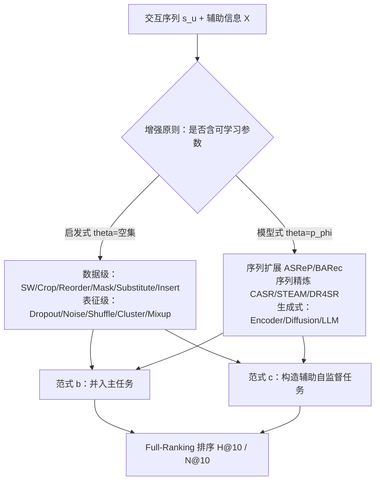
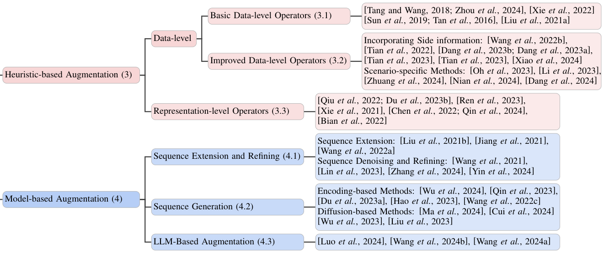
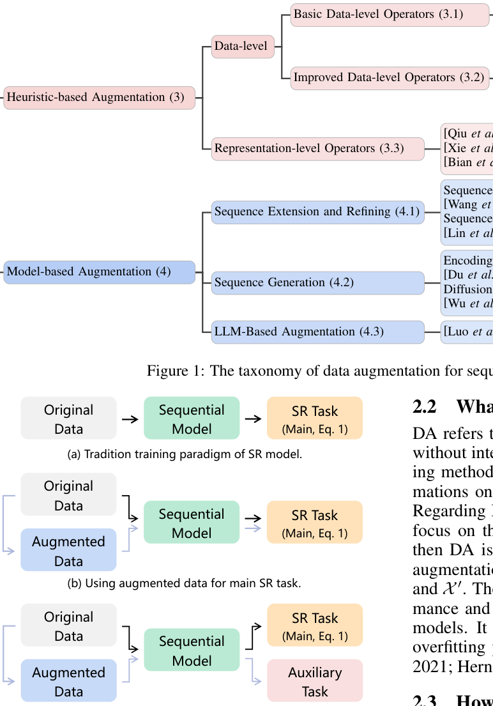

# Data Augmentation for Sequential Recommendation: A Survey (序列推荐中的数据增强：综述)

- **会议/期刊**: IEEE TKDE（arXiv 2024-09 预印，2026 目标目录）
- **作者与机构**: Yizhou Dang, Enneng Yang, Yuting Liu, Guibing Guo, Linying Jiang, Jianzhe Zhao, Xingwei Wang（东北大学软件学院 / 计算机学院）
- **推荐链路定位**: 召回（序列编码器训练）与端到端数据侧优化
- **研究方向**: 序列与会话推荐（主） / 自监督对比学习与交互去噪（次）
- **论文原文**: [https://arxiv.org/abs/2409.13545v1](https://arxiv.org/abs/2409.13545v1)
- **开源代码**: [https://github.com/KingGugu/DA-CL-4Rec](https://github.com/KingGugu/DA-CL-4Rec)

## TL;DR (1分钟核心速览)

序列推荐（SR）受用户交互数据极度稀疏所困，结构侧加层加头的边际收益已趋饱和，研究者转向数据侧。本文是首篇**以数据增强（DA）为核心对象**的 SR 综述：提出"增强原则 × 增强对象 × 增强目的"三维分类轴，统一形式化"主任务式"与"辅助任务式"两种使用范式，并给出启发式 vs 模型式的成本-收益对比矩阵。作者在 SASRec 骨干、Beauty/Sports/Yelp 三集、5-core 过滤 + Leave-One-Out、**无偏全库 Full-Ranking** 协议下复现全部开源方法，最优结果相对基线提升最高 +66.0%（Sports H@10）。

## Background & Motivation (背景与核心矛盾)

- **主流范式**: GRU4Rec → Caser → SASRec 的演进主轴是序列架构（RNN/CNN/Transformer），靠海量行为日志拟合 next-item 条件概率 $P(v_{|s_u|+1}=v^{*}\,|\,s_u,X)$。
- **前人局限一**: 用户在平台上的交互极短，且跨平台数据受隐私限制不可汇聚，导致复杂架构严重欠拟合。
- **前人局限二**: 模型侧改进空间已相当拥挤，增加参数与算力的性价比持续下降，而 CV/NLP 已证明"免费扩数据"可作正则项。
- **核心洞察 (Key Insight)**: SR 序列不是图像/文本——它携带**时序信任与转移模式**，直接套用随机裁剪、回译式替换会破坏转移语义（semantic drift），因此需要为"序列"重新设计增强算子，并区分"增强样本本身有用"还是"增强提供的自监督约束有用"。
- **本文切入点**: 把 DA 从对比学习的附属工具提升为独立研究对象，回答"在哪增强、对什么增强、为何增强"。

## Method (核心方法设计)

### 1. 整体框架 (Overall Architecture)

综述沿一条统一管线组织现有工作：输入是用户按时间排序的交互序列 $s_u$及辅助信息$X$；首先按"是否含可学习参数"分叉为**启发式**（随机算子直接作用于序列/表征）与**模型式**（训练增广模块或生成器）两大原则；再按作用对象落为数据级（离散 item 序列）与表征级（嵌入矩阵$\mathbf{R}$）；最后按目的落为序列扩展、去噪精炼、序列生成（编码式 / 扩散式 / LLM 式）。增广产物可并入主任务训练集直接改写交叉熵目标，也可仅用于构造辅助任务做自监督对比。第 5 节用统一的 SASRec + Full-Ranking 协议把散落的单篇结果拉到同一张表上比较。

<figure class="paper-figure" markdown="span">
  <figcaption>图1：面向序列推荐的数据增强分类体系。</figcaption>
</figure>

### 2. 关键设计拆解 (Key Designs)

1. **三维正交分类轴（原则 × 对象 × 目的）**：前人 SSL 综述只把 DA 当作构造正视图的手段，忽略了"直接改写主任务数据"的一整类工作。本文以可学习参数的有无为第一刀，再按对象切分：数据级操作离散 item（如 Masking 以比例 $\eta$替换 `[mask]`），表征级操作嵌入矩阵，例如Dropout 对 embedding 做伯努利掩码$\mathbf{R}_a=\mathbf{R}\odot\mathbf{M},\ \mathbf{M}_{i,j}\sim\mathrm{Bernoulli}(1-p)$、Mixup 做跨样本插值$\tilde{\mathbf{r}}_i=\alpha\mathbf{r}_i+(1-\alpha)\mathbf{r}_j$。直觉：离散算子只能在组合集上取极端值，连续表征算子则能在"保持同分布"与"跨越原型"之间做连续折中。

2. **两种训练范式的统一形式化**：范式 b 直接把增广数据 $s'_u=\mathrm{Aug}(s_u)$混入训练集优化主任务；范式 c 只把增广视图拿去做辅助任务。后者总损失为$\mathcal{L}=\mathcal{L}_{CE}+\lambda\mathcal{L}_{aux}$，典型$\mathcal{L}_{aux}$取 InfoNCE：$\mathcal{L}_{CL}=-\log\frac{\exp(\mathrm{sim}(\mathbf{h}_u,\mathbf{h}_u^{+})/\tau)}{\sum_{j}\exp(\mathrm{sim}(\mathbf{h}_u,\mathbf{h}_j)/\tau)}$。关键直觉：辅助范式不改动标签分布，只注入"序列不变性先验"，因此即便增广样本发生语义漂移也不会直接污染监督信号——这正是消融中"单用算子掉点、接上辅助任务回暖"的机制来源。

3. **训练目标、负采样与推理效率**：综述性结论是**只用 Full-Ranking、不做负采样排序**，因为采样排序会系统性偏置结论。成本上，启发式算子零参数、零额外推理开销、可即插即用于任意骨干，但需逐数据集搜超参；模型式（ASReP 的反向 Transformer、DiffuASR 的序列 U-Net、LLM 提示增广）能利用全局分布与外部知识，代价是额外训练/存储，且 ASReP、BARec 等强绑定 Transformer 骨干，在极端稀疏数据下模块本身训不起来。

<figure class="paper-figure" markdown="span">
  <figcaption>图2：不同训练范式的示意图。</figcaption>
</figure>

## Experimental Setup & Evaluation Protocol (实验设置与评估协议)

- **数据集与预处理**: 仅比较**开源**方法，Amazon 两个品类 + Yelp 商户交易记录，统一 **5-core** 过滤（用户/物品交互数 < 5 剔除）。原文未报告精确统计量：

| 数据集 | 领域 | #Users | #Items | #Interactions | 过滤/场景说明 |
| :--- | :--- | :---: | :---: | :---: | :--- |
| Beauty | Amazon 美妆 | 未报告 | 未报告 | 未报告 | 5-core，含评分与时间戳，序列极短 |
| Sports | Amazon 运动户外 | 未报告 | 未报告 | 未报告 | 5-core，品类集中、长尾显著 |
| Yelp | LBSN 商户 | 未报告 | 未报告 | 未报告 | 5-core，取 2019-01-01 后交易记录 |

- **数据划分与防穿越 (Splitting Strategy)**: **Leave-One-Out**，每个用户最后两个交互分别作验证/测试，其余作训练，严格按时序。
- **排名评测协议 (Ranking Protocol)**: 无偏 **Full-Ranking（全库未交互物品排序）**，明确拒绝负采样排序；指标为 H@10 与 N@10。
- **对比基线与超参设置**: 骨干统一 SASRec，$d=64$、batch=256、最大序列长度 50，其余超参照各原文调优，**5 次运行取均值**；对比对象是 20+ 个 DA 方法（含 3.1 单算子、3.1+ 算子组合、3.2 改进算子、3.3 表征算子、4.1 扩展/精炼、4.2 生成式）。未报告显著性检验。

## Key Experimental Results (实验关键数据)

### 1. 主实验对比 (Main Results)

| 类别 | 方法 | Beauty N@10 | Beauty H@10 | Sports N@10 | Sports H@10 | Yelp N@10 | Yelp H@10 |
| :--- | :--- | :---: | :---: | :---: | :---: | :---: | :---: |
| 骨干 | SASRec | 0.0338 | 0.0638 | 0.0177 | 0.0321 | 0.0135 | 0.0271 |
| 启发+CL | CL4SRec* | 0.0366 | 0.0686 | 0.0221 | 0.0412 | 0.0153 | 0.0325 |
| 启发+CL | CoSeRec* | 0.0379 | 0.0701 | 0.0235 | 0.0428 | 0.0184 | 0.0362 |
| 改进算子 | RepPad | 0.0390 | 0.0726 | 0.0212 | 0.0416 | 0.0177 | 0.0359 |
| 改进算子 | TiCoSeRec* | 0.0401 | 0.0738 | 0.0269 | 0.0486 | 0.0203 | 0.0390 |
| 改进算子 | ECL-SR* | **0.0434** | 0.0782 | 0.0284 | **0.0533** | 0.0190 | 0.0373 |
| 表征级 | ICLRec* | 0.0407 | 0.0744 | 0.0238 | 0.0437 | **0.0205** | **0.0409** |
| 表征级 | FEARec* | 0.0432 | **0.0803** | **0.0291** | 0.0510 | 0.0196 | 0.0395 |
| 序列扩展 | ASReP | 0.0351 | 0.0664 | 0.0189 | 0.0355 | 0.0146 | 0.0302 |
| 编码生成 | MCLRec | 0.0423 | 0.0774 | 0.0275 | 0.0493 | 0.0202 | 0.0406 |
| — | **Improv.(最优)** | **+28.4%** | **+25.9%** | **+64.4%** | **+66.0%** | **+51.9%** | **+50.9%** |

### 2. 消融实验 (Ablation Study)

以 Beauty 为统一赛场，拆解"算子 × 使用范式"的贡献：

| 配置 | N@10 | H@10 | Δ N@10 vs SASRec |
| :--- | :---: | :---: | :---: |
| SASRec（无增强） | 0.0338 | 0.0638 | — |
| + Cropping（仅主任务） | 0.0270 | 0.0539 | −20.1% |
| + CL4SRec 三算子（仅主任务，无辅助） | 0.0304 | 0.0574 | −10.1% |
| + CL4SRec 三算子 + 对比辅助任务 | 0.0366 | 0.0686 | +8.3% |
| + TiCoSeRec（时间感知算子 + 辅助任务） | 0.0401 | 0.0738 | +18.6% |
| + ASReP（逆向序列扩展，模型式） | 0.0351 | 0.0664 | +3.8% |
| + DiffuASR（扩散生成，模型式） | 0.0372 | 0.0679 | +10.1% |
| + FEARec（频域表征增强 + 辅助任务） | 0.0432 | 0.0803 | +27.8% |

### 3. 关键实验发现 (Key Findings)

1. **增强本身不是收益来源，"不变性约束"才是**：同一组算子不加辅助任务时 N@10 从 0.0338 掉到 0.0304（−10.1%），单算子 Cropping 更惨（−20.1%）；接上自监督对比任务后同一算子组合反升至 0.0366（+8.3%）。这说明随机截断确实丢失了反映主偏好的关键交互，但作为视图仍能提供有效正则。
2. **极简启发式可与模型式打平**：RepPad 仅"用原序列替代 0 填充"就在 Beauty/Sports 拿下 0.0390/0.0726、0.0212/0.0416，全面超过 ASReP 逆向生成（0.0351/0.0664、0.0189/0.0355）与 DiffuASR（0.0372/0.0679）。在 5-core 短序列为主的数据上，"复用/补全已有信号"比"凭空生成新交互"更安全，且零训练成本。
3. **没有跨域最优解**：ECL-SR* 拿下 Beauty/Sports 的 N@10 与 Sports H@10，但在 Yelp 跌至 0.0190/0.0373；Yelp 最优换成 ICLRec*（0.0205/0.0409）与 MCLRec（0.0202/0.0406），说明 LBSN 长尾商户更适配意图聚类/元学习式表征增强，算子级增广在此几乎无增益（CoSeRec* 0.0184 已接近饱和）。

## Highlights & Limitations (亮点、对比与审稿批判)

- **与代表作对比 (vs. Prior Work)**: Yu/Jing/Ren 等人的 SSL 综述把 DA 仅当作构造自监督视图的手段，本文把"直接改写主任务数据"的一类工作补全；相比 TiCoSeRec、CL4SRec 等单篇论文只报告"我的增强有效"，本文用统一协议揭示其增益主要来自辅助任务而非算子本身，是一次有价值的"去魅"。
- **可迁移亮点**: ① RepPad 的零成本 padding 替换技巧可直接用于任何定长序列模型；② "把有噪声的增广转成不变性约束"这一范式可迁移到会话推荐、跨域序列与多模态序列建模。
- **审稿级局限批判**: ① 作者自陈缺乏理论基础——无法解释"何时增广有益/有害"，也没有增广比例 $\eta$、视图数量的敏感性分析，分类轴对 LLM 增广的归属（自称启发式与模型式混合体）规则不一致；② 实验只用一个骨干（SASRec）、三个数据集，未报告方差与显著性检验，未覆盖冷启动、跨域、多模态等 DA 最该发挥作用的场景，"最优方法按域变化"的结论因此说服力受限。

## Rating (四维评分)

- **方法创新性 (Novelty)**: ⭐⭐⭐⭐ （三维正交分类轴与双范式形式化有整理价值，但属综述性贡献，无新算法与理论刻画）
- **评估协议与实验扎实度 (Protocol & Experiments)**: ⭐⭐⭐⭐ （Full-Ranking 无偏协议 + 仅比开源方法 + 5 次均值值得肯定，但单骨干三数据集、缺显著性检验与稀疏分桶）
- **写作与数学规范度 (Clarity & Rigor)**: ⭐⭐⭐⭐ （符号统一、算子公式一一对应，优劣对比表信息密度高；LLM 分支略浅）
- **工业落地与复现价值 (Industrial & Practical Value)**: ⭐⭐⭐⭐ （代码库 DA-CL-4Rec 持续维护，Table 1 的成本-收益矩阵可直接用于线上选型，启发式算子可零成本上线）

