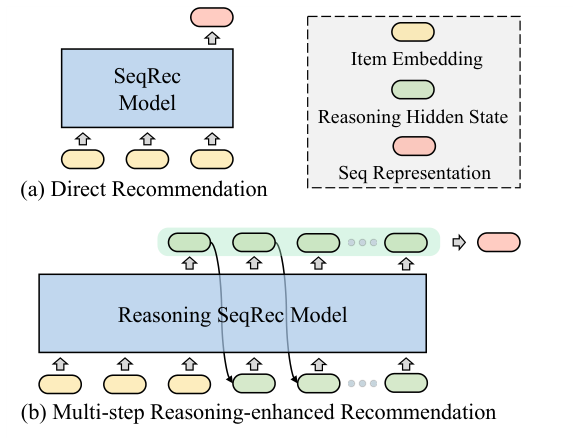
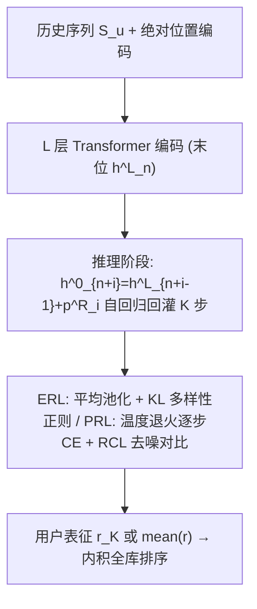
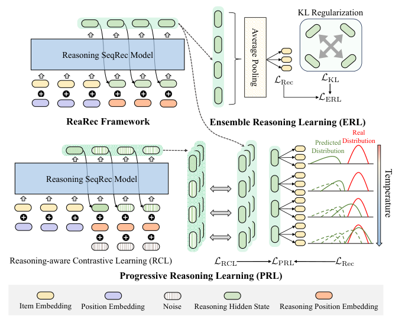

# Think Before Recommend: Unleashing the Latent Reasoning Power for Sequential Recommendation (先思考再推荐：释放序列推荐的潜在推理能力)

- **会议/期刊**: TKDE 2026（arXiv:2503.22675v3，2025-08 更新）
- **作者与机构**: Jiakai Tang, Sunhao Dai, Teng Shi, Jun Xu, Xu Chen（中国人民大学高瓴人工智能学院）、Wen Chen, Jian Wu, Yuning Jiang（阿里巴巴集团）
- **推荐链路定位**: 召回（序列编码器末端表征增强，模型无关插件）
- **研究方向**: 序列与会话推荐 / 自监督对比与交互去噪
- **论文原文**: [arXiv:2503.22675v3](https://arxiv.org/abs/2503.22675v3)
- **开源代码**: [TangJikai/ReaRec](https://github.com/TangJiakai/ReaRec)

## TL;DR (1分钟核心速览)

现有 SeqRec 全部采用「一次前向、末位隐状态即用户向量」的直接推理范式，计算深度受限，对长尾用户/冷门物品的偏好演化刻画不足。本文提出 ReaRec：把末位隐状态连同专属**推理位置编码**自回归回灌编码器，做 $K$ 步**隐空间**推理（不是生成 token），并以 ERL（多步集成 + KL 多样性正则）与 PRL（温度退火 + 推理感知对比学习）两种策略注入过程监督。在 5 个 Yelp/Amazon 数据集、4 个 ID/文本骨架、全库排序与 NDCG@{10,20}/Recall@{10,20} 协议下，平均提升 7.49%，延迟仅 +3.51%；事后最优步分析显示性能天花板被抬高 30%–50%。

## Background & Motivation (背景与核心矛盾)

- **主流范式**: SASRec/BERT4Rec/UniSRec/MoRec 等均以 $L$层自注意力编码序列，取末位输出$\mathbf{h}_u=\mathbf{H}^L[-1]$ 与物品矩阵内积打分，一次前向完成预测。
- **前人局限**: ① 计算深度被网络层数锁死，**无法在推理期扩展算力**去刻画兴趣漂移；② 长尾用户（交互少）与冷门物品（协同信号稀薄）恰恰最需要更深特征交叉，却最先被欠拟合。
- **核心洞察 (Key Insight)**: 借鉴 LLM 中 CoT「用计算深度换表达力」的理论（Feng et al.），作者验证：仅把末位隐状态回灌即可在**不增参数**的前提下加深特征交叉；但缺少中间步监督会导致两种退化——**推理模式坍缩**（每步复制上一步输出）与**推理漂移**（误差累积、目标物品排名反降）。
- **本文切入点**: 用 RPE 解耦「物品编码空间」与「推理空间」，再用 ERL/PRL 给中间推理步加权监督，把隐式推理变为可训练、可泛化的模块。

<figure class="paper-figure" markdown="span">
  <figcaption>图 1：传统直接推理（即无推理）与本文提出的多步推理增强序列推荐框架示意图。</figcaption>
</figure>

## Method (核心方法设计)

### 1. 整体框架 (Overall Architecture)

输入用户历史 $S_u$经绝对位置编码与$L$层 MHSA/FFN 得到序列隐状态；随后进入推理阶段：第$k$步把上一步末位输出加上**推理位置嵌入**$\mathbf{p}^R_i$作为新 token 追加到序列尾部，自回归再前向一次，得到推理隐状态序列$\mathbf{R}=[\mathbf{r}_0,\dots,\mathbf{r}_K]$；最终以$\mathbf{r}_K$（PRL）或$\overline{\mathbf{r}}$（ERL）与候选物品做内积/余弦打分。训练时叠加推荐交叉熵与辅助正则（KL 或 InfoNCE），推理时借 KV-Cache 复用历史键值，只计算新增位置的注意力。

<figure class="paper-figure" markdown="span">
  <figcaption>图 3：所提 ReaRec 框架及两种推理增强学习策略——Ensemble Reasoning Learning 与 Progressive Reasoning Learning 的概览。</figcaption>
</figure>

### 2. 关键设计拆解 (Key Designs)

1. **推理位置编码 RPE（解耦两种任务空间）**：直接把隐状态回灌会让模型把「推理输入」误当成「新物品」，实验显示 Naive 版本甚至低于基线。作者为推理步单独学习 $\mathbf{P}^R\in\mathbb{R}^{K\times d}$：$\mathbf{h}^0_{n+i}=\mathbf{h}^L_{n+i-1}+\mathbf{p}^R_i$，使同一编码器能区分「物品编码模式」与「推理模式」。直觉上这是给连续思维链一个显式的「时间戳」，避免任务歧义。
2. **ERL：多阶集成 + KL 反坍缩**：把各步 $\mathbf{r}_i$视为兴趣的多视图，取$\mathbf{h}_u=\frac{1}{K}\sum_{i=0}^{K}\mathbf{r}_i$后统一做 CE 监督$\mathcal{L}_{Rec}$；但平均池化易让模型「抄近路」，故成对最大化各步预测分布的 KL 散度：$\mathcal{L}_{KL}=-\sum_{i=0}^{K-1}\sum_{j=i+1}^{K}\mathrm{KL}(\hat{y}^{(i)}\|\hat{y}^{(j)})$，总损失$\mathcal{L}_{ERL}=\mathcal{L}_{Rec}+\lambda\mathcal{L}_{KL}$。$\lambda$ 过大（>0.05）会破坏序列建模，故仅在弱强度下起「防同质化」作用。
3. **PRL：渐进温度退火 + 推理感知对比（RCL）**：为每步设 $\tau_k=\tau\alpha^{K-k}$，$\hat{y}^{(k)}=\mathrm{softmax}(\mathbf{r}_k\mathbf{E}^\top/\tau_k)$，逐步 CE：$\mathcal{L}_{Rec}=-\sum_{k=0}^{K}\log\hat{y}^{(k)}_{v^+}$。早期高温保留探索、后期降温锐化分布，类比课程学习。为抗中间步漂移，对每步输入注入$\boldsymbol{\epsilon}\sim\mathcal{N}(\mathbf{0},\gamma\mathbf{I})$得含噪视图$\tilde{\mathbf{R}}$，用 InfoNCE 拉近$\tilde{\mathbf{r}}_k$与$\mathbf{r}_k$、推远 batch 内其他序列的同类步状态：$\mathcal{L}_{PRL}=\mathcal{L}_{Rec}+\mathcal{L}_{RCL}$。
4. **训练/效率**：负采样沿用 in-batch 交叉熵（全库 softmax），无额外负采样器；KV-Cache 使第 $k$步注意力量级由$O(N^2)$降为$O(N)$，额外复杂度$O(L(KCd+Kd^2))$，仅新增$K\times d$ 个 RPE 参数。

## Experimental Setup & Evaluation Protocol (实验设置与评估协议)

- **数据集与预处理**:

| 数据集 | #Users | #Items | #Interactions | 稀疏度 | 过滤/场景 |
| :--- | :---: | :---: | :---: | :---: | :--- |
| Yelp | 13,083 | 10,697 | 443,807 | 99.68% | rating>3 为正、20-core |
| Video & Games | 89,021 | 22,933 | 530,989 | 99.97% | rating>3、5-core |
| Software | 30,049 | 16,705 | 168,029 | 99.97% | rating>3、5-core |
| CDs & Vinyl | 35,238 | 87,969 | 513,991 | 99.98% | rating>3、10-core |
| Baby & Products | 140,292 | 30,689 | 780,809 | 99.98% | rating>3、5-core |

- **数据划分与防穿越**: 全局时间戳切分（Yelp 取 2018-09-04 / 2020-05-12 两个阈值切 train/valid/test；Amazon 采用官方绝对时间戳），无未来信息泄漏。
- **排名评测协议**: 论文仅报告 NDCG@{10,20} 与 Recall@{10,20}，未显式声明候选池构造，按社区惯例应视为 **Full-Ranking 全库未交互物品排序**（若为采样排序则结果不可横比，属报告瑕疵）。
- **对比基线与超参**: 4 个骨架覆盖 ID 编码（SASRec、BERT4Rec）与文本编码（UniSRec、MoRec，物品文本经 LLaMA-3.1-8B 编码后 PCA 至 768 维）；$d=256$、batch=2048、序列截断 50、Adam lr=1e-3；BERT4Rec 推理段用 unidirectional 前缀掩码；$\lambda\in[0.001,0.1]$、$\gamma=0.01$、$\tau\in\{0.05..5\}$、$\alpha\in\{1,1.2,1.5,2,5,10\}$；未报告显著性检验。

## Key Experimental Results (实验关键数据)

### 1. 主实验对比 (Main Results)

| 数据集 | 骨架 | 变体 | N@10 | N@20 | R@10 | R@20 | Avg.Improv. |
| :--- | :--- | :--- | :---: | :---: | :---: | :---: | :---: |
| Yelp | SASRec | Base | 0.0347 | 0.0452 | 0.0626 | 0.1047 | — |
| Yelp | SASRec | +ERL | 0.0383 | 0.0474 | 0.0691 | 0.1056 | ↑6.62% |
| Yelp | SASRec | +PRL | **0.0388** | **0.0493** | **0.0730** | **0.1149** | **↑11.81%** |
| Yelp | UniSRec | Base | 0.0380 | 0.0495 | 0.0737 | 0.1195 | — |
| Yelp | UniSRec | +PRL | 0.0413 | 0.0529 | 0.0788 | 0.1253 | ↑6.83% |
| Yelp | MoRec | +ERL | 0.0417 | 0.0531 | 0.0832 | 0.1283 | ↑5.36% |
| V&G | BERT4Rec | +PRL | 0.0306 | 0.0380 | 0.0584 | 0.0879 | ↑7.00% |
| Software | UniSRec | +PRL | 0.0869 | 0.1076 | 0.1687 | 0.2518 | ↑2.96% |
| CDs | SASRec | +ERL | 0.0182 | 0.0212 | 0.0363 | 0.0482 | ↑18.59% |
| CDs | UniSRec | +ERL | **0.0208** | **0.0259** | **0.0428** | **0.0629** | **↑31.54%** |
| Baby | BERT4Rec | Base | 0.0109 | 0.0154 | 0.0257 | 0.0439 | — |
| Baby | BERT4Rec | +ERL | 0.0148 | 0.0195 | 0.0293 | 0.0481 | ↑21.49% |

### 2. 消融实验 (Ablation Study)

| 数据集(Yelp/V&G, NDCG@20) | w/o 组件 | w/ 组件 | 结论 |
| :--- | :---: | :---: | :--- |
| ERL 去 KL 正则（Yelp） | ≈0.0471 | ≈0.0477 | KL 抑制多步输出同质化 |
| ERL 去 KL（V&G） | ≈0.0365 | ≈0.0382 | 稀疏集上增益更明显 |
| PRL 去 RCL（Yelp） | ≈0.0379 | ≈0.0490 | 缺自纠错则误差累积 |
| PRL 去 RCL（V&G） | ≈0.0320 | ≈0.0410 | 鲁棒性贡献最大 |
| 去掉 RPE（Naive） | 低于 Base | — | 回灌无法区分任务空间 |

（消融来自原文图 7 直读近似值，原文未给表格式数字。）

### 3. 关键实验发现 (Key Findings)

1. **长尾受益、热门受损的「过度思考」分野**：固定训练 3 步、推理逐步加深时，冷门物品组 IG-1 的 NDCG@20 随步数提升 12.08%→16.35%→18.69%，短序列用户组同步上涨；但长序列用户与热门物品在高步数下反而下降——说明差分推理深度（快/慢思考路由）是必然下一步。
2. **收益/成本比在 $K=2$处最优**：SASRec 延迟 5.6761s→5.8752s（+3.51%），BERT4Rec +4.67%，UniSRec 仅 +2.74%；$K\ge4$ 后延迟涨到 6–10% 而指标同步回落，提示隐式推理不存在 LLM 式 scaling law 的单调性。
3. **稀疏集与文本骨架的增益最大**：CDs & Vinyl（密度 0.02%、平均物品交互 5.84）上 UniSRec+ERL 均涨 31.54%、SASRec+ERL 涨 18.59%，而稠密的 Software 仅 2–4%；说明推理深度补足的正是协同信号不足处，与「深度替代数据」的解释一致。

## Highlights & Limitations (亮点、对比与审稿批判)

- **与代表作对比 (vs. Prior Work)**: 相对 SASRec/BERT4Rec 的差异不在网络结构而在**推阶段计算深度**，可与任意骨架正交叠加；相对 UniSRec/MoRec 的文本语义增强，本文增益来自隐空间多阶特征交叉（二者可叠加，实验已验证）；相对 LLM4Rec 的显式 CoT，本文无需解码 token，$Kd$ 参数与 KV-Cache 即可落地。
- **可迁移亮点**: ① RPE 式「阶段专属位置嵌入」可直接移植到多任务/多场景共享编码器的解耦；② 温度退火 $\tau_k=\tau\alpha^{K-k}$ 可作为通用「逐层分布锐化」正则，用于任何迭代式表征精炼；③ 噪声注入 + InfoNCE 模拟误差自纠，可复用到级联精排的逐层表征稳定性训练。
- **审稿级局限批判**: ① **评测协议不透明**——未声明全库/采样排序、未做显著性检验，跨论文比较存疑；② 增益高度依赖超参（$\alpha$过大即破坏课程式锐化，$\lambda>0.05$反而掉点），且 PRL 在 V&G 上 UniSRec 出现 −0.08% 的负增益，鲁棒性未完全成立；③ 缺乏推理深度的自适应选择与理论分析（作者自认缺失 inference-time scaling law），$K$ 需离线穷举，且编码与推理共享参数造成任务歧义。

## Rating (四维评分)

- **方法创新性 (Novelty)**: ⭐⭐⭐⭐ （首次将推理时计算/隐式 CoT 引入推荐，RPE 解耦与 ERL/PRL 双策略设计巧妙，但核心算子仍是回灌 + 常规 KL/InfoNCE 组合）
- **评估协议与实验扎实度 (Protocol & Experiments)**: ⭐⭐⭐ （5 数据集 × 4 骨架的广度可观，含子群鲁棒性、延迟与可视化分析，但未声明候选池、无显著性检验、消融仅以图形式给出）
- **写作与数学规范度 (Clarity & Rigor)**: ⭐⭐⭐⭐ （RPE/ERL/PRL 公式推导清晰、复杂度分析完整；但 PRL 与 ERL 推理阶段表征取法不一致，理论支撑偏直觉）
- **工业落地与复现价值 (Industrial & Practical Value)**: ⭐⭐⭐⭐⭐ （模型无关插件、仅增 3.51% 延迟、$Kd$ 参数开销近零，代码已开源，可直接接入现有序列召回链路）

