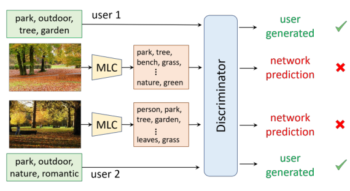
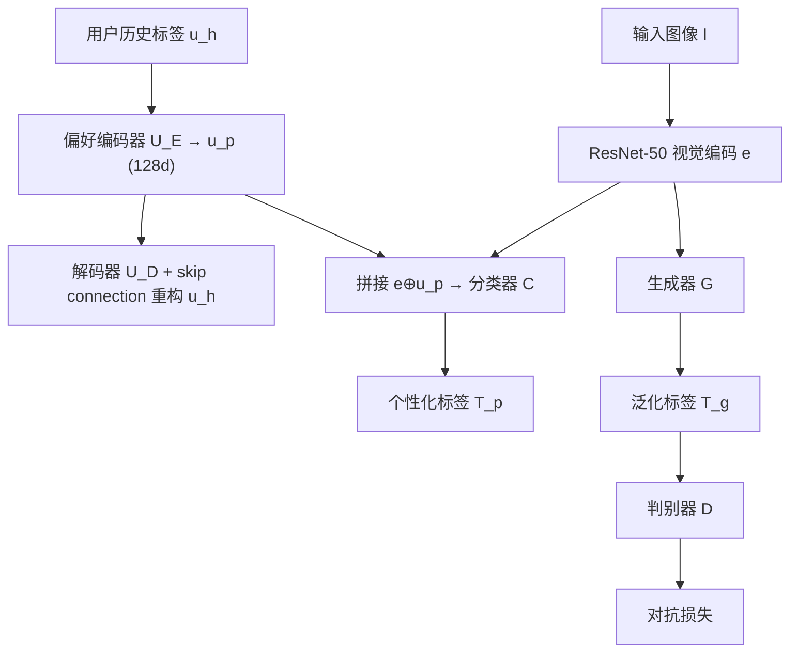
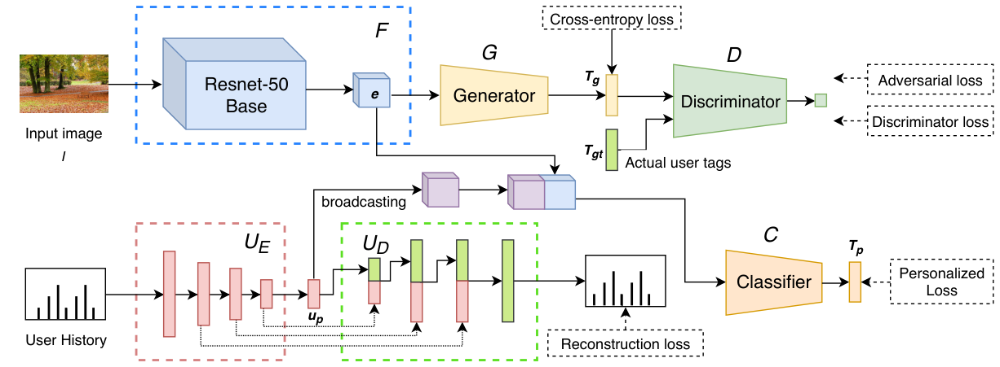

# Adversarial Learning for Personalized Tag Recommendation (面向个性化标签推荐的对抗学习)

- **会议/期刊**: IEEE Transactions on Multimedia (TMM)
- **作者与机构**: Erik Quintanilla, Yogesh Rawat, Andrey Sakryukin, Mubarak Shah, Mohan Kankanhalli（IIT、UCF CRCV、NUS）
- **推荐链路定位**: 端到端生成式标签推荐（图像 → 标签列表，召回即输出）
- **研究方向**: 多模态推荐 / 冷启动与长尾推荐
- **论文原文**: [论文原文链接](https://arxiv.org/abs/2004.00698v1)
- **开源代码**: [开源代码仓库链接](https://github.com/vyzuer/ALTReco)

## TL;DR (1分钟核心速览)

现有多标签图像分类器只会罗列图中所有视觉对象，与用户真实打标习惯（受兴趣与个人词汇偏好支配）严重错位，且经典标签推荐依赖共现/张量分解难以扩展到亿级数据。本文提出 ALTReco：以 ResNet-50 视觉编码与无监督用户偏好自编码器（带 skip connection + Huber 重构）联合优化，并引入生成器-判别器对抗分支迫使命名分布贴近人类标签。在 YFCC100M 上 P@5 达 0.39（ConTagNet 0.25，+56%），NUS-WIDE O-F1@10 达 0.47。

## Background & Motivation (背景与核心矛盾)

- **主流范式**: 标签推荐长期依赖标签共现、张量分解、图排序等浅层方法，图像侧则以 ImageNet/NUS-WIDE 的实验室标注做多标签分类（MLC）。
- **前人局限**: ① MLC 输出的是"清单式"客观视觉概念，而人类只挑与自己兴趣相关的少量词（图 1）；② PROMPT 等个性化方法把用户偏好估计与视觉编码割裂，且协同过滤/图模型无法扩展到 YFCC100M 规模。
- **核心洞察 (Key Insight)**: 视觉相似的图，不同用户用词完全不同（sunset/sky vs. ocean/beach），说明"选哪些词、按什么分布选"本身承载了用户偏好，是纯粹的视觉分类器学不到的信号——它属于**标签分布层面**而非具体视觉对象层面。
- **本文切入点**: 用一个无监督偏好表征去条件化视觉编码，再用判别器专门区分"机器清单标签"与"人类标签"，把分布对齐写进损失。

<figure class="paper-figure" markdown="span">
  <figcaption>图 1：与列出所有视觉对象的多标签图像分类器（MLC）相比，人类对其图像的标注方式不同。</figcaption>
</figure>

## Method (核心方法设计)

### 1. 整体框架 (Overall Architecture)

输入图像 $I$经 ResNet-50 取 layer-46 特征图得视觉描述子$e\in\mathbb{R}^{h\times w\times c}$；同时用户历史标签向量$u_h\in\mathbb{R}^{N}$（按该用户最高频标签计数归一化）经编码器$U_E$得到 128 维偏好$u_p$。$e$与$u_p$拼接后送入分类器$C$输出个性化标签$T_p$；$U_D$在 skip connection 辅助下重构$u_h$以无监督训练$U_E$。另一条并行支路中生成器$G$仅以$e$为输入产生"泛化标签"$T_g$，由判别器$D$ 与真实用户标签对抗。全部模块端到端联合训练。

<figure class="paper-figure" markdown="span">
  <figcaption>图 3：所提框架概览。输入图像 I 使用卷积神经网络 F 编码，并与……集成。</figcaption>
</figure>

### 2. 关键设计拆解 (Key Designs)

1. **Skip-connection 自编码器偏好学习（让偏好码本"类内紧凑、类间可分"）**：若纯粹压缩重构，相似打标行为的用户会被编码到同一点而无法还原各自频次差异。作者把 $U_E$各层输出跨接拼接到$U_D$ 对应层（借鉴 U-Net），令身份性细节走旁路、潜码只保留"偏好语义"；重构用对异常值不敏感的 Huber 损失：

$$\mathcal{L}_{r}=\frac{1}{N}\sum_{i=1}^{N}\begin{cases}\frac{1}{2}(u_i-\hat{u}_i)^2 & |u_i-\hat{u}_i|\le\delta\\ \delta\left(|u_i-\hat{u}_i|-\frac{\delta}{2}\right) & \text{otherwise}\end{cases}$$

其中 $\delta=1.0$。直觉是：潜空间被"逼"成偏好聚类，而重构保真由旁路承担，两者不再互相妥协。

2. **视觉-偏好拼接 + 独立对抗支路（把"分布像人"而非"内容对"作为优化目标）**：加法/乘法融合都劣于拼接，因拼接允许网络分别调用视觉证据与打标习惯。对抗损失**故意只加在无个性化的泛化支路**上：$\mathcal{L}_{adv}=\mathbb{E}_{e\sim F(I)}[\log(1-D(G(e)))]$；若加在$T_p$上，一是真假标签已很接近、判别器无梯度可学，二是对抗梯度会污染偏好学习（真假样本并非同一用户配对）。为解决判别器"作弊"（预测概率 vs. 0/1 硬标签一眼可分），对真实标签做抖动$ \hat{p}_i=\eta p_i+\text{rand}(0,\iota)$，$\eta=0.7,\ \iota=0.3$，使真实标签置信度落在$[0.7,1.0]$或$[0,0.3]$。该抖动被作者称为训练有效判别器的关键。

3. **训练目标与推理**：总损失 $\mathcal{L}_{t}=\alpha\mathcal{L}_{p}+\beta\mathcal{L}_{g}+\gamma\mathcal{L}_{r}+\theta\mathcal{L}_{adv}$，$\mathcal{L}_p,\mathcal{L}_g$为标签词表上的二元交叉熵，实验取等权；判别器与主网络按步交替优化，Adadelta、batch 50、lr=1.0。推理仅需一次前向（视觉 + 偏好编码 + 分类器），对抗支路只在训练期存在，线上无额外开销；无负采样（对全词表$N$ 做 sigmoid 打分）。

## Experimental Setup & Evaluation Protocol (实验设置与评估协议)

| 数据集 | #Users | #Items(图像) | #Interactions | 稀疏度 | 特征/场景说明 |
| :--- | :---: | :---: | :---: | :---: | :--- |
| YFCC100M | 257,275 | ~2M 训练 / 68K 测试 | ~2M 图像-标签对 | 极高（1540 词表，单图标签极少） | 真实 Flickr 用户噪声标签，沿用官方 split |
| NUS-WIDE | ~50,000 | ~209K 可下载（204K/5K） | ~204K | 高（1000 用户标签；另含 81 概念） | 用 Flickr API 补齐用户信息以构造 $u_h$ |

- **数据划分与防穿越**: 遵循 YFCC100M 官方划分与 NUS-WIDE 原划分（非 Leave-One-Out，非时间切分）；$u_h$**仅由训练集图像标签统计**，避免测试期标签泄漏；冷启动实验将$u_h$ 置零。
- **排名评测协议**: 在完整标签词表（1540 / 1000）上对全部标签打分后取 top-$k$（$k\in\{3,5,10\}$），属**全词表排序**而非小候选采样；指标为 Precision@k、Recall@k、Accuracy@k，NUS-WIDE 另报 per-class 与 overall 的 P/R/F1。
- **对比基线与超参**: 最常见标签 Baseline、CNN、CNN-CTC、PROMPT、ConTagNet、DLSR、WARP、FastTag、Softmax、CNN-RNN、ML-ZSL、CLARE；ResNet-50 主干 ImageNet 预训练（NUS-WIDE 另报 YFCC100M 预训练）；偏好潜维 128，未报显著性检验。

## Key Experimental Results (实验关键数据)

### 1. 主实验对比 (Main Results)

YFCC100M（$k=5$）：

| 方法 | Precision@5 | Recall@5 | Accuracy@5 |
| :--- | :---: | :---: | :---: |
| Baseline (最热标签) | 0.04 | 0.03 | 0.18 |
| CNN (ResNet-50) | 0.21 | 0.18 | 0.65 |
| CNN-CTC | 0.24 | 0.20 | 0.72 |
| PROMPT | 0.23 | 0.19 | 0.69 |
| ConTagNet | 0.25 | 0.20 | 0.71 |
| **ALTReco (本文)** | **0.39** | **0.28** | **0.84** |
| Improv. (vs. best baseline) | +56.0% | +40.0% | +16.7% |

NUS-WIDE（$k=10$ 的 overall / per-class 指标与 Prec@5）：

| 方法 | O-P | O-R | O-F1 | C-F1 | Prec@5 |
| :--- | :---: | :---: | :---: | :---: | :---: |
| FastTag | 0.20 | 0.25 | 0.22 | – | 0.17 |
| Softmax | 0.17 | 0.29 | 0.22 | 0.16 | – |
| CNN-RNN | 0.19 | 0.31 | 0.23 | 0.17 | – |
| ConTagNet | 0.22 | 0.36 | 0.27 | 0.20 | 0.27 |
| ML-ZSL | 0.29 | 0.32 | 0.30 | – | – |
| **ALTReco (ImageNet)** | 0.31 | 0.64 | 0.42 | 0.33 | 0.47 |
| **ALTReco (YFCC 预训练)** | **0.35** | **0.70** | **0.47** | **0.40** | **0.52** |
| Improv. (O-F1 vs. ML-ZSL) | – | – | +56.7% | – | – |

### 2. 消融实验 (Ablation Study)

$k=5$，P/R/Acc（YFCC100M / NUS-WIDE）：

| 变体 | UP | Adv | Joint | YFCC P | YFCC R | NUS P | NUS R |
| :--- | :---: | :---: | :---: | :---: | :---: | :---: | :---: |
| A1 视觉 only | ✗ | ✗ | ✗ | 0.10 | 0.07 | 0.08 | 0.05 |
| A2 + 用户偏好 | ✓ | ✗ | ✗ | 0.15 | 0.10 | 0.17 | 0.15 |
| A3 + Adv(泛化支路) | ✓ | ✓(I) | ✗ | 0.29 | 0.21 | 0.14 | 0.13 |
| A4 + 冷启动（$u_h=0$） | ✓ | ✓(I) | ✓ | 0.26 | 0.19 | 0.14 | 0.14 |
| A5 Adv 加在个性化标签 | ✓ | ✓(P) | ✓ | 0.36 | 0.26 | 0.39 | 0.40 |
| **A6 完整模型** | ✓ | ✓(I) | ✓ | **0.39** | **0.28** | **0.52** | **0.58** |

偏好自编码器内部消融（NUS-WIDE，$k=5$，P/R/Acc）：无 skip + MSE 0.39/0.42/0.86 → 加 skip 0.43/0.45/0.90 → 换 Huber 0.43/0.48/0.92 → **skip + Huber 0.52/0.58/0.97**。

### 3. 关键实验发现 (Key Findings)

1. **对抗损失是主增益源，但增益依赖"分布可分性"**：YFCC100M 上 A2→A6 使 P@5 从 0.15 跳到 0.39（+160%）；而把对抗加在已很接近真值的个性化标签上（A5, 0.36）反而不如独立泛化支路，印证"判别器必须有区分空间才提供有效梯度"。
2. **联合训练在小数据上收益更陡**：NUS-WIDE 中 A3（不联合）0.14 → A6（联合）0.52，而 YFCC100M 仅 0.29 → 0.39；说明大用户量主要喂饱对抗分支，小数据则更依赖视觉与偏好的耦合优化。
3. **偏好可用但脆弱**：skip+Huber 让偏好重构质量带来 P@5 0.39→0.52（+33%）；然而冷启动置零后 NUS-WIDE 从 0.52 崩到 0.14，YFCC100M 从 0.39 降到 0.26，表明模型对新用户高度依赖 $u_h$，冷启动鲁棒性不足。

## Highlights & Limitations (亮点、对比与审稿批判)

- **与代表作对比**: 相比 ConTagNet（用图像上下文/元数据，无用户偏好）与 PROMPT（偏好由标签共现聚类**独立**估计），本文的关键差异是偏好与视觉编码**同网络联合优化**、且偏好学习是自监督重构而非聚类；相比 CLARE/ML-ZSL 依赖标签-标签图结构，本文用对抗方式隐式建模标签共现分布，无需构建结构先验。
- **可迁移亮点**: ① "硬标签抖动"（$\eta=0.7,\iota=0.3$）是让判别器在多标签 BCE 输出上不失效的通用技巧，可直接用于任何"分布对齐"型对抗正则；② skip-connection + Huber 的自编码器使潜码承担语义聚类、旁路承担个体细节，可迁移到用户画像/场景表征压缩。
- **审稿级局限批判**: ① 评估仅用 Precision/Recall/Accuracy@k，缺少 NDCG/MAP 等带序指标与显著性检验，且"准确性@k"阈值定义不清、跨论文可比性弱；② YFCC100M 只从 28M 训练集中随机抽 2M，标签词表压到 1540，规模优势未被完全验证；③ 冷启动性能崩塌且未给缓解方案，判别器抖动系数 $\eta,\iota$ 敏感度未做扫描；④ 无推理延迟/显存报告，GAN 交替训练稳定性未讨论。

## Rating (四维评分)

- **方法创新性 (Novelty)**: ⭐⭐⭐⭐ （把"人类打标分布"作为对抗目标、并刻意将对抗支路与偏好解耦，是标签推荐里少见且有解释力的设计）
- **评估协议与实验扎实度 (Protocol & Experiments)**: ⭐⭐⭐ （两套大规模真实数据 + 完整组件消融与冷启动/动态历史分析，但仅 top-k 截断指标、无显著性检验、数据子采样削弱规模说服力）
- **写作与数学规范度 (Clarity & Rigor)**: ⭐⭐⭐⭐ （损失与融合方式交代清晰、抖动与 Huber 动机明确，但符号 $\hat p_i$ 在 BCE 与抖动公式中复用、易混淆）
- **工业落地与复现价值 (Industrial & Practical Value)**: ⭐⭐⭐⭐ （代码开源、推理仅单次前向、对抗支路可离线，适合相册/短视频打标冷启动场景；但依赖用户历史，冷启动需另配兜底策略）

