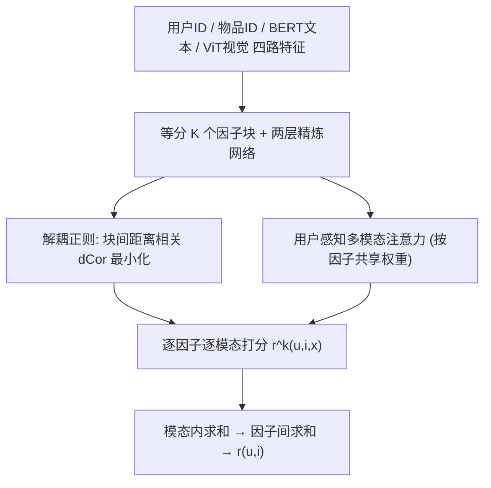
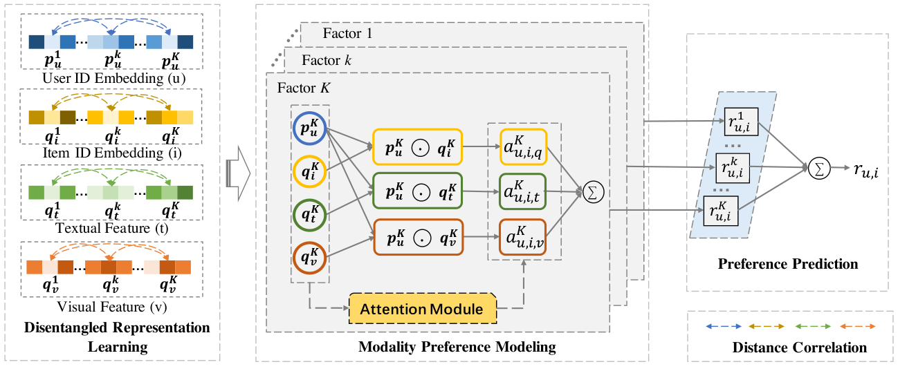

# Disentangled Multimodal Representation Learning for Recommendation (面向推荐的多模态解耦表征学习)

- **会议/期刊**: IEEE Transactions on Multimedia (TMM)
- **作者与机构**: Fan Liu, Huilin Chen, Zhiyong Cheng, Anan Liu, Liqiang Nie, Mohan Kankanhalli (新加坡国立大学、天津大学/天津理工大学、齐鲁工业大学、哈工大深圳)
- **推荐链路定位**: 召回 (Top-N 排序打分)
- **研究方向**: 多模态推荐 / 协同过滤
- **论文原文**: [https://arxiv.org/abs/2203.05406v2](https://arxiv.org/abs/2203.05406v2)
- **开源代码**: [https://github.com/liufancs/DMRL](https://github.com/liufancs/DMRL)

## TL;DR (1分钟核心速览)

现有多模态推荐把 ID/评论/图像的融合特征当作**整块纠缠向量**使用，既无法刻画"同一因子在不同模态上含义不同"，也无法刻画"不同用户对各模态的依赖程度不同"。DMRL 把每种模态的向量等分为 $K$ 个因子块，用**距离相关 (distance correlation) 正则**强制块间独立，再对每个因子施加**权重共享的用户感知多模态注意力**，最后按因子-模态加权求和打分。在 5 个 Amazon 类目、逐用户 80/20 划分、**全库未交互物品排序**协议下，Recall@20 相对最强基线 GRCN 提升 2.6%–15.7%，NDCG@20 提升 2.6%–20.9%。

## Background & Motivation (背景与核心矛盾)

- **主流范式**: 多模态 CF 分两支——早期线性/非线性拼接融合 (JRL 直接 concat 评分、评论、图像特征)，或把多模态特征当作正则项/边信息注入 CF (CML、MAML、MMGCN、GRCN 的消息传递)。
- **前人局限 1（因子-模态错配）**: 评论主要承载质量/舒适度等因子，图像主要承载外观/款式等因子，但现有模型对多模态特征一视同仁地融合，从未在**因子级**区分各模态的贡献权重。
- **前人局限 2（用户模态偏好缺失）**: 心理学研究表明用户组织信息存在个体差异——同样判断"款式"，有人看图像、有人读评论；现有模型对所有用户共享同一套模态融合方式。
- **核心洞察 (Key Insight)**: 单一模态内部的多个因子本就纠缠在同一向量里（等分切片后相互耦合），会带来信息冗余并削弱因子级偏好建模；而解耦表征在图像领域已被证明对复杂变化更鲁棒。
- **本文切入点**: 把"解耦"从交互图 (DGCF) 迁移到**多模态特征侧**，在解耦因子空间上再做用户级模态注意力。

## Method (核心方法设计)

### 1. 整体框架 (Overall Architecture)

模型将用户 ID、物品 ID、BERT 文本特征、ViT 视觉特征四路向量各自切为 $K$块（每块对应一个隐因子），经两层 LeakyReLU 精炼网络对齐维度后进入三个模块：①解耦正则模块计算块间距离相关系数并作为损失约束；②模态偏好建模模块对每个因子$k$用共享参数注意力网络计算用户在 ID/T/V 三模态上的权重分布；③偏好预测模块按"注意力权重$\times$模态契合度"逐因子逐模态打分，先模态内求和、再因子间求和得到最终$r_{u,i}$。训练用 BPR  pairwise 损失 + 解耦正则 + L2 联合优化。

<figure class="paper-figure" markdown="span">
  <figcaption>图1：我们的DMRL模型概览。建议以彩色查看。</figcaption>
</figure>

### 2. 关键设计拆解 (Key Designs)

1. **距离相关解耦正则（让因子块真正独立）**: 等分切片只是形式切分，各块仍在同一语义空间耦合。本文引入距离相关系数，它对**任意非线性依赖**敏感且为零当且仅当两向量独立，比协方差/正交约束更强：

$$\mathcal{L}_{d}=\sum_{y\in\{p_u,q_i,q_t,q_v\}}\sum_{k=1}^{K}\sum_{k'=k+1}^{K}\mathrm{dCor}\left(y^{k},y^{k'}\right),\quad \mathrm{dCor}=\frac{\mathrm{dCov}(y^k,y^{k'})}{\sqrt{\mathrm{dVar}(y^k)\,\mathrm{dVar}(y^{k'})}}$$

   直觉：把"外观块"与"质量块"在嵌入空间中推开，避免同一信息被多个因子重复编码，从而让后续注意力权重具有可辨识的物理含义。

2. **权重共享的用户感知多模态注意力（建模"谁看哪个模态"）**: 痛点是对每个因子独立建注意力网络会参数爆炸且稀疏。做法是把用户块 $p_u^k$ 与物品三模态块拼接后过**所有因子共享**的两层网络，softmax 归一化到三模态概率单纯形：

$$\hat{a}^{k}_{u,i}=W_v\,\mathrm{Tanh}\left(W\,[p^{k}_{u};q^{k}_{i};q^{k}_{t};q^{k}_{v}]+b\right),\quad a^{k}_{u,i,x}=\frac{\exp(\hat{a}^{k}_{u,i,x})}{\sum_{x'\in\{q,t,v\}}\exp(\hat{a}^{k}_{u,i,x'})}$$

   由于 $p_u^k$ 参与拼接，同一物品对不同用户会得到不同权重，这正是与 MAML/GRCN 这类"物品侧注意力"的本质区别。

3. **因子-模态双线性打分与训练目标**: 打分把注意力权重与模态契合度相乘，软plus 保证非负，再两级求和：

$$r^{k}_{u,i,x}=a^{k}_{u,i,x}\cdot\sigma\!\left(p^{k}_{u}\odot q^{k}_{x}\right),\quad r_{u,i}=\sum_{k=1}^{K}\sum_{x\in\{q,t,v\}}r^{k}_{u,i,x}$$

   总损失 $\mathcal{L}=\mathcal{L}_{\text{BPR}}+\lambda_\theta\|\Theta\|_2^2+\lambda_d\mathcal{L}_d$。负采样采用 **1 正 + 4 随机负候选，再从中按嵌入内积挑选最相似者作为硬负样本**（$n=4$ 权衡效率与难度），无需全库负采样；推理时对四路向量做一次前向即得分数，与 MF 同阶，仅多出注意力小网络的开销。

## Experimental Setup & Evaluation Protocol (实验设置与评估协议)

- **数据集与预处理**: Amazon Review 五个类目，统一 `5-core` 过滤（用户与物品均至少 5 次交互），每物品配 1 张图；文本用 BERT、图像用 32 层 ViT (1024-D) 抽取后再降维。

| 数据集 | #Users | #Items | #Interactions | 稀疏度 | 场景说明 |
| :--- | :---: | :---: | :---: | :---: | :--- |
| Office Products | 4,874 | 7,279 | 52,957 | 99.85% | 办公用品 |
| Baby | 12,637 | 18,646 | 121,651 | 99.95% | 母婴 |
| Clothing | 18,209 | 35,526 | 150,889 | 99.98% | 服饰（视觉主导） |
| Toys Games | 18,748 | 30,420 | 161,653 | 99.97% | 玩具 |
| Sports | 21,400 | 36,224 | 982,618 | 99.97% | 运动户外（最稠密） |

- **数据划分与防穿越**: **逐用户随机 80%/20% 划分**（非全局时间戳切分、非 Leave-One-Out），训练集内再随机取 10% 作验证集调参。注意此协议存在时间信息穿越风险，偏乐观。
- **排名评测协议**: **无偏 Full-Ranking**——测试时把该用户所有未交互物品作为候选，报告 top-20 的 Recall@20 与 NDCG@20，并对全部测试用户取平均；训练阶段才使用 1:4 采样 + 硬负样本。
- **对比基线与超参**: 基线含纯交互类 (NeuMF、NGCF、DGCF) 与多模态类 (JRL、CML、MMGCN、MAML、GRCN)；统一 embedding 维度 $d=128$，Xavier 初始化，Adam，学习率$1\times10^{-4}$，batch 1024，$\lambda_\theta,\lambda_d$在$\{10^{-5},\dots,10^{1}\}$网格搜索，因子数$K\in\{1,2,4,8\}$，early stopping（Recall@20 连续 50 轮不升即停）。原文未报告显著性检验。

## Key Experimental Results (实验关键数据)

### 1. 主实验对比 (Main Results)

| 数据集 | Office R@20 | Office N@20 | Baby R@20 | Baby N@20 | Clothing R@20 | Clothing N@20 | Toys R@20 | Toys N@20 | Sports R@20 | Sports N@20 |
| :--- | :---: | :---: | :---: | :---: | :---: | :---: | :---: | :---: | :---: | :---: |
| NeuMF | 0.0605 | 0.0337 | 0.0502 | 0.0224 | 0.0189 | 0.0080 | 0.0253 | 0.0128 | 0.0330 | 0.0157 |
| NGCF | 0.0814 | 0.0479 | 0.0694 | 0.0313 | 0.0466 | 0.0216 | 0.0970 | 0.0587 | 0.0707 | 0.0337 |
| DGCF | 0.1206 | 0.1105 | 0.0788 | 0.0465 | 0.0745 | 0.0405 | 0.1262 | 0.1085 | 0.1026 | 0.0629 |
| CML | 0.1229 | 0.1395 | 0.0674 | 0.0444 | 0.0409 | 0.0224 | 0.1227 | 0.1160 | 0.0982 | 0.0640 |
| JRL | 0.0656 | 0.0365 | 0.0579 | 0.0266 | 0.0233 | 0.0124 | 0.0472 | 0.0413 | 0.0368 | 0.0214 |
| MMGCN | 0.1173 | 0.1231 | 0.0814 | 0.0496 | 0.0573 | 0.0312 | 0.1171 | 0.1056 | 0.0913 | 0.0572 |
| MAML | 0.1333 | 0.1412 | 0.0867 | 0.0521 | 0.0782 | 0.0387 | 0.1183 | 0.1117 | 0.1029 | 0.0676 |
| GRCN | 0.1351 | 0.1524 | **0.0883** | **0.0541** | 0.0861 | 0.0452 | 0.1336 | 0.1236 | 0.1065 | 0.0693 |
| **DMRL** | **0.1563** | **0.1842** | **0.0906** | **0.0561** | **0.0917** | **0.0511** | **0.1434** | **0.1331** | **0.1111** | **0.0711** |
| **Improv.** | +15.7% | +20.9% | +2.6% | +3.7% | +6.5% | +13.1% | +7.3% | +7.7% | +4.3% | +2.6% |

### 2. 消融实验 (Ablation Study)

| 变体 | Office R/N | Baby R/N | Clothing R/N | Toys R/N | Sports R/N |
| :--- | :---: | :---: | :---: | :---: | :---: |
| DGCF (仅 ID + 解耦) | 0.1206 / 0.1105 | 0.0788 / 0.0465 | 0.0745 / 0.0405 | 0.1262 / 0.1085 | 0.1026 / 0.0629 |
| DMRL$_{t}$ (ID+文本) | 0.1517 / 0.1578 | 0.0783 / 0.0497 | 0.0766 / 0.0419 | 0.1258 / 0.1257 | 0.1071 / 0.0657 |
| DMRL$_{v}$ (ID+图像) | 0.1532 / 0.1612 | 0.0852 / 0.0534 | 0.0897 / 0.0464 | 0.1395 / 0.1287 | **0.1122** / 0.0682 |
| DMRL w/o $a$ (去掉注意力) | 0.1513 / 0.1454 | 0.0759 / 0.0479 | 0.0781 / 0.0392 | 0.1363 / 0.1262 | 0.0998 / 0.0597 |
| DMRL w/o $u$ (注意力去掉用户) | 0.1541 / 0.1559 | 0.0835 / 0.0513 | 0.0841 / 0.0427 | 0.1211 / 0.1186 | 0.1112 / 0.0691 |
| **DMRL (完整)** | **0.1563 / 0.1842** | **0.0906 / 0.0561** | **0.0917 / 0.0511** | **0.1434 / 0.1331** | 0.1111 / **0.0711** |

### 3. 关键实验发现 (Key Findings)

1. **解耦正则与注意力各自独立贡献，但注意力是主力**：去掉注意力 (w/o $a$) 后 Office NDCG 从 0.1842 暴跌至 0.1454（−21.1%），甚至低于只用单模态的 DMRL$_{t}$(0.1578) 与 DMRL$_{v}$(0.1612)——说明"无差别融合多模态"不如"择一模态而用"，模态差异性建模是增益核心；而去掉用户条件的 w/o$u$仍有 0.1559，证明**用户个性化权重**是第二层增益（+18.2% NDCG over w/o$u$）。
2. **视觉模态在稀疏/时尚类目更重要，文本在稠密类目补位**：DMRL$_{v}$在全部五个数据集的 Recall@20 均优于 DMRL$_{t}$（如 Clothing 0.0897 vs 0.0766），但 DMRL$_{t}$ 在 Toys/Sports 的 NDCG 反超（0.1257 vs 0.1287 差距极小、0.0657 vs 0.0682），说明模态价值随类目迁移，不能固定融合权重。
3. **因子数 $K$呈倒 U 型，且 Sports 出现"融合负迁移"**：$K=2$或$4$最优，$K=8$时因单块维度过小、表达力不足而全面下降（图 5）；同时 Sports 上完整 DMRL 的 Recall (0.1111) 略低于只用视觉的 DMRL$_{v}$ (0.1122)，作者归因为多模态特征在该类目下存在**不一致性（模态冲突）**，粗暴融合会引入噪声——这是全文最诚实的失效边界。

## Highlights & Limitations (亮点、对比与审稿批判)

- **与代表作对比**: 相较 JRL/MMGCN 的"拼接或图传播式融合"，DMRL 首次在**因子粒度 × 模态粒度**的二维网格上分配权重；相较 DGCF 的交互图解耦，DMRL 把解耦施加于**内容模态特征**并额外引入用户级模态注意力，二者正交（DGCF 在五域均被大幅超越）。
- **可迁移亮点**: ① 用 `dCor` 作为块间独立性正则，可无缝替换到多向量/多兴趣召回 (MIND 类) 与多模态对比学习中的冗余抑制；② "共享权重 + 拼接用户向量"的轻量注意力，可在因子数 $K$ 增大时保持参数不膨胀。
- **审稿级局限批判**: ① 评估采用**逐用户随机 80/20 划分**而非全局时间戳切分，存在未来交互泄漏，且未报告显著性检验与方差，Baby/Sports 上 +2.6% 的增益稳健性存疑；② 因子块为**均匀等分**，因子语义靠正则隐式涌现、不可解释，且 $K$ 需逐数据集调参；③ 每物品仅 1 张图且文本/图像编码器固定，模态不一致 (Sports) 时缺乏冲突消解机制，推理虽与 MF 同阶但需缓存 BERT/ViT 特征。

## Rating (四维评分)

- **方法创新性 (Novelty)**: ⭐⭐⭐⭐ （把距离相关解耦与用户级模态注意力组合到因子-模态二维偏好建模，思路清晰但组件均为已有技术的巧妙重组）
- **评估协议与实验扎实度 (Protocol & Experiments)**: ⭐⭐⭐ （五数据集 + 全库排序 + 完整消融较好，但随机划分有泄漏风险、无显著性检验、缺冷启动/长尾分桶）
- **写作与数学规范度 (Clarity & Rigor)**: ⭐⭐⭐⭐ （公式链条简洁自洽、符号统一、注意力与打分的物理含义解释到位，但缺少复杂度与收敛性分析）
- **工业落地与复现价值 (Industrial & Practical Value)**: ⭐⭐⭐⭐ （代码已开源、打分开销与 MF 同阶、可直接接入现有多模态召回特征管线，但需离线预计算多模态 embedding）

