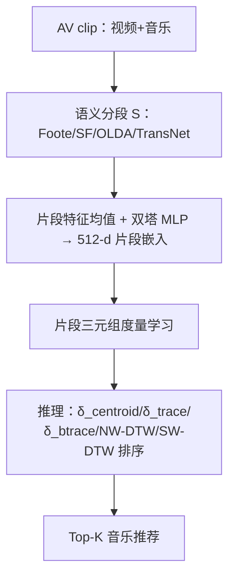

# Video-to-Music Recommendation using Temporal Alignment of Segments (基于片段时序对齐的视频到音乐推荐)

- **会议/期刊**: IEEE Transactions on Multimedia (TMM)
- **作者与机构**: Laure Prétet, Gaël Richard, Clément Souchier, Geoffroy Peeters；Télécom Paris / Bridge.audio
- **推荐链路定位**: 召回
- **研究方向**: 多模态推荐
- **论文原文**: [论文原文链接](https://arxiv.org/abs/2306.07187v1)
- **开源代码**: [TransNet（论文采用的外部镜头分割实现）](https://github.com/soCzech/TransNet)；端到端训练代码暂未开源

## TL;DR (1分钟核心速览)

本文针对音乐监督中 VM-Net 将整段视频/音乐压成单一静态嵌入、丢失镜头与主副歌结构的痛点，提出 Seg-VM-Net：用语义片段级自监督三元组训练，并在推理时以片段序列对齐成本（Trace / NW-DTW / SW-DTW / Best Trace）排序曲目。在 HIMV-50K 训练、MVD 1,000 条查询的全库 1,000 曲 Full-Ranking 下，最佳配置 Mean Rank 32、R@25 78.4，较 clip-level 基线 Mean Rank 118 降低 72.9%，R@25 绝对提升 45.0。

## Background & Motivation (背景与核心矛盾)

- **主流范式**: VM-Net 用双塔将整段视频与音乐映射到同一 512-d 空间，以扩展三元组做自监督跨模态对齐，推理按欧氏距离排序。
- **前人局限**: ①整段平均池化丢失镜头/主副歌的时序结构；②手工音频特征与 clip-level 训练无法利用结构，视频稍长后内容异质，单一向量表征不足。
- **核心洞察 (Key Insight)**: 音乐视频由可切分的镜头与 verse/chorus 段构成；同一时间戳的片段应相似，非同一时间戳/曲目应远离，故“结构”本身可作为推荐信号。
- **本文切入点**: 将 clip 拆为语义片段，把“片段级度量学习 + 序列对齐成本”替代“整段嵌入 + 点距离”。

## Method (核心方法设计)

### 1. 整体框架 (Overall Architecture)

输入为 AV clip $c=(c_v,c_m)$。先按分段算法$S$切分为$K_c$个非重叠片段，片段内对帧级特征取均值；音乐用 Mediapipe 128-d 预训练嵌入，视频用 ImageNet/Mediapipe 1024-d 特征。两条 MLP 分支将每段投影到 512-d L2 归一化空间，片段级三元组拉近同一时间戳的$v/m$段、推远其他曲目任意段。推理时对 query 与候选曲目逐段编码，按$\delta$排序；$\delta$ 可为聚类聚合或序列对齐。

<figure class="paper-figure" markdown="span">
  ![图1：所研究的 Seg-VM-Net 推荐系统总体概览（训练视角）。“FC”表示全连接，“BN”表示批归一化。红色标出与 Hong 等 \[11\] 所述原始 VM-Net 的差异。](../../../../assets/papers/2306.07187v1/figure_1.png)<figcaption>图1：所研究的 Seg-VM-Net 推荐系统总体概览（训练视角）。“FC”表示全连接，“BN”表示批归一化。红色标出与 Hong 等 [11] 所述原始 VM-Net 的差异。</figcaption>
</figure>
图 1：Seg-VM-Net 训练视角总览；红字标出相对 VM-Net 的改动。

### 2. 关键设计拆解 (Key Designs)

1. **片段级三元组与跨曲目负采样**：痛点起因是 clip-level 三元组只能对齐整段平均向量。本文设 anchor 为 $x^v_{c,k}$，正样本为同时间戳音乐段$x^m_{c,k}$，负样本为其他曲目任意段$x^m_{c',*}$。总损失保留扩展三元组：
   $\mathcal{L}=\lambda_1\mathcal{L}_{VM}+\lambda_2\mathcal{L}_{MV}$，
   $\mathcal{L}_{VM}=\max(\|f_v(x^v_{c,k})-f_m(x^m_{c,k})\|_2^2-\|f_v(x^v_{c,k})-f_m(x^m_{c',*})\|_2^2+\alpha,0)$。
   直觉是迫使模型学习局部内容对应，而非整段平均后的粗粒度对应。

2. **结构分段 + 对齐排序**：用 Foote/SF/OLDA 估音乐结构边界，用 TransNet 估镜头边界，将边界共享给另一模态；每段特征取帧级均值。推理不只用 $\delta_{\mathrm{centroid}}$，而用
   $\delta_{\mathrm{trace}}=\sum_{i=1}^{\min(K_c,K_q)}\|e^m_{c,i}-e^v_{q,i}\|_2$，
   以及允许偏移的 $\delta_{\mathrm{btrace}}$ 和 NW/SW-DTW。直觉是 trace 直接奖励同序号片段匹配，btrace/DTW 处理裁剪与拉伸。

3. **训练目标、负采样与推理效率**：总损失同上；每 batch $b=1000$个 clip，每个 anchor 用其余$b-1$个样本做 in-batch 负样本，共$b(b-1)$个三元组平均；无显式 hard negative 挖掘。推理先编码 query 和候选曲目片段，再算$\delta$排序；$\delta_{\mathrm{trace}}$ 处理 1,000 查询约 53s，NW/SW-DTW 为二次复杂度，约 13–21min，需按场景选。

## Experimental Setup & Evaluation Protocol (实验设置与评估协议)

- **数据集与预处理**: 无 5-core 过滤；HIMV-50K 为 YouTube-8M 中 “music video” 子集，无标签；MVD 为人工精选专业 MV，完全未参与训练。

| 数据集 | 规模 | 训练/验证/测试 | 平均时长 | 说明 |
| :--- | :---: | :---: | :---: | :--- |
| HIMV-50K | 51,000 AV clips | 50,000 / 1,000 / — | 3m54s | 自监督训练集，随机划分 |
| MVD | 2,212 clips | — / — / 1,000 | 4m00s | 专业 MV，全库检索测试 |

- **数据划分与防穿越 (Splitting Strategy)**: HIMV-50K 随机抽 50,000 训练、1,000 验证；MVD 随机抽 1,000 条未见过 clip 作 test query，训练/测试无重叠。
- **排名评测协议 (Ranking Protocol)**: 无偏 Full-Ranking，候选为 MVD 中 1,000 条音乐轨；每条 query 仅一个 ground-truth 音乐，按 $\delta$ 升序排名，报告 R@1/10/25 与 Mean Rank，Mean Rank 给 95% CI；未使用 sampled negatives。
- **对比基线与超参设置**: Baseline 1 为 Librosa 手工音频特征 VM-Net；Baseline 2 为 Mediapipe 预训练音频特征 VM-Net。Seg-VM-Net 分别用 Foote/SF/OLDA/TransNet 分段。Embedding $d=512$，Adam lr$10^{-6}$，batch$1000$，dropout$0.5$，$\alpha=0.1$，$\lambda_1=\lambda_2=1$；DTW indel 成本 0.05/0.01。显著性主要看 Mean Rank 95% CI，未报告$p$ 值。

## Key Experimental Results (实验关键数据)

### 1. 主实验对比 (Main Results)

| 方法（分段 / 排序） | 粒度 | Mean Rank↓ | R@25↑ | 1,000 查询推理时间 |
| :--- | :---: | :---: | :---: | :---: |
| Chance | — | 500 | — | 0 |
| Baseline 1：VM-Net + Librosa [11] | clip | 193±25 | — | 10s |
| Baseline 2：VM-Net + Mediapipe [14] | clip | 118±19 | 33.4 | 10s |
| Seg-VM-Net（Foote / $\delta_{\mathrm{centroid}}$） | segment | 94±17 | 40.10 | <1min |
| Seg-VM-Net（OLDA / NW-DTW） | segment | 46±12 | — | 13m41s |
| Seg-VM-Net（OLDA / SW-DTW） | segment | 62±14 | — | 21m14s |
| **Seg-VM-Net（OLDA / $\delta_{\mathrm{trace}}$）** | segment | **32±10** | **78.40** | **53s** |
| Seg-VM-Net（OLDA / $\delta_{\mathrm{btrace}}$） | segment | 43±12 | — | 1m35s |

相对 Baseline 2：Mean Rank 降低 72.9%，R@25 提升 45.0 绝对点（+134.7%）。

### 2. 消融实验 (Ablation Study)

| 配置（除注明外均为 SOLDA 分段） | Vanilla MR↓ | Crop Query MR↓ | Stretch Targets MR↓ | Crop+Stretch MR↓ |
| :--- | :---: | :---: | :---: | :---: |
| Clip-level Baseline 2（去分段） | 118 | — | — | — |
| Segment + $\delta_{\mathrm{centroid}}$（去时序对齐） | 94 | 96 | 94 | 96 |
| Segment + $\delta_{\mathrm{trace}}$ | 32 | 92 | 90 | 146 |
| Segment + $\delta_{\mathrm{btrace}}$ | 43 | 60 | 83 | 89 |
| Segment + NW-DTW | 46 | 75 | 55 | 65 |
| Segment + SW-DTW | 62 | 72 | 68 | 79 |
| $\delta_{\mathrm{trace}}$ + Foote 分段 | 44 | — | — | — |
| $\delta_{\mathrm{trace}}$ + TransNet 分段 | 43 | — | — | — |

### 3. 关键实验发现 (Key Findings)

- **分段是主增益，换特征不是**：Baseline 2 已用 Mediapipe 特征仍为 MR 118、R@25 33.4；改为 OLDA + $\delta_{\mathrm{trace}}$ 后 MR 32、R@25 78.4，说明片段表征显著优于整段平均。
- **时序对齐贡献最大**：同为分段，$\delta_{\mathrm{centroid}}$为 MR 94、R@25 40.1，而$\delta_{\mathrm{trace}}$ 降至 32、78.4；仅做集合聚合会浪费片段顺序信息。
- **鲁棒性与成本需权衡**：Crop Query 下 $\delta_{\mathrm{btrace}}$MR 60 优于$\delta_{\mathrm{trace}}$ 的 92；Stretch 下 NW-DTW 55 优于 trace 的 90，但 NW-DTW 推理 13m41s，trace 仅 53s。OLDA 分段优于 TransNet（32 vs 43），因音乐段平均约 18.6s，镜头段仅 6.6s，过密切分引入无关边界。

## Highlights & Limitations (亮点、对比与审稿批判)

- **与代表作对比 (vs. Prior Work)**: 相较 Hong 等 VM-Net 的 clip-level 静态双塔，本文保留片段时序结构；相较早期序列比较工作依赖低层/情绪标注，本文保持自监督且用语义片段；相较音乐结构生成工作，本文首次把结构分段 + DTW 用于 V2M 召回。
- **可迁移亮点**: 片段级跨曲目负采样可直接迁移到视频-文本、商品-短视频等跨模态召回；$\delta_{\mathrm{trace}}/\delta_{\mathrm{btrace}}$ 是廉价且可解释的序列排序基线。
- **审稿级局限批判**: ①片段平均 18.6s，时间分辨率粗，无法做帧级（40ms）细对齐；②DTW 为 $O(K_cK_q)$，大曲库在线召回成本高，且每个分段$S$ 需单独训练一套投影；③评估仅一个 ground truth + 人工裁剪/拉伸扰动，缺少大规模人工评测与真实音乐监督 A/B。

## Rating (四维评分)

- **方法创新性 (Novelty)**: ⭐⭐⭐⭐ （首次把自监督片段度量学习、语义分段与 DTW 对齐统一到 V2M 召回，机制简洁但增量明确）
- **评估协议与实验扎实度 (Protocol & Experiments)**: ⭐⭐⭐⭐ （1,000 曲 Full-Ranking、95% CI 与三类扰动较扎实；但缺人工评测、显著性检验和大规模线上验证）
- **写作与数学规范度 (Clarity & Rigor)**: ⭐⭐⭐⭐ （pipeline、损失与对齐公式清晰；符号与分段/对齐组合较多，阅读成本偏高）
- **工业落地与复现价值 (Industrial & Practical Value)**: ⭐⭐⭐ （512-d 轻量双塔与 53s/1,000 查询有落地潜力；但按分段算法重训、DTW 二次复杂度限制大库扩展，端到端代码未开源）

