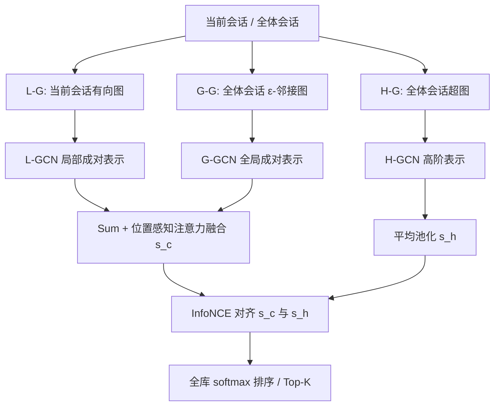
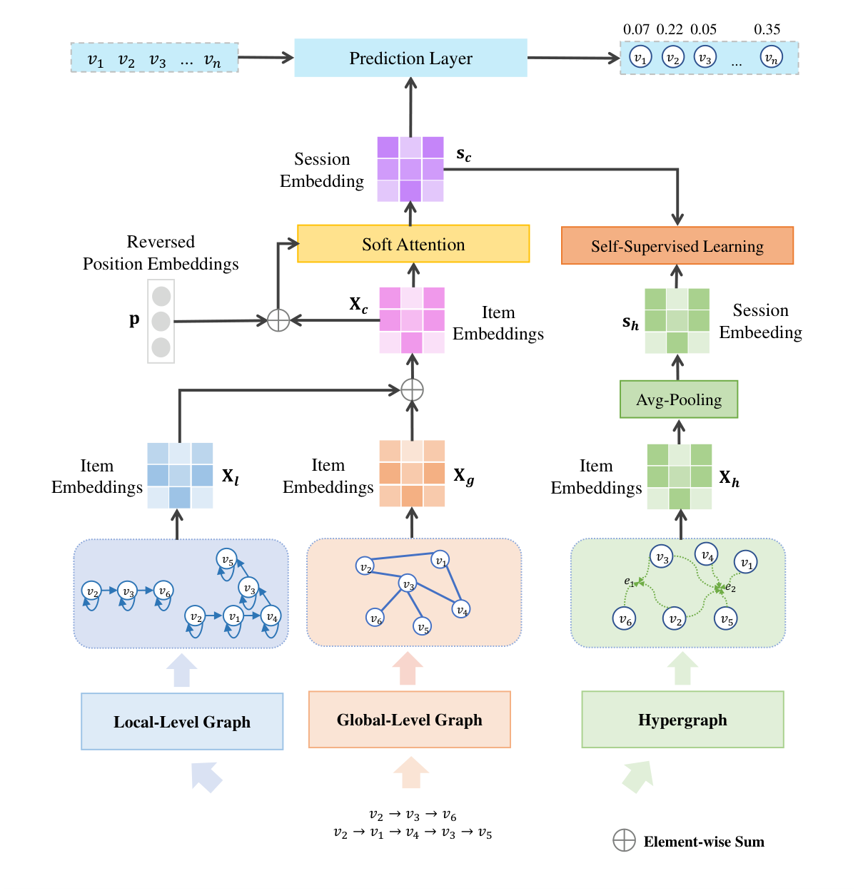

# Contrastive Multi-Level Graph Neural Networks for Session-based Recommendation（对比多级图神经网络会话推荐）

- **会议/期刊**: IEEE Transactions on Multimedia (TMM), 2023（arXiv 2023-11-06）
- **作者与机构**: Fuyun Wang, Xingyu Gao, Zhenyu Chen, Lei Lyu；山东师范大学信息科学与工程学院、中国科学院计算技术研究所
- **推荐链路定位**: 召回/排序（Next-item 全库排序）
- **研究方向**: 序列与会话推荐 / 自监督对比与交互去噪
- **论文原文**: [论文原文链接](https://arxiv.org/abs/2311.02938v1)
- **开源代码**: 暂未开源

## TL;DR (1分钟核心速览)

针对会话短、匿名交互稀疏、单会话图难捕获跨会话与高阶转移的痛点，CM-GNN 构造局部/全局/超图三级图，以注意力融合成对表示，并用 InfoNCE 将高阶超图表示注入其中。在 Tmall、Diginetica、Nowplaying 全库排序上，多数 P@K/MRR@K 领先，Tmall P@20 相对最强基线提升 3.80%。

## Background & Motivation (背景与核心矛盾)

- **主流范式**: SBR 从 GRU4Rec/STAMP 转向 SR-GNN/FGNN/GCE-GNN 的会话图建模，近期 S2-DHCN 用超图捕捉高阶关系。
- **前人局限**: 现有方法多只建模当前会话或仅成对转移；跨会话信息与高阶关系割裂，短会话稀疏时表示不稳。
- **核心洞察 (Key Insight)**: 同一会话的“成对关系视图”与“高阶超图视图”应互相监督，而非简单拼接。
- **本文切入点**: 三级图分别取局部/全局/高阶信号，以对比学习把高阶知识蒸馏进成对会话表示。

## Method (核心方法设计)

### 1. 整体框架 (Overall Architecture)

CM-GNN 将当前会话、全体会话与全库物品转移分别构造成局部有向图 L-G、全局 ε-邻接图 G-G 与超图 H-G；三路 GCN 输出局部/全局成对关系与高阶关系物品表示。L-GCN 与 G-GCN 经 sum pooling 后由位置感知软注意力融合成 $\mathbf{s}_c$，H-GCN 多层平均得$\mathbf{s}_h$；InfoNCE 将$\mathbf{s}_h$的高阶监督注入$\mathbf{s}_c$。预测层对全部物品做 softmax 排序，训练用交叉熵+对比辅助损失联合优化。

图 1：CM-GNN 整体框架。
<figure class="paper-figure" markdown="span">
  <figcaption>图 1：我们提出的 CM-GNN 的整体框架。</figcaption>
</figure>

### 2. 关键设计拆解 (Key Designs)

1. **L-GCN：当前会话四类边注意力聚合**：L-G 将相邻点击建成 $r_{in},r_{out},r_{in-out},r_{self}$四类有向边，用边关系调制节点相似度：$a_{ij}=\mathrm{LeakyReLU}(\mathbf{w}^\top\mathbf{r}_{ij}(\mathbf{x}_{v_i}\odot\mathbf{x}_{v_j}))$，softmax 后聚合邻居$\mathbf{x}^l_{v_i}=\sum_{v_j\in\mathcal{N}^l_{v_i}}\alpha_{ij}\mathbf{x}_{v_j}$。直觉是同一会话内不同转移类型对意图贡献不同。

2. **G-GCN 与 H-GCN：跨会话成对关系 + 全局高阶关系**：G-G 以 ε-邻接和转移频次边权建全局无向图，会话感知注意力 $b_{ij}=\mathbf{q}_1^\top\mathrm{LeakyReLU}(\mathbf{W}_1[(\mathbf{s}\odot\mathbf{x}_{v_j})\|\mathbf{w}_{ij}])$后聚合；H-G 把每个会话作超边，用$\mathbf{X}^{(t+1)}_h=\mathbf{D}^{-1}\mathbf{H}\mathbf{W}\mathbf{B}^{-1}\mathbf{H}^\top\mathbf{X}^{(t)}_h$ 做节点-超边-节点两阶段传播。前者补跨会话稀疏，后者补多跳共现。

3. **注意力融合 + 跨层级 InfoNCE**：位置感知注意力 $\beta_i=\mathbf{q}_2^\top\sigma(\mathbf{W}_4\mathbf{z}_{v_i}+\mathbf{W}_5\mathbf{s}'+\mathbf{b}_4)$，$\mathbf{s}_c=\sum_i\beta_i\mathbf{x}'_{v_i}$；$\mathbf{s}_h$由 H-GCN 物品表示平均池化。$\mathcal{L}_s=-\log\sigma(\mathbf{s}_c^\top\mathbf{s}_h)-\log\sigma(1-\tilde{\mathbf{s}}_c^\top\mathbf{s}_h)$，负样本对$\mathbf{s}_c$行列打乱；总损失$\mathcal{L}=\mathcal{L}_r+\beta\mathcal{L}_s$，$\mathcal{L}_r$为全库 softmax 交叉熵。预测$\hat{y}_{v_i}=\mathrm{softmax}(\mathbf{s}_c^\top\mathbf{x}_{v_i})$。为什么有效：把高阶共现作为自监督信号约束成对表示，缓解短会话监督不足。

## Experimental Setup & Evaluation Protocol (实验设置与评估协议)

- **数据集与预处理**: 过滤仅 1 个物品的会话、出现少于 5 次的物品；末周作测试集，其余训练；用前缀序列增强样本。

| 数据集 | #Users | #Items | #Sessions(训练/测试) | 平均长度 | 特征/场景说明 |
| :--- | :---: | :---: | :---: | :---: | :--- |
| Tmall | 匿名(未提供) | 30,968 | 351,268 / 25,898 | 6.69 | 天猫购物日志 |
| Diginetica | 匿名(未提供) | 40,728 | 719,470 / 60,858 | 5.12 | CIKM Cup 交易数据 |
| Nowplaying | 匿名(未提供) | 43,097 | 825,304 / 89,824 | 7.42 | Twitter 音乐收听 |

- **数据划分与防穿越 (Splitting Strategy)**: 全局时间切分（末周测试）+ 序列前缀增强；非 Leave-One-Out。
- **排名评测协议 (Ranking Protocol)**: Full-Ranking：对全部候选物品 softmax 后排序，报告 P@10/20、MRR@10/20；论文未给采样负例比例。
- **对比基线与超参设置**: 对比 11 个基线（表 2 摘 8 个代表）；$d=100$，batch=256，Adam lr=0.001 每 3 epoch×0.1，L2=1e-5，ε=3，邻居=12；β=0.001（Diginetica/Nowplaying）/0.01（Tmall）。

## Key Experimental Results (实验关键数据)

### 1. 主实验对比 (Main Results)

| 方法 | Tmall P@20 | Tmall MRR@20 | Digi P@20 | Digi MRR@20 | Now P@20 | Now MRR@20 |
| :--- | :---: | :---: | :---: | :---: | :---: | :---: |
| Item-KNN | 9.15 | 3.31 | 35.75 | 11.57 | 15.94 | 4.91 |
| FPMC | 16.06 | 7.32 | 22.14 | 6.66 | 7.36 | 2.82 |
| STAMP | 26.47 | 13.36 | 46.62 | 15.13 | 17.66 | 6.88 |
| CSRM | 29.46 | 13.96 | 50.55 | 16.38 | 18.14 | 6.42 |
| SR-GNN | 27.57 | 13.72 | 51.26 | 17.78 | 18.87 | 7.47 |
| FGNN | 25.24 | 10.39 | 50.58 | 16.84 | 18.78 | 7.15 |
| GCE-GNN | 33.42 | 15.42 | 54.22 | 19.04 | 22.37 | 8.40 |
| S2-DHCN | 31.42 | 15.05 | 53.66 | 18.51 | **23.50** | 8.18 |
| CM-GNN | **34.69** | **16.41** | **54.67** | **19.19** | 23.30 | **8.44** |

CM-GNN 相对该列最强基线：Tmall P@20 +3.80%、MRR@20 +6.42%；Diginetica +0.83%/+0.79%；Nowplaying MRR@20 +0.48%，P@20 -0.85%（S2-DHCN 仍高 0.20）。

### 2. 消融实验 (Ablation Study)

| 变体 | Tmall P@20/MRR@20 | Digi P@20/MRR@20 | Now P@20/MRR@20 |
| :--- | :---: | :---: | :---: |
| w/o L-GCN (CG-L) | 14.56 / 6.81 | 48.71 / 15.34 | 20.69 / 7.83 |
| w/o G-GCN (CG-G) | 30.41 / 14.17 | 54.53 / 19.05 | 22.89 / 7.76 |
| w/o H-GCN (CG-H) | 33.85 / 15.76 | 54.53 / 19.11 | 22.79 / 8.49 |
| w/o 注意力融合 (CG-A) | 28.98 / 14.25 | 48.48 / 16.73 | 18.83 / 6.09 |
| InfoNCE→MSE (CG-S) | 33.70 / 15.50 | 54.55 / 19.11 | 22.93 / **8.52** |
| CM-GNN | **34.69 / 16.41** | **54.69 / 19.19** | **23.30** / 8.44 |

### 3. 关键实验发现 (Key Findings)

1. **L-GCN 是命门**：去掉后 Tmall P@20 34.69→14.56（-58.0%）、Diginetica 54.69→48.71（-10.9%），当前会话内转移仍是 SBR 主信号。
2. **跨会话与融合次之**：去 G-GCN 使 Tmall P@20 降至 30.41（-12.3%），去注意力融合降至 28.98（-16.4%）；Nowplaying 上去融合跌至 18.83/6.09，匿名短会话更依赖自适应加权而非均值。
3. **对比学习并非全胜**：Tmall CG-S 33.70/15.50 低于 CM 34.69/16.41；Nowplaying 上 CG-S MRR@20 8.52 反超 CM 8.44，短会话两视图趋同导致 InfoNCE 收益不稳；Diginetica 平均长度仅 5.12，H-GCN 高阶收益也有限（54.53→54.69）。

## Highlights & Limitations (亮点、对比与审稿批判)

- **与代表作对比 (vs. Prior Work)**: 相比 GCE-GNN，额外引入 H-G 高阶关系与 InfoNCE；相比 S2-DHCN，保留显式 L/G 成对分支与注意力融合，不只依赖超图；相比 SR-GNN/FGNN，显式利用跨会话转移。
- **可迁移亮点**: “多级图视图 + 跨层级互信息”可迁移到其他短序列推荐；会话超边构造适合建模匿名短会话的高阶共现。
- **审稿级局限批判**: 全库 softmax 面对 3–4 万物品，训练/推理开销偏高且无 ANN 截断分析；InfoNCE 负例仅靠行列打乱，短会话易视图坍缩；β 数据集敏感（0.001 vs 0.01），且 Nowplaying P@20 未全面领先、论文“all metrics”表述与表 2 略有出入；评估仅 P@K/MRR，缺 NDCG、Recall、覆盖率与在线 A/B。

## Rating (四维评分)

- **方法创新性 (Novelty)**: ⭐⭐⭐⭐ （L/G/H 三级图 + 跨层级 InfoNCE 组合清晰，但各组件均有较强前作影子）
- **评估协议与实验扎实度 (Protocol & Experiments)**: ⭐⭐⭐⭐ （三数据集、11 基线、完整消融；但全库排序细节与负采样未交代，Nowplaying P@20 未领先）
- **写作与数学规范度 (Clarity & Rigor)**: ⭐⭐⭐⭐ （公式与符号较完整；部分结论与表格数值存在张力）
- **工业落地与复现价值 (Industrial & Practical Value)**: ⭐⭐⭐ （无开源；超图构图与全库 softmax 开销高，线上需候选截断/ANN 改造）

