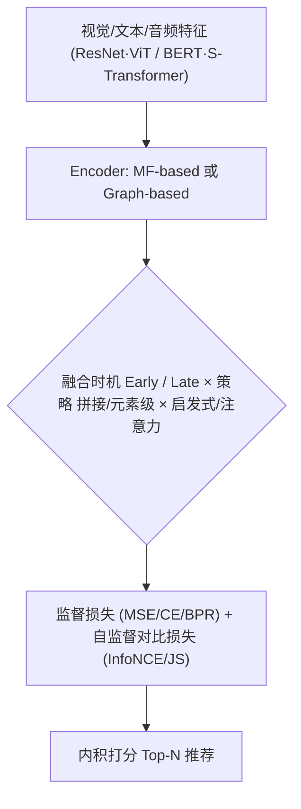
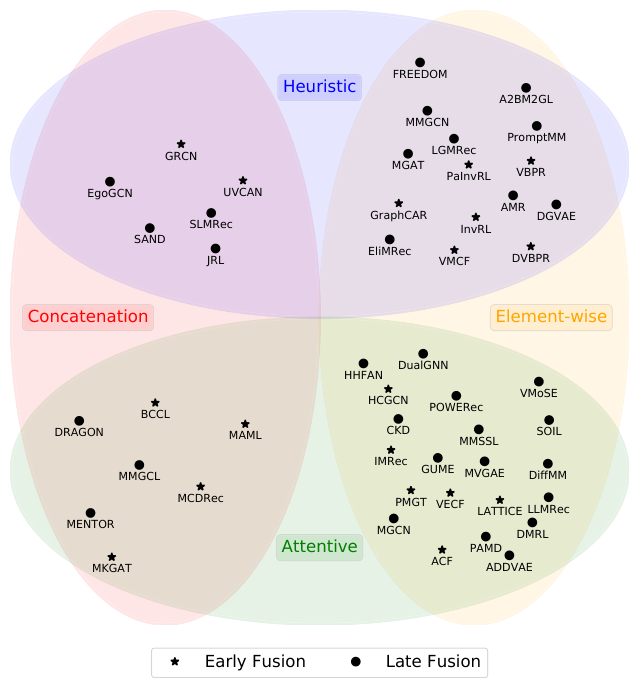

# A Survey on Multimodal Recommender Systems: Recent Advances and Future Directions (多模态推荐系统综述：最新进展与未来方向)

- **会议/期刊**: IEEE Transactions on Multimedia (TMM)；arXiv v1 于 2025-01 发布
- **作者与机构**: Jinfeng Xu、Jinze Li、Shuo Yang、Edith C. H. Ngai（香港大学）、Zheyu Chen（香港理工）、Wei Wang、Xiping Hu（深圳北理莫斯科大学 / 北京理工）、Steven Hoi（新加坡管理大学）
- **推荐链路定位**: 召回 / 表征学习（多模态内容侧召回与协同过滤表征）
- **研究方向**: 多模态推荐 / 图神经网络推荐
- **论文原文**: [论文原文链接](https://arxiv.org/abs/2502.15711v1)
- **开源代码**: [Awesome-Multimodal-Recommender-Systems](https://github.com/Jinfeng-Xu/Awesome-Multimodal-Recommender-Systems)（实验侧配套 [MMRec](https://github.com/enoche/MMRec.git)）

## TL;DR (1分钟核心速览)

针对现有多模态推荐（MRS）综述"按模态粗粒度罗列、或只讲流程不讲技术演进"的痛点，本文以 **Feature Extraction → Encoder → Multimodal Fusion → Loss Function** 四段式技术流水线，系统梳理 2016–2025 年 48 篇代表性工作，并首次把融合拆成 **时机（early/late）× 策略（拼接/元素级 × 启发式/注意力）** 的正交二维矩阵，最后给出统一模型、冷启动与更丰富模态三个未来方向。

## Background & Motivation (背景与核心矛盾)

- **主流范式**: 以 ID 嵌入协同过滤为骨架，注入视觉（ResNet/ViT）、文本（BERT/Sentence-Transformer）乃至音频（LSTM/GRU）特征，经 MF 或 GCN 编码后做内积打分。
- **前人局限**: ① Deldjoo 等按"模态名称"做粗粒度归类，无法回答"同一批模态特征该在何处融合"；② Liu 等 [5] 沿流程阶段叙述，读者难以看出技术本身的迭代脉络；③ Zhou 等 [12] 给出公共框架但流水线颗粒度不足。
- **核心洞察 (Key Insight)**: MRS 的性能差异几乎不来自"用了哪些模态"，而来自**融合发生在消息传播之前还是之后**、以及**损失是监督还是自监督**这两个正交维度。
- **本文切入点**: 把每个模块分析到底层算子与目标函数，用统一的 $\hat{R}=\text{Aggr}(\text{Encoder}(U,I_m))$ 形式化记号横向对齐所有模型。

## Method (核心方法设计)

### 1. 整体框架 (Overall Architecture)

综述把任一 MRS 模型规约为四段闭环：先由冻结的预训练骨干抽取模态特征（Amazon 数据存在损坏图，社区已转向**使用数据集预提供特征**以保证可复现）；再送入 MF 或 GCN 编码器得到用户/物品表征；随后在 early/late 两种时机、四种策略下融合；最后以监督损失（pointwise/pairwise）为主任务、自监督对比损失为辅助任务联合优化。四段之间以 $\bar{E}=\text{Encoder}(U,\text{Aggr}(I_m))$（early）与 $\bar{E}=\text{Aggr}(\text{Encoder}(U,I_m))$（late）两条通式贯通。

### 2. 关键设计拆解 (Key Designs)

1. **编码器二分与同质图增强**：MF 类只做低秩分解 $R\approx\hat{R}=UI^{\top}$，难以刻画高阶邻域；图类在 LightGCN 简化传播$E^{(l)}=\tilde{D}^{-\frac{1}{2}}\tilde{A}\tilde{D}^{-\frac{1}{2}}E^{(l-1)}$之上，额外用 top-$k$相似度构造 item-item（LATTICE）与 user-user（DualGNN）同质图并做对称归一化$\hat{U}=(S_U)^{L_u}\bar{U}$。直觉：同质图把"视觉/文本相近但未交互"的隐性关联补进协同信号，直接缓解稀疏。
2. **融合的时机×策略二维分类**：早融合在传播前聚合，易使模态独有信息被过早平均；晚融合保留模态个性却丢失跨模态相关性。策略上元素级 $E_v+E_t$比拼接$E_v|E_t$更深度融合但会放大模态噪声；注意力权重$\alpha_vE_v+\alpha_tE_t$ 能动态配比却显著抬高训练开销（新增一组可学习权重与额外前向）。该矩阵首次让"改动一个融合算子"的边际收益可被比较。
3. **监督/自监督损失的形式化与推理开销**：点式（MSE/CE）把打分拉向标签，成对（BPR $-\log\sigma(y_{u,i^+}-y_{u,i^-})$）只约束相对序，更适配隐式反馈稀疏标签。自监督通过视图构造器$w=\mathcal{C}(R,E,M)$分两支：特征扰动$\omega=(R,\text{Perturb}(E),M)$（不同模态本身即天然双视图，等价模态对齐）与结构扰动$\omega=(\text{Perturb}(R),E,M)$（边丢弃/加噪），目标为 InfoNCE 或 JS 二分类式。总损失$ \mathcal{L}=\mathcal{L}_{\text{main}}+\lambda\,\mathcal{L}_{\text{ssl}} $，负采样沿用以批内负例为主，推理阶段无额外开销（视图仅训练期存在）。

直接引用（如图 6 的融合分类）：
<figure class="paper-figure" markdown="span">
  <figcaption>图6. 多模态融合的分类。五角星和圆形符号分别表示早期融合和晚期融合。</figcaption>
</figure>

## Experimental Setup & Evaluation Protocol (实验设置与评估协议)

- **数据集与预处理**: 综述**本身不含自建实验**，故无 #Users/#Items 统计表；其归纳的对象是社区通用基准（Amazon 各子类、TikTok 微视频、时尚/医疗垂类），这些数据集普遍至少含**交互 + 视觉 + 文本**三模态，且近年工作统一采用 MMRec 提供的**预抽取特征**而非自行 ResNet/BERT 编码，以避免损坏图导致的不可复现。
- **数据划分与防穿越 (Splitting Strategy)**: 归纳对象的主流协议为 `5-core` 过滤 + `Leave-One-Out`（末次交互为测试、倒数第二次为验证）。
- **排名评测协议 (Ranking Protocol)**: 主流为 `Full-Ranking`（全库未交互物品排序，报告 Recall@20 / NDCG@20），少量工作用采样排序；训练负采样以 Uniform 单负例为主，MMGCL 等引入模态感知难负例。
- **对比基线与超参设置**: 综述不设基线；其"对照"是与 5 篇既有综述（Zhang、Guo、Deldjoo×3、Jannach、Wu、Meng、Zhou、Liu）在分类粒度上的定性对比；文献检索覆盖 MM/KDD/WWW/SIGIR/AAAI/ICLR/IJCAI/CIKM/WSDM/TMM/TKDE/TPAMI/INFFUS，经"收集—去重筛选—技术剖析"三阶段。

## Key Experimental Results (实验关键数据)

### 1. 主实验对比 (Main Results)

综述无实验表，此处汇总其分类结果的可核验统计（基于文中 Table III 的 48 篇工作清点）：

| 维度 | 类别 | 篇数（约） | 代表模型 | 时间分布特征 |
| :--- | :--- | :---: | :--- | :--- |
| Encoder | Graph-based | 36 | MMGCN, LATTICE, DualGNN, FREEDOM, DiffMM | 2019 后占绝对主导 |
| Encoder | MF-based | 12 | VBPR, ACF, DVBPR, AMR, EliMRec | 集中于 2016–2022 |
| Fusion 时机 | Early | 16 | VBPR, LATTICE, HCGCN, PMGT | 2016–2024 持续出现 |
| Fusion 时机 | Late | 32 | MMGCN, DualGNN, FREEDOM, LGMRec, SAND | 2021 后成主流 |
| Loss | Pointwise | 11 | VMCF, PMGT, ADDVAE, BCCL, VMoSE | 少数派，多为生成/变分式 |
| Loss | Pairwise + SSL | 36+ | MMGCL, SLMRec, BM3, MMSSL, MENTOR | 2022 后近乎默认配置 |

### 2. 消融实验 (Ablation Study)

原文未提供统一复现实验，以"技术要素增删"的定性对照替代：

| 配置变动 | 综述给出的效应 | 代价 |
| :--- | :--- | :--- |
| 去掉同质图（仅 U-I 图） | 丢失跨用户/跨物品隐性关联，稀疏场景退化 | 构图 $O(|I|^2)$ 相似度计算可省 |
| Early → Late 融合 | 保留模态独有信息，但跨模态相关性捕捉减弱 | 需多套模态专属编码器 |
| 启发式 → 注意力融合 | 模态权重动态化，噪声模态被抑制 | 参数与训练复杂度上升 |
| 去掉 SSL 辅助任务 | 表征鲁棒性下降，长尾/稀疏更敏感 | 无（推理零开销） |

### 3. 关键实验发现 (Key Findings)

- **图编码器已成事实标准**：48 篇中约 36 篇（75%）采用 GCN 类编码，且集中出现在 2019 年 MMGCN 之后，MF 路线仅在 2016–2022 早期与轻量化场景存续，说明"高阶邻域传播"比"更强模态特征"更能带来增益。
- **损失配置高度同质化**：仅 11 篇使用 pointwise 损失，2022 年后的新模型几乎全部叠加结构/特征自监督（InfoNCE 为主），表明社区已把 SSL 当作低成本的免费涨点项而非创新点。
- **融合重心从"何时"转向"如何加权"**：晚融合约 32 篇并持续增长，但 2023 年后注意力加权、ATE 因果加权、频域融合（SMORE）、不确定性加权（VMoSE）等**再加权机制**成为新的差异化战场，单纯切换时机已难产生独立贡献。

## Highlights & Limitations (亮点、对比与审稿批判)

- **与代表作对比 (vs. Prior Work)**: 相较 Deldjoo 等按模态划分的粗粒度综述，本文的融合"时机×策略"矩阵可解释 LATTICE（early+attention）与 MMGCN（late+element-wise）为何性能路径不同；相较 Liu 等 [5] 的流程叙事，本文落到 BPR/InfoNCE 等算子级对比，可直接指导实现选型。
- **可迁移亮点**: ① "早/晚融合 × 拼接/元素级 × 启发式/注意力"矩阵可作为任何多源特征融合任务的选型清单；② 把不同模态视为天然双视图做对比学习（免人工增广）的做法，可平移到多场景/跨域推荐。
- **审稿级局限批判**: ① 全篇为**定性综述**，无统一 benchmark 复现与元分析，因此"图编码器更优""晚融合更好"等结论缺乏同协议下的数值证据，易受各原始论文调参差异干扰；② 分类存在重叠与边界模糊（如 MCDRec 同时落入早融合与注意力策略），且对 2024–2025 兴起的 CLIP/LLM 视觉-语言统一表征、生成式多模态检索仅停留在"未来方向"，技术覆盖有明显时滞。

## Rating (四维评分)

- **方法创新性 (Novelty)**: ⭐⭐⭐ （综述类工作，融合时机×策略正交矩阵与四段式流水线切分是有价值的组织创新，但无新算法与理论推导）
- **评估协议与实验扎实度 (Protocol & Experiments)**: ⭐⭐ （检索策略规范、覆盖 13 个顶会顶刊，但零复现实验、零显著性检验，结论全为定性归纳）
- **写作与数学规范度 (Clarity & Rigor)**: ⭐⭐⭐⭐ （$R\approx UI^{\top}$、LightGCN 传播、InfoNCE/JS 等通式统一且紧凑，Preliminary 1/2 记号分层清晰，模型归属表与时间轴图可读性高）
- **工业落地与复现价值 (Industrial & Practical Value)**: ⭐⭐⭐⭐ （配套 Awesome 仓库与 MMRec 统一特征/评测框架，使 48 篇方法可直接横向复现，对内容电商与短视频召回的选型工程价值高）

