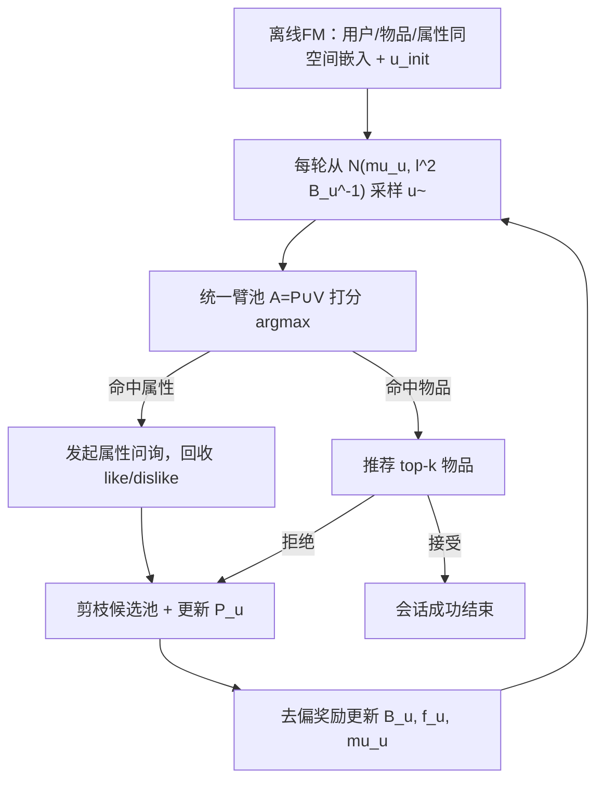

# Seamlessly Unifying Attributes and Items: Conversational Recommendation for Cold-Start Users (无缝统一属性与物品：面向冷启动用户的对话推荐)

- **会议/期刊**: ACM Transactions on Information Systems (TOIS), Vol.39, No.4, Article 40
- **作者与机构**: Shijun Li、Xiangnan He（中科大），Wenqiang Lei、Tat-Seng Chua（新加坡国立大学），Qingyun Wu（弗吉尼亚大学），Peng Jiang（快手）
- **推荐链路定位**: 交互式在线推荐（多轮对话召回，无历史行为的冷启动用户）
- **研究方向**: 对话推荐与智能体仿真 / 强化学习与 Bandit 动态探索
- **论文原文**: [https://arxiv.org/abs/2005.12979v5](https://arxiv.org/abs/2005.12979v5)
- **开源代码**: [https://github.com/xiwenchao/conTS-TOIS-2021](https://github.com/xiwenchao/conTS-TOIS-2021)（含快手新数据集）

## TL;DR (1分钟核心速览)

冷启动用户没有历史行为，只能靠多轮对话在线试探偏好。既有做法把「物品」和「属性」当成两类不同性质的臂分别打分，再用人工规则（ConUCB 的 $b(t)=5\lfloor\log t\rfloor$）决定何时问、何时推，策略脆弱且不可迁移。本文提出 ConTS：把全部属性和全部物品塞进**同一个臂空间**$\mathcal{A}=\mathcal{P}\cup\mathcal{V}$，用一个含属性互促项的统一奖励函数 + 上下文 Thompson Sampling 采样，把「问什么属性、推什么物品、这一轮是问还是推」三个问题坍缩成一个「选臂」问题。在 Yelp/LastFM/快手三套冷启动拟真协议下，SR@15 相对 EAR 提升 69.5%（Yelp）、106.2%（快手），平均轮次同步下降。

## Background & Motivation (背景与核心矛盾)

- **主流范式**: 静态 CF/神经推荐依赖充足历史日志；冷启动场景改用 bandit 在线探索（Thompson Sampling / UCB），后续 ConUCB 进一步把属性问询纳入 UCB 框架以加速候选池收缩。
- **前人局限一（臂建模同质化）**: 早期 bandit 推荐只把**物品**当臂，而真实物品池可达十亿级（淘宝/YouTube），在物品层做探索命中率极低；属性是可解释的偏好载体，天然可以剪枝，却被排除在臂空间之外。
- **前人局限二（策略手工化）**: ConUCB 虽把属性也建成臂，但属性与物品分属两个臂空间、两套打分，且「何时问」由手写频率函数 $b(t)$决定。该函数与数据集强耦合（原文自己就试了$5\log t$、$10\log t$、$15\log t$、$10\log(t/50)$ 等），换域即失效。
- **核心洞察**: 既然「问属性」和「推物品」本质都是消耗一次对话机会去换取信息/收益的**同一种决策**，就应当共享同一奖励估计器；属性与物品的分数天然互相促进（用户已确认的属性应抬高包含该属性物品的分数）。
- **本文切入点**: 用统一臂空间 + 上下文 Thompson Sampling 的后验采样，让 EE 权衡与问/推切换都由「采样—取最大奖励—更新后验」一个闭环自动完成，彻底去掉启发式规则。

## Method (核心方法设计)

### 1. 整体框架 (Overall Architecture)

离线阶段用 FM（BPR 损失，先训物品预测、收敛后接属性预测多任务）在同一嵌入空间得到用户/物品/属性向量，作为臂嵌入。在线阶段每个会话：新用户分布初值取已有用户嵌入均值 $\mathbf{u}_{init}$，协方差取单位阵；每轮从$\mathcal{N}(\boldsymbol{\mu}_u, l^2\mathbf{B}_u^{-1})$采样一个用户向量，对候选池内所有臂（物品 + 属性）算统一奖励并 argmax：命中属性则发起问询（Yelp 问父类、快手一次问 top-12），命中物品则推 top-$k$；依据反馈剪枝候选池（否定则删臂，肯定则把属性并入$\mathcal{P}_u$并过滤不含该属性的物品），再用去偏奖励更新后验。最大轮次$T$ 到达即失败退出。

### 2. 关键设计拆解 (Key Designs)

1. **统一臂空间与互促奖励函数（本文最核心的算子改写）**：为打破属性/物品两套打分，把两者的期望奖励写成同一形式，显式加入「臂与用户已确认属性集的亲和度」：
$$r(a,u,\mathcal{P}_u)\sim\mathcal{N}\Big(\mathbf{u}^{\top}\mathbf{x}_a+\sum_{p_i\in\mathcal{P}_u}\mathbf{x}_a^{\top}\mathbf{p}_i,\; l^2\Big),\qquad a^{(t)}=\arg\max_{a\in\mathcal{A}_u}\Big(\tilde{\mathbf{u}}^{\top}\mathbf{x}_a+\sum_{p_i\in\mathcal{P}_u}\mathbf{x}_a^{\top}\mathbf{p}_i\Big)$$
第一项是通用偏好，第二项是属性互促。直觉：一旦用户确认「科幻」，所有科幻电影的分数被整体抬高，同时未确认属性若与已确认属性嵌入相近也会被抬高——信息在两类臂之间单向流动，这正是分空间建模无法表达的。

2. **冷启动后验初始化与去偏更新**：Thompson Sampling 传统以零向量初始化，等价于假设新用户中性；本文改为 $\mathbf{u}_{init}=\frac{1}{N}\sum_{i}\mathbf{u}_i$（已有用户均值），并把该先验与属性项一起视为**偏置**，从观测奖励中扣除后再更新：
$$\mathbf{B}_u\leftarrow\mathbf{B}_u+\mathbf{x}_a\mathbf{x}_a^{\top},\quad r'_a=r_a-\mathbf{x}_a^{\top}\Big(\mathbf{u}_{init}+\sum_{p_i\in\mathcal{P}_u}\mathbf{p}_i\Big),\quad \mathbf{f}_u\leftarrow\mathbf{f}_u+r'_a\mathbf{x}_a,\quad \boldsymbol{\mu}_u=\mathbf{B}_u^{-1}\mathbf{f}_u$$
即只让 $\mathbf{u}_{orig}$ 承担可学习部分，避免均值先验与属性偏置被重复计入而导致过自信、探索过早收缩。

3. **训练目标、奖励设计与推理开销**：无独立策略网络，全部「训练」即在线贝叶斯更新；奖励为人工标量（$r_{succ\_rec}=r_{succ\_ask}=5$，$r_{fail\_rec}=-0.15$，$r_{fail\_ask}=-0.03$，非对称设计使「推荐失败」比「问询失败」惩罚更重，倒逼模型先问后推）。每轮复杂度$O(2d(n+k)+d^2)$，$n$为候选物品数、$k$ 为属性数，与矩阵分解同阶，无额外高阶开销。

## Experimental Setup & Evaluation Protocol (实验设置与评估协议)

- **数据集与预处理**:

| 数据集 | #Users | #Items | #Interactions | 稀疏度 | 特征/问询设定 |
| :--- | :---: | :---: | :---: | :---: | :--- |
| Yelp | 27,675 | 70,311 | 1,345,606 | 0.069% | 590 属性归为 29 父类，**枚举式问询**（一次问父类、用户选子属性） |
| LastFM | 1,801 | 7,432 | 76,693 | 0.573% | 33 属性，**二元问询**（喜/厌） |
| Kuaishou | 6,861 | 18,612 | 100,699 | 0.079% | 665 属性，**多属性问询**（一次问 top-12，各给二元反馈）；过滤 <10 次浏览用户与 <5 次出现属性 |

- **数据划分与防穿越**: **用户不相交（user-disjoint）按交互记录 7:1.5:1.5 划分**；训练集用户视为「老用户」用于离线 FM，验证/测试集用户视为「冷启动新用户」（训练集中无其任何记录），彻底避免行为穿越。
- **排名评测协议**: 非全库离线排序，而是**对话拟真（user simulator）在线评测**：以测试集每条 (user, item) 记录为一个会话，仅该物品及其属性为正反馈，其余为负；指标为 $SR@t$（$t$轮内成功会话占比）与$AT$（平均结束轮次，未成功记$T$），主实验$T=15$，另测$T=7,10$；单样本配对 t 检验，$p<0.01$。
- **对比基线与超参**: Abs Greedy（只推不问）、EAR（RL 策略网络，warm-start SOTA）、ConUCB（分空间 UCB + 手工 $b(t)$）；嵌入维度$d=64$，$k=10$，$l=0.01$，ConUCB 取最优$\lambda=0.8,\tilde{\lambda}=1$。

## Key Experimental Results (实验关键数据)

### 1. 主实验对比 (Main Results)

| 方法 | Yelp SR@15 | Yelp AT | LastFM SR@15 | LastFM AT | Kuaishou SR@15 | Kuaishou AT |
| :--- | :---: | :---: | :---: | :---: | :---: | :---: |
| Abs Greedy | 0.340 | 14.01 | 0.0104 | 14.92 | 0.1395 | 14.06 |
| ConUCB | 0.262 | 13.01 | 0.1540 | 14.23 | 0.1457 | 13.71 |
| EAR | 0.446 | 11.58 | 0.0640 | 14.33 | 0.2362 | 13.48 |
| Seamless-UCB（本文策略+UCB） | 0.7394 | 8.78 | 0.1593 | 14.01 | 0.4136 | 12.71 |
| **ConTS（本文）** | **0.756** | **8.58** | **0.1628** | **13.92** | **0.4872** | **11.87** |
| Improv. vs 最优基线 | +69.5% | −25.9% | +5.7% | −2.2% | +106.2% | −11.9% |

### 2. 消融实验 (Ablation Study)

| 变体 | Yelp SR@15 / AT | LastFM SR@15 / AT | Kuaishou SR@15 / AT |
| :--- | :---: | :---: | :---: |
| ConTS 全量 | **0.756 / 8.58** | **0.1628 / 13.92** | **0.4872 / 11.87** |
| w/o $\mathbf{u}_{init}$（零向量初始化） | 0.734 / 8.62 | 0.1514 / 13.98 | 0.4644 / 12.05 |
| w/o $\mathcal{P}_u$（去掉属性互促项） | 0.328 / 12.81 | 0.1505 / 14.02 | 0.4031 / 12.29 |
| w/o 采样（仅用均值，去探索） | 0.491 / 11.00 | 0.0610 / 14.59 | 0.1446 / 13.79 |

### 3. 关键实验发现 (Key Findings)

1. **属性互促项 $\sum_{p_i\in\mathcal{P}_u}\mathbf{x}_a^{\top}\mathbf{p}_i$是最大贡献源**：去掉后 Yelp SR@15 从 0.756 崩到 0.328（−56.6%）、AT 从 8.58 涨到 12.81，远大于去掉$\mathbf{u}_{init}$ 的影响（0.756→0.734），说明「同空间 + 互促打分」而非初始化技巧才是统一建模的价值所在。
2. **探索机制不可省，且 Thompson Sampling 优于 UCB**：仅用后验均值（ConTS-exp）在快手 SR@15 直接跌至 0.1446（−70%），退化到 Abs Greedy 水平；同为统一臂空间，Seamless-UCB 在快手只有 0.4136，低于 ConTS 的 0.4872，且已有用户先验让 UCB 的置信上界过早收敛。
3. **收益随会话长度放大，但存在冷启动度拐点**：$T=7$时 Yelp SR 0.551 vs EAR 0.243，$T=15$时扩大到 0.756 vs 0.446（+69.5%），说明 ConTS 每轮累积信息更多；然而按比例$\theta$向训练集回灌历史记录后，$\theta>0.1$ 时 EAR 迅速反超——ConTS 应定位为「近零历史」阶段的专用策略，而非 warm-start 的替代品。

## Highlights & Limitations (亮点、对比与审稿批判)

- **与代表作对比**: 相比 Abs Greedy（只能推、无法问，Yelp 仅 0.340），ConTS 证明属性问询是加速剪枝的必要手段；相比 EAR（RL 策略网络只在老用户上训练、纯利用），ConTS 用在线后验采样天然具备探索，且无需为冷启动重新训练策略网；相比 ConUCB（属性/物品两个臂空间 + 手工 $b(t)$），ConTS 把「何时问」变成内生决策——实验显示仅把 ConUCB 的属性选择换成 ConTS 的互促打分函数，$b(t)=15\log t$下 SR@15 就从 0.197 跳到 0.598，而原框架换一次$b(t)$ 函数本身就能从 0.117 波动到 0.262，反证了手工策略的脆弱性。
- **可迁移亮点**: ①「异构动作统一臂空间 + 共享奖励估计器」的思路可直接迁移到搜索澄清问句选择、广告创意/定向组合决策；②把先验均值与已确认属性当作**偏置项从观测奖励中扣除**（$r'_a$）的做法，是冷启动 bandit 中避免先验过自信的通用技巧。
- **审稿级局限批判**: ①外部基线仅 3 个（Abs Greedy/EAR/ConUCB），且 EAR 与 ConUCB 在此冷启动用户不相交划分下并非原设计场景，适配后的公平性存疑；②奖励标量（5 / −0.15 / −0.03）为网格搜索手工设定且强非对称，模型对这几个人工常数与 $l$ 的敏感度未给出系统分析，实际部署需重新调参；③评测完全依赖基于留出记录的合成用户模拟器，真实用户中途改主意、多意图并发等行为未被建模，线上收益尚未验证。

## Rating (四维评分)

- **方法创新性 (Novelty)**: ⭐⭐⭐⭐ （把三类对话策略问题坍缩为单一选臂问题，并用去偏奖励解决先验与属性偏置的重复计入，思路干净）
- **评估协议与实验扎实度 (Protocol & Experiments)**: ⭐⭐⭐ （user-disjoint 划分与 $T\in\{7,10,15\}$、冷启动度扫描做得扎实，但外部基线仅 3 个、依赖合成模拟器）
- **写作与数学规范度 (Clarity & Rigor)**: ⭐⭐⭐⭐ （从 Eq.7 到 Eq.14 的后验推导完整可复核，复杂度分析清晰；部分符号 $r'_a$、$\mathbf{f}_u$ 在不同表格中命名略不一致）
- **工业落地与复现价值 (Industrial & Practical Value)**: ⭐⭐⭐⭐ （代码与快手新数据均已开源，每轮 $O(d(n+k)+d^2)$ 与 FM 同阶，快手线上场景直接对应）

