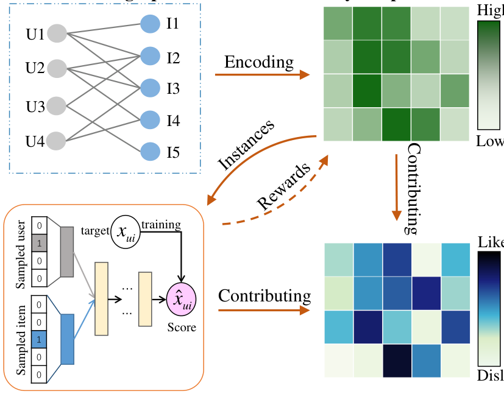
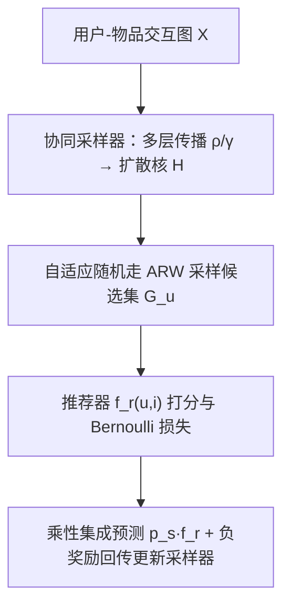

# CoSam: An Efficient Collaborative Adaptive Sampler for Recommendation (面向推荐的高效协同自适应采样器)

- **会议/期刊**: ACM TOIS (Transactions on Information Systems)
- **作者与机构**: Jiawei Chen, Chengquan Jiang, Can Wang, Sheng Zhou, Yan Feng, Chun Chen (浙江大学)；Martin Ester (SFU)；Xiangnan He (中国科学技术大学)
- **推荐链路定位**: 召回/训练阶段负采样（模型无关，可插拔到 MF/NCF）
- **研究方向**: 协同过滤与双塔召回 / 去偏与工业架构
- **论文原文**: [论文原文链接](https://arxiv.org/abs/2011.07739v1)
- **开源代码**: 暂未开源

## TL;DR (1分钟核心速览)

隐式反馈推荐的负采样长期二难：均匀采样方差大收敛慢，启发式（按热度/排名）依赖领域知识且抓不准"难样本"，基于对抗的采样器虽自适应却需 $O(n\times m)$全库遍历、且不均匀分布本身把目标函数带偏（难负样本被过度压制、疑似正样本被打低分）。CoSam 用**交互图上的扩散核**显式定义归一化采样分布，并以自适应随机走把采样复杂度从$O(m)$降到$O(l_r)$；同时用**乘性采样器-推荐器集成框架**在预测端矫正偏置。四数据集上 Pre@5 最高相对提升 61.7%，Epinions 训练 420s vs. 对抗采样 8760s（约 20×)。

## Background & Motivation (背景与核心矛盾)

- **主流范式**: 隐式反馈下未观测样本视为负例，靠 SGD + 负采样（均匀 / 按流行度 / 按排名）降低单轮训练开销。
- **前人局限**: ① 启发式采样需人工先验，采样规则固定、无法跟踪训练中"难度"的漂移；② 对抗式模型采样器每轮需遍历全库更新动态分布，$O(n\times m)$在大物品集上不可用；③ 更致命的是目标偏置——采样后期望目标变为$\sum_u[\sum_{i\in X_u}\log f_r + \sum_{i\notin X_u}N_u^r\mathbb{E}[p_r(i|u)]\log(1-f_r)]$，负例被采样概率加权，难但"像正例"的物品被过训练压成低分。
- **核心洞察 (Key Insight)**: 采样难度可由交互图上的**信息路径**度量——$U_1$-$I_2$-$U_2$表明两用户行为相似、样本难度应相近；$U_1$-$I_2$-$U_2$-$I_4$表明无直接交互的$U_1$-$I_4$ 仍高亲和、是高信息量负例。
- **本文切入点**: 把采样分布写成图扩散核诱导的"元分布混合"，让采样与预测共享同一份协同信号，且用集成（而非对抗）方式消偏。

<figure class="paper-figure" markdown="span">
  <figcaption>图1. CoSam 示意图：利用交互图进行采样，并将采样分布（模型）融入预测。用户-物品交互图由用户-物品交互信息构建，其中对具有正反馈的用户-物品对建立连接。</figcaption>
</figure>

## Method (核心方法设计)

### 1. 整体框架 (Overall Architecture)

CoSam 由两个耦合部件组成：**(a) 协同采样器模型**——在用户-物品二部图上做多层传播，用户的采样分布向量 $\rho_u$与物品标签向量$\gamma_i$（one-hot 指示）交替聚合邻居信息，收敛后得到闭式的图扩散核，从而把"路径越短越强、路径越多越强"的协同邻近度直接写进采样概率；**(b) 集成的采样器-推荐器框架**——模拟消费者"先圈候选集、再精选"的两段决策，采样器过滤易样本、推荐器在候选集内区分真正难样本，最终预测由两者概率相乘给出，从而在数学上抵消不均匀采样带来的偏置。训练上对推荐器用 Bernoulli 似然、对采样器用策略梯度，且梯度只需在随机走采样到的少量路径上估计，无需遍历全库。

### 2. 关键设计拆解 (Key Designs)

1. **图扩散核采样分布（Normalized + Interaction-aware）**：痛点是不均匀采样必须仍是合法分布且能表达协同邻近。传播算子为
$\rho_u^{(t)}=c_1\sum_{i\in N_u}w_{ui}^{(1)}\gamma_i^{(t-1)}+(1-c_1)\rho_u^{(0)}$，$\gamma_i^{(t)}=c_2\sum_{u\in N_i}w_{iu}^{(2)}\rho_u^{(t-1)}+(1-c_2)\gamma_i^{(0)}$，
收敛闭式 $[P;Y]=(I-CW)^{-1}(I-C)[P^{(0)};Y^{(0)}]$，即$H=(I-CW)^{-1}(I-C)$ 是图扩散核，故
$\rho_u=\sum_{k\in U}H_{u,k}U+\sum_{k\in I}H_{u,n+k}z_k$，且$H_{ij}=\sum_{P\in A_{ij}}F(P)$。直觉：分布是"均匀元分布 + 物品指示元分布"的混合，混合系数由路径条数与自适应路径强度决定，天然归一（$(I-CW)^{-1}(I-C)e=e$，行和为 1）。
2. **自适应随机走采样 (ARW)**：分布随训练演化，若每轮重算则前功尽弃。ARW 在用户节点以 $1-c_1$终止并均匀抽一个物品，否则按当前学到的边权$W_{v*}$跳到邻居（物品节点同理用$c_2$）；可证路径被走出的概率恰等于路径强度$F(P)$，因此采样严格服从$\rho_u$而复杂度仅$O(l_r)$，期望长度$\mathbb{E}[l_r]=2/(1-\min(c_1,c_2))$，实践中控制在 10 步内。
3. **乘性集成框架与策略梯度训练**：预测改为 $p(i\in X_u)=p(i\in G_u)p(i\in X_u|i\in G_u)\propto p_s(i|u;\theta)f_r(u,i;\varphi)$——难样本被采样概率放大、易样本被抑制，恰好解释并抵消了对抗框架的过压制。对$p(X)$用 Jensen 得下界后，推荐器目标为$\mathcal{L}_\varphi=\sum_{i\in X_u}\log f_r(u,i;\varphi)+\sum_{\alpha\in G_u}(1-x_{u\alpha})\log(1-f_r(u,\alpha;\varphi))$，与对抗框架一致（模型无关）；采样器则用负奖励$e_{u\alpha}=(1-x_{u\alpha})\log(1-f_r(u,\alpha;\varphi))$的策略梯度$\nabla_\theta\mathcal{L}\approx\sum_u\big(\sum_{i\in X_u}\nabla_\theta\log p_s(i|u;\theta)+\sum_{\alpha\in G_u}\nabla_\theta\log p_s(\alpha|u)e_{u\alpha}\big)$，并用式 (17) 把$\nabla_\theta p_s$拆解为路径概率梯度，仅用 batch 内采到的路径$\mathcal{S}_u$近似，彻底避免全库遍历。总训练开销三部分均为$O(n\bar{N}_u l_r)$量级，$\bar{N}_u=5|X_u|$。

## Experimental Setup & Evaluation Protocol (实验设置与评估协议)

- **数据集与预处理**: 统一"二值化"为隐式反馈，过滤掉交互数少于 3 的物品。

| 数据集 | #Users | #Items | #Interactions | 稀疏度/密度 | 特征/场景说明 |
| :--- | :---: | :---: | :---: | :---: | :--- |
| LastFM | 1,892 | 4,476 | 52,627 | 0.62% | 音乐社交标签数据 |
| Movielens-1M | 6,040 | 3,678 | 1,000,177 | 4.50% | 电影评分（稠密） |
| Ciao | 5,298 | 19,264 | 138,723 | 0.14% | 商品评论+社交 |
| Epinions | 21,290 | 33,992 | 333,658 | 0.05% | 大规模极稀疏点评 |

- **数据划分与防穿越 (Splitting Strategy)**: 采用**5 折交叉验证**+网格搜索调参；原文未显式声明 Leave-One-Out 或全局时间戳切分，亦未做冷启动切分（属评估披露不足之处）。
- **排名评测协议 (Ranking Protocol)**: 报告 Pre@5 / Rec@5 / NDCG，由模型估计分数排序取 top-K 计算；原文**未明确是全库 Full-Ranking 还是采样候选集排序**，也未披露每正例的负采样条数，跨论文对比时需谨慎。
- **对比基线与超参设置**: 采样器基线 Uniform、Pop（按流行度 $\propto\xi_i^\alpha$）、Adp（自适应过采样）、Adv（对抗式 MF 采样器，SOTA）；推荐模型基线 MF、BPR、NCF、IRGAN、NGCF。超参$N_u=5|X_u|$，$c_1,c_2\in\{0.4,0.6,0.8,1\}$，Adam，学习率$\{0.001,0.01,0.1\}$；成对差异检验$p<0.05$。

## Key Experimental Results (实验关键数据)

### 1. 主实验对比 (Main Results)

| 采样器 | LastFM Pre@5 | Rec@5 | Ciao Pre@5 | Rec@5 | Epinions Pre@5 | Rec@5 | Epinions 时间(s) |
| :--- | :---: | :---: | :---: | :---: | :---: | :---: | :---: |
| Uniform | 0.0954 | 0.0859 | 0.0140 | 0.0122 | 0.0085 | 0.0095 | 156 |
| Pop | 0.0978 | 0.0881 | 0.0146 | 0.0119 | 0.0092 | 0.0098 | 264 |
| Adp | 0.0986 | 0.0881 | 0.0146 | 0.0122 | 0.0088 | 0.0095 | 348 |
| Adv | 0.1002 | 0.0897 | 0.0153 | 0.0139 | 0.0094 | 0.0103 | 8760 |
| **CoSam** | **0.1302** | **0.1162** | **0.0185** | **0.0149** | **0.0153** | **0.0168** | **420** |
| Improv.% | +23.00% | +29.53% | +20.93% | +7.48% | +61.72% | +62.72% | 20× 加速 |

Movielens-1M 上 CoSam 亦为最优（Pre@5 0.3772 / Rec@5 0.0837 / NDCG 0.5726，相对最佳基线 +2.17%/+3.15%/+0.59%），但增益明显小于稀疏数据集。

### 2. 消融实验 (Ablation Study)

| 变体 (采样器-框架) | LastFM Pre@5 | Rec@5 | Ciao Pre@5 | Epinions Pre@5 | Epinions 时间(s) |
| :--- | :---: | :---: | :---: | :---: | :---: |
| Sam-MF-Adv (即 Adv) | 0.1002 | 0.0897 | 0.0153 | 0.0094 | 8760 |
| Sam-MF-Int | 0.1073 | 0.0957 | 0.0160 | 0.0125 | 9984 |
| Sam-Co-Adv | 0.0994 | 0.0892 | 0.0154 | 0.0091 | 322 |
| **Sam-Co-Int (CoSam)** | **0.1302** | **0.1162** | **0.0185** | **0.0153** | **420** |

### 3. 关键实验发现 (Key Findings)

1. **两条创新强耦合、单用其一近乎无效**：把协同采样器塞进对抗框架（Sam-Co-Adv）反而略劣于 MF 采样器（LastFM 0.0994 vs. 0.1002，Epinions 0.0091 vs. 0.0094）——说明采样器越"有信息量"其分布越偏，必须由集成框架矫正才转化为收益；而换成集成框架后增益从 0.1002 跳到 0.1302。
2. **稀疏度越大收益越大**：Epinions（密度 0.05%）提升 61.7%，Movielens（4.50%）仅 2.17%，说明协同路径信息在交互稀缺时最稀缺、也最有价值。
3. **效率是同等重要的胜利**：Epinions 上对抗采样 8760s vs. CoSam 420s（约 20×），且 CoSam 的梯度方差与采样训练损失接近 Adv（图 7），即在不牺牲稳定性与信息量的前提下取得量级加速；进一步预测端消融显示，训练时集成但预测只用 S 或只用 R 都会掉点（Sam-MF-Int > Sam-MF-Int-S / -R），仅当 S 与 R 在预测时"相乘互补"才最优。

## Highlights & Limitations (亮点、对比与审稿批判)

- **与代表作对比 (vs. Prior Work)**: 相比 IRGAN/Adv 的**对抗**博弈，CoSam 改为**协作**生成过程，采样概率进入预测而非仅参与训练；相比 SamWalker，随机走从社交图搬到交互图、转移概率由推荐器奖励而非曝光数据学习；相比 Pop/Adp 等启发式，采样分布是参数化且随训练自演化的。
- **可迁移亮点**: ①"乘性集成 $\propto p_s\cdot f_r$"是一个极轻量的采样偏置矫正插件，可直接套到任意 BPR/Softmax 采样训练上；②把扩散核的路径强度与随机走路径概率对齐（$F(P)=p_{ARW}(P)$）从而实现$O(l_r)$ 精确采样，这一"分布可走通"的构造思路可迁移到图/序列负采样。
- **审稿级局限批判**: ①评估协议披露不足——未说明全库排序还是采样排序、未做时间切分与冷启动划分，"61.7% 提升"缺乏可比口径；②$c_1,c_2$与$N_u=5|X_u|$ 为固定超参，图传播与随机走在稠密图上仍随度数增长，且图需随新交互更新，冷启动物品在图上孤立时退化为均匀采样；③实验仅在 MF/NCF 上验证，未在原论文声称的 LightGCN 等图模型上给出协同信号叠加的边界。

## Rating (四维评分)

- **方法创新性 (Novelty)**: ⭐⭐⭐⭐ （用图扩散核闭式定义归一化采样分布、并让随机走精确复现该分布，思路优雅且有归一性/路径强度等理论支撑）
- **评估协议与实验扎实度 (Protocol & Experiments)**: ⭐⭐⭐ （四数据集+5 折交叉+显著性检验+消融齐全，但未披露全库/采样排序口径、无时间切分与冷启动设定）
- **写作与数学规范度 (Clarity & Rigor)**: ⭐⭐⭐⭐ （传播闭式解、Jensen 下界与策略梯度的路径分解推导完整，符号统一；部分公式排版有噪声）
- **工业落地与复现价值 (Industrial & Practical Value)**: ⭐⭐⭐⭐ （模型无关、可插拔，20× 采样加速对大规模稀疏场景直接可用；但图维护成本与未开源的复现门槛打了折扣）

