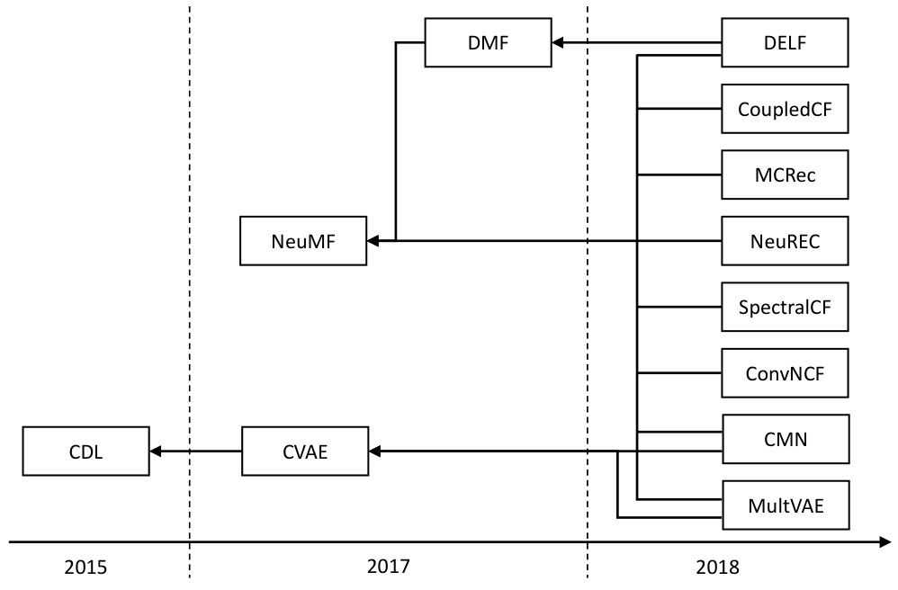
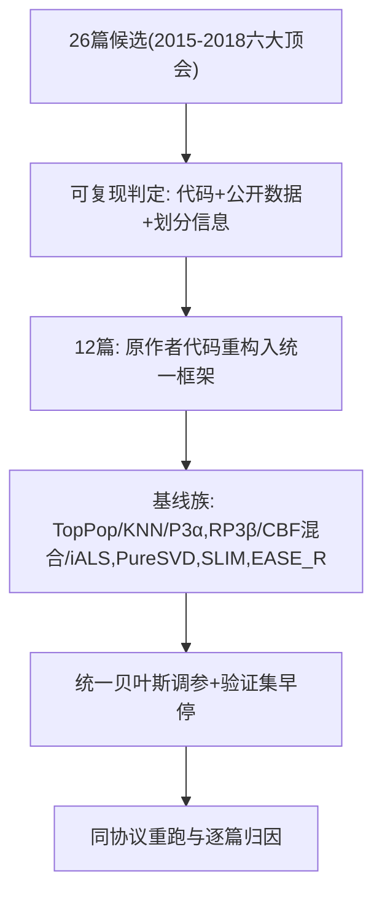
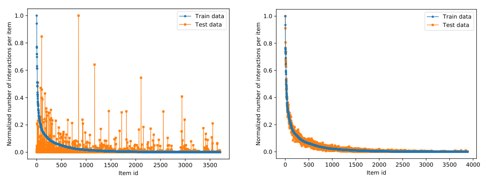

# A Troubling Analysis of Reproducibility and Progress in Recommender Systems Research (对推荐系统研究中可复现性与"虚假进展"的警示性分析)

- **会议/期刊**: ACM Transactions on Information Systems (TOIS) 39(2), Article 20, 2021（会议版前身：RecSys 2019）
- **作者与机构**: Maurizio Ferrari Dacrema, Simone Boglio, Paolo Cremonesi（米兰理工）；Dietmar Jannach（克拉根福大学）
- **推荐链路定位**: 召回（Top-N 排序）阶段的**离线评测协议与基线可信度审计**
- **研究方向**: 去偏/可信与工业架构（主） / 协同过滤与双塔召回（次）
- **论文原文**: [arXiv:1911.07698v3](https://arxiv.org/abs/1911.07698v3)
- **开源代码**: [RecSys2019_DeepLearning_Evaluation](https://github.com/MaurizioFD/RecSys2019_DeepLearning_Evaluation)（含全部基线、超参搜索与结果）

## TL;DR (1分钟核心速览)

本文质疑 2015–2018 年顶会"神经 CF 持续 SOTA"的共识：扫描 KDD/IJCAI/WWW/SIGIR/RecSys/WSDM 得到 26 篇相关论文，仅 12 篇（46%）可复现；在**沿用原作者数据集、划分与指标**的前提下，用统一贝叶斯调优的 KNN、图随机游走（P3α/RP3β）、iALS/PureSVD、SLIM、EASE^R 等基线重跑，结果 **11/12 的神经方法可被概念上极简的方法超越**；若只看非神经机器学习基线，仅 Mult-VAE 在 1 个数据集上明显更好。这是"评测方法学"层面的去偏工作。

## Background & Motivation (背景与核心矛盾)

- **主流范式**: 以 NCF/NeuMF 为祖点的深层网络在 Top-N 隐式反馈排序上成为标配，论文普遍宣称显著优于 SOTA。
- **前人局限**: ① 基线选择任意且常"继承弱基线"——NCF 本身就未必强于 KNN，却被后继论文当作强 SOTA 反复引用；② 基线几乎不做数据集级调参，而新方法却精调，形成确认偏误下的"幽灵进展 (phantom progress)"。
- **核心洞察 (Key Insight)**: 排序任务的评测自由度极大（数据集、划分、负采样比、截断长度、度量可任意组合），作者在部分原作者的代码中发现 **epoch 数在测试集上选取、跨 epoch 取各指标最大值、非随机划分、非标准 NDCG 实现**等直接泄漏或度量失真。
- **本文切入点**: 不做新模型，而构建一个"可插拔复现框架"，把原作者代码 + 统一调优的多族基线放在**完全相同**的协议下重跑。

<figure class="paper-figure" markdown="span">
  <figcaption>图1. 神经方法概览，箭头表示较新的方法在实验中将另一种方法用作基线。</figcaption>
</figure>

## Method (核心方法设计)

### 1. 整体框架 (Overall Architecture)

流程为：文献筛选 → 代码/数据可得性判定 → 原作者代码重构成统一接口（核心算法实现不改）→ 对每一篇论文沿用其原始数据集、划分、负采样与度量 → 对全部基线做同等强度的贝叶斯超参搜索 + 验证集早停 → 逐论文对比"原论文数值 vs 本文调优后基线"。总计算量为 900+ 个训练完成的模型、41,000 次拟合、约 253 天 p3.2xlarge（V100）机时。

### 2. 关键设计拆解 (Key Designs)

1. **基线族的"可调优"线性/邻域模型（本文真正的强力对手）**：为反驳"神经一定更强"，作者给线性模型同等调参预算。SLIM 逐列解稀疏回归 $\min_{\boldsymbol{W}}\tfrac{1}{2}\|\boldsymbol{X}-\boldsymbol{X}\boldsymbol{W}\|_F^2+\lambda_1\|\boldsymbol{W}\|_1+\lambda_2\|\boldsymbol{W}\|_F^2,\ \mathrm{diag}(\boldsymbol{W})=0$；EASE^R 则有闭式解$\boldsymbol{B}=\boldsymbol{I}-(\boldsymbol{X}^{\top}\boldsymbol{X}+\lambda\boldsymbol{I})^{-1}\mathrm{diagMat}(\boldsymbol{X}^{\top}\boldsymbol{X})$ 并置对角为零。直觉：隐式反馈排序本质是一个**物品-物品低秩相似度估计**问题，浅层闭式解已能吃掉大部分信号。
2. **图随机游走基线 P3α / RP3β**：P3α 在 user-item 二部图上两步游走，等价于以概率向量点积为相似度的 ItemKNN；RP3β 进一步做流行度惩罚 $s_{ij}^{\mathrm{RP3\beta}}=s_{ij}^{\mathrm{P3\alpha}}/\mathrm{pop}_j^{\beta}$。二者以极低代价克服"直连邻域"限制，却在社区中被长期忽视——这正是"弱基线传播"的结构性证据。
3. **训练目标、早停与调参规范**：所有学习型基线以验证集 NDCG 早停（每 5 个 epoch 验证一次，连续 5 次不提升即停），贝叶斯搜索（Scikit-Optimize）50 例、前 15 例随机初始化；神经方法基本沿用原文最优超参（因数据集与协议一致），仅 SpectralCF 因划分缺陷重调。**推理/训练开销对照**是本文的隐性"损失函数"：NeuMF 训练 ML-1M 需 4 小时，SLIM 4 分钟，EASE^R 约 12 秒；DMF 需近 5 天，而全面胜出的 iALS 仅 4 分钟。

## Experimental Setup & Evaluation Protocol (实验设置与评估协议)

- **数据集与预处理**: 本文**不引入新数据集**，而是复现各论文原始数据；作者在报告中列出 12 篇复现论文共使用 **18 个不同数据集**（CiteULike-a/t、MovieLens 100K/1M/20M/Hetrec、Amazon Movie/Music、Epinions、FilmTrust、Frappe、Gowalla、LastFM、MSD、Netflix、Pinterest、Tafeng、Yelp），交集极小：

| 协议维度 | 12 篇可复现论文中的实际分布 | 后果 |
| :--- | :--- | :--- |
| 数据划分 | `Leave-One-Out`、`Leave-Last-Out`、`80/20` 单次划分、按用户保留 1 或 10 条交互 | 结果不可跨论文比较 |
| 候选打分 | 以 `Sampled Ranking` 为主，每正样本采 50 / 100 / 1000 个负样本 | 负样本比直接改变相对排序 |
| 截断长度 | @1 至 @300（CDL 只报 ≥50、最高 300） | 短列表结论缺失 |
| 度量 | HR、Precision、Recall、MAP、NDCG（部分实现非标准） | 度量本身失真 |
| 显著性 | 普遍单次划分、无置信区间与显著性检验 | 不可区分噪声与增益 |

- **数据划分与防穿越 (Splitting Strategy)**: 本文严格采用原作者划分以保证可比，但**对可疑划分另建随机划分做二次验证**（SpectralCF、DELF）；统一以验证集早停替代原文"测试集选 epoch"，阻断穿越。
- **排名评测协议 (Ranking Protocol)**: 沿用原文（多为 `Sampled Ranking`），并在讨论中明确指出这与无偏 `Full-Ranking` 的结论差异风险。
- **对比基线与超参设置**: 5 大族共 13 个基线（TopPopular；UserKNN/ItemKNN；P3α/RP3β；CBF 及 CFCBF 混合；iALS/PureSVD/SLIM/EASE^R）；KNN 族联合调邻域大小、5 种相似度、shrinkage、TF-IDF/BM25 权重与归一化开关。无统一嵌入维度（并批评 ConvNCF 将所有基线 embedding 硬设为 64）。

## Key Experimental Results (实验关键数据)

### 1. 主实验对比 (Main Results)

下表为 12 篇复现论文在**各自原始协议**下的裁决结果（"被超越"= 某个概念简单的基线在该论文全部或绝大多数数据集/指标上更好）：

| 被复现方法 (会议) | #数据集 | 与调优基线对比的结论 | 发现的复现/方法学缺陷 |
| :--- | :---: | :--- | :--- |
| CDL (KDD'15) | 4 | **3/4 被简单混合基线超越**；稠密集上短列表亦被纯 CF 击败 | 仅报 ≥50 截断、最高 300 |
| CVAE (KDD'17) | 4 | **3/4 被超越**（但确认优于 CDL） | 同上，仅极稀疏集占优 |
| NCF/NeuMF (WWW'17) | 2 | 1 个数据集**全指标被 KNN 超越**，另 1 个不如 iALS/SLIM | epoch 在**测试集**上选取 |
| DMF (IJCAI'17) | 4 | **3/4 被长期已知基线超越** | 报告测试集跨 epoch 最大值 |
| Mult-VAE (WWW'18) | 3 | 2 个数据集数值可复现且大幅超越邻域基线；**唯一在 1 个数据集上胜过全部非神经基线** | 另一数据集 SLIM（同目标 NDCG）更好 |
| NeuRec (IJCAI'18) | 4 | **3/4 被多数基线超越**，原文数值本身无法复现 | 各指标取自不同 epoch |
| CoupledCF (IJCAI'18) | 2 | 1 个被非深度 ML 一致超越，另 1 个 KNN 更好 | 划分与论文描述不符；基线用默认超参 |
| DELF (IJCAI'18) | 2 | MovieLens 全败；Amazon Music 大胜系**冷启动物品被推前**所致 | 时间切分下 >50% 测试物品未在训练出现 |
| ConvNCF (IJCAI'18) | 2 | 1 个数据集 KNN **全胜**，另 1 个除单指标外全胜 | 所有基线 embedding 固定 64 |
| MCRec (KDD'18) | 1 | MovieLens 上 **ItemKNN 全指标更优** | meta-path 硬编码；NDCG 非常规实现 |
| CMN (SIGIR'18) | 3 | 2 个被简单基线超越；Epinions 上胜出但 **TopPopular 最强** | 优势源自流行度偏差 |
| SpectralCF (RecSys'18) | 3 | 仅在**作者提供的划分**上有竞争力；自建随机划分后持续垫底 | 提供划分的流行度分布严重偏移 |

<figure class="paper-figure" markdown="span">
  <figcaption>图2. SpectralCF 的训练集和测试集划分的归一化流行度分布，值 1 对应该划分中最受欢迎的物品。对于随机划分，如图2b所示，两个划分的归一化值平均而言相似。然而，在原作者提供的划分中，如图2a所示，训练数据和测试数据的分布差异相当大。</figcaption>
</figure>

### 2. 消融/效率对照实验 (Ablation & Cost)

| 模型 | 数据集 | 训练耗时 | 同数据集最优浅层基线的耗时与精度关系 |
| :--- | :--- | :--- | :--- |
| NeuMF | MovieLens-1M | ≈4 h | SLIM 4 min / EASE^R 12 s，精度更高 |
| NeuMF | Pinterest (1.5M) | >2 天 | SLIM 12 min / EASE^R 2 min |
| DMF | MovieLens-1M | ≈5 天 | iALS 4 min，**全指标胜 DMF** |
| CDL | CiteULike-a (55k) | ≈2 h | EASE^R 2 min；ItemKNN-CFCBF 邻域预计算 <10 s |
| Mult-VAE | MovieLens-20M | ≈21 min | SLIM ≈2 h（唯一"深度模型更省时"的案例） |

### 3. 关键实验发现 (Key Findings)

1. **"深度"并未换来精度，却换来 2–4 个数量级的训练成本**：DMF 用 5 天训练仍被 4 分钟的 iALS 全指标击败，NeuMF 在 ML-1M 上被 12 秒的 EASE^R 超越——说明收益瓶颈不在模型容量，而在隐式反馈的相似度估计质量。
2. **部分"SOTA"优势可被单一协议假象解释**：DELF 在 Amazon Music 上的胜出，源于时间切分导致 >50% 测试物品在训练中从未出现，而模型倾向于把无法学习的冷启动物品推至列表顶端；剔除冷启动物品后其表现回落到基线之下（对应图 2 所示的划分分布偏移逻辑）。SpectralCF 更极端：原作者划分的训练/测试流行度分布差异显著（图 2a），随机重划后（图 2b）该图卷积模型跌至非个性化基线之下。
3. **简单方法在"分组归因"上更稳健**：13 个基线中没有任何一族在所有配置下占优；非个性化 TopPopular 在 Epinions 上即击败所有个性化方法，提示部分数据集本身被流行度结构主导——这与"神经架构改进"无关，而与数据分布偏置有关。

## Highlights & Limitations (亮点、对比与审稿批判)

- **与代表作对比 (vs. Prior Work)**: 相较 Dacrema 等的 RecSys'19 短文，本文扩展到 12 篇 + 13 个基线 + 完整超参搜索与效率剖析；相较 Rendle 等（2019，评分预测）聚焦 MF 与 BPR 的调优问题、相较 Ludewig 等（会话推荐）的简单基线路线，本文是**首个覆盖六大顶会、逐篇代码级审计 Top-N 神经 CF** 的系统性研究。
- **可迁移亮点**: ① "多族基线 + 同强度贝叶斯调参 + 验证集早停"应作为投稿硬性 check-list；② 划分的**训练/测试流行度分布对照图**是一个 5 行代码即可完成的廉价体检，可提前发现划分泄漏与冷启动污染；③ EASE^R 式闭式浅层模型是任何新召回模型的必测下界。
- **审稿级局限批判**: ① **结论计数自相矛盾**：摘要称 11/12 被"概念简单方法"超越，引言则称 8/12 被邻域方法超越、仅 1/12 能被非神经 ML 基线在全数据集上稳定胜过——两种口径的差异未被澄清，削弱了核心论断的精确性。② 复现筛选把"作者未响应代码请求"直接判为不可复现（14 篇中 10 篇无回复），可能系统性高估不可复现率；且 12 篇样本量下未做统计检验，"11/12"这类计数缺乏置信区间。③ 全文未给出统一 `Full-Ranking` 复测，最关键的"采样排序 vs 全库排序下结论是否翻转"仍未回答。

## Rating (四维评分)

- **方法创新性 (Novelty)**: ⭐⭐⭐⭐ （无新模型，但以"可插拔复现框架 + 多族同强度调优"确立了评测方法学范式，影响远超单个算法论文）
- **评估协议与实验扎实度 (Protocol & Experiments)**: ⭐⭐⭐⭐⭐ （12 篇逐篇沿用原协议复现、41,000 次拟合、900+ 模型、253 天机时，审计粒度直达源码级缺陷）
- **写作与数学规范度 (Clarity & Rigor)**: ⭐⭐⭐⭐ （基线公式与超参空间交代清楚，但摘要/引言的结果计数口径不一致，部分表格仅定性描述）
- **工业落地与复现价值 (Industrial & Practical Value)**: ⭐⭐⭐⭐⭐ （开源仓库已成推荐评测事实标准之一，EASE^R/SLIM 等结论可直接指导线上召回选型与算力预算）

