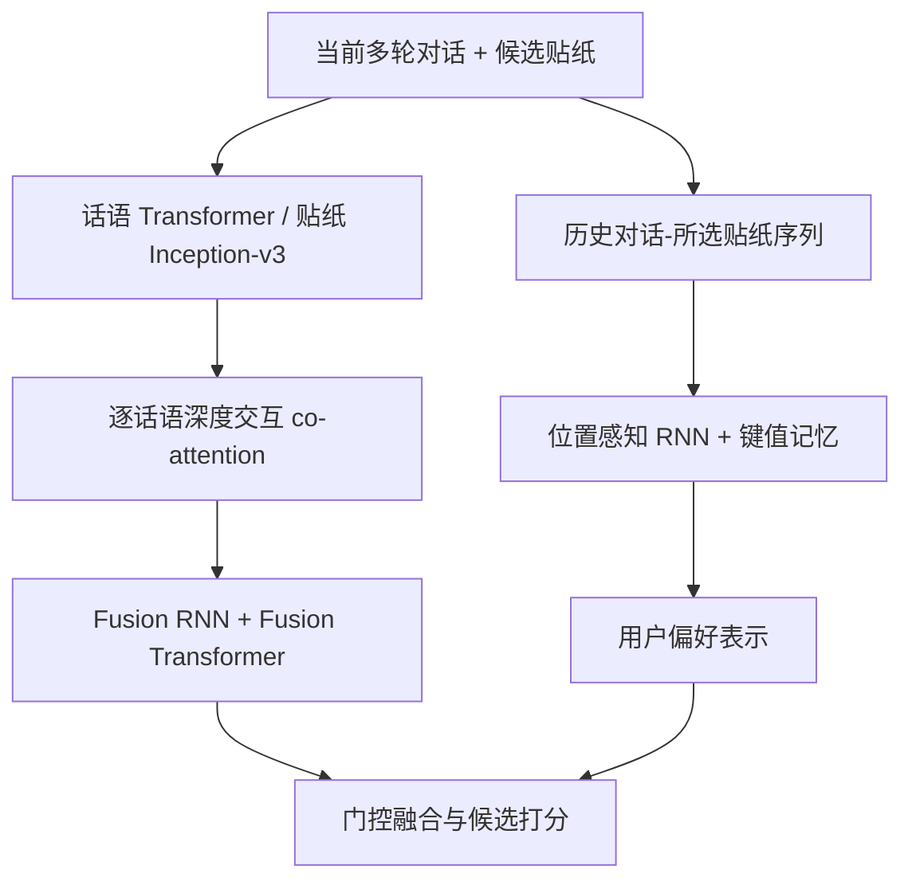
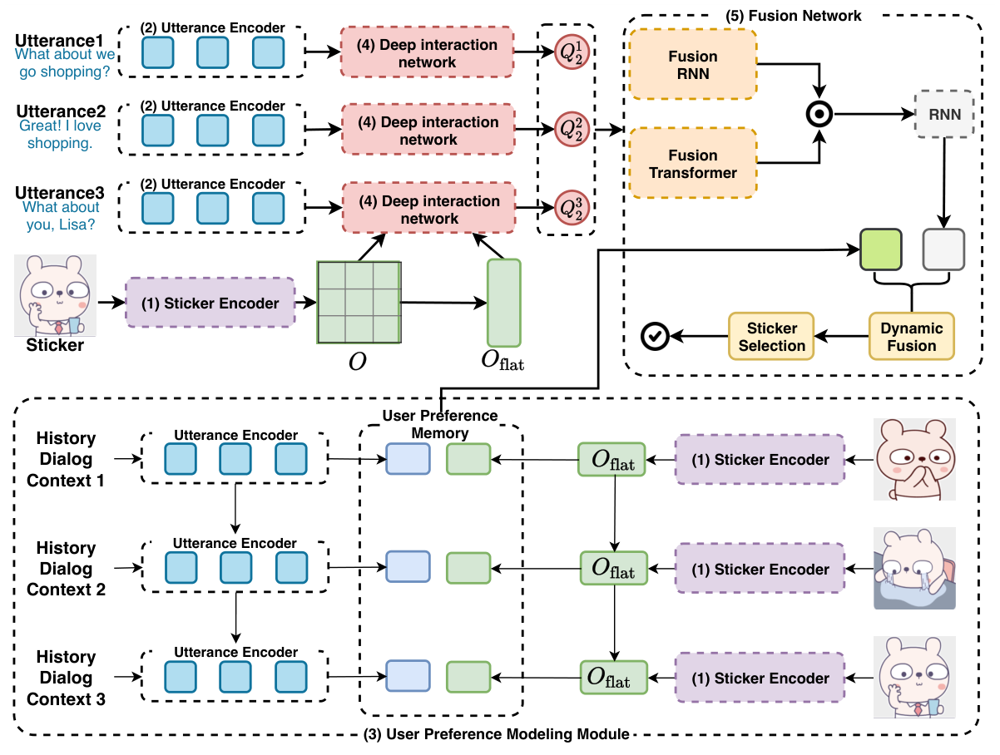
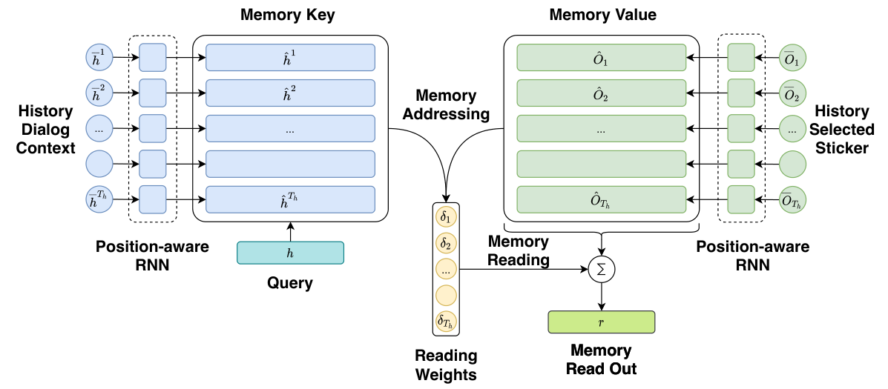

# Learning to Respond with Your Favorite Stickers: A Framework of Unifying Multi-Modality and User Preference in Multi-Turn Dialog (用你最喜欢的表情包回复：多轮对话中融合多模态与用户偏好的推荐框架)

- **会议/期刊**: TOIS 2021（arXiv 2020）
- **作者与机构**: Shen Gao, Xiuying Chen, Li Liu, Dongyan Zhao, Rui Yan；北京大学、Inception Institute of AI、中国人民大学
- **推荐链路定位**: 重排（候选表情包选择）
- **研究方向**: 多模态推荐 / 对话推荐
- **论文原文**: [论文原文链接](https://arxiv.org/abs/2011.03322v1)
- **开源代码**: [开源代码仓库链接](https://github.com/gsh199449/stickerchat)

## TL;DR (1分钟核心速览)

本文指出仅靠“对话上下文-表情包图像”匹配会忽略用户选包偏好，提出 PESRS：用位置感知 RNN 编码用户最近选包历史，以对话上下文为 key、所选表情包为 value 构建键值记忆，再与多粒度图文交互结果门控融合。在 Telegram 32 万级数据、1 正 9 负的 10 候选采样排序协议下，MAP 0.743、R10@1 0.632，较前作 SRS 分别提升 4.8% 与 7.1%。

## Background & Motivation (背景与核心矛盾)

- **主流范式**: 表情包/emoji 推荐多将多轮对话文本与候选图像做跨模态匹配；前作 SRS 已用 Transformer 编码话语、CNN 编码贴纸，并做逐话语深度匹配。
- **前人局限**: ①只度量上下文与图像的匹配度，忽略“同一用户反复使用偏好”，相同语义下用户可能固定选某几张包；②多模态匹配结果与用户历史偏好如何动态融合尚未解决。
- **核心洞察 (Key Insight)**: 统计发现 54.09% 的当前贴纸出现在用户最近 10 张已用贴纸中，且语义相似的历史对话常对应同一贴纸，说明用户偏好具有强短期复用性。
- **本文切入点**: 不把用户历史压成静态向量，而是用“历史对话上下文→历史所选贴纸”的键值记忆，按当前上下文查询动态偏好，再与图文匹配结果融合。

## Method (核心方法设计)

### 1. 整体框架 (Overall Architecture)

PESRS 由五部分组成：Inception-v3 贴纸编码器同时输出二维 patch 表示与全局向量；Transformer 编码当前各条话语；深度交互网络对贴纸 patch 与每条话语做双向 co-attention；用户偏好模块用位置感知 RNN 编码最近历史对话与所选贴纸，并存入键值记忆；融合网络用 Fusion RNN 捕捉短期依赖、Fusion Transformer 捕捉长期显著话语，最后经门控融合输出候选贴纸得分。训练额外加入 emoji 标签辅助分类以加速收敛，推理时对每个候选贴纸重复交互并读取用户记忆。

<figure class="paper-figure" markdown="span">
  <figcaption>图5. PESRS 概览。我们将模型分为五个部分：（1）贴纸编码器通过卷积神经网络学习贴纸表示；（2）话语编码器通过基于自注意力的 Transformer 学习每个话语的表示；（3）用户偏好建模模块获得位置感知的历史表示，并将其存入键值记忆网络；（4）深度交互网络在不同粒度层级上进行贴纸表示与话语表示之间的深度匹配交互；（5）融合网络结合长期和短期。</figcaption>
</figure>

### 2. 关键设计拆解 (Key Designs)

1. **多粒度双向图文交互**：痛点是把整张贴纸压成单向量后，无法对齐“开心/哭”等情感词与贴纸局部表情。本文先构造关系矩阵 $M_{kj}=\sigma(O_k,h_j)$，其中$\sigma(x,y)=w^\top[x\oplus y\oplus(x\otimes y)]$；再双向 max-pooling 得词级注意力$\tau_{u_j}=\max(M_{:j})$与 patch 级注意力$\tau_{s_k}=\max(M_{k:})$，分别聚合成 sticker-aware utterance$l=\sum_j\tau_{u_j}h_j$与 utterance-aware sticker$r=\sum_k\tau_{s_k}O_k$。物理直觉是模型自动聚焦表情、手势等判别区域。
2. **位置感知键值记忆用户偏好**：历史上下文作 key、用户当时所选贴纸作 value，先以 RNN 按时间顺序编码并注入位置特征，得到 $\hat{h}_k$与$\hat{O}_k$；以当前上下文表示$h$查询：$\delta_k=\mathrm{softmax}(hW_\delta\hat{h}_k)$，读出$r=\sum_k\delta_k\hat{O}_k$。这样不是简单平均历史，而是“找语义相近的历史场景”，解释性强。
3. **门控融合与训练目标**：当前图文匹配向量 $\tilde{g}_{T_u}$与偏好向量$r$互补，门控$f_g=\sigma(\mathrm{FC}([r\oplus\tilde{g}_{T_u}]))$，最终$\hat{y}=\sigma(\mathrm{FC}(f_g\tilde{g}_{T_u}+(1-f_g)r))$。损失采用 hinge ranking：$\mathcal{L}=\sum\max(0,\hat{y}_{neg}-\hat{y}_{pos}+margin)$，并辅以 emoji 分类交叉熵$L_s$；每样本从贴纸库随机采 9 个负例，无额外 hard negative 挖掘。

<figure class="paper-figure" markdown="span">
  <figcaption>图7. 用户偏好建模模块框架，由位置感知 RNN 和键值记忆网络组成。我们将历史对话上下文作为键，将历史所选贴纸作为值。最后，我们将当前对话上下文的表示作为查询，以查询用户偏好记忆。</figcaption>
</figure>

## Experimental Setup & Evaluation Protocol (实验设置与评估协议)

- **数据集与预处理**: Telegram 20 个公开群组，过滤 URL/附件及用户信息并匿名化；每条样本取贴纸前 20 条话语，单话语最多 30 词，用户历史最多 10 条。

| 数据集 | #Users | #Items | #Interactions | 稀疏度/密度 | 特征/场景说明 |
| :--- | :---: | :---: | :---: | :---: | :--- |
| Telegram Sticker Dialog | 匿名未披露 | 174,695 stickers（3,516 套） | 340,168 对（320,168/10k/10k） | 每样本 10 候选；88.12% 有历史 | 20 个公开群组，平均 15.5 条话语，平均历史长度 6.82 |

- **数据划分与防穿越 (Splitting Strategy)**: 预先固定 train/valid/test，三份数据无重复对话上下文；非 Leave-One-Out，也非全局时间切分。
- **排名评测协议 (Ranking Protocol)**: **Sampled Ranking**，1 个 ground-truth + 9 个随机负例共 10 候选；报告 MAP、$R_{10}@1$、$R_{10}@2$、$R_{10}@5$。显著性用双尾配对 t 检验，$\alpha=0.01$ 标 ▲。
- **对比基线与超参设置**: 对比 VQA（Synergistic、PSAC）、多轮回复选择（SMN、DAM、MRFN）、用户建模（LSTUR）及前作 SRS；词向量与隐藏维 100，batch 32，Adam，学习率 $1\times10^{-4}$，Inception-v3 预训练初始化。

## Key Experimental Results (实验关键数据)

### 1. 主实验对比 (Main Results)

| 方法 | MAP | R10@1 | R10@2 | R10@5 |
| :--- | :---: | :---: | :---: | :---: |
| Synergistic | 0.593 | 0.438 | 0.569 | 0.798 |
| PSAC | 0.662 | 0.533 | 0.641 | 0.836 |
| SMN | 0.524 | 0.357 | 0.488 | 0.737 |
| DAM | 0.620 | 0.474 | 0.601 | 0.813 |
| MRFN | 0.684 | 0.557 | 0.672 | 0.853 |
| LSTUR | 0.689 | 0.558 | 0.680 | 0.874 |
| SRS | 0.709 | 0.590 | 0.703 | 0.872 |
| **PESRS** | **0.743** | **0.632 ▲** | **0.740 ▲** | **0.897** |
| Improv. vs SRS | +4.8% | +7.1% | +5.3% | +2.9% |

### 2. 消融实验 (Ablation Study)

| 变体 | MAP | R10@1 | R10@2 | R10@5 |
| :--- | :---: | :---: | :---: | :---: |
| w/o Classify | 0.714 | 0.598 | 0.707 | 0.866 |
| w/o DIN | 0.728 | 0.612 | 0.725 | 0.888 |
| w/o FR | 0.727 | 0.609 | 0.725 | 0.886 |
| FR2T（RNN→Transformer） | 0.725 | 0.610 | 0.719 | 0.881 |
| w/o UPM | 0.709 | 0.590 | 0.703 | 0.872 |
| w/o TAR（去位置感知 RNN） | 0.710 | 0.589 | 0.706 | 0.873 |
| **PESRS** | **0.743** | **0.632** | **0.740** | **0.897** |

### 3. 关键实验发现 (Key Findings)

1. **用户偏好记忆是最大增益源**：去掉 UPM 后 MAP 0.743→0.709、R10@1 0.632→0.590，几乎退回 SRS；仅用最常选贴纸 MostSelected 的 MAP 仅 0.545，平均池化 AverageMem 0.701、加权池化 WeightedMem 0.694，说明“按当前上下文查询历史”比静态偏好更有效。
2. **深度交互与融合 RNN 各自贡献稳定**：w/o DIN 使 R10@1 降至 0.612，w/o FR 降至 0.609；将 Fusion RNN 换成带位置编码的 Transformer（FR2T）也降至 0.610，表明逐话语短期顺序信息不可由自注意力完全替代。
3. **辅助分类与相似度鲁棒性**：去掉 emoji 辅助分类后 MAP 降至 0.714，且训练收敛由 21 小时延长至 35 小时；按候选贴纸 SSIM 相似度分五组，R10@1 均高于 0.42、最高 0.59，说明模型在高度相似候选下仍具区分力；话语数约 15 时性能达峰，历史长度仅 2 时明显变差。

## Highlights & Limitations (亮点、对比与审稿批判)

- **与代表作对比 (vs. Prior Work)**: 相比 SRS，本文唯一但关键的增量是把“用户最近选包”作为动态记忆引入，MAP/R10@1 提升 4.8%/7.1%；相比 MRFN，本文同时建模多轮文本与贴纸图像，MAP 相对提升约 8.6%；相比 LSTUR，本文不用静态用户 embedding，而以当前对话查询历史，避免海量用户冷启动问题。
- **可迁移亮点**: ①“上下文作 key、用户历史行为作 value”的键值记忆可直接迁移到表情/商品/短视频的短期偏好建模；②用领域辅助标签（emoji）做多任务分类，可缓解真实照片预训练 CNN 与贴纸域不匹配；③门控融合适合任意“内容匹配分 + 用户偏好分”的重排场景。
- **审稿级局限批判**: ①评测仅为 1 正 9 负的 10 候选采样排序，未做全库 Full-Ranking，MAP 绝对值可能偏乐观；②仅一个 Telegram 中文数据集、无线上 A/B，且 11.88% 样本无历史，冷启动用户收益未单独评估；③逐话语 co-attention 与 10 候选逐一打分带来推理开销，emoji 标签存在噪声（人工抽查 20 套中 2 套标签错误），分类准确率仅 65.74%。

## Rating (四维评分)

- **方法创新性 (Novelty)**: ⭐⭐⭐⭐ （键值记忆+位置感知 RNN+门控融合的组合自然，但核心增量是在 SRS 上做用户偏好扩展，理论新意有限）
- **评估协议与实验扎实度 (Protocol & Experiments)**: ⭐⭐⭐ （RQ1–RQ9 较完整、有显著性检验与相似度分桶，但仅单数据集、10 候选采样排序，缺全库排序与线上验证）
- **写作与数学规范度 (Clarity & Rigor)**: ⭐⭐⭐⭐ （模块公式、交互与记忆读写定义清晰，符号统一；复杂度与超参分析略简）
- **工业落地与复现价值 (Industrial & Practical Value)**: ⭐⭐⭐ （数据与代码开源、结构可落地，但逐话语交互与多候选打分成本较高，冷启动与延迟需工程优化）

