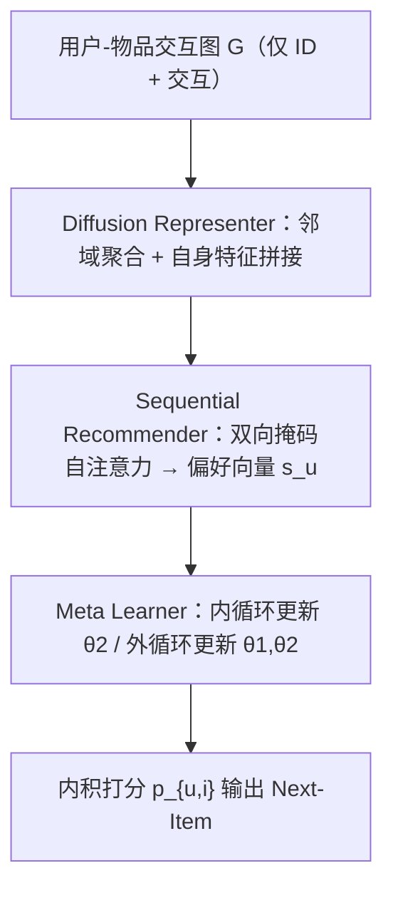
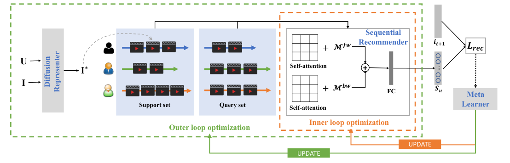
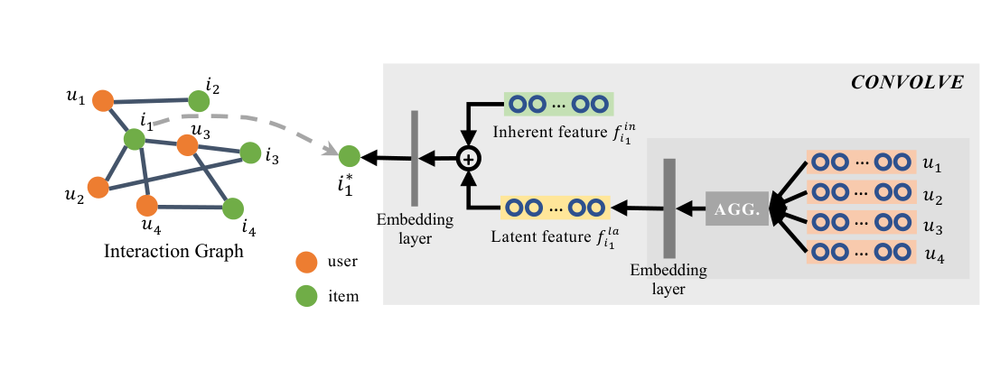

# Learning to Learn a Cold-start Sequential Recommender (学习如何学习一个冷启动序列推荐器)

- **会议/期刊**: ACM Transactions on Information Systems (TOIS)
- **作者与机构**: Xiaowen Huang, Jitao Sang, Jian Yu（北京交通大学）, Changsheng Xu（中科院自动化所 NLPR / 国科大 / 鹏城实验室）
- **推荐链路定位**: 召回（Next-Item 序列召回）
- **研究方向**: 冷启动与长尾推荐 / 序列与会话推荐
- **论文原文**: [https://arxiv.org/abs/2110.09083v1](https://arxiv.org/abs/2110.09083v1)
- **开源代码**: 暂未开源

## TL;DR (1分钟核心速览)

针对新用户行为极稀疏、且现实中常拿不到人口统计/物品属性等侧信息的痛点，本文提出 metaCSR：在用户-物品交互图上做信息扩散得到高阶表征，用双向掩码自注意力编码行为序列，再把 MAML 套在"用户=任务"的设定上学习可迁移初始化。三数据集在冷启动场景（末位行为留出、1:100 采样排序）上，AUC 最高相对提升 7.85%（MovieLens-1M），MAP 最高提升 29.62%（Amazon-Video），且全程不依赖任何辅助信息。

## Background & Motivation (背景与核心矛盾)

- **主流范式**: 冷启动一侧依赖侧信息（MF+属性、跨域迁移），另一侧依赖元学习（MeLU、MetaCS、MetaCF），但后者基本建模在静态偏好上，未刻画行为时序。
- **前人局限**: ① 侧信息在隐私与数据可得性约束下经常缺失，属性类方法直接失效；② 既有元学习冷启动方法把用户当作静态评分向量，丢失"先看第一集再看续集、先买电脑再买配件"这类序贯共性模式。
- **核心洞察 (Key Insight)**: 序贯模式在用户间高度共享，因而"新用户推荐"本质是 few-shot 任务——用常规用户的任务分布学一个初始化，使新用户仅凭数次梯度更新即可收敛到个性化偏好。
- **本文切入点**: 将图扩散表征、自注意力序列编码与 MAML 三者耦合进一个端到端框架，只用 user ID / item ID / 交互矩阵。

## Method (核心方法设计)

### 1. 整体框架 (Overall Architecture)

模型先在 regular users 构成的二部图上做邻域扩散，得到用户与物品的共享表征；随后把每个用户的行为序列送进双向掩码自注意力编码器，输出用户偏好向量 $s_u$并与候选物品内积打分。训练阶段将 15 个用户组织成一个元任务，内循环只用 support set 更新序列推荐器参数$\theta_2$以获得任务级个性化，外循环在 query set 上用 Adam 同时更新表征参数$\theta_1$与$\theta_2$；测试时对新用户的历史序列做 1 次（或数次）梯度更新即完成适配并输出 next-item 排序。

<figure class="paper-figure" markdown="span">
  <figcaption>图 1. 基于元学习的冷启动序列推荐框架（metaCSR）示意图。</figcaption>
</figure>

### 2. 关键设计拆解 (Key Designs)

1. **Diffusion Representer（无侧信息的高阶表征）**：单靠 ID embedding 无法缓解稀疏，作者在交互图上把实体表征拆成"固有特征 $f^{in}$+ 扩散潜特征$f^{la}$"两路：
$f_v=\mathrm{ReLU}\big(W_2[f_v^{in};\,\mathrm{ReLU}(W_1\mathrm{AGG}(f_{\hat v})+b_1)]+b_2\big)$，再做 L2 归一化。直觉是邻居聚合把长尾物品的稀疏信号补成结构信号，同时保留 ID 本身的区分度，避免过平滑。

2. **双向掩码自注意力序列编码器（刻画兴趣漂移）**：RNN 难并行、长依赖弱，本文用两个独立的前向/后向掩码矩阵 $M^{fw}_{m,n}=-|d_{m,n}|$（$m<n$，否则$-\infty$）显式注入相对位置惩罚：$cor(i_m,i_n)=W_3^{\top}\sigma(W_4 i_m+W_5 i_n)+M^{fw/bw}_{m,n}$，双向注意力输出拼接后经 FC 得到$s_u$。双向设计让"未来行为"也为当前意图提供上下文，位置偏差项抑制远距离噪声。

3. **元学习器与训练目标（只在内循环个性化）**：损失为成对排序 $\mathcal{L}=\sum_u\sum_j\sum_{j^-\in J^-}-\log\sigma(p_{u,j}-p_{u,j^-})$；内循环$\theta_2'=\theta_2-\alpha\nabla_{\theta_2}\mathcal{L}_{\mathcal{T}_i}$**仅更新序列推荐器**，外循环$\theta_1\!\leftarrow\!\theta_1-\beta\nabla_{\theta_1}\mathcal{L}_{\mathcal{T}_i}(f_{\theta_1,\theta_2'})$更新全部参数。关键取舍：用户/物品表征跨任务共享，若内循环也更新会造成任务间表征冲突，因此把个性化全部压进$\theta_2$。负采样为每正样本均匀采 100 个未交互物品，推理时只需对新序列做一次前向，无需重训表征。

<figure class="paper-figure" markdown="span">
  <figcaption>图 2. Diffusion Representer 示意图。</figcaption>
</figure>

## Experimental Setup & Evaluation Protocol (实验设置与评估协议)

- **数据集与预处理**: MovieLens-1M 取评分 ≥4 视为正反馈（隐式化）；Last.fm 截取最近一周；Amazon-Video 天然长尾，仅用交互。

| 数据集 | #Users | #Items | #Interactions | 稀疏度/密度 | 特征/场景说明 |
| :--- | :---: | :---: | :---: | :---: | :--- |
| MovieLens-1M | 6,040 | 3,952 | 575,281 | 2.41% | 电影，80%/20% 划分 regular/new |
| Last.fm-1week | 699 | 45,519 | 59,725 | 0.19% | 音乐，最近一周 |
| Amazon-Video | 368,837 | 19,653 | 482,591 | 0.007% | 极稀疏长尾，2–5 行为判为新用户 |

- **数据划分与防穿越 (Splitting Strategy)**: 用户级冷启动划分。MovieLens/Last.fm 按行为量取前 80% 为 regular、后 20% 为 new，新用户**只保留最多 10 条最早行为**；Amazon-Video 将行为数 2–5 者划为新用户。测试统一为留出末位行为（Leave-Last-One），之前的序列用于 fine-tune；warm-start 场景留出 regular users 的末位行为。
- **排名评测协议 (Ranking Protocol)**: 采用 **Sampled Ranking（1 正 : 100 负）**，指标为 AUC、MAP、Hit@N、NDCG@N（$N\in[1,20]$），非 Full-Ranking，因此 AUC/MAP 绝对值偏高，跨论文比较需谨慎。
- **对比基线与超参设置**: BPR、LSTM、CSAN、MeLU、MetaCS-L、MetaCS-DNN、SML、MetaCF-NGCF 共 8 个基线；元任务 15-way 5-shot（support 5 / query 15），序列长度 $T\in[2,10]$，embedding$d=128$，内循环 SGD$\alpha=1e^{-4}$，外循环 Adam$\beta=1e^{-2}$，weight decay$5e^{-4}$，batch 16；未报告显著性检验。

## Key Experimental Results (实验关键数据)

### 1. 主实验对比 (Main Results)

冷启动场景（新用户，1:100 采样排序）：

| 方法 | ML-1M AUC | ML-1M MAP | Last.fm AUC | Last.fm MAP | Amazon AUC | Amazon MAP |
| :--- | :---: | :---: | :---: | :---: | :---: | :---: |
| BPR | 0.7355 | 0.2031 | 0.8333 | 0.2639 | 0.7217 | 0.1859 |
| LSTM | 0.7621 | 0.2119 | 0.8889 | 0.3903 | 0.7831 | 0.2494 |
| CSAN | 0.7693 | 0.2563* | 0.9242* | 0.4829 | 0.7791 | 0.2509 |
| MeLU | 0.7391 | 0.1964 | 0.8586 | 0.2900 | 0.7580 | 0.2461 |
| MetaCS-DNN | 0.7035 | 0.2009 | 0.8788 | 0.5051* | 0.7213 | 0.2566* |
| SML | 0.7621 | 0.1501 | 0.9053 | 0.4940 | 0.7997 | 0.2444 |
| MetaCF-NGCF | 0.7995* | 0.2506 | 0.9242* | 0.5005 | 0.8041* | 0.2530 |
| **metaCSR** | **0.8623** | **0.2987** | **0.9596** | **0.5394** | 0.8011 | **0.3326** |
| Improv. | +7.85% | +16.54% | +3.83% | +6.79% | -0.37% | +29.62% |

warm-start 场景 metaCSR 仍取得 ML-1M AUC 0.8589（+2.08%）、Last.fm MAP 0.9097（+7.37%）的最优；但 Amazon-Video 上 MAP 0.3813，反而落后 CSAN 的 0.4483（-14.95%）。

### 2. 消融实验 (Ablation Study)

MovieLens-1M 冷启动，逐模块移除：

| 配置 | AUC | 相对完整模型 |
| :--- | :---: | :---: |
| w/o Diffusion Representer | 0.8285 | -3.92% |
| w/o Sequential Recommender | 0.8297 | -3.78% |
| w/o Meta Learner | 0.8056 | -6.58% |
| metaCSR (full) | **0.8623** | — |

### 3. 关键实验发现 (Key Findings)

1. **元学习器是收益主引擎**：移除后 AUC 掉 6.58%，损失最大；且图 6 显示完整模型在数次迭代内 AUC 迅速抬升至 0.90 以上，而无元学习器版本收敛缓慢，证实外循环确实学到"可迁移初始化"而非单纯正则。
2. **数据效率极强**：训练数据仅用 25%–85% 即可追平 8 个基线在 100% 数据下的最优 AUC/MAP（图 5），说明收益来自任务分布上的共性模式而非样本量；同时输入序列长度 $T=10$最优，$T>15$ 后 AUC/MAP 下滑，验证长历史引入噪声。
3. **表征空间收敛更紧、区分度更高**：t-SNE 显示新用户偏好向量与物品向量在 metaCSR 下明显聚拢，且新用户正/负样本内积分布重叠区显著小于 w/o Meta Learner；非 fine-tune 情形下新老用户分布已高度重合，解释其"零/少样本即可上线"的能力。但 Amazon-Video 上 warm-start 反降 14.95%，暴露元素级注意力的粒度不足以对抗 0.007% 密度的极端稀疏。

## Highlights & Limitations (亮点、对比与审稿批判)

- **与代表作对比 (vs. Prior Work)**: 相比 MeLU / MetaCS-L / MetaCS-DNN 这类 MAML 冷启动工作，本文额外引入序列依赖与图扩散表征，冷启动 AUC 领先 5–16 个点；相比 MetaCF-NGCF（同样免侧信息、但用动态子图采样做初始化），本文把"共享表征冻结 + 只适配序列头"的分工做得更彻底；相比 CSAN 这类纯序列模型，本文补上了新用户适配环节。
- **可迁移亮点**: ① "内循环只更新任务特定头、共享 embedding 冻结"的分层元更新策略，可直接搬到跨域/多场景迁移；② 用位置距离惩罚矩阵 $M^{fw/bw}$ 做双向编码，是低成本增强序列上下文感的通用技巧。
- **审稿级局限批判**: ① 评测全部基于 1:100 采样排序，未做 Full-Ranking，AUC/MAP 存在乐观偏差，且无显著性检验；② 元训练需按"15 用户一任务"的二阶梯度展开，内存与训练开销显著高于普通序列模型，论文未给出复杂度/时延分析；③ 新用户定义依赖行为数阈值（Amazon 2–5 条），与真实冷启动分布仍有差距，且 $T$、shot 数、内循环步数均较敏感。

## Rating (四维评分)

- **方法创新性 (Novelty)**: ⭐⭐⭐⭐ （把图扩散、双向掩码自注意力与 MAML 组合并明确"共享表征不参与内循环"的分工，机制清晰但各组件本身均为已有模块的拼接）
- **评估协议与实验扎实度 (Protocol & Experiments)**: ⭐⭐⭐ （三数据集 + 冷/暖双场景 + 消融 + 数据量与序列长度敏感性较完整，但仅采样排序、无全库排序与显著性检验，Amazon warm-start 负提升未深究）
- **写作与数学规范度 (Clarity & Rigor)**: ⭐⭐⭐ （框架与算法伪代码交代清楚，但公式 (1)(5)(10) 存在符号笔误与 softmax 分母重复 $i_n$ 的下标错误，且缺少复杂度分析）
- **工业落地与复现价值 (Industrial & Practical Value)**: ⭐⭐⭐⭐ （只用 ID 与交互矩阵、免侧信息，适配仅需一次梯度更新，工程友好；代价是元训练二阶梯度成本与未开源代码）

