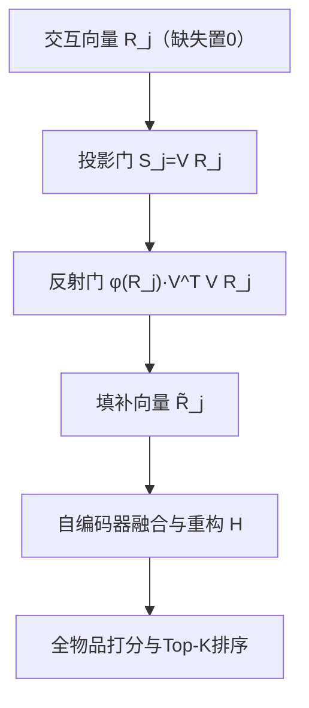
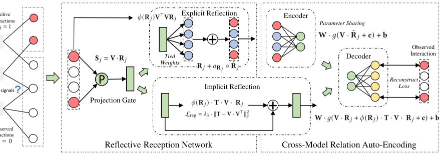

# Collaborative Reflection-Augmented Autoencoder Network for Recommender Systems (协作反射增强自编码器推荐网络)

- **会议/期刊**: ACM TOIS（2021 正式发表；arXiv 2022）
- **作者与机构**: Lianghao Xia、Chao Huang、Yong Xu 等；华南理工大学、香港大学、澳大利亚国立大学
- **推荐链路定位**: 召回/排序（全物品打分与重构）
- **研究方向**: 协同过滤与双塔召回 / 自监督对比学习与交互去噪
- **论文原文**: [论文原文链接](https://arxiv.org/abs/2201.03158v1)
- **开源代码**: [开源代码仓库链接](https://github.com/akaxlh/CRANet)

## TL;DR (1分钟核心速览)

针对协同过滤把未观测交互直接当负例、造成假阳性与稀疏偏置的问题，CRANet 用“投影—反射门”从已观测评分反推缺失评分，再以绑定权重自编码器融合重构；训练只对已观测位置计损失，免负采样。在 ML-1M/ML-10M/Netflix 的 RMSE 为 0.822/0.768/0.814，ML-1M、Foursquare、Yelp 的 P@3 达 15.71%/7.27%/3.21%，较最强基线约 +5.0%/+46.0%/+6.6%。

## Background & Motivation (背景与核心矛盾)

- **主流范式**: 神经 CF、AutoRec/CDAE、NADE 与图协同过滤均把用户—物品矩阵映射到隐空间，靠未观测采样构造负信号。
- **前人局限**: 未交互不等于负反馈，负采样会注入假阴性；不同用户/物品的稀疏度差异导致稠密向量能量主导训练。
- **核心洞察 (Key Insight)**: 缺失评分可由已观测评分的低秩结构“反射”得到；反射能量应按交互数归一化，避免填补值压过真实观测。
- **本文切入点**: 用转置绑定权重实现可解释的缺失值反射，再以自编码器学习观测与反射信号间的协同依赖。

## Method (核心方法设计)

### 1. 整体框架 (Overall Architecture)

以物品侧交互向量 $\mathbf{R}_j$为输入：投影门$\mathbf{S}_j=\mathbf{V}\mathbf{R}_j$压缩稀疏向量；反射门用$\mathbf{V}^{\top}\mathbf{V}$反推未交互评分，并按稀疏度衰减；填补后的$\tilde{\mathbf{R}}_j$ 进入三层自编码器，解码出全物品分数。训练仅重构图示观测位置，未观测位置保留反射填补值；推理时对全物品打分排序。物品侧建模优于用户侧，因用户向量更稀疏、更易过拟合。

<figure class="paper-figure" markdown="span">
  <figcaption>图1. 所提出 CRANet 的模型架构。显式反射接收网络（即利用 V⊤ 推断由式1～式3定义的缺失交互分数），以及隐式反射（即在反射中用 T 替代 V⊤，并在跨模型自编码中作为编码器，如式4～式5所定义）。</figcaption>
</figure>

### 2. 关键设计拆解 (Key Designs)

1. **反射门与稀疏度衰减（Reflection Gate）**：痛点是把缺失值统一置 0 会丢失协同信号。核心算子为 $\hat{\mathbf{R}}_j=\phi(\mathbf{R}_j)\mathbf{V}^{\top}\mathbf{V}\mathbf{R}_j$，其中$\phi(\mathbf{R}_j)=\alpha/\|\mathbf{R}_j\|_0$，再以$\tilde{\mathbf{R}}_j=\mathbf{R}_j+\mathbf{o}_{R_j}\odot\hat{\mathbf{R}}_j$ 只填补未观测位。衰减按交互数归一化能量，使稠密与稀疏向量尺度可比，避免填补值主导。
2. **绑定权重与隐式反射（Tied Weight & Implicit Reflection）**：独立矩阵 $\mathbf{U}$易产生与观测相反的反射分量，且解空间含任意可逆矩阵、不稳定。本文令反射使用$\mathbf{V}^{\top}$，并引入轻量$\mathbf{T}$近似$\mathbf{V}\mathbf{V}^{\top}$：$H=\mathbf{W}g(\mathbf{V}\mathbf{R}_j+\phi(\mathbf{R}_j)\mathbf{T}\mathbf{V}\mathbf{R}_j+\mathbf{c})+\mathbf{b}$，配合$\mathcal{L}_{reg}=\lambda_3\|\mathbf{T}-\mathbf{V}\mathbf{V}^{\top}\|_F^2$。这样保证反射与观测余弦相似非负，且把两次大矩阵乘法降为一次$d_p\times d_p$ 乘法。
3. **训练目标、负采样与推理效率**：总损失 $\mathcal{L}=\sum_j\|(1-\mathbf{o}_{R_j})\odot(H-\mathbf{R}_j)\|_2^2+\lambda_1\|\mathbf{V}\|_F^2+\lambda_2\|\mathbf{W}\|_F^2+\lambda_3\|\mathbf{T}-\mathbf{V}\mathbf{V}^{\top}\|_F^2$，只用观测重构，**免负采样**；Adam 优化，隐层 500 维。复杂度$O(Nd_p)$，与三层自编码器同阶，适合全库打分但单次输出仍为$O(N)$。

## Experimental Setup & Evaluation Protocol (实验设置与评估协议)

- **数据集与预处理**: Foursquare 过滤交互数 $<20$ 的用户/物品；其余按常用评分数据设置。

| 数据集 | #Users | #Items | #Interactions | 密度 | 特征/场景 |
| :--- | :---: | :---: | :---: | :---: | :--- |
| ML-1M | 6,040 | 3,706 | ≈1.00M | 0.05 | 1–5 星评分 |
| ML-10M | 69,878 | 10,677 | ≈10.00M | 0.01 | 半星评分 |
| Netflix | 480,189 | 17,770 | ≈100.48M | 0.01 | 1–5 星评分 |
| Foursquare | 24,748 | 7,763 | ≈0.96M | 0.005 | 签到，过滤 $<20$ |
| Yelp | 11,894 | 8,560 | ≈0.71M | 0.007 | 商户评论 |

- **数据划分与防穿越 (Splitting Strategy)**: 按 9:1 随机划分训练/测试；再从训练集取 5% 作验证集调参；五次随机重划分取平均。**非全局时间戳切分**，存在随机划分穿越风险。
- **排名评测协议 (Ranking Protocol)**: 评分预测用 RMSE；物品推荐用自编码器全物品输出排序后计算 Precision@3、NDCG@3，**非训练期负采样排序**，未报告采样正负比。Foursquare 另给 K=3/5/10 曲线。
- **对比基线与超参设置**: 覆盖 MF、神经 CF、GNN、NADE/CF-UIcA、AutoRec/CDAE、S-Imp/I-NMF；隐层 $d_p=500$，Adam，$\lambda$与$\alpha$网格搜索；五次均值，RMSE 标准差$<0.002$，未报告显著性$p$ 值。

## Key Experimental Results (实验关键数据)

### 1. 主实验对比 (Main Results)

**表1 评分预测 RMSE（越低越好）**

| 方法 | ML-1M | ML-10M | Netflix |
| :--- | :---: | :---: | :---: |
| BiasMF | 0.845 | 0.803 | 0.844 |
| NCF-NeuMF | 0.840 | 0.780 | 0.818 |
| NGCF | 0.830 | 0.778 | - |
| NADE | 0.829 | 0.771 | 0.803 |
| CF-UIcA | 0.823 | 0.769 | **0.799** |
| AutoRec | 0.831 | 0.782 | 0.823 |
| CDAE | 0.833 | 0.778 | 0.819 |
| I-NMF | 0.828 | 0.777 | 0.818 |
| **CRANet** | **0.822** (↑0.12%) | **0.768** (↑0.13%) | 0.814 (↓1.88%) |

**表2 物品推荐 P@3 / NDCG@3（%）**

| 方法 | ML-1M | Foursquare | Yelp |
| :--- | :---: | :---: | :---: |
| SVD++ | 6.57 / 2.49 | 4.32 / 3.82 | 2.23 / 1.50 |
| BiasMF | 6.58 / 2.49 | 4.57 / 4.03 | 2.42 / 1.58 |
| NCF | 8.62 / 3.51 | 4.63 / 4.08 | 2.50 / 1.84 |
| NGCF | 9.18 / 3.84 | 4.98 / 4.60 | 2.73 / 1.83 |
| NADE | 13.81 / 5.51 | 4.93 / 4.44 | 2.94 / 2.01 |
| CF-UIcA | 14.96 / 5.96 | 4.88 / 4.11 | 3.01 / 2.03 |
| AutoRec | 8.21 / 3.38 | 4.68 / 4.05 | 2.83 / 2.01 |
| **CRANet** | **15.71 / 6.26** | **7.27 / 6.91** | **3.21 / 2.21** |

相对最强基线：ML-1M P@3/NDCG@3 约 +5.0%/+5.0%；Foursquare +46.0%/+50.2%；Yelp +6.6%/+8.9%。

### 2. 消融实验 (Ablation Study)

| 设置 | ML-1M | ML-10M | Netflix |
| :--- | :---: | :---: | :---: |
| CRANet-R（去反射） | 0.831 | 0.782 | 0.823 |
| CRANet-N（邻域相似度填补） | 0.838 | 0.779 | 0.821 |
| **CRANet（完整）** | **0.822** | **0.768** | **0.814** |

### 3. 关键实验发现 (Key Findings)

- **反射门是主要增益源**：去反射后 ML-1M/ML-10M/Netflix RMSE 分别恶化 0.009/0.014/0.009；邻域相似度填补更差（0.838/0.779/0.821），说明学习式低秩反射优于启发式补全。
- **稀疏场景收益最大**：Foursquare 上 P@3 从最强基线 NGCF 的 4.98% 提到 7.27%（+46.0%），NDCG@3 +50.2%，印证未观测 POI 的反射填补对稀疏签到有效。
- **精度与开销兼顾**：ML-1M 上 CRANet 训练 1.09s、6.30M 参数，快于 NADE 的 3.61s/30.23M；$T+L_{reg}$参数量 6.30M，低于独立$U$ 的 9.07M，说明绑定权重在降参同时稳住了反射解空间。

## Highlights & Limitations (亮点、对比与审稿批判)

- **与代表作对比 (vs. Prior Work)**: 相比 AutoRec 的零填充与 CDAE 的鲁棒去噪，CRANet 显式“反推”缺失评分；相比 NADE/CF-UIcA 的自回归高参数量，它以绑定权重降低训练成本；相比 NGCF/ST-GCN 对未观测边零填充，CRANet 在 Netflix 上可扩展，而图模型出现 OOM。
- **可迁移亮点**: 按交互数 $\ell_0$归一化的反射门可直接用于稀疏向量预填补；$\mathbf{T}\approx\mathbf{V}\mathbf{V}^{\top}$的轻量正则把大矩阵乘法降为$d_p\times d_p$，适合大物品库。
- **审稿级局限批判**: ① 推理需输出全物品向量，$O(N)$ 打分在千万级物品库成本高；② 9:1 随机划分缺时间切分，且无显著性检验，Netflix 上仍逊于 CF-UIcA（0.814 vs 0.799），稠密数据可能被绑定权重过度正则。

## Rating (四维评分)

- **方法创新性 (Novelty)**: ⭐⭐⭐⭐ （反射门+稀疏度衰减+绑定权重的理论分析有新意，但仍属缺失值填补/AE 协同过滤的延续）
- **评估协议与实验扎实度 (Protocol & Experiments)**: ⭐⭐⭐ （四数据集两任务、五次均值较完整；缺显著性检验与主表全 K 值，Netflix 非最优）
- **写作与数学规范度 (Clarity & Rigor)**: ⭐⭐⭐⭐ （公式链条清楚，余弦下界与解空间歧义分析有说服力；符号略密）
- **工业落地与复现价值 (Industrial & Practical Value)**: ⭐⭐⭐ （代码开源、复杂度与 AE 同阶；全物品输出和离线随机划分限制线上直接部署）

