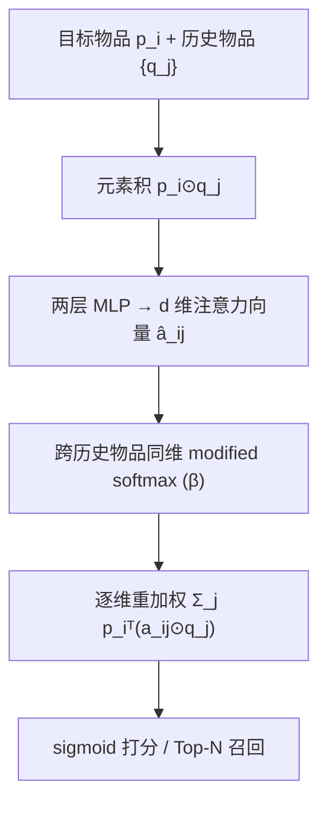
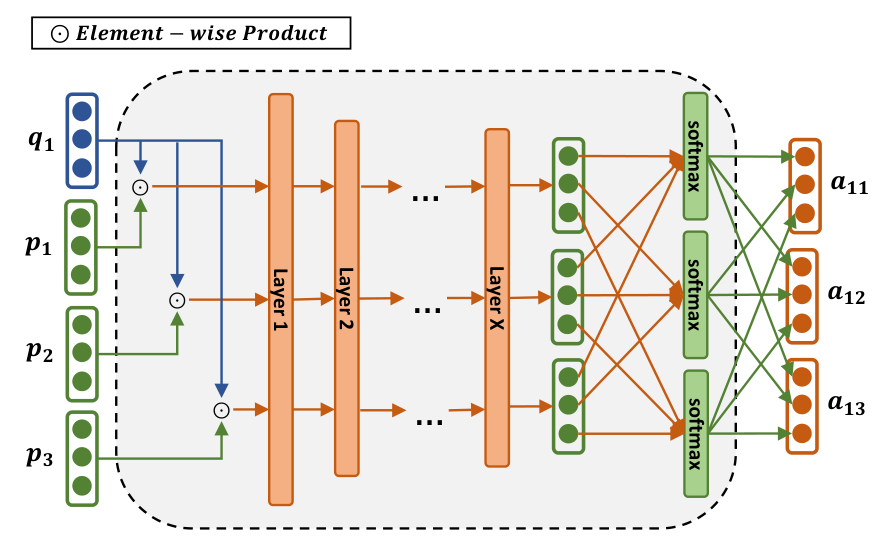
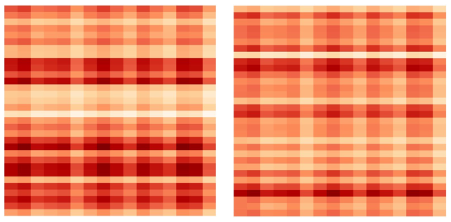

# Feature-level Attentive ICF for Recommendation (面向推荐的物品级协同过滤特征级注意力)

- **会议/期刊**: ACM TOIS (Accepted, 2022; arXiv v2 2021-10)
- **作者与机构**: Zhiyong Cheng (齐鲁工业大学/山东省人工智能研究院), Fan Liu, Shenghan Mei, Yangyang Guo, Liqiang Nie (山东大学), Lei Zhu (山东师范大学)
- **推荐链路定位**: 召回 (Item-based CF 相似度召回)
- **研究方向**: 协同过滤与双塔召回
- **论文原文**: [https://arxiv.org/abs/2102.10745v2](https://arxiv.org/abs/2102.10745v2)
- **开源代码**: [https://github.com/liufancs/FLA](https://github.com/liufancs/FLA)

## TL;DR (1分钟核心速览)

现有 ICF 模型（NAIS/DeepICF）只做**物品级注意力**——为每条历史物品输出一个标量权重，无法表达"用户因为导演还是因为主演而喜欢该物品"的维度级意图差异。本文提出模型无关的**特征级注意力 (FLA)**：把嵌入的每一维视作一个意图特征，为目标物品与每条历史物品生成 $d$ 维注意力向量并逐维重加权，再求和内积预测。在 6 个 MovieLens/Amazon 数据集、HR@10 / NDCG@10 排序协议下，FLA-NAIS 在 ML-1m 上 NDCG@10 相对提升 **6.32%**，FLA-DeepICF 在 Movies 上提升 **6.52%**。

## Background & Motivation (背景与核心矛盾)

- **主流范式**: FISM 用物品嵌入内积刻画相似度，NAIS/DeepICF 在此基础上加物品级注意力（标量权重 + 带平滑指数 $\beta$ 的 modified softmax）并堆叠 MLP 捕捉高阶物品关系。
- **前人局限一**: 物品级注意力只输出标量，把整条嵌入向量同比例放大/缩小，无法区分"哪一维特征在起作用"，因此相似度估计停留在粗粒度。
- **前人局限二**: 高维嵌入中大量维度对该目标物品是噪声，标量缩放会连带放大噪声维度，且历史物品数量在各用户间差异极大，标准 softmax 会过度惩罚活跃用户。
- **核心洞察 (Key Insight)**: 用户对物品的采纳意图是多元且**逐物品变化**的（同一用户对 $m_1$因主演、对$m_2$ 因导演），因此权重应是一个向量而非标量；且该向量的每一维应在"所有历史物品的同一维"之间做归一化——某历史物品整体不相关时，其全部维度权重会被同步压低，从而**隐式融合**物品级注意力。
- **本文切入点**: 用元素积 $p_i\odot q_j$作为特征匹配信号，经一层轻量 MLP 输出$d$ 维权重向量，直接替换原有标量注意力。

## Method (核心方法设计)

### 1. 整体框架 (Overall Architecture)

输入为目标物品嵌入 $p_i$与用户历史集合$\mathcal{R}_u^{+}\setminus\{i\}$中各物品嵌入$q_j$；对每对$(i,j)$计算元素积并送入共享的两层注意力网络，输出$d$维未归一化权重$\hat{a}_{ij}$；随后在"同一特征维、跨全部历史物品"的方向上做带平滑指数的 softmax 归一化，得到最终权重向量$a_{ij}$；将$a_{ij}$与$q_j$逐维相乘后累加，与$p_i$ 做内积得到预测分。训练采用成对 log loss + Adagrad，并用 FISM 学到的嵌入做初始化（预训练），推理时保持 ICF 的在线优势——新交互只需检索相似物品，无需重训模型。

<figure class="paper-figure" markdown="span">
  <figcaption>图2. 第二种设计的物品级和特征级注意力网络结构。</figcaption>
</figure>

### 2. 关键设计拆解 (Key Designs)

1. **特征级注意力向量 (Feature-level Attention Vector)**：痛点是把标量权重作用于整条向量，无法体现维度级意图。做法是对元素积做非线性变换得到 $\hat{a}_{ij}=H^{\top}\mathrm{ReLU}(W(p_i\odot q_j)+b)$，其中$W\in\mathbb{R}^{d'\times d}$、$H\in\mathbb{R}^{d'\times d}$，输出维度即为特征数$d$。直觉：元素积的每一维$p_{ik}q_{jk}$ 就是该特征上的局部相似度，是内积的逐维推广，因此非线性变换后天然对应"该特征有多匹配"。

2. **跨物品同维归一化 (Design 2, 隐式物品级注意力)**：痛点在于若像 Design 1 那样先用两个独立网络分别算物品级标量 $b_{ij}$与特征级向量再做$a_{ij}=b_{ij}\cdot\hat{a}_{ij}$，参数量与结构都翻倍且易过拟合。Design 2 把归一化方向改为跨历史物品、锁定同一维：

$$a_{ijk}=\frac{\exp(\hat{a}_{ijk})}{\left[\sum_{j'\in\mathcal{R}_u^{+}\setminus\{i\}}\exp(\hat{a}_{ij'k})\right]^{\beta}}$$

由此不相关物品的全部 $d$维权重同时被压低，物品级与特征级注意力被**一次归一化融合**，仅保留单套$W,b,H$；$\beta$ 沿用 NAIS 的平滑作用，缓解长历史用户的权重惩罚。

3. **训练目标、负采样与推理效率**：沿用隐式反馈二分类设定与成对目标

$$\mathcal{L}=-\frac{1}{|\mathcal{R}^{+}|+|\mathcal{R}^{-}|}\Big[\sum_{(u,i)\in\mathcal{R}^{+}}\log\sigma(\hat{r}_{ui})+\sum_{(u,i)\in\mathcal{R}^{-}}\log\big(1-\sigma(\hat{r}_{ui})\big)\Big]+\lambda\|\Theta\|^{2}$$

每个正样本配 4 个均匀随机负样本（非 hard negative、非 in-batch）；$\Theta=\{p_i,q_j,W,b,H\}$由 Adagrad 优化。相对 NAIS 仅新增一个$d'\times d$ 输出矩阵，推理开销与 backbone 同阶。

## Experimental Setup & Evaluation Protocol (实验设置与评估协议)

- **数据集与预处理**（Amazon 系列取 `5-core`，CDs/Movies 进一步强化为 `10-core`）：

| 数据集 | #Users | #Items | #Interactions | 稀疏度 | 特征/场景说明 |
| :--- | :---: | :---: | :---: | :---: | :--- |
| ML-1m | 6,040 | 3,416 | 999,611 | 95.16% | 电影评分，最稠密 |
| Delicious | 1,055 | 1,055 | 11,784 | 98.94% | 社交书签，小规模 |
| Amazon Music | 5,541 | 3,568 | 64,706 | 99.67% | 稀疏 |
| Amazon Beauty | 22,363 | 12,101 | 198,502 | 99.93% | 最稀疏 |
| Amazon CDs | 15,592 | 16,184 | 445,412 | 99.82% | 中等 |
| Amazon Movies | 33,326 | 21,901 | 958,986 | 99.87% | 大规模稀疏 |

- **数据划分与防穿越**: `比例划分` (**逐用户随机 70:10:20**)，**未采用全局时间戳切分**，存在轻微未来信息泄漏风险。
- **排名评测协议**: 目标为 top-$n$ 排序，报告 **HR@10 / NDCG@10**；训练阶段每正样本采 4 负样本，但**论文未明确说明测试阶段是 `Full-Ranking` 全库排序还是采样排序**，属协议披露不完整。
- **对比基线与超参设置**: 9 个基线覆盖启发式（Random/Pop/ItemKNN）、UCF（BMF/BPR/MLP）与 ICF（FISM/NAIS/DeepICF）；主表固定 $d=16$（另测$d\in\{8,16,32,64\}$），$\beta$网格$\{0.1,\dots,0.9\}$默认 0.7，学习率网格搜索，FLA 模型以 FISM 嵌入初始化；显著性用**双尾配对 t 检验**，`*` 为$p<0.05$、`Δ` 为$p<0.01$。

## Key Experimental Results (实验关键数据)

### 1. 主实验对比 (Main Results)

$d=16$，数值为百分数（省略 `%`），括号内为相对 backbone 的 `Improv.%`：

| 方法 | ML-1m HR / NDCG | Delicious | Music | Beauty | CDs | Movies |
| :--- | :---: | :---: | :---: | :---: | :---: | :---: |
| Pop | 55.70 / 9.93 | 8.16 / 2.20 | 3.56 / 1.24 | 1.91 / 0.74 | 3.41 / 0.64 | 3.45 / 0.68 |
| BMF | 87.73 / 37.59 | 16.30 / 7.50 | 5.99 / 2.10 | 2.57 / 1.06 | 4.66 / 0.91 | 4.51 / 0.91 |
| BPR | 70.40 / 22.59 | 68.69 / 40.79 | 19.00 / 7.70 | 6.65 / 3.06 | 11.13 / 3.78 | 10.75 / 2.51 |
| MLP | 85.36 / 31.32 | 70.71 / 41.61 | 11.10 / 3.67 | 6.25 / 2.38 | 9.53 / 3.04 | 6.02 / 1.84 |
| FISM | 89.37 / 33.50 | 72.70 / 37.04 | 21.08 / 7.59 | 7.83 / 2.93 | 21.25 / 4.94 | 14.69 / 3.13 |
| NAIS | 89.77 / 34.03 | 75.26 / 37.88 | 22.31 / 8.27 | 9.02 / 3.47 | 23.44 / 5.52 | 15.81 / 3.42 |
| DeepICF | 88.25 / 33.78 | 73.74 / 37.56 | 21.04 / 7.84 | 7.85 / 2.97 | 22.73 / 5.39 | 14.87 / 3.22 |
| FLA-NAIS | **90.36** / **36.18** | **76.11** / **38.84** | **23.25** / **8.55** | **9.13** / **3.52** | **24.04** / **5.81** | **16.30** / **3.58** |
| 　Improv. | +0.66% / +6.32% | +1.13% / +2.53% | +4.21% / +3.39% | +1.22% / +1.44% | +2.56% / +5.25% | +3.10% / +4.68% |
| FLA-DeepICF | 90.11 / 35.73 | 73.93 / 38.41 | 22.22 / 8.08 | 8.17 / 3.03 | 23.47 / 5.65 | 15.59 / 3.43 |
| 　Improv. | +2.11% / +5.77% | +0.26% / +2.26% | +5.61% / +3.06% | +4.08% / +2.02% | +3.26% / +4.82% | +4.84% / +6.52% |

### 2. 消融实验 (Ablation Study)

| 配置 | ML-1m HR / NDCG | Music | Beauty | Movies |
| :--- | :---: | :---: | :---: | :---: |
| NAIS（仅物品级注意力，w/o FLA） | 89.77 / 34.03 | 22.31 / 8.27 | 9.02 / 3.47 | 15.81 / 3.42 |
| FLA-NAIS **Design 1**（双网络相乘） | 90.46 / 35.54 | 22.97 / 8.28 | 9.02 / 3.48 | 16.04 / 3.52 |
| FLA-NAIS **Design 2**（跨物品同维归一化，完整版） | **90.36 / 36.18** | **23.25 / 8.55** | **9.13 / 3.52** | **16.30 / 3.58** |
| FLA-NAIS **w/o 预训练**（随机初始化） | 88.03 / 33.31 | 17.25 / 6.14 | 7.30 / 3.12 | 10.92 / 2.25 |
| FLA-DeepICF **w/o 预训练**（随机初始化） | 82.42 / 27.58 | 17.89 / 6.13 | 7.42 / 2.81 | 10.13 / 2.06 |

### 3. 关键实验发现 (Key Findings)

1. **特征级注意力的收益与数据稠密度强正相关**：NDCG@10 相对提升在稠密的 ML-1m 上为 **+6.32%**、CDs **+5.25%**，而在最稀疏的 Beauty 上仅 **+1.44%**——细粒度意图建模需要更多交互支撑，纯隐式反馈在长尾场景下信息量不足。
2. **简化设计反而更强**：Design 2 参数更少、更抗过拟合，ML-1m 上 NDCG 反超 Design 1（36.18 vs 35.54），说明"跨物品同维归一化"已足够承载物品级信息，双网络显式相乘属冗余。
3. **预训练是该方法能否生效的命门**：去掉 FISM 初始化后，Movies 上 FLA-NAIS 的 HR@10 从 16.30 跌到 10.92（**−33.0%**），Music NDCG 从 8.55 跌到 6.14（**−28.2%**），印证了 $d$ 维注意力输出的非凸优化极易陷入局部极小。
4. **嵌入维度越小、相对增益越大**（图 3）：$d$ 增大时所有模型绝对精度上升，但 FLA 的相对优势收窄，因为特征维度较小时注意力网络更容易学到可靠的维度权重。

<figure class="paper-figure" markdown="span">
  <figcaption>图6. 预测用户对两个物品偏好时物品级和特征级注意力的可视化。</figcaption>
</figure>

## Highlights & Limitations (亮点、对比与审稿批判)

- **与代表作对比**: 相比 **FISM**（无注意力）与 **NAIS**（标量物品级注意力），本文把权重从 $\mathbb{R}$扩展到$\mathbb{R}^{d}$，且不引入第二个注意力网络；相比 **DIN/DGCF** 等用户侧意图解耦工作，本文在 *ICF 侧* 用物品嵌入维度承载意图，避免了对用户嵌入动态重构，从而保留了 ICF 免重训的在线优势。
- **可迁移亮点**: ① "跨序列位置/跨历史物品、锁定同一维"的 modified softmax + 平滑指数 $\beta$，可直接迁移到会话推荐的物品加权；② 用元素积 + 轻量 MLP 生成逐维门控，可作为双塔召回中多向量表示的低成本特征门控插件。
- **审稿级局限批判**: ① "嵌入维度 = 语义意图" 完全依赖隐式学习，缺少语义锚定与可视化因果验证（图 6 仅展示热力图），本质仍是维度级门控而非可解释解耦；② 评估协议披露不全——测试阶段是否全库排序未说明，仅报 HR/NDCG@10，且划分采用**逐用户随机切分**而非时间切分，存在信息泄漏；③ 强制依赖 FISM 预训练，端到端训练不成立，工业部署需额外一套训练流水线；④ 在 Beauty 等稀疏集上增益不足 1.5%，实际业务收益需线上 A/B 佐证（本文无线上实验）。

## Rating (四维评分)

- **方法创新性 (Novelty)**: ⭐⭐⭐ （把 ICF 注意力从标量升级为向量并巧妙用"跨物品同维归一化"隐式融合两级注意力，想法干净但增量属渐进式改良，缺乏理论分析）
- **评估协议与实验扎实度 (Protocol & Experiments)**: ⭐⭐⭐ （6 个不同规模/稀疏度数据集 + 配对 t 检验较规范，但随机切分、测试排序协议未明示、缺少 Full-Ranking 对照）
- **写作与数学规范度 (Clarity & Rigor)**: ⭐⭐⭐⭐ （两种设计的公式与直觉对比清晰，符号统一，并给出复杂度与参数量层面的取舍讨论）
- **工业落地与复现价值 (Industrial & Practical Value)**: ⭐⭐⭐⭐ （代码与超参已开源，改动仅为一个注意力矩阵、推理开销与 backbone 同阶，契合 ICF 免重训在线更新；但预训练依赖降低了一体化部署便利性）

