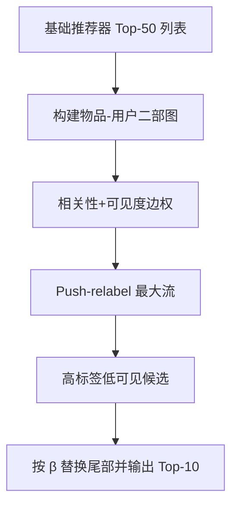

# A Graph-based Approach for Mitigating Multi-sided Exposure Bias in Recommender Systems (一种缓解推荐系统多边曝光偏差的图方法)

- **会议/期刊**: TOIS
- **作者与机构**: Masoud Mansoury (TU Eindhoven/DePaul)、Himan Abdollahpouri (Northwestern)、Mykola Pechenizkiy (TU/e)、Bamshad Mobasher (DePaul)、Robin Burke (CU Boulder)
- **推荐链路定位**: 重排（生成后后处理）
- **研究方向**: 去偏公平、可信隐私与工业架构 / 多边曝光公平
- **论文原文**: [https://arxiv.org/abs/2107.03415v1](https://arxiv.org/abs/2107.03415v1)
- **开源代码**: 暂未开源

## TL;DR (1分钟核心速览)

FairMatch 把推荐重排建模为二部图最大流：迭代选出低曝光但高相关物品/供应商，替换高曝光尾部，从而在不重训基础模型下同时提升物品与供应商曝光公平、聚合多样性和长尾覆盖；在 Last.fm/MovieLens 上以 BPR/NCF/UserKNN 为基座，公平指标显著提升，精度损失可控。

## Background & Motivation (背景与核心矛盾)

- **主流范式**: 曝光公平多通过 Popularity Bias 缓解、聚合多样性提升或后处理重排实现，代表作为 FA*IR、xQuAD、Discrepancy Minimization、ProbPolicy。
- **前人局限**: 多数方法只优化物品级可见性，忽略“物品由供应商提供”的多边结构；仅提升物品覆盖不必然让供应商曝光更均衡。另一矛盾是，现有聚合多样性常只统计“是否推荐过一次”，会奖励一次性长尾曝光而非持续可见性。
- **核心洞察 (Key Insight)**: 低可见度且高相关的物品/供应商在最大流中会因边容量不足把超额流退回源点，从而被标签机制识别为候选；这使公平重排可同时兼顾相关性与曝光。
- **本文切入点**: 在推荐二部图上迭代求解最大流，边权显式融合用户相关性、物品可见度或供应商可见度，再按比例替换原列表尾部。

## Method (核心方法设计)

### 1. 整体框架 (Overall Architecture)

基础推荐器先为每个用户生成 $t=50$的长列表；FairMatch 将其转为“物品—用户”二部图，并加入源点$s_1$与汇点$s_2$。边权由排序相关性与物品/供应商可见度共同决定，随后用 Push-relabel 反复求最大流，识别低容量、高相关候选；每轮抽取候选子图并从图中删除，最后按$\beta$比例把原列表底部高曝光项替换为候选低曝光项，得到$n=10$ 的最终列表。

### 2. 关键设计拆解 (Key Designs)

1. **多边可见度加权边（物品/供应商二选一）**：痛点在于仅按相关性排序会放大热门偏差。物品变体用 $w_{iu}=\lambda\,rank_{iu}+(1-\lambda)\,\widetilde{degree}_i$；供应商变体把$degree_i$替换为供应商聚合可见度$\widetilde{SV}_{B(i)}$，其中$B(i)$返回物品$i$的供应商。$\lambda$ 控制相关性与公平的折中；可见度归一化到与 rank 同量级，避免量纲主导。
2. **迭代最大流候选选择**：在 Push-relabel 中，源点到各物品的容量相同，但物品—用户边容量由 rank 与可见度决定。低可见或高相关物品无法把全部超额流推给用户，只能回流源点并被赋予高标签；算法以 $\ell_i\ge |I|+|U|+2$ 识别候选。直觉是“容量不足”同时编码了低曝光与高相关性。
3. **列表重构、训练与推理**：FairMatch 无需训练参数、无需负采样；总目标不是可微损失，而是对最大流候选集合做批量替换。最终列表按可见度升序处理，删除原列表中 $\min(\beta n,|I_C|)$ 个高曝光尾部项，加入同数量候选。推理开销主要是批量最大流，需离线或准在线重排。

## Experimental Setup & Evaluation Protocol (实验设置与评估协议)

- **数据集与预处理**:

| 数据集 | #Users | #Items | #Interactions | #Suppliers | 稀疏度/说明 |
| :--- | :---: | :---: | :---: | :---: | :--- |
| Last.fm | 2,000 | 6,817 | 218,985 | 2,856 | 1.61%；用户<50、物品<200 过滤后采样 2,000 用户；专辑为物品，艺术家为供应商 |
| MovieLens | 6,040 | 3,079 | 928,739 | 1,699 | 5.00%；电影为物品，OMDB 补电影制作者为供应商 |

- **数据划分与防穿越**: 采用 **80%/20% 比例划分**，训练集建模型并生成长列表，测试集算 Precision；未使用全局时间戳切分。
- **排名评测协议**: 非全库 Full-Ranking；基础推荐器先产 top-50 候选池，重排后取 top-10，Precision 统计测试集命中。负采样方面，BPR/NCF 沿用默认训练负采样，FairMatch 重排阶段无训练负采样。
- **对比基线与超参**: 基座为 BPR、NCF、UserKNN；重排基线含 FA*IR、xQuAD、DM、ProbPolicy，另设 Random/Reverse 作极端参照。$t=50,n=10$，$\lambda\in\{0,0.25,0.5,0.75,1\}$，$\beta=0.6$(Last.fm)、$\beta=1$(MovieLens)；McNemar 检验$p<0.05$。

## Key Experimental Results (实验关键数据)

### 1. 主实验对比 (Main Results)

下表取 MovieLens + BPR 基座（$t=50,n=10$），省略 Random/Reverse 极端行；SG 越低越好，其余公平/覆盖指标越高越好。`Improv.` 为 FairMatch_Sup 相对最佳真实重排基线。

| 方法 | Precision | 1-IA | LT | 1-SA | SG | SE |
| :--- | :---: | :---: | :---: | :---: | :---: | :---: |
| Base | **0.332** | 0.392 | 0.351 | 0.418 | 0.845 | 5.40 |
| FA*IR | 0.306 | 0.402 | 0.362 | 0.400 | 0.802 | 5.50 |
| xQuAD | **0.322** | 0.461 | 0.426 | 0.451 | 0.822 | 5.34 |
| DM | 0.314 | 0.470 | 0.435 | 0.453 | 0.791 | **5.51** |
| ProbPolicy | 0.289 | 0.439 | 0.402 | 0.451 | 0.782 | 5.49 |
| FairMatch_item | **0.322** | 0.544 | 0.515 | 0.536 | 0.820 | 5.32 |
| FairMatch_Sup | 0.311 | **0.547** | **0.518** | **0.578** | **0.779** | **5.51** |
| **Improv.%** | −3.4%* | **+16.4%** | **+19.1%** | **+27.6%** | **−0.4%** | 0.0% |

\*Precision 相对最佳重排基线 xQuAD/FairMatch_item；相对 Base 为 −6.3%。FairMatch_Sup 在 1-SA 上相对 Base 提升 $0.578/0.418-1=+38.3\%$。

### 2. 消融实验 (Ablation Study)

原文未设严格“去模块”消融，以下用目标函数变体作组件对比（MovieLens-BPR）：

| 变体 | Precision | 1-IA | LT | 1-SA | SG | 结论 |
| :--- | :---: | :---: | :---: | :---: | :---: | :--- |
| Base | 0.332 | 0.392 | 0.351 | 0.418 | 0.845 | 无公平重排 |
| FairMatch_item | 0.322 | 0.544 | 0.515 | 0.536 | 0.820 | 物品可见度目标更强 |
| FairMatch_Sup | 0.311 | 0.547 | 0.518 | 0.578 | 0.779 | 供应商可见度目标显著抬升 1-SA/SG |

### 3. 关键实验发现 (Key Findings)

1. 供应商级目标确实“对症下药”：ML-BPR 上 FairMatch_Sup 把 1-SA 从 0.418 提到 0.578（+38.3%），SG 从 0.845 降到 0.779，而 Precision 仅从 0.332 降到 0.311（−6.3%）。
2. 物品变体更适合打穿最低可见度组：在 IVS 曲线中 FairMatch_item 对 G9/G10 的提升更明显；FairMatch_Sup 则在供应商组 SVS、1-SA、SG 上更优，说明边权聚合层级决定公平侧重点。
3. 标准 1-IA 会误导：ML-BPR 上 FairMatch_Sup 的 1-IA=0.547 高于 DM=0.470，但当 $\alpha>8$时 DM 反超，说明“推荐一次”与“持续可见”是不同公平目标；供应商侧 FairMatch_Sup 在所有$\alpha$ 下仍优于 DM。

## Highlights & Limitations (亮点、对比与审稿批判)

- **与代表作对比**: DM 最小化与目标分布的偏差，FairMatch 不预设目标分布，直接迭代找“低可见+高相关”候选；xQuAD 主要平衡热门/长尾比例，未显式建模供应商；ProbPolicy 关注供应商公平但缺少图覆盖式候选选择。
- **可迁移亮点**: 把供应商聚合可见度写入物品—用户边权，可迁移到多创作者/多店铺平台；$\alpha$-IA、$\alpha$-SA 比标准聚合多样性更能防止“一次性曝光”刷指标。
- **审稿级局限批判**: 最大流批处理开销较大，在线部署需近似或分片；仅两个数据集、80/20 随机划分且无时间切分/线上 A/B，供应商由元数据推断可能含噪；$\lambda,\beta$ 需按数据集调，代码未开源削弱复现。

## Rating (四维评分)

- **方法创新性 (Novelty)**: ⭐⭐⭐⭐ （将多边曝光公平转为带可见度边权的迭代最大流，物品/供应商双目标统一较新颖）
- **评估协议与实验扎实度 (Protocol & Experiments)**: ⭐⭐⭐⭐ （三基座、两数据集、多公平指标与显著性检验较完整，但缺少时间切分与线上验证）
- **写作与数学规范度 (Clarity & Rigor)**: ⭐⭐⭐⭐ （算法流程和指标定义清晰，最大流候选机制解释到位，复杂度分析偏弱）
- **工业落地与复现价值 (Industrial & Practical Value)**: ⭐⭐⭐ （后处理易插拔、业务价值明确，但批量最大流开销与无开源代码限制落地复现）

