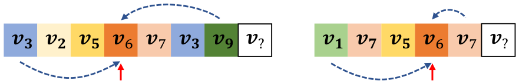
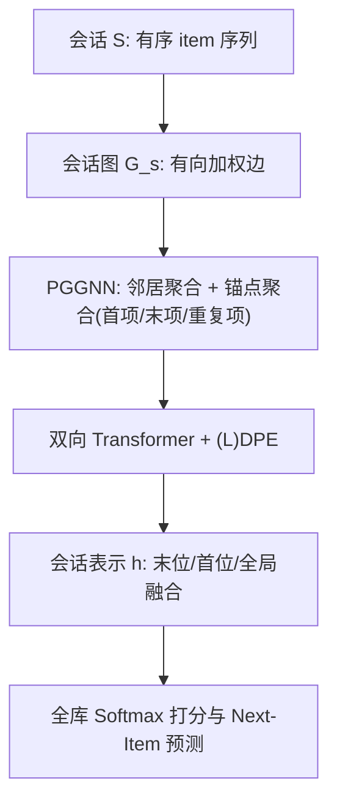
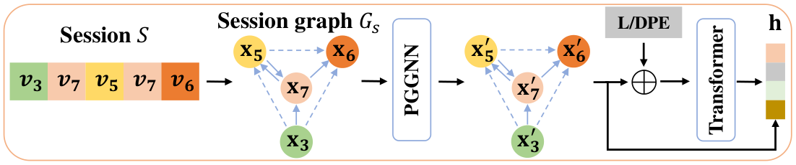

# Exploiting Positional Information for Session-based Recommendation (面向会话推荐的位置信息挖掘)

- **会议/期刊**: TOIS 2022
- **作者与机构**: Ruihong Qiu, Zi Huang, Tong Chen, Hongzhi Yin；The University of Queensland
- **推荐链路定位**: 召回（匿名会话 Next-Item 预测）
- **研究方向**: 序列与会话推荐 / 图神经网络与知识图谱推荐
- **论文原文**: [https://arxiv.org/abs/2107.00846v2](https://arxiv.org/abs/2107.00846v2)
- **开源代码**: 暂未开源

## TL;DR (1分钟核心速览)

针对会话推荐中“仅看末位”或“仅从前向后编码”难以同时刻画初始意图与最新意图的痛点，本文形式化定义前向感知与后向感知，提出双位置编码 DPE/LDPE，并设计位置感知门控图网络 PGGNN 与图级双向 Transformer。在 Yoochoose 1/64、1/4 与 Diginetica 的全库排序协议下，R@5 相对最优基线提升约 0.55%–2.90%，R@10/M@10 稳定领先 SR-GNN、FGNN、SASRec 等。

## Background & Motivation (背景与核心矛盾)

- **主流范式**: RNN 隐式按时间顺序编码；STAMP/SASRec 以末位 item 为 query 做 attention；SR-GNN/FGNN/GC-SAN 将会话构图后用 GNN+readout 学习会话表示。
- **前人局限**: RNN 易遗忘早期意图；绝对位置编码通常只前向感知，难以表达“距末位多近”；GNN 只保留相邻转移的相对方向，既不能区分首项/末项，也会在无重复 item 的短会话中图过稀。
- **核心洞察 (Key Insight)**: 会话中一个 item 的位置同时包含“距初始意图多远”和“距最新意图多近”两类信息；现有 PE 多为单向前向感知，缺失后向感知。
- **本文切入点**: 用理论框架定义 forward-awareness/backward-awareness，证明 SPE 仅前向、RPE 两者皆非，再以“半维前向+半维后向”的 DPE/LDPE 补齐双感知，并用锚点聚合缓解会话图稀疏。

<figure class="paper-figure" markdown="span">
  <figcaption>图1. 会话中位置与意图动态之间关系的示意图。尽管𝑣6在会话S1和S2中的正向计数位置相同，但其反向计数位置不同，从而导致其在会话中的相对位置不同。</figcaption>
</figure>

图1：同一 item 在两条会话中前向位置相同、后向位置不同，说明仅前向编码会丢失“距最新意图”的信息。

## Method (核心方法设计)

### 1. 整体框架 (Overall Architecture)

输入匿名会话 $S=[v_{s,1},\dots,v_{s,l}]$，先转为有向加权会话图$G_s$；PGGNN 同时聚合普通邻居与首项、末项、重复项等锚点节点，得到位置感知 item 表示；双向 Transformer 以该表示和 (L)DPE 为输入，生成图级会话向量$h$；最终用$h$ 与全 item 嵌入做 softmax 全库打分，预测下一 item。训练采用全库交叉熵而非 BPR/负采样，推理直接全库排序。

<figure class="paper-figure" markdown="span">
  <figcaption>图2. PosRec的流程。会话𝑆首先被转换为会话图𝐺𝑠。PGGNN聚合邻居节点（实线边）和锚点节点（虚线边），以更新𝐺𝑠中的节点特征。双向Transformer使用更新后的节点特征和(L)DPE计算会话表示h。⊕表示逐元素相加。</figcaption>
</figure>

图2：PosRec 流程：会话图经 PGGNN 更新节点，双向 Transformer 结合 (L)DPE 输出会话表示。

### 2. 关键设计拆解 (Key Designs)

1. **DPE/LDPE（双位置编码）**：SPE 只按 $pos$从前往后编码，RSPE 只按$l-pos-1$从后往前编码。DPE 直接拼接两半：前向半维用$P_{pos,2i}=\sin(pos/f(i))$、$P_{pos,2i+1}=\cos(pos/f(i))$，后向半维把$pos$替换为$l-pos-1$。因此前向半维保证首项跨会话一致，后向半维保证末项跨会话一致，满足 SBRS 双感知需求。LDPE 进一步改为可学习表：$P_{pos,0:d/2-1}=\mathrm{Embed}[pos]$，$P_{pos,d/2:d-1}=\mathrm{Embed}[l-pos-1]$，以吸收真实时间间隔的非线性。
2. **PGGNN（位置感知门控图网络）**：传统 GGNN 只聚合 $N_{in}$/$N_{out}$，短会话图稀疏且不区分首末项。本文扩展为$N'_{in}=N_{in}\cup\{v_0,v_*\}$、$N'_{out}=N_{out}\cup\{v_{l-1},v_*\}$，其中$v_*$为重复项；锚点边权取无权无向图中的距离。聚合公式为$\hat{x}_t=\sum_{v_{t'}\in N'_{in}}w_{t',t}x_{t'}W_{in}\Vert\sum_{v_{t'}\in N'_{out}}w_{t,t'}x_{t'}W_{out}$，再经$x'_t=\mathrm{GRU}(x_t,\hat{x}_t)$ 更新。直觉是给普通节点注入“与首/末/高频项的距离”这一位置先验，并增加图连通性。
3. **图级 readout、损失与推理**：在去重后的图节点上做 $H=\mathrm{Transformer}(X'+P)$，会话表示为$h=\lambda_0X'_{l-1}+\lambda_1H_{l-1}+\lambda_2H_0$，分别保留末位 item、末位上下文与首项全局意图。打分$\hat{y}=\mathrm{Softmax}(Xh^\top)$，损失$\mathcal{L}=-\sum_i y_i^\top\log\hat{y}_i$；无负采样，训练即全库 softmax，在线推理为$O(|\mathcal{I}|d)$ 全库打分。

## Experimental Setup & Evaluation Protocol (实验设置与评估协议)

- **数据集与预处理**: 匿名会话数据，过滤长度 1 的会话与出现频次 $<5$ 的 item；长会话按前缀扩充，末位作标签。Yoochoose 取最近时间戳的 1/64 与 1/4 两个子集。

| 数据集 | #Clicks | #Train | #Test | #Items | 平均长度 |
| :--- | :---: | :---: | :---: | :---: | :---: |
| Yoo. 1/64 | 557,248 | 369,859 | 55,898 | 16,766 | 6.16 |
| Yoo. 1/4 | 8,326,407 | 5,917,746 | 55,898 | 29,618 | 5.71 |
| Diginetica | 982,961 | 719,470 | 60,858 | 43,097 | 5.12 |

- **数据划分与防穿越 (Splitting Strategy)**: 采用会话前缀扩充的 Next-Item 划分，末位 item 仅作标签；Yoochoose 按时间戳取最近 1/64、1/4，训练/测试按原挑战集划分。
- **排名评测协议 (Ranking Protocol)**: 无偏 **Full-Ranking（全库未交互 item 排序）**，报告 R@5、R@10、M@5、M@10；未使用采样排序。
- **对比基线与超参设置**: 基线覆盖 POP/S-POP/Item-KNN/BPR-MF/FPMC、GRU4REC/NARM、STAMP、SR-GNN/FGNN/GC-SAN、SASRec。嵌入维度 $d=100$，batch=100，Adam 初始 lr=0.001，每 3 epoch 衰减 0.1，4 epoch 早停；1 层 PGGNN + 1 层 Transformer；$\lambda_2$在 Yoochoose 取 0.5、Diginetica 取 1。结果报告多次运行标准差，但未见形式化$p$ 值检验。

## Key Experimental Results (实验关键数据)

### 1. 主实验对比 (Main Results)

| 方法 | Yoo.1/64 R@10 | Yoo.1/64 M@10 | Yoo.1/4 R@10 | Yoo.1/4 M@10 | Dig. R@10 | Dig. M@10 |
| :--- | ---: | ---: | ---: | ---: | ---: | ---: |
| GRU4REC | 50.30 | 22.81 | 49.60 | 21.43 | 32.67 | 13.26 |
| NARM | 57.56 | 27.16 | 57.73 | 27.39 | 36.09 | 14.02 |
| STAMP | 58.67 | 29.66 | 58.03 | 29.08 | 37.46 | 15.96 |
| SR-GNN | 60.04 | 30.08 | 60.64 | 30.24 | 37.87 | 16.49 |
| FGNN | 60.13 | 30.17 | 60.68 | 30.19 | 37.82 | 16.55 |
| GC-SAN | 59.47 | 29.33 | 59.86 | 29.72 | 37.75 | 16.23 |
| SASRec | 58.98 | 29.87 | 57.88 | 29.23 | 37.53 | 16.12 |
| **PosRec** | **60.90** | **30.57** | **60.92** | **31.03** | **38.87** | **16.85** |
| **Improv.%** | **+1.28** | **+1.33** | **+0.40** | **+2.61** | **+2.64** | **+1.81** |

### 2. 消融实验 (Ablation Study)

下表验证 LDPE 作为位置编码模块的迁移增益；原始 STAMP 无位置编码，SASRec 原本使用 LPE。

| 变体 | Yoo.1/64 R@10 | Yoo.1/64 M@10 | Dig. R@10 | Dig. M@10 |
| :--- | ---: | ---: | ---: | ---: |
| STAMP | 58.67 | 29.66 | 37.46 | 15.96 |
| STAMP + LDPE | 58.82 | 29.94 | 37.81 | 16.34 |
| SASRec | 58.98 | 29.87 | 37.53 | 16.12 |
| SASRec + LDPE | 59.17 | 30.11 | 37.90 | 16.53 |
| **PosRec (full)** | **60.90** | **30.57** | **38.87** | **16.85** |

锚点聚合消融（图5/6）显示：在 SR-GNN、FGNN、GC-SAN 与 PosRec-ANC 上加入锚点后 Recall 全面上升；MRR 仅在 GC-SAN 与 PosRec 上稳定提升。说明锚点主要补“连通性+位置先验”，并非对所有 readout 都同幅度有效。

### 3. 关键实验发现 (Key Findings)

1. **LDPE 可跨架构稳定增益**：STAMP 在 Yoo.1/64 R@10 从 58.67 升至 58.82、Diginetica 从 37.46 升至 37.81；SASRec 从 58.98 升至 59.17、从 37.53 升至 37.90，且参数规模相同，证明双位置编码不是 PosRec 专属 trick。
2. **完整 PosRec 的增益主要来自 DPE + PGGNN 协同**：Diginetica R@10 38.87 对 SR-GNN 37.87 提升 2.64%，Yoo.1/64 60.90 对 FGNN 60.13 提升 1.28%；而单换 LDPE 的增益约 0.15–0.35，说明锚点聚合与图级 Transformer 不可省略。
3. **后向位置信息更关键且首因权重需调**：可视化中 DPE 在长度 10/20 的最近邻热图呈双向对角带，LDPE 的右下角后向相关性更明显；$\lambda_2=0.5$时 Yoo.1/64 最佳，Diginetica 则$\lambda_2=1$ 最佳，首因权重过大或过小都会伤害效果。

## Highlights & Limitations (亮点、对比与审稿批判)

- **与代表作对比 (vs. Prior Work)**: 相比 STAMP 只以末位 item 做 attention，本文将“首因—最新意图”拆成双位置通道；相比 SR-GNN/FGNN/GC-SAN 只依赖图边方向，PGGNN 用首/末/重复锚点显式注入位置先验；相比 SASRec 的 LPE，LDPE 同时建模前向与后向位置，且可直接替换。
- **可迁移亮点**: DPE/LDPE 可插入任意 attention/Transformer 会话推荐；锚点聚合可作为稀疏会话图的通用增边策略；图级去重 readout 能降低重复 item 的噪声。
- **审稿级局限批判**: 仅在两个电商数据集验证，缺少跨域/冷启动与线上 A/B；位置理论基于绝对计数，未处理真实时间间隔与不规则会话；$\lambda_2$ 需按数据集调，全库 softmax 推理开销随 item 数线性增长，工业规模需 ANN 或采样近似。

## Rating (四维评分)

- **方法创新性 (Novelty)**: ⭐⭐⭐⭐ （前向/后向感知理论定义清晰，DPE 的“半维拼接”简单但切中会话推荐的位置本质）
- **评估协议与实验扎实度 (Protocol & Experiments)**: ⭐⭐⭐⭐ （Full-Ranking 协议较公平，主实验与 PE 替换消融完整；但仅两数据集、无显著性检验扣分）
- **写作与数学规范度 (Clarity & Rigor)**: ⭐⭐⭐⭐ （定义—定理—证明链条完整，SPE/RPE/RSPE 反例清楚；个别符号与实现细节略密）
- **工业落地与复现价值 (Industrial & Practical Value)**: ⭐⭐⭐⭐ （LDPE 可直接嵌入现有模型，锚点增边成本低；但全库 softmax 与无开源代码限制大规模部署）

