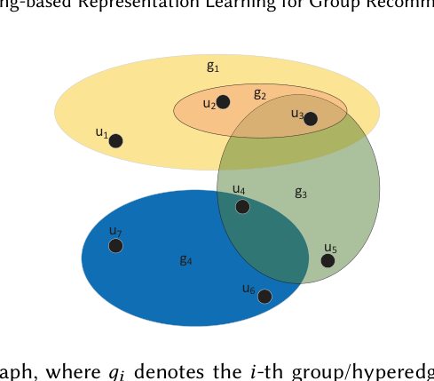
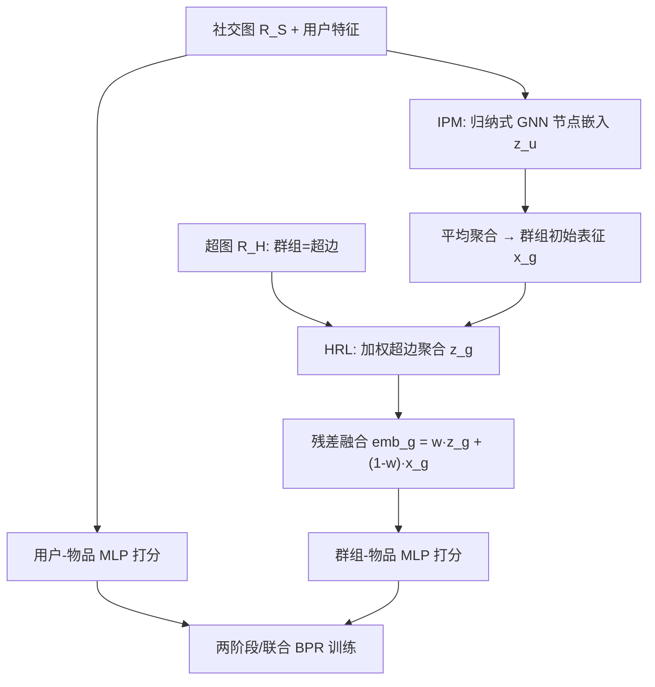

# Hierarchical Hyperedge Embedding-based Representation Learning for Group Recommendation (基于层次化超边嵌入表征学习的群组推荐)

- **会议/期刊**: ACM Transactions on Information Systems (TOIS)
- **作者与机构**: Lei Guo (山东师范大学), Hongzhi Yin, Tong Chen (昆士兰大学), Xiangliang Zhang (KAUST), Kai Zheng (电子科技大学)
- **推荐链路定位**: 召回（群组级候选物品打分）
- **研究方向**: 社交与群组推荐 / 图神经网络与知识图谱推荐
- **论文原文**: [https://arxiv.org/abs/2103.13506v1](https://arxiv.org/abs/2103.13506v1)
- **开源代码**: 暂未开源

## TL;DR (1分钟核心速览)

本文聚焦**偶发群组推荐 (OGR)**：群组成员临时拼凑、群组-物品交互极度稀疏（Yelp 上平均每组仅 1.12 条）。已有工作把群组表征视为成员偏好的注意力聚合，忽略了两个事实——(1) 用户-物品交互本身同样稀疏；(2) 共享成员的群组之间存在同质性。HyperGroup 提出层次化框架：底层用社交图 GNN 借好友偏好增强个体表征，上层把每个群组建模为超图的一条超边，用「共享成员数加权 + 共享成员身份」的归纳式超边聚合器学习群组表征，并以两阶段训练融合用户-物品与群组-物品两类交互。在 Yelp 与 Douban-Event 的 **全库 Full-Ranking** 协议下，Yelp HR@5 相对最强基线 GroupIM 提升 **268%**（$p<0.01$）。

## Background & Motivation (背景与核心矛盾)

- **主流范式**: OGR 主流做法是「早聚合」——用注意力/自注意力（AGREE、SIGR、GroupSA、GroupIM）把成员的个人表征动态加权融合成群组表征；或者「晚聚合」——先给每个成员出推荐列表，再用平均满意度/最小遗憾等静态规则合并。
- **前人局限一**: 个人偏好空间与群组偏好空间**可能正交**，群组决策的共识效应无法由成员表征的凸组合表达；同时把群组当作 pseudo-user 直接学群组 ID 嵌入（NCF、BPR-MF）在每组仅 1 条交互时完全失效（实验里 BPR-MF 甚至不如 Pop）。
- **前人局限二**: 现有方法把每个群组**孤立建模**，忽视了「同一用户可同时属于多个群组」带来的群组级相似性；而他们援引来缓解稀疏的「用户个人活动数据」，其密度本身仅 0.051%/0.057%，同样稀疏。
- **核心洞察 (Key Insight)**: 两个群组共享的成员越多、且共享的成员越有影响力，二者的群组级偏好越相似。因此关键不只是「共享几个成员」，而是**「共享的是谁」**——这正是把群组建模为超边（连接成员集合）而非普通图节点的根本理由。
- **本文切入点**: 用社交同质性补个体表征、用超图超边归纳式嵌入补群组表征，两层串联 + 与用户-物品任务联合训练。

<figure class="paper-figure" markdown="span">
  <figcaption>图 1. 超图示例，其中 푔푖 表示连接其内所有用户的第 푖 个群组/超边。例如，用户 푢7、푢6 和 푢4 均由群组/超边 푔4 连接。若两个超边/群组至少共享一个共同群组成员，则二者之间建立边（即重叠关系）；例如超边/群组 푔3 与 푔4 共享同一用户 푢4，因此 푔3 与 푔4 之间存在连接。</figcaption>
</figure>

## Method (核心方法设计)

### 1. 整体框架 (Overall Architecture)

输入包含四类关系：用户-用户社交 $R_S$、用户-物品$R_U$、群组-物品$R_G$、群组-群组重叠$R_H$。IPM（个体偏好建模）在社交图上做 K 层 mean-aggregator 的归纳式节点嵌入，得到成员表征$z_u$，并平均聚合成群组初始表征$x_g^G$；HRL（超边表征学习）以$x_g^G$为初值，在「群组为超边」的超图上再做 K 层超边聚合，得到$z_g^G$，与初值残差融合为最终群组嵌入。最后群组/用户嵌入分别与**共享的物品嵌入**拼接，经 MLP 打分，用 BPR  pairwise 损失以两阶段方式优化。

### 2. 关键设计拆解 (Key Designs)

1. **社交增强的个体偏好建模 (IPM)**：痛点是个体交互稀疏导致成员表征不准。做法是对每个用户采样固定大小 $S$的邻居集合$\mathcal{N}(u)$，逐层聚合：$\boldsymbol{h}^i_{\mathcal{N}(u)}=\mathrm{MEAN}(\{\boldsymbol{h}^{i-1}_{u'}\})$，$\boldsymbol{h}^i_u=\sigma(\boldsymbol{W}_i\cdot[\boldsymbol{h}^{i-1}_u \| \boldsymbol{h}^i_{\mathcal{N}(u)}])$，末层$z_u=\boldsymbol{h}^K_u$。采用 GraphSAGE 式**归纳式**（而非谱式 GCN）聚合，免去全图邻接矩阵，可泛化到新用户且空间高效。群组初值$\boldsymbol{x}^G_g=\frac{1}{|\mathcal{G}(g)|}\sum_{u\in\mathcal{G}(g)}\boldsymbol{emb}_u$。

2. **身份感知的超边聚合器 (HRL)**：这是全文最核心的增量算子。普通超图卷积只用关联矩阵归一化度数，无法区分「谁被共享」。本文定义
$$\mathrm{AGG}^G_i(g)=\sum_{g'\in\mathcal{N}(g)}\alpha_{g,g'}\left(\boldsymbol{m}^i_{g'}+\boldsymbol{l}^i_{g,g'}\right),\quad \alpha_{g,g'}=|\mathcal{G}(g)\cap\mathcal{G}(g')|$$
其中 $\boldsymbol{l}^i_{g,g'}=\mathrm{MEAN}(\{\boldsymbol{emb}_u, u\in\mathcal{G}(g)\cap\mathcal{G}(g')\})$显式编码**共享成员集合的身份信息**，$\alpha$编码**共享规模**。物理直觉：规模决定「借多少信号」，身份决定「信号质量」——高影响力成员共享一次比边缘成员共享三次更有信息量。最终$\boldsymbol{emb}^G_g=w\boldsymbol{z}^G_g+(1-w)\boldsymbol{x}^G_g$ 用残差保留个体聚合基底，避免超边聚合在稀疏时过度平滑。

3. **训练目标、负采样与推理**：两个任务共用 BPR 损失 $\mathcal{L}_G=-\sum_{(g,v_h,v_{h'})\in\mathcal{D}_G}\ln\sigma(\hat{r}^G_{g,h}-\hat{r}^G_{g,h'})+\lambda\|\Theta\|^2$，用户侧$\mathcal{L}_U$同构，总损失$\mathcal{L}=\mathcal{L}_G+\mathcal{L}_U$。每正样本随机采$N_x$个负样本（主实验为可比性取$N_x=1$，超参实验显示$N_x=3\!\sim\!4$更优）。提供两阶段（先$\mathcal{L}_U$后$\mathcal{L}_G$）与联合训练两种策略，**两阶段更优**；推理仅需前向 MLP + 邻居采样聚合，开销与层数$K$和采样数$S$ 线性相关。

## Experimental Setup & Evaluation Protocol (实验设置与评估协议)

- **数据集与预处理**: 两数据集均由 Yin et al. 从原始签到/活动数据中抽取隐式群组（社交相连的用户在同一时间访问同一餐厅/活动即构成群组），非 5-core 过滤。

| 数据集 | #Users | #Items | #Groups | 平均组规模 | 每组交互 | 每用户交互/好友 |
| :--- | :---: | :---: | :---: | :---: | :---: | :--- |
| Yelp | 34,504 | 22,611 | 24,103 | 4.45 | 1.12 | 13.98 / 20.77 |
| Douban-Event | 29,181 | 46,097 | 17,826 | 4.84 | 1.47 | 25.22 / 40.86 |

- **数据划分与防穿越**: 群组-物品交互**随机 8:1:1 比例划分**（train/valid/test），非时间戳切分（因原始数据无严格先后约束）。
- **排名评测协议 (Ranking Protocol)**: 采用**无偏 Full-Ranking**——对测试集每条 $(g,v)$对**全库所有物品**打分排序，明确拒绝 AGREE/GroupSA 等前作「随机抽 100 个未交互物品作候选」的采样协议，因而数值不可与前作直接横比，但更可信。指标 HR@N 与 NDCG@N（二值相关性），$N\in\{5,10\}$。
- **对比基线与超参设置**: 基线含 Pop、NCF、BPR-MF、PIT、COM、AGREE、SIGR、GroupSA、GroupIM。嵌入维度统一 128，IPM 层数 $K=1$、HRL 层数$K=2$，采样邻居$S=4$，dropout 0.1，Adam + batch 256 + lr 1e-4；所有提升通过$p<0.01$ 显著性检验。

## Key Experimental Results (实验关键数据)

### 1. 主实验对比 (Main Results)

| 方法 | Yelp HR@5 | Yelp NDCG@5 | Yelp HR@10 | Douban HR@5 | Douban NDCG@5 | Douban HR@10 |
| :--- | :---: | :---: | :---: | :---: | :---: | :---: |
| Pop | 0.0117 | 0.0076 | 0.0201 | 0.0031 | 0.0017 | 0.0046 |
| BPR-MF | 0.0026 | 0.0056 | 0.0022 | 0.0009 | 0.0017 | 0.0007 |
| COM | 0.0481 | 0.0313 | 0.0812 | 0.0103 | 0.0053 | 0.0214 |
| AGREE | 0.0569 | 0.0389 | 0.0896 | 0.0122 | 0.0073 | 0.0255 |
| SIGR | 0.1085 | 0.0738 | 0.1499 | 0.0200 | 0.0114 | 0.0345 |
| GroupSA | 0.1211 | 0.0843 | 0.1680 | 0.0212 | 0.0137 | 0.0382 |
| GroupIM | 0.1312 | 0.1033 | 0.1493 | 0.0511 | 0.0358 | 0.0669 |
| **HyperGroup** | **0.4827** | **0.3973** | **0.5598** | **0.0608** | **0.0406** | **0.0914** |
| Improv.% (vs 最强基线) | +267.9% | +284.6% | +233.3% | +19.0% | +13.4% | +36.6% |

### 2. 消融实验 (Ablation Study)

| 变体 (Yelp) | HR@5 | NDCG@5 | HR@10 | NDCG@10 | 说明 |
| :--- | :---: | :---: | :---: | :---: | :--- |
| HGroup-SH | 0.2159 | 0.1651 | 0.2806 | 0.1860 | 去掉 IPM+HRL，退化为 MF + 注意力聚合 |
| HGroup-S | 0.2679 | 0.2089 | 0.3354 | 0.2305 | 去掉 IPM（社交 GNN） |
| HGroup-H | 0.3543 | 0.2764 | 0.4339 | 0.3021 | 去掉 HRL（超边聚合），改均值聚合 |
| HGroup-U | 0.0123 | 0.0081 | 0.0201 | 0.0106 | 去掉用户-物品交互（仅群组-物品训练） |
| **HyperGroup** | **0.4827** | **0.3973** | **0.5598** | **0.4223** | 完整模型 |

### 3. 关键实验发现 (Key Findings)

1. **超边聚合 (HRL) 是最大增益来源**：Yelp 上移除 HRL 使 HR@5 从 0.4827 掉到 0.3543（−26.6%），仍远高于 GroupSA 的 0.1211——说明即便只靠社交增强的个体表征，已能碾压注意力聚合类方法；超边层在其上再贡献约 1/4 相对增益。
2. **用户-物品数据的联合训练是「生死线」**：HGroup-U（只用群组-物品交互）HR@5 仅 0.0123，甚至不如 NCF+社交的变体，而完整模型高 39 倍——在每组 1.12 条交互的极端稀疏下，群组表征**必须**由用户侧信号搭脚手架。两阶段优于联合训练（Fig.6），因为层次结构要求底层个体嵌入先收敛。
3. **模型对冷物品与中等规模群组鲁棒**：冷启动物品（$\tau\le3$）HR@5 = 0.4668 与热门物品 0.4936 接近，差距远小于常规协同过滤的冷热分化；组规模分桶显示中群（$3\le l\le7$）HR@5 达 0.5529，小群（$l<3$，无足够成员建重叠关系）与大群（$l>7$，共识难达成）分别降至 0.4709/0.4580，印证「重叠成员」机制依赖可共享的成员结构。超参上$S=4$、$w=0.5$（Yelp）/0.3（Douban）最优，$S>4$ 引入无关群组反而退化。

## Highlights & Limitations (亮点、对比与审稿批判)

- **与代表作对比 (vs. Prior Work)**: 与 **GroupSA/SIGR**（社会影响力 + 自注意力聚合成员偏好，群组间相互孤立）的本质区别在于引入了群组级协同信号；与 **GAME**（用户-群组-物品三视图交互图）的区别在于 GAME 只建「群组节点图」，丢失了「哪些成员被共享」的信息；与 **GroupIM**（偏好协方差 + 互信息最大化正则）的区别在于本文利用的是群组**重叠关系**而非组内成员间的偏好一致性。
- **可迁移亮点**: (1)「$\alpha$编码共享规模 +$\boldsymbol{l}$ 编码共享实体身份」的加权超边聚合器可直接迁移到超图会话推荐、跨域用户对齐等场景；(2) 用两阶段而非联合训练解耦层次图模型（先底层实体、后高层超边），是一个低成本高收益的工程技巧。
- **审稿级局限批判**: (1) **评估协议虽更严格但与前作不可横比**，且缺少与采样协议下的对照复现，导致 +268% 的幅度容易被質疑为协议差异驱动；(2) **群组构造依赖启发式规则**（同时同地共同消费），真实偶发群组的边界模糊，结论外推需谨慎；(3) 无开源代码，超边聚合需预构建 $R_H$重叠图，群组规模增大时$|\mathcal{N}(g)|$与重叠矩阵存储开销可能成为线上瓶颈；(4) 主实验固定$N_x=1$以对齐基线，而超参实验显示$N_x=3\!\sim\!4$ 更优，报告值偏保守但未给出最优配置结果。

## Rating (四维评分)

- **方法创新性 (Novelty)**: ⭐⭐⭐⭐ （把群组推荐重构为超图超边归纳式嵌入，并以「共享成员身份」改造聚合器，问题重述比算子本身更亮眼，但 GNN 骨架仍属 GraphSAGE 的变体组合）
- **评估协议与实验扎实度 (Protocol & Experiments)**: ⭐⭐⭐⭐ （主动弃用前作 100 负样本采样、改用全库 Full-Ranking 并做 $p<0.01$ 检验，消融覆盖组件/训练策略/超参/群组规模/冷热分桶，少一颗星在于未复现采样协议下的对照）
- **写作与数学规范度 (Clarity & Rigor)**: ⭐⭐⭐⭐ （公式与符号体系清晰，算法伪代码完整，复杂度与收敛曲线有交代；但聚合权重 $\alpha$未归一化、残差权重$w$ 缺乏理论解释）
- **工业落地与复现价值 (Industrial & Practical Value)**: ⭐⭐⭐ （训练耗时随数据量近似线性可扩展，但无开源代码、需维护群组重叠图与在线邻居采样，冷启动群组场景价值高而工程改造成本中等）

