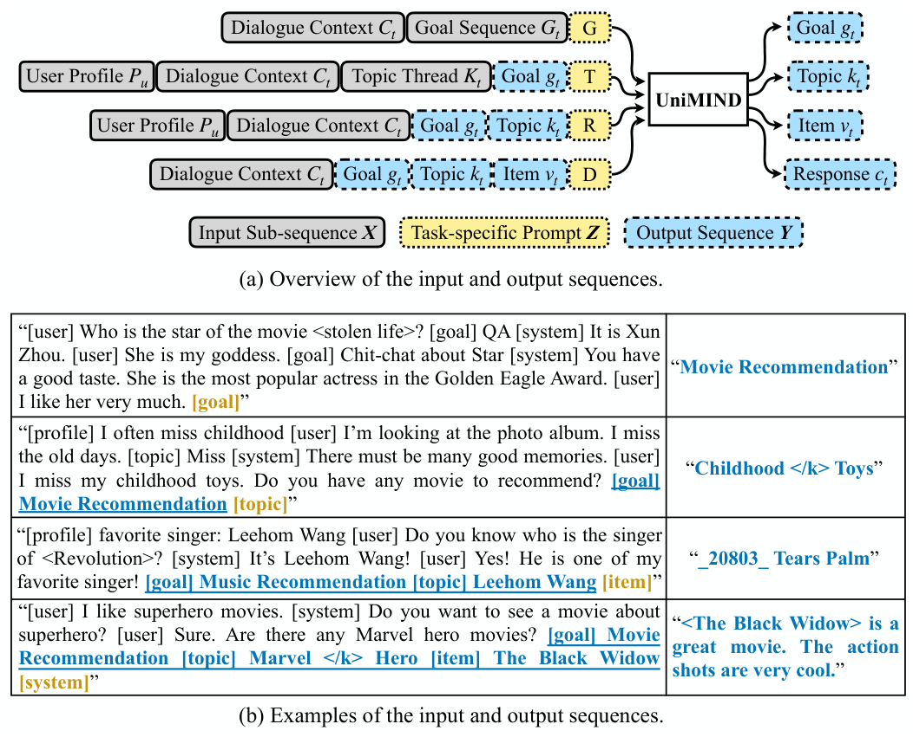

# A Unified Multi-task Learning Framework for Multi-goal Conversational Recommender Systems (多目标对话推荐系统的统一多任务学习框架)

- **会议/期刊**: ACM TOIS (arXiv 2022-04)
- **作者与机构**: Yang Deng, Wenxuan Zhang, Weiwen Xu, Wenqiang Lei, Tat-Seng Chua, Wai Lam（香港中文大学 / 四川大学 / 新加坡国立大学）
- **推荐链路定位**: 端到端生成式（对话式召回-推荐-回复一体化）
- **研究方向**: 对话推荐与智能体仿真 / 大语言模型推荐
- **论文原文**: [https://arxiv.org/abs/2204.06923v1](https://arxiv.org/abs/2204.06923v1)
- **开源代码**: [https://github.com/dengyang17/UniMIND](https://github.com/dengyang17/UniMIND)

## TL;DR (1分钟核心速览)

多目标对话推荐（MG-CRS）包含目标规划、主题预测、物品推荐、回复生成四个范式各异（多标签分类 / 排序 / 文本生成）的任务，现有工作要么只做其中一部分，要么用模块化流水线各自独立训练，割裂了任务间依赖。本文提出 UniMIND，把四个任务全部重写为同一 Seq2Seq 生成范式，并借助任务特定 Prompt 实现单模型多任务学习。在 DuRecDial 与 TG-ReDial 上，回复生成 F1 相较最强基线分别提升 3.4% 与 8.6%，主题预测 Hit@1 从 0.4420 升至 0.7351（+66.3%），物品推荐 NDCG@10 提升 10.9%–13.9%，全部任务 SOTA。

## Background & Motivation (背景与核心矛盾)

- **主流范式**: MG-CRS 被拆成四个子任务，主流做法是模块化框架——MGCG 用 CNN 做两阶段目标分类（完成度估计 + 目标预测）+ 多 GRU 生成；TG-ReDial 的 Union 用三个独立 PLM 模块分别做主题、物品与回复，且会话目标（闲聊 / 推荐）预先给定。
- **前人局限**: (i) 任务间本应互惠增强，但独立建模无任何跨任务信息流；(ii) 现实中不可能始终给定目标序列或主题线索，而现有工作大量依赖该先验（GOKC、KERS 在给定 goal 时性能显著更高），牺牲了 MG-CRS 与普通 CRS 的本质区别；(iii) 四任务范式差异大（分类 / 排序 / 生成），分别设计与调参成本高。
- **核心洞察 (Key Insight)**: 任何任务的输入输出都能被重述为 token 序列，因此 Seq2Seq 是天然的"公分母"范式；且生成式建模能利用**标签语义**（主题词本身）与**上下文词—候选物品的语义关联**，而非仅靠一个无语义的 ID 分类头。
- **本文切入点**: 范式迁移（paradigm shift）+ Prompt-based Learning，把异构任务压进一个 BART，再用统一目标联合训练。

## Method (核心方法设计)

### 1. 整体框架 (Overall Architecture)

以中文 BART-base 为骨干。每个样本被构造成"拼接式子序列 + 任务 Prompt"作为编码输入 $X$，目标输出$Y$一律为自然语言 token 序列；不同信息段（对话上下文、目标序列、主题线索、用户画像、物品）前加上 `[user] [system] [goal] [topic] [item] [profile]` 等**特殊段 token**，作为可学习的额外词表 embedding。训练分三阶段：① 四个任务的全部数据混合做多任务训练，得到共享参数$\theta$；② 以$\theta$为初值，对每个任务用其 Prompt 形式的数据各自继续微调，得到$\theta_G,\theta_T,\theta_R,\theta_D$；③ 推理时按 目标→主题→物品→回复 的顺序级联，前序输出作为后序输入的条件。

<figure class="paper-figure" markdown="span">
  <figcaption>图2. UniMIND输入与输出序列的概览及示例。</figcaption>
</figure>

### 2. 关键设计拆解 (Key Designs)

1. **四任务统一为 Seq2Seq（范式迁移）**：目标规划原需"完成度二分类 + 下一目标多分类"，存在两阶段误差传播，本文直接生成目标标签 $g_t=\text{UniMIND}(\mathcal{C}_t,\mathcal{G}_t)$；主题预测原为"逐候选匹配打分"$y_i=\text{CLS}(\text{Enc}(k_i),\text{Enc}(\cdot))$，候选集大且预测数量固定，本文改为多标签序列生成，用分隔符 `</k>` 拼接多个主题，推理时按该符号切分还原——这一改动使主题数量可为零、可多个，且与候选集规模解耦；物品推荐扩展词表，目标序列写作 `_100_ The Witness` 这种"索引 + 表面名"形式，兼顾 ID 可枚举性与语义可迁移性；回复生成本身即 Seq2Seq，无需迁移。
2. **特殊 Token Prompt（连续 Prompt）**：与 T5 式自然语言指令 $Z_G=$"Plan the next goal:" 不同，UniMIND_S 直接用段 token 作 Prompt（$Z_G=[goal]$、$Z_T=[topic]$、$Z_R=[item]$、$Z_D=[system]$）。这些 token 本就承担"标记信息类型起点"的职责，其表示因而天然编码了各信息形态的差异（如 `[goal]`/`[topic]` 各自隔离一组分类标签空间，`[system]` 区分说话人角色），复用为任务指示器几乎零额外参数——实验显示该变体在多数任务上略优于自然语言 Prompt。
3. **训练目标与推理开销**：所有任务共用同一逐 token 似然目标
$\mathcal{L}_{\theta}=\sum_{l=1}^{L}\log p_{\theta}(y_l\mid y_{<l};X,Z)$，
物品推荐在推理时只解码一步并按扩展词表中的物品概率取最大：
$v_t=\arg\max_{v^{(i)}\in\mathcal{V}}p_{\theta}(v^{(i)}\mid[\text{sos}];\mathcal{C}_t,\mathcal{P}_u,g_t,k_t)$。
无负采样设计（全词表 softmax 隐式归一化），单样本推理需 4 次前向（目标 / 主题 / 物品各 1 步 + 回复自回归），成本约为单任务模型的 4 倍。

## Experimental Setup & Evaluation Protocol (实验设置与评估协议)

- **数据集与预处理**（沿用原数据集划分，未额外过滤）：

| 数据集 | #Users | #Items | #Dialogues (train/dev/test) | #Utterances | #Goals / #Topics | 场景说明 |
| :--- | :---: | :---: | :---: | :---: | :---: | :--- |
| TG-ReDial | 未披露 | 33,834 | 10,000 (8,495/757/748) | 129,392 | 8 / 2,571 | 电影域，主题为抽象话题类 |
| DuRecDial | 未披露 | 11,162 | 10,190 (6,618/946/2,626) | 155,477 | 21 / 701 | 跨域（电影/音乐/餐厅），主题为知识实体 |

- **数据划分与防穿越**: 采用**原始数据集的固定比例划分**（非 Leave-One-Out），复用官方 train/dev/test 以避免与基线不可比；测试集目标序列严格不可见（表中 `×`/`✓` 标记区分是否在测试时喂入 ground-truth goal/topic）。
- **排名评测协议**: 物品推荐为 **Full-Ranking（在全部 33,834 / 11,162 个物品上排序）**，报告 NDCG@{10,50} 与 MRR@{10,50}；主题预测在全部候选主题上做 **Full-Ranking**，报告 Hit@{1,3,5} 与 Micro-P/R/F1（无主题的样本若预测为空则记 P=R=F1=1）；回复生成用 F1 / BLEU-1,2 / Dist-2 / PPL。显著性采用 $p<0.05$ 的统计检验（†）。
- **对比基线与超参**: 回复生成对比 seq2seq、PGN、PostKS、Trans.、GPT-2、BART、MGCG、GOKC、KERS、Union、TopicRef.；目标规划对比 MGCG、BERT、BERT+CNN；主题预测对比 Topic/Profile/Conv-BERT、Union；物品推荐对比 GRU4Rec、SASRec、TextCNN、BERT、Union。学习率 5e-5、weight decay 0.01、源/目标最大长度 512/100；多任务训练 15 epoch + Prompt 微调 5 epoch。

## Key Experimental Results (实验关键数据)

### 1. 主实验对比 (Main Results)

回复生成（端任务）：

| 模型 | TG-ReDial F1 | TG BLEU-1/2 | TG PPL | DuRecDial F1 | Du BLEU-1/2 | Du PPL |
| :--- | :---: | :---: | :---: | :---: | :---: | :---: |
| GPT-2 | – | 0.279/0.066 | 13.38 | 47.01 | 0.392/0.295 | 15.56 |
| BART | 32.80 | 0.291/0.070 | 7.59 | 48.41 | 0.418/0.328 | 8.72 |
| Union | – | 0.280/0.065 | 7.22 | – | – | – |
| TopicRef. | – | 0.294/0.086 | – | – | – | – |
| MGCG | – | – | – | 42.04 | 0.362/0.252 | 14.89 |
| GOKC | – | – | – | 47.28 | 0.413/0.318 | 11.38 |
| KERS | – | – | – | 50.47 | 0.463/0.362 | 8.34 |
| **UniMIND_N** | – | – | – | **52.19**† | **0.479/0.398**† | **6.63**† |
| **UniMIND_S** | **35.62**† | **0.314/0.090**† | **5.22**† | 51.87† | 0.477/0.397† | 6.69† |
| Improv. | +8.6% | +6.8%/+4.7% | −31.2% | +3.4% | +3.5%/+9.9% | −20.5% |

子任务（代表性最优基线 vs. UniMIND）：

| 任务 / 指标 | 数据集 | 最强基线 | UniMIND | Improv. |
| :--- | :---: | :---: | :---: | :---: |
| 目标规划 F1 | TG-ReDial | 0.8971 (BERT+CNN) | **0.9137** | +1.9% |
| 目标规划 F1 | DuRecDial | 0.9229 (BERT+CNN) | **0.9357** | +1.4% |
| 主题预测 Hit@1 | TG-ReDial | 0.4420 (Union) | **0.7351** | +66.3% |
| 主题预测 F1 | DuRecDial | 0.7582 (Union) | **0.8978** | +18.4% |
| 物品推荐 NDCG@10 | TG-ReDial | 0.0348 (Union) | **0.0386** | +10.9% |
| 物品推荐 NDCG@10 | DuRecDial | 0.5568 (Union) | **0.6343** | +13.9% |

### 2. 消融实验 (Ablation Study)

| 变体 | TG F1 | TG BLEU-1/2 | Du F1 | Du BLEU-1/2 |
| :--- | :---: | :---: | :---: | :---: |
| UniMIND_S (完整) | **35.62** | **0.314/0.090** | **51.87** | **0.477/0.397** |
| w/o MTL（四模型独立训练） | 34.73 | 0.305/0.086 | 50.98 | 0.465/0.381 |
| w/o PL（无任务 Prompt） | 33.94 | 0.299/0.084 | 50.67 | 0.454/0.373 |
| DirectGen（仅对话历史） | 32.80 | 0.291/0.070 | 48.41 | 0.418/0.328 |
| OracleGen（注入金标三元组） | 39.43 | 0.350/0.104 | 55.07 | 0.525/0.444 |
| 主题 → 金标 Oracle | 38.22 | 0.336/0.100 | 52.68 | 0.492/0.413 |
| 主题 → Union 预测值 | 34.32 | 0.301/0.084 | 51.09 | 0.469/0.383 |
| w/o 主题 | 35.01 | 0.307/0.085 | 48.73 | 0.426/0.340 |
| w/o 目标 | 35.13 | 0.309/0.086 | 50.97 | 0.467/0.380 |
| w/o 物品 | 35.73 | 0.315/0.090 | 51.10 | 0.469/0.385 |

### 3. 关键实验发现 (Key Findings)

1. **"信息注入"贡献远大于"任务耦合"贡献**：从 DirectGen（32.80/48.41）到 OracleGen（39.43/55.07）F1 提升 15%–25%，而多任务学习与 Prompt 微调各自只带来约 1–2 个 F1 点（35.62→34.73 / 33.94）。这说明统一框架的主要收益来自把目标、主题、物品显式写进输入序列，而非参数共享本身。
2. **任务重要性呈现明显的"主题 ≫ 目标 > 物品"梯度**：把主题替换为金标可涨到 38.22/52.68，而 w/o item 在 TG-ReDial 上甚至略高于完整模型（35.73 vs 35.62），DuRecDial 上仅掉 0.77。即回复的语言合理性主要由主题驱动，物品身份几乎不影响文本生成质量——这也解释了为何 UniMIND 在物品推荐上依赖扩展词表的语义线索。
3. **生成式重述对变长多标签任务收益最大**：主题预测 Hit@1 从 0.4420 跃至 0.7351，甚至超过最强基线的 Hit@5（0.6374）；同时传统序列推荐在稀疏交互下几乎失效（GRU4Rec / SASRec 在 TG-ReDial 的 NDCG@10 仅 0.0028 / 0.0092，远低于文本基线 0.0246）。人评四个维度（Fluency 1.94、Informativeness 1.62、Appropriateness 1.72、Proactivity 1.96）均优于 GPT-2 / Union / BART，但在 Informativeness 上距人类（1.90）仍有明显差距。

## Highlights & Limitations (亮点、对比与审稿批判)

- **与代表作对比 (vs. Prior Work)**: 相比 MGCG（CNN 两阶段目标分类 + 多 GRU，目标需分两步），本文把目标规划压成一次生成，消除级联误差；相比 Union / TG-ReDial（三个独立 PLM 模块且 goal 预定义），本文四任务共享一个骨干并自动规划 goal；相比 GOKC / KERS（强制给定完整 goal 序列），本文在 DuRecDial 上即使不给 goal 也高出 KERS 的 w/o goal 版本（52.19 vs 48.95）。
- **可迁移亮点**: (i) 用分隔符 `</k>` 做变长多标签生成 + 切分还原，可直接搬到多兴趣召回、多标签意图识别；(ii) `_id_ 表面名` 的扩展词表目标序列写法，让生成式模型同时拥有 ID 精确匹配与语义泛化能力，是后续 TIGER 类语义 ID 工作的前驱技巧。
- **审稿级局限批判**: (i) 论文宣称"unified model"，但算法 1 中每个任务从共享 $\theta$出发各自微调，最终需保存并部署$\theta_G,\theta_T,\theta_R,\theta_D$**四份参数副本**，参数量与线上显存并未真正压缩，推理也需四次前向，延迟叠加；(ii) 误差传播未解决，EM 从主题 87.20% 衰减到物品 80.17%，在 TG-ReDial 上回复 EM 仅 15.44%；(iii) 完全未使用用户历史交互（$\mathcal{P}_u$ 仅以文本形式入模），导致 TG-ReDial 物品推荐 NDCG@10 仅 0.0386，绝对水平偏低；(iv) 主题预测表中 UniMIND 未报 Hit@3/@5，而基线按最高 F1@k 汇报，指标对齐存在轻微不公平。

## Rating (四维评分)

- **方法创新性 (Novelty)**: ⭐⭐⭐⭐ （范式迁移 + 特殊 token 双重身份的 Prompt 设计颇为巧妙，但本质是 BART 多任务工程化，理论新意有限）
- **评估协议与实验扎实度 (Protocol & Experiments)**: ⭐⭐⭐⭐ （两数据集 × 四任务 × Full-Ranking + 人评 + 分目标类型分析相当完整，扣分在于未用 Leave-One-Out、主题预测指标对齐与显著性检验覆盖不足）
- **写作与数学规范度 (Clarity & Rigor)**: ⭐⭐⭐⭐ （四任务的"旧公式 → 新公式"对照写法非常清晰，符号统一；但缺复杂度与推理成本分析）
- **工业落地与复现价值 (Industrial & Practical Value)**: ⭐⭐⭐ （代码已开源、基于中文 BART 易复现；但四份参数副本 + 四次前向的级联推理在低延迟对话场景成本偏高，物品推荐绝对精度尚不足上线）

