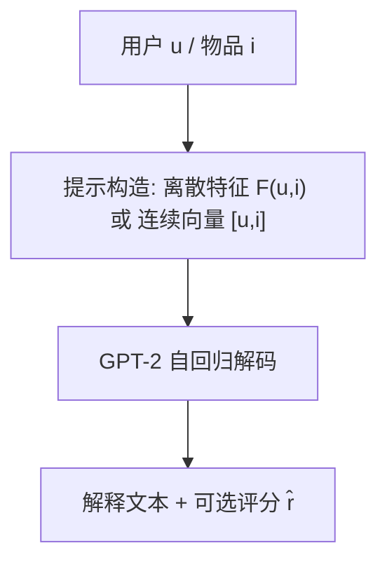
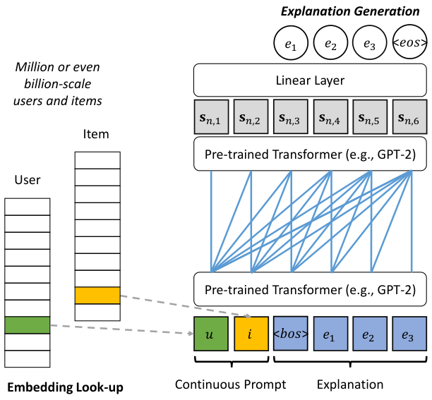

# Personalized Prompt Learning for Explainable Recommendation (面向可解释推荐的个性化提示学习)

- **会议/期刊**: ACM TOIS (arXiv 2022-02)
- **作者与机构**: Lei Li, Li Chen (Hong Kong Baptist University)；Yongfeng Zhang (Rutgers University)
- **推荐链路定位**: 端到端生成式（推荐理由/解释文本生成，可与任意召回/排序模型解耦）
- **研究方向**: 对话推荐与智能体仿真 / 大语言模型推荐
- **论文原文**: [https://arxiv.org/abs/2202.07371v2](https://arxiv.org/abs/2202.07371v2)
- **开源代码**: [https://github.com/lileipisces/PEPLER](https://github.com/lileipisces/PEPLER)

## TL;DR (1分钟核心速览)

可解释推荐需要为用户-物品对生成自然语言理由，但用户/物品 ID 与预训练语言模型的词向量处于完全不同的语义空间，直接拼接会让随机初始化的 ID 向量无法被 SGD 有效优化。本文提出 PEPLER：把 ID 当作**提示**——要么转成物品特征构成离散提示（PEPLER-D），要么直接作为连续提示向量输入 GPT-2（PEPLER），并配套**顺序调优**（先冻 LM 训 prompt，再联合微调）与**推荐即正则**两种训练策略。在 TripAdvisor/Amazon/Yelp 三个数据集、8:1:1 五次随机划分下，PEPLER 的 BLEU-4 相对最强基线 PETER 提升 15%–21%，特征覆盖率 FCR 提升约 1 倍。

## Background & Motivation (背景与核心矛盾)

- **主流范式**: 解释生成普遍采用"MLP 把 user/item ID 编码成 context 向量 + LSTM/GRU 或小型未预训练 Transformer 解码"，代表作为 NRT、Att2Seq、PETER。
- **前人局限**: ① GPT-2/GPT-3 级模型参数达十亿量级、训练语料百 GB 级，无法定制修改结构或重新预训练，而 ID 又必须进入模型；② 把 ID 转成 item features 虽能对齐词空间，却丢失 ID 的**辨识（identification）作用**——由"爱吃奶酪"无法反推"这是 Jerry"。
- **核心洞察 (Key Insight)**: Prompt learning 的思路是"让任务适配模型而非改模型"；但连续提示随机初始化、预训练权重已收敛，二者处于**不同学习阶段**，SGD 只能在随机初始点的小邻域内更新，导致融合失败。
- **本文切入点**: ID 即提示（离散=特征词，连续=ID 向量），再用两阶段调优/推荐正则把两类参数拉到同一学习阶段。

## Method (核心方法设计)

### 1. 整体框架 (Overall Architecture)

输入仅需 $(u,i)$，因此与任何推荐模型兼容。先构造提示：离散路线检索$u,i$ 关联特征拼成定长词序列；连续路线取出两组随机初始化的 ID 嵌入。提示与解释词序列拼接后送入 GPT-2（单向掩码自回归），末端线性层 + softmax 做逐词预测；训练用 NLL，并可选地用评分预测任务作正则；推理时以 `<bos>` 起手贪心解码至 `<eos>` 或长度上限（20 BPE token）。

<figure class="paper-figure" markdown="span">
  <figcaption>图 4. 我们提出的方法 PEPLER，将用户和物品 ID 作为连续提示用于解释生成。</figcaption>
</figure>

### 2. 关键设计拆解 (Key Designs)

1. **离散提示 PEPLER-D（用特征替代 ID）**：为兼顾信息量与定长约束，先取 $u,i$ 共有特征（最能解释"为何推荐给他"），不足再以并集差补齐：
$F_{u,i}=[(F_u\cap F_i),\ (F_u\cup F_i)/(F_u\cap F_i)]$损失为$\mathcal{L}_D=\frac{1}{|\mathcal{T}|}\sum_{(u,i)}\frac{1}{|E_{u,i}|}\sum_t -\log c_{e_t}^{|F_{u,i}|+t}$。有效直觉：特征词与 LM 词表同源，无需新增参数，但牺牲了 ID 的辨识信息。

2. **连续提示 PEPLER（ID 向量直入）**：不把 ID 加入词表（否则 $|\mathcal{V}|$膨胀到百万级、解码 softmax 不可行），而是维护$\mathbf{U}\in\mathbb{R}^{|\mathcal{U}|\times d}$、$\mathbf{I}\in\mathbb{R}^{|\mathcal{I}|\times d}$，以$\boldsymbol{u}=\mathbf{U}^{\top}g(u)$查表，序列变为$[u,i,e_1,\dots]$，损失$\mathcal{L}_C$ 的偏移量为 2。它保留完整 ID 信息，代价是引入"随机初始化 vs 预训练收敛"的阶段差。

3. **两种桥接策略与总目标**：*顺序调优*先冻结 $\Theta_{LM}$只训$\Theta_P$，收敛后再联合优化$\min_{\Theta=\{\Theta_{LM},\Theta_P\}}\mathcal{L}_C$，等价于 Fixed-LM Prompt Tuning → Prompt+LM Fine-tuning 的串联；*推荐即正则*用评分信号约束 ID 嵌入，MF 版$\hat{r}_{u,i}=\boldsymbol{u}^{\top}\boldsymbol{i}$（零额外参数），MLP 版经$z=2$ 层隐层输出，最终
$\mathcal{J}=\min_{\Theta}\left(\mathcal{L}_C+\lambda\mathcal{L}_R\right),\ \mathcal{L}_R=\frac{1}{|\mathcal{T}|}\sum(r_{u,i}-\hat{r}_{u,i})^2$
训练免负采样（纯生成任务），推理为逐 token 贪心，单条解释约 20 步前向。

## Experimental Setup & Evaluation Protocol (实验设置与评估协议)

- **数据集与预处理**: 三个公开可解释推荐数据集，每条记录含 user ID、item ID、1–5 评分、解释句与物品特征；解释句保证至少含一个特征词。

| 数据集 | #Users | #Items | #Interactions | #Features | 记录/用户 | 记录/物品 | 场景 |
| :--- | :---: | :---: | :---: | :---: | :---: | :---: | :--- |
| TripAdvisor | 9,765 | 6,280 | 320,023 | 5,069 | 32.77 | 50.96 | 酒店 |
| Amazon | 7,506 | 7,360 | 441,783 | 5,399 | 58.86 | 60.02 | 电影&TV |
| Yelp | 27,147 | 20,266 | 1,293,247 | 7,340 | 47.64 | 63.81 | 餐厅 |

- **数据划分与防穿越**: **比例划分 8:1:1**，重复 5 次随机划分并取均值；约束训练集对每个 user 与每个 item 至少保留 1 条记录（非 Leave-One-Out，非全局时间戳切分）。
- **评估协议**: 属**生成式评测**，不含全库/采样排序指标。文本质量用 BLEU-1/4、ROUGE-1/2 的 P/R/F1；解释性用 USR（唯一句比例，检测"千人一面"）、FMR（生成句是否命中真值特征）、FCR（生成覆盖的全局特征比例）、DIV（两两句特征交集，越低越好）。
- **对比基线与超参**: ACMLM（BERT+特征注意力）、NRT（GRU）、Att2Seq（2 层 LSTM）、PETER（小型未预训练 Transformer + context prediction）。骨干 GPT-2 small，$d=768$、词表 50,257 BPE，batch 128，学习率 1e-3（PEPLER）/1e-4（PEPLER-D），$\lambda\in[10^{-5},10^{3}]$网格搜索，$d_h=400$，$p<0.01/0.05$ 的 Student's t 检验。

## Key Experimental Results (实验关键数据)

### 1. 主实验对比 (Main Results)

表 1 Yelp（最大规模数据集，% 值省略百分号；↑越大越好，DIV↓）

| 方法 | BLEU-4 | R1-F | R2-F | FMR | FCR | USR | DIV |
| :--- | :---: | :---: | :---: | :---: | :---: | :---: | :---: |
| ACMLM (BERT) | 0.24 | 6.82 | 0.39 | 0.05 | 0.31 | 0.95 | 0.95 |
| PEPLER-D | 0.40 | 11.73 | 0.83 | 0.05 | 0.24 | 0.13 | 1.53 |
| NRT (GRU) | 0.60 | 12.89 | 1.26 | 0.06 | 0.12 | 0.20 | 1.67 |
| Att2Seq (LSTM) | 0.54 | 12.72 | 1.16 | 0.05 | 0.05 | 0.05 | 2.25 |
| PETER (Transformer) | 0.63 | 12.63 | 1.28 | 0.08 | 0.15 | 0.15 | 1.62 |
| PEPLER (顺序调优) | 0.73 | 13.53 | 1.46 | 0.08 | **0.30** | **0.35** | **1.52** |
| PEPLER (MLP 正则) | 0.68 | 13.36 | 1.40 | 0.08 | 0.24 | 0.25 | 1.58 |
| **PEPLER (MF 正则)** | **0.75** | **13.72** | **1.48** | 0.08 | 0.27 | 0.30 | 1.66 |
| Improv. vs PETER | +19.0% | +8.6% | +15.6% | — | +100% | +133% | — |

表 2 另两个数据集的 BLEU-4 / ROUGE-1 F1（括号内为相对 PETER 提升）

| 方法 | Amazon B4 | Amazon R1-F | TripAdvisor B4 | TripAdvisor R1-F |
| :--- | :---: | :---: | :---: | :---: |
| ACMLM | 0.22 | 9.69 | 0.02 | 3.72 |
| PEPLER-D | 0.49 | 12.80 | 0.87 | 15.32 |
| NRT | 0.69 | 13.83 | 0.80 | 15.58 |
| Att2Seq | 0.73 | 14.14 | 0.96 | 16.38 |
| PETER | 0.89 | 13.55 | 1.00 | 16.00 |
| PEPLER | 1.05 | 14.87 | 1.09 | 16.24 |
| **PEPLER (MF)** | **1.08** (+21.3%) | **14.92** (+10.1%) | **1.15** (+15.0%) | **16.69** (+4.3%) |

### 2. 消融实验 (Ablation Study)

| 消融对象 | 配置 | 关键指标变化（Amazon / Yelp） |
| :--- | :--- | :--- |
| 提示形式 | 连续 → 离散 (PEPLER-D) | B4 1.05→0.49 / 0.73→0.40；USR 0.38→0.15 |
| 训练策略 | 顺序调优 → Prompt+LM 联合微调 | 三条数据集 BLEU-4 曲线均低于顺序调优（Fig.6） |
| 训练策略 | 顺序调优 → Fixed-LM 仅训 prompt | 曲线平稳但整体最低，LM 无法适配解释任务 |
| 正则形式 | MF → MLP | FCR 0.24→0.34、USR 0.35→0.48，但 B4 1.02→1.08 反向 |
| 正则强度 $\lambda$|$10^{-2}\to10^{3}$ | BLEU-4 先升后降，USR/FCR 单调下降（TripAdvisor） |
| 骨干规模 | small → medium/large | BLEU-4 无单调上升趋势，XL 直接 OOM |

### 3. 关键实验发现 (Key Findings)

1. **ID 直用 > ID 转特征，但离散路线并非无效**：Yelp 上 PEPLER 比 PEPLER-D 的 BLEU-4 高 87.5%（0.75 vs 0.40），验证了"特征无法反推 ID"的辨识信息损失；而 PEPLER-D 仍把 ACMLM 从 0.24 拉到 0.40（+67%），说明自回归预训练骨干本身就比 BERT 式掩码填空更适合生成长句。
2. **预训练知识是文本质量的主因，且不牺牲解释性**：PEPLER(MF) 相对同为 Transformer 但未预训练的 PETER，BLEU-4 在 Yelp/Amazon/TripAdvisor 分别 +19.0%/+21.3%/+15.0%；同时 FCR 从 0.15 升至 0.27–0.30（约翻倍），说明流畅度与特征命中并非零和。RNN 系基线（NRT/Att2Seq）则因长程依赖与重复句问题（TripAdvisor 上 USR 仅 0.00/0.02）落后。
3. **推荐正则存在"质量-多样性"权衡，且 MF 优于 MLP**：MF 零额外参数，Yelp BLEU-4 达 0.75（MLP 0.68），但 MLP 在 Amazon 上 FCR 0.34、USR 0.48 更优；$\lambda$增大时 BLEU-4 与 RMSE 此消彼长，USR/FCR 持续下降，故作者以文本质量优先选$\lambda$（约$10^{-2}$）。

## Highlights & Limitations (亮点、对比与审稿批判)

- **与代表作对比**: vs **PETER**（小型未预训练 Transformer + context prediction 辅助任务桥接 ID），本文不改结构、直接借 GPT-2 的语言知识，靠"提示 + 两阶段调优"完成融合，参数利用效率更高；vs **ACMLM**（BERT 掩码填空），本文是真正的自回归生成，句子可读性差距悬殊（ACMLM 输出近似乱序词袋）；vs **NRT/Att2Seq**（RNN + MLP 编码 ID），本文避免了长程依赖与模式坍塌。
- **可迁移亮点**: ① 两阶段顺序调优可泛化到任何"新随机初始化模态嵌入 + 已收敛预训练骨干"的融合场景（多模态 ID、跨域 ID、语音/图像 token）；② ID 向量不进词表、仅作前置位置偏移的做法，避免了百万级词表 softmax，是生成式推荐里控制解码开销的实用技巧。
- **审稿级局限批判**: ① 评测只有生成指标，**完全缺失推荐排序评估（HR/NDCG）与在线 A/B 或人工评测**，"解释更好"是否真的提升用户信任仍属外推；② 每条解释需 20 步自回归贪心解码，线上延迟远高于模板/检索式解释，论文未报告推理时延；③ 依赖数据集自带的人工标注 item feature（离散路线直接依赖，连续路线的可解释性度量也依赖），特征抽取质量与跨语言迁移未验证；④ 骨干规模实验显示 medium/large 无增益且 XL OOM，规模效应结论不完整。

## Rating (四维评分)

- **方法创新性 (Novelty)**: ⭐⭐⭐⭐ （首个把 prompt learning 系统引入可解释推荐，"ID 即提示"的视角清晰，但机制本身是已有 prompt tuning 的组合与工程化）
- **评估协议与实验扎实度 (Protocol & Experiments)**: ⭐⭐⭐⭐ （三数据集 × 5 次随机划分 + t 检验 + 文本/解释性双维度指标较完整，扣分在于缺排序指标与人工评测）
- **写作与数学规范度 (Clarity & Rigor)**: ⭐⭐⭐⭐⭐ （提示、掩码、偏移位置、两阶段目标推导清楚，与五种 tuning 范式的对照表尤其清晰）
- **工业落地与复现价值 (Industrial & Practical Value)**: ⭐⭐⭐ （代码与 GPT-2 配置完整可复现，但与推荐主链路解耦、生成延迟高，需蒸馏或缓存才能上线）

