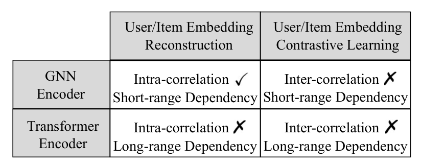
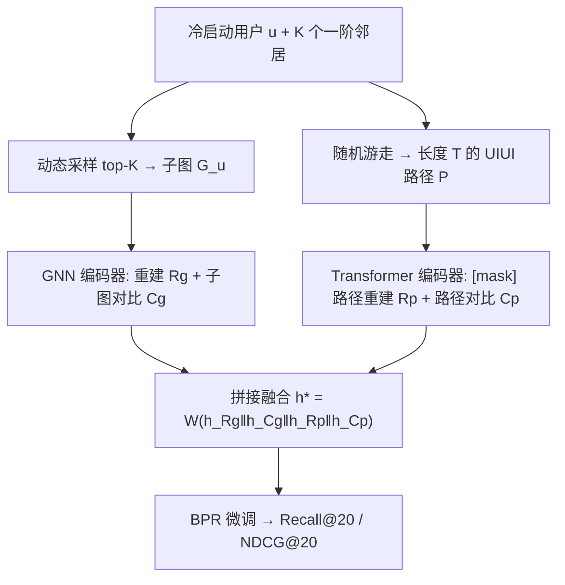
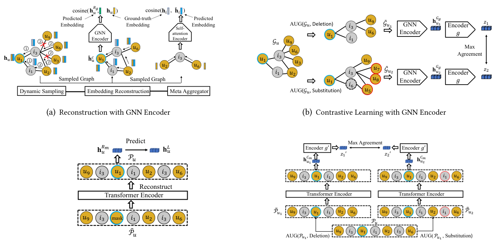

# A Multi-Strategy based Pre-Training Method for Cold-Start Recommendation (冷启动推荐的多策略预训练方法)

- **会议/期刊**: ACM TOIS (Proc. ACM Meas. Anal. Comput. Syst.), 2022；CIKM'21 会议版 PT-GNN 的期刊扩展
- **作者与机构**: Bowen Hao, Jing Zhang, Cuiping Li, Hong Chen (中国人民大学)；Hongzhi Yin (昆士兰大学)
- **推荐链路定位**: 召回（冷启动用户/物品表征预训练）
- **研究方向**: 冷启动与长尾推荐 / 自监督对比学习
- **论文原文**: [论文原文链接](https://arxiv.org/abs/2112.02275v4)
- **开源代码**: 暂未开源

## TL;DR (1分钟核心速览)

冷启动用户交互极稀疏，GNN 受过平滑限制只能有效聚合 $\le 3$ 跳邻居，而 PT-GNN 的嵌入重建借口任务只建模子图内部 (intra) 相关性、忽略跨子图 (inter) 相关性。MPT 从两处扩展：架构上加 Transformer 路径编码器捕获长程依赖，任务上加图/路径双粒度对比学习；四类借口任务在 meta-learning 框架下独立预训练、拼接微调。在 Ml-1M/MOOCs/Gowalla 的金属冷启动划分下，以 LightGCN 为骨干的 MPT 相对 PT-GNN 外延 Recall@20 提升 20.5%/12.3%/4.1%，NDCG@20 提升 42.3%/21.2%/16.1%。

## Background & Motivation (背景与核心矛盾)

- **主流范式**: 冷启动一是靠 side information（KG、内容特征）补表征，二是靠 GNN 高阶邻居聚合或元学习（PT-GNN 在元学习设定下重建真值嵌入）显式提升冷启动表征质量。
- **前人局限**: ① 过平滑/过拟合使 GNN 实质上只能看到 $\le 3$ 跳邻居，而冷启动节点的低阶邻居几乎无信息，恰恰最需要高阶信号；② 嵌入重建是生成式任务，只看目标子图内部相关性，无法利用不同用户/物品子图之间的相似性（这正是对比学习的强项）。
- **核心洞察 (Key Insight)**: 短程依赖（低阶邻居）、长程依赖（随机游走路径上的共现顺序）、intra 相关、inter 相关是四种互补信息源，冷启动表征必须同时覆盖四者，缺一即容量缺口（图 1 的"✓/%"示意）。

<figure class="paper-figure" markdown="span">
  <figcaption>图1. MPT对原始PT-GNN的改进。✓表示PT-GNN的容量，%表示PT-GNN的缺失容量。</figcaption>
</figure>

- **本文切入点**: 骨干网络 GNN + Transformer 并联，借口任务重建 + 对比并联，四任务独立预训练后拼接融合。

## Method (核心方法设计)

### 1. 整体框架 (Overall Architecture)

对每个目标用户 $u$（物品同理），先保留至多$K$个一阶邻居构造子图$\mathcal{G}_u$并做$L$步图卷积，同时从$\mathcal{G}_u$出发随机游走生成长度$T$的 UIUI 路径$\mathcal{P}$；GNN 分支执行"重建 + 子图对比"，Transformer 分支执行"掩码路径重建 + 路径对比"，四个借口任务各自持有独立初始化的嵌入表并完全并行预训练；微调阶段把四路输出拼接为$\mathbf{h}^*_u$，用 BPR 损失在下游推荐任务上联合微调编码器。

### 2. 关键设计拆解 (Key Designs)

1. **动态邻居采样（替换 REINFORCE 采样器）**：PT-GNN 的自适应采样器是 Monte-Carlo 策略梯度，动作-状态轨迹复杂、收敛慢。MPT 用"元嵌入 $\tilde{\mathbf{h}}$（自注意力聚合的一阶邻居摘要，刻画冷启动特性）+ 当前训练嵌入$\mathbf{h}^l$"拼接后的余弦相似度做 top-$K_l$选择：$a_{uj}=\cos(\tilde{\mathbf{h}}_u\|\mathbf{h}^l_u,\ \tilde{\mathbf{h}}_j\|\mathbf{h}^l_j)$，再取$\mathrm{S\_TOP}$保留$K_l$ 个邻居。它每轮只需一次前向打分，无需多次采样，兼顾冷启动感知与效率。
2. **Transformer 掩码路径重建（补长程依赖）**：GNN 看不到 $>3$跳，但路径上的顺序共现能编码远程协同信号。将路径$\mathcal{P}=[x_1,\dots,x_T]$中目标用户位置替换为 `[mask]`，用 Transformer 第$t$位隐向量预测真值嵌入，损失为$\mathcal{L}_{Rp}=\sum_u \cos(\mathbf{h}^{Rp}_u,\mathbf{h}_u)$；推理时枚举所有把$u$放在第$t$位的路径并平均预测。自注意力可显式对齐任意距离的两个节点，故$T=8$ 时收益最大。
3. **双粒度对比 + 融合微调**：重建只覆盖 intra 相关性，故对子图/路径做删除 ($a\%$) 或替换 ($b\%$) 增广，同源两次增广为正对、批内其余为负对，用 InfoNCE$l_c(m,n)=-\log\frac{\exp(\cos(\mathbf{z}_m,\mathbf{z}_n)/\tau)}{\sum_{k=1}^{2N}\mathbb{I}_{k\neq m}\exp(\cos(\mathbf{z}_m,\mathbf{z}_k)/\tau)}$拉近相似节点、推开异质节点；微调时拼接四路$\mathbf{h}^*_u=\mathbf{W}(\mathbf{h}^{Rg}_u\|\mathbf{h}^{Cg}_u\|\mathbf{h}^{Rp}_u\|\mathbf{h}^{Cp}_u)$，用 BPR$\mathcal{L}_{BPR}=\sum_{(u,i)\in E,(u,j)\notin E}-\ln\sigma(y_{ui}-y_{uj})$ 优化，训练采用隐式反馈 1 正 1 负采样，推理需 4 次编码器前向（比 PT-GNN 增加 2 次）但无负采样开销。

<figure class="paper-figure" markdown="span">
  <figcaption>图2. 所提出的预文本任务概览。这些预文本任务独立训练。</figcaption>
</figure>

## Experimental Setup & Evaluation Protocol (实验设置与评估协议)

- **数据集与预处理**:

| 数据集 | #Users | #Items | #Interactions | 稀疏度 | 场景说明 |
| :--- | :---: | :---: | :---: | :---: | :--- |
| MovieLens-1M | 6,040 | 3,706 | 1,000,209 | 4.47% | 电影评分，稠密 |
| MOOCs | 82,535 | 1,302 | 458,453 | 0.42% | 课程选课，用户极多 |
| Gowalla | 29,858 | 40,981 | 1,027,370 | 0.08% | LBS 签到，最稀疏 |

- **数据划分与防穿越 (Splitting Strategy)**: 采用**阈值式冷启动划分**（元学习元训练/元测试）。用户侧：一阶交互数 $>n_i$者入$D_T$，其余入$D_N$（$n_i$=25/10/25）；物品侧阈值$n_u$=15/10/15。内在任务在$D_T$上按 7:3 切分$Train_T/Test_T$，并对$Test_T$每节点仅保留$K$个邻居（$K=3$与$8$）模拟冷启动；外延任务在$D_N$上**按时间顺序**取前$c\%$=20% 交互作训练、其余作测试，杜绝未来交互泄漏。
- **排名评测协议 (Ranking Protocol)**: 外延为**全库排序 (Full-Ranking)**——对测试集用户的剩余 $1-c\%$物品全部打分排序，无负采样；指标 Recall@20 / NDCG@20（三数据集统一$K=20$）。内在评测用预测嵌入与真值嵌入的**余弦相似度**（真值由 NCF 学习，另做 LightGCN/GCMC/PinSage/NGCF 敏感性检验）。
- **对比基线与超参设置**: 三类基线——NCF；GNN（PinSage、GCMC、NGCF、LightGCN，后缀 `+` 表示接入 PT-GNN、`*` 表示接入 MPT）；自监督 SGL（后缀 `-SGL`）。默认 $d=32$、学习率 0.003、$L=4$、$T=6$、$a=b=0.2$、$\tau=0.2$。

## Key Experimental Results (实验关键数据)

### 1. 主实验对比 (Main Results)

外延冷启动推荐（$c\%$=20%，$L$=4）：

| 方法 | Ml-1M R@20 | Ml-1M N@20 | MOOCs R@20 | MOOCs N@20 | Gowalla R@20 | Gowalla N@20 |
| :--- | :---: | :---: | :---: | :---: | :---: | :---: |
| NCF | 0.004 | 0.009 | 0.132 | 0.087 | 0.039 | 0.013 |
| GCMC | 0.008 | 0.006 | 0.232 | 0.172 | 0.006 | 0.033 |
| PinSage-SGL | 0.040 | 0.033 | 0.172 | 0.086 | 0.011 | 0.021 |
| GCMC+ (PT-GNN) | 0.044 | 0.041 | 0.248 | 0.187 | 0.018 | 0.032 |
| GCMC* (MPT) | 0.071 | 0.076 | 0.272 | 0.212 | 0.065 | 0.043 |
| NGCF* (MPT) | 0.083 | 0.077 | 0.241 | 0.208 | 0.047 | 0.016 |
| LightGCN | 0.058 | 0.064 | 0.217 | 0.169 | 0.011 | 0.023 |
| LightGCN-SGL | 0.066 | 0.077 | 0.275 | 0.178 | 0.034 | 0.028 |
| LightGCN+ (PT-GNN) | 0.078 | 0.071 | 0.308 | 0.184 | 0.049 | 0.031 |
| **LightGCN\* (MPT)** | **0.094** | **0.101** | **0.346** | **0.223** | **0.051** | **0.036** |
| Improv. vs LightGCN+ | +20.5% | +42.3% | +12.3% | +21.2% | +4.1% | +16.1% |

内在嵌入推断（余弦相似度，8-shot）：MPT 在 LightGCN 骨干下用户/物品为 0.647/0.704 (Ml-1M)、Gowalla 物品达 0.774；GCMC* 物品最优 0.744/0.764，PinSage* 用户最优 0.690/0.698。相对 LightGCN 原始 0.549/0.600 提升约 15%–18%。

### 2. 消融实验 (Ablation Study)

MOOCs 数据集、LightGCN 骨干，四类借口任务单独使用 vs. 全量融合：

| 变体 | Recall@20 | NDCG@20 | 说明 |
| :--- | :---: | :---: | :--- |
| 仅 $Rg$（GNN 重建） | 0.336 | 0.205 | PT-GNN 主任务 |
| 仅 $Cg$（GNN 子图对比） | 0.219 | 0.156 | 无重建，内在任务最弱 |
| 仅 $Rp$（Trans 路径重建） | 0.234 | 0.171 | 依赖长程路径 |
| 仅 $Cp$（Trans 路径对比） | 0.182 | 0.160 | 排序收益 > 相似度收益 |
| LightGCN+（PT-GNN 全量） | 0.308 | 0.184 | 上一代 SOTA |
| **MPT（四任务融合）** | **0.346** | **0.223** | +12.3% / +21.2% |

采样策略效率（每轮平均，Ml-1M / MOOCs）：随机 0.56s / 2.78s，重要性 6.56s / 2.86s，PT-GNN 自适应 **134.64s / 160.37s**，MPT 动态 **8.93s / 3.20s**；而各变体每轮训练时间均约 205s / 240s。

### 3. 关键实验发现 (Key Findings)

1. **收益主要来自 inter-correlation 而非重建精度**：PT-GNN→MPT 在 Ml-1M 上 Recall 只涨 20.5%，NDCG 却涨 42.3%（0.071→0.101）；消融中仅 $Cg$/$Cp$ 的相似度指标很差（0.219/0.182）但排序指标不弱，证明对比任务优化的是"相对排序结构"，与重建任务的"绝对嵌入逼近"互补而非冗余。
2. **冷启动越极端，MPT 优势越大**：固定 LightGCN 骨干，当 $n_i$从 15 降到 5、$c\%$从 60% 降到 20%（用户可用交互更少）时，MPT 相对基线的领先幅度持续扩大；$K$从 8 降到 3 时所有基线大幅掉点而 MPT 仅小幅下降，说明路径级长程信号在$\le 5$ 个邻居时是唯一有效补充。
3. **换掉 RL 采样器几乎无损且大幅提速**：动态采样把每轮采样从 134.64s 压到 8.93s（Ml-1M，约 15×），训练时间持平，且性能优于自适应/重要性/随机三种策略——即 PT-GNN 的 REINFORCE 采样器是"高成本低回报"设计。

## Highlights & Limitations (亮点、对比与审稿批判)

- **与代表作对比 (vs. Prior Work)**: 相对 PT-GNN，本文本质是把"单架构单任务"扩成"双架构双任务"，并用 top-$K$相似度采样替掉 RL 采样；相对 SGL，SGL 是在下游任务上做多任务自监督增广（无真值嵌入监督），MPT 是预训练+微调且显式重建真值嵌入，二者在表 3 中差距明显（Ml-1M NDCG 0.077 vs 0.101）；相对 LightGCN 等纯 GNN，其增量在于跳出$\le 3$ 跳感受野。
- **可迁移亮点**: ① `[mask]` + 随机游走路径的"序列级重建"可低成本移植到序列推荐/会话推荐的预训练；② 用"元嵌入‖当前嵌入"的余弦 top-$K$ 替代 REINFORCE 邻居采样，是图采样加速的通用技巧。
- **审稿级局限批判**: ① 四任务各持独立嵌入表、独立预训练再拼接，参数量与预训练成本近 4 倍，且推理需 4 次编码 + 全路径枚举平均，线上时延未评测；② 冷启动靠人工阈值 $n_i/n_u$划分（本质是少交互而非零交互），外延评测只覆盖冷启动**用户**、未验证冷启动物品，Gowalla（密度 0.08%）上 Recall 仅 +4.1%，令人怀疑极稀疏图上$T=6$ 随机游走路径的信噪比。

## Rating (四维评分)

- **方法创新性 (Novelty)**: ⭐⭐⭐⭐ （架构×任务的双维正交扩展思路清晰，"长程依赖缺失 + inter 相关缺失"的诊断准确，但组件本身均为已有技术组合）
- **评估协议与实验扎实度 (Protocol & Experiments)**: ⭐⭐⭐⭐ （内在+外延双评测、全库排序、四类借口任务细粒度消融与采样效率对比齐备，扣分在于冷启动为阈值式划分、未覆盖冷启动物品与显著性检验）
- **写作与数学规范度 (Clarity & Rigor)**: ⭐⭐⭐⭐ （四任务公式与符号统一、复杂度分析到 $O(T^2 d)$与采样$O(E\cdot d\cdot|N^+|)$，但 Fig.4 矩阵与正文表述略有歧义）
- **工业落地与复现价值 (Industrial & Practical Value)**: ⭐⭐⭐ （预训练-微调范式与动态采样可直接落地，但 4 倍嵌入存储、路径枚举推理及未开源限制了工程复现）

