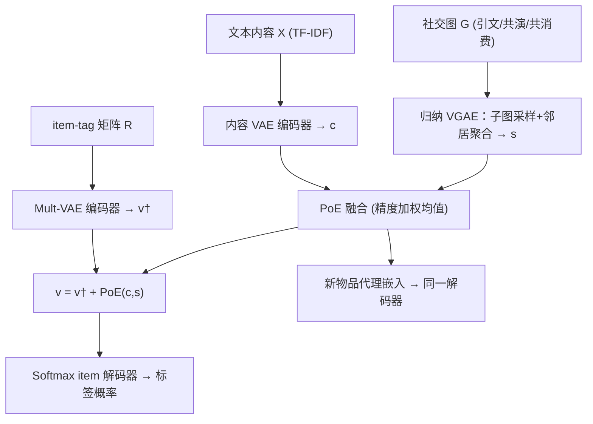

# Multi-Auxiliary Augmented Collaborative Variational Auto-encoder for Tag Recommendation (多辅助信息增强的协同变分自编码器标签推荐)

- **会议/期刊**: ACM TOIS (arXiv 2204.09422)
- **作者与机构**: Jing Yi, Xubin Ren, Zhenzhong Chen（武汉大学计算机学院 / 遥感信息工程学院）
- **推荐链路定位**: 召回（物品中心标签推荐，Top-N 候选标签生成）
- **研究方向**: 冷启动与长尾推荐 / 图神经网络与知识图谱推荐
- **论文原文**: [https://arxiv.org/abs/2204.09422v1](https://arxiv.org/abs/2204.09422v1)
- **开源代码**: 暂未开源

## TL;DR (1分钟核心速览)

面向“物品→标签”标注任务中交互极度稀疏（citeulike-t 密度仅 0.085%）与新物品无任何标注的冷启动困境。本文提出 MA-CVAE：以多项式 VAE 建模 item-tag 协同信号、内容 VAE 与**归纳式 VGAE** 分别建模文本与社交图，通过 Product-of-Experts 融合两路辅助潜变量，并由 MAP 推导出的 MSE 项将其与协同潜向量互相约束；再用同一 item 解码器对辅助嵌入加重建损失，使其成为新物品的“代理嵌入”。在 ml-20m / citeulike-a / citeulike-t 全标签库排序下，Recall@20 相对最强基线分别提升 **59.2% / 55.7% / 99.2%**。

## Background & Motivation (背景与核心矛盾)

- **主流范式**: 混合式标签推荐，把 item-tag 交互（PITF/GNN-PTR）与物品内容（bi-GRU+Attention、ITAG）拼在一个模型里；CTR-SR 进一步用层次贝叶斯模型把 LDA 主题与 PMF 线性耦合，并接入物品社交网络。
- **前人局限**: ① LDA/线性 PMF 表示力弱，在 high-dim 稀疏文本上反而失效——CTR-SR 在 citeulike-t 的 NDCG@20 仅 0.0479，低于纯协同的 PITF(0.0555)；② 社交图用线性项注入，且标准 VGAE 是**直推式(transductive)**的，训练时未见过的节点无法得到嵌入，新物品直接失效。
- **核心洞察 (Key Insight)**: 若把内容潜变量 $c$、社交潜变量$s$、协同潜变量$v$ 都建成高斯，则 PoE 的均值是**精度加权语义和**——信息量大的辅助源自动获得更大权重；而 MAP 推导会把“潜变量贴近”这一约束精确地化成一个 MSE 项，等价于三类信息互为正则。
- **本文切入点**: 用一个概率生成过程把 Mult-VAE、内容 VAE、归纳 VGAE 缝合成单一框架，并用辅助解码器为新物品提供无需交互的预测通路。

## Method (核心方法设计)

### 1. 整体框架 (Overall Architecture)

MA-CVAE 定义联合生成过程 $p_\theta(V,C,S_{m}^{s},R,X,G_{m}^{s})=p_{\theta_c}(X|C)p(C)p_{\theta_s}(G_m^s|S_m^s)p(S_m^s)p(V|C,S)p_{\theta_v}(R|V)$。三路观测——item-tag 矩阵$R$、TF-IDF 文本$X$、社交子图$G_m^s$——分别由三条编码器推断高斯后验，物品潜向量$v=v^\dagger+\mathrm{PoE}(c,s)$融合协同与辅助信息，再经 Softmax 解码器输出标签上的多项式分布。训练采用块坐标上升：轮流固定辅助变量优化$v$、固定$v,s$优化$c$、固定$v,c$优化$s$；推理时老物品走“协同+辅助”双路平均，新物品仅走 PoE 辅助路。

### 2. 关键设计拆解 (Key Designs)

1. **PoE 融合 + MSE 互约束（把“信息融合”变成“互相正则”）**：直接把多源特征拼接无法区分各源可靠度。作者令 $c\sim\mathcal{N}(0,\lambda_C^{-1}I)$、$s\sim\mathcal{N}(0,\lambda_S^{-1}I)$，PoE 后均值$\mu_m=(\mu_c\lambda_C+\mu_s\lambda_S)/(\lambda_C+\lambda_S)$、精度$\lambda_m=\lambda_C\lambda_S/(\lambda_C+\lambda_S)$，故$v=v^\dagger+\mathrm{PoE}(c,s)$。代入 MAP 后 ELBO 化为
$$\mathcal{L}_{\text{item}}=\mathbb{E}[\log p_{\theta_v}(R|V)]-\frac{\lambda_C}{2}\|V-\hat{C}\|_F^2-\frac{\lambda_S}{2}\|V-\hat{S}\|_F^2 .$$
直觉：$\lambda$ 越大该源越“硬”，协同信息稀疏时辅助源的梯度自然接手主导权，反之亦然。

2. **辅助重建损失 → 冷启动代理嵌入**：仅有 MSE 拉近，新物品仍无协同编码器可用。作者把**同一个** item 解码器额外作用于 $\hat C$、$\hat S$，即加入$\log p_{\theta_v}(R|C)$、$\log p_{\theta_v}(R|S)$ 两项重建损失，强制辅助嵌入落在“可解码出标签分布”的流形上。于是新物品预测可直接写成
$$\mathbb{E}[r|\mathcal{D}]=p_{\theta_v}\big(r\,|\,\tfrac{\mu_c\lambda_C+\mu_s\lambda_S}{\lambda_C+\lambda_S}\big),$$
老物品则再叠加 $p_{\theta_v}(r|\mu_v)$。这是全文对冷启动最直接的一刀。

3. **归纳式 VGAE（让新节点可推断）**：用随机游走为每个节点采 $l$-hop 子图，编码器采用带跳连的均值聚合$s_v^{k}\leftarrow\zeta(W\cdot\mathrm{MEAN}(\{s_v^{k-1}\}\cup\{s_u^{k-1},\forall u\in\mathcal{N}(v)\}))$，解码器用 BPR 式内积$\log p(G_m^s|S_m^s)=\sum_{(v,v^+,v^-)}\log\zeta(s_v^\top s_{v^+}-s_v^\top s_{v^-})$，负样本随机采非邻居；因此测试期新物品只需其**内在链接**（引文/共演）即可聚出$s$。

4. **训练目标与开销**：总损失 $\mathcal{L}=\mathcal{L}_{\text{item}}+\mathcal{L}_{\text{content}}+\mathcal{L}_{\text{social}}$，各含重建项 + KL 项 + MSE 项，重参数化$z=\mu_z+\epsilon\odot\sigma_z$后单样本蒙特卡洛估计即可收敛；社交侧免负采样外的额外采样开销，三网络均为 2 隐层 MLP、嵌入维$K=64$，推理仅为一次前向 + Softmax。

## Experimental Setup & Evaluation Protocol (实验设置与评估协议)

| 数据集 | #Items | #Tags | #Interactions | 稀疏度/密度 | 特征/场景说明 |
| :--- | :---: | :---: | :---: | :---: | :--- |
| ml-20m | 1,065 | 992 | 137,748 | 13.038%（稠密） | IMDB 剧情简介 + 共演/共编/共导 + 共消费≥50 用户 |
| citeulike-a | 12,734 | 11,785 | 195,139 | 0.130% | 标题+摘要 + 引文 + 共消费≥4 用户 |
| citeulike-t | 19,634 | 13,162 | 220,377 | 0.085%（极稀疏） | 同上，词表 20k，去掉出现<3 次的标签 |

- **数据划分与防穿越**: 每数据集先切出 **1,000 个物品作为 new items**（完全不进训练集），剩余物品的标签按 **6:2:2** 随机划分为 train/valid/test；验证/测试标签必在训练标签词表内。属“比例划分 + 冷启动划分”的混合协议。
- **排名评测协议**: **全标签库排序（Full tag-space ranking）**——对完整标签词表打分取 Top-20，不做负采样；指标为 Recall@20、NDCG@20、MRR@20（MRR 为首次命中位置的倒数，未命中计 0）。作者明确弃用 Precision，因未标注不等于不适用。
- **对比基线与超参**: 协同类 CF / PITF / GNN-PTR，内容类 Bi-GRU+Att / ITAG，混合类 CTR-SR / HAM-TR；$K=64$，batch=64，$\lambda_C,\lambda_S\in\{0.1,0.5,1,2,10,100\}$网格搜索，三子网络分别以$10^{-5}/10^{-4}/5\times10^{-4}$ 级学习率预训练后联合微调；未报告显著性检验。

## Key Experimental Results (实验关键数据)

### 1. 主实验对比 (Main Results)

| 模型 | ml-20m R↑ | ml-20m N↑ | ml-20m M↑ | citeulike-a R↑ | -a N↑ | -a M↑ | citeulike-t R↑ | -t N↑ | -t M↑ |
| :--- | :---: | :---: | :---: | :---: | :---: | :---: | :---: | :---: | :---: |
| CF | 0.1504 | 0.0861 | 0.1714 | 0.0913 | 0.0441 | 0.0831 | 0.0812 | 0.0365 | 0.0576 |
| PITF | 0.3461 | 0.2084 | 0.2364 | 0.1275 | 0.0634 | 0.1081 | 0.1172 | 0.0555 | 0.0819 |
| GNN-PTR | 0.3554 | 0.2094 | 0.2214 | 0.1240 | 0.0594 | 0.0989 | 0.1196 | 0.0542 | 0.0763 |
| Bi-GRU+Att | 0.2521 | 0.0199 | 0.1632 | 0.2089 | 0.0183 | 0.1711 | 0.2006 | 0.0140 | 0.1437 |
| ITAG | 0.2930 | 0.0852 | 0.0627 | 0.1402 | 0.0397 | 0.0347 | 0.1282 | 0.0410 | 0.0377 |
| CTR-SR | 0.1280 | 0.0601 | 0.0965 | 0.2052 | 0.0847 | 0.1189 | 0.1167 | 0.0479 | 0.0537 |
| HAM-TR | 0.2479 | 0.0705 | 0.0496 | 0.2105 | 0.0652 | 0.0498 | 0.1691 | 0.0484 | 0.0396 |
| **MA-CVAE** | **0.5658** | **0.2822** | **0.5000** | **0.3277** | **0.1596** | **0.3329** | **0.3369** | **0.1683** | **0.2818** |
| Improv. | +59.2% | +34.8% | +111.5% | +55.7% | +88.4% | +180.0% | +99.2% | +203.2% | +244.1% |

**冷启动（1,000 个新物品，仅内容/社交可用）**:

| 模型 | ml-20m R↑ | ml-20m M↑ | citeulike-a R↑ | -a M↑ | citeulike-t R↑ | -t M↑ |
| :--- | :---: | :---: | :---: | :---: | :---: | :---: |
| Bi-GRU+Att | 0.2023 | 0.2425 | 0.2113 | 0.2885 | 0.1859 | 0.2334 |
| ITAG | 0.2930 | 0.0601 | 0.1259 | 0.0324 | 0.1284 | 0.0395 |
| MA-CVAE_content | 0.2647 | 0.5940 | 0.2605 | 0.7566 | 0.2640 | 0.5317 |
| MA-CVAE_social | 0.2840 | 0.6029 | 0.2734 | 0.7678 | 0.2952 | 0.5829 |
| **MA-CVAE** | **0.2983** | **0.6153** | **0.2862** | **0.7971** | **0.3085** | **0.6077** |

### 2. 消融实验 (Ablation Study)

| 配置 | ml-20m R | citeulike-a R | citeulike-t R | 说明 |
| :--- | :---: | :---: | :---: | :--- |
| w/o（仅 Mult-VAE） | 0.4956 | 0.2558 | 0.2351 | 纯协同生成式基线 |
| + content | 0.5539 | 0.3153 | 0.3260 | 加内容 VAE |
| + social | 0.5555 | 0.3266 | 0.3363 | 加社交 VGAE |
| Full (MA-CVAE) | **0.5658** | **0.3277** | **0.3369** | PoE 双源融合 |

### 3. 关键实验发现 (Key Findings)

1. **换生成式骨架本身就是最大增量**：仅协同的 MA-CVAE_w/o（0.4956）已比最强协同基线 GNN-PTR（0.3554）高 39.5%，说明多标签多项式似然对隐式稀疏反馈的拟合远优于张量分解的 BPR 成对损失；辅助信息的边际增益（+0.058~0.070）是建立在这一强底座之上的第二层收益。
2. **数据越稀疏，辅助信息越关键、社交图越吃重**：ml-20m（密度 13%）上内容与社交增益几乎持平（+0.058 vs +0.060）；citeulike-t（0.085%）上社交增益 +0.101 明显超过内容 +0.091，且单源模型 MA-CVAE_social 已达 0.3363，逼近完整模型 0.3369——这与细粒度可视化中“graph”类标签只能靠邻居文献命中、内容本身无法命中的现象一致。
3. **辅助重建损失是冷启动的真正开关**：冷启动表里 MRR 从内容基线的 0.2885 跃到 0.7971（citeulike-a），提升 176%；若没有 $p(r|C),p(r|S)$ 这两项，新物品嵌入只是“贴近协同空间”，而非“可解码为标签分布”，PoE 路径无法独立出分。同时 ml-20m 冷启动 Recall 仅从 ITAG 的 0.2930 提升到 0.2983，说明该增益高度依赖辅助特征质量（稠密电影数据上文本描述信息量有限）。

## Highlights & Limitations (亮点、对比与审稿批判)

- **与代表作对比**: 相对 **CTR-SR**（LDA+PMF 线性耦合、无新物品通路），本文用深度生成模型替换线性主题模型，并把社交图从线性项升级为可归纳的图编码器；相对 **HAM-TR**（注意力加权平均融合、仍依赖协同输入），本文的 PoE + MSE 是概率意义上的互相正则而非启发式拼接；相对 **Mult-VAE/VAE-CF**（纯协同、无辅助解码），本文额外开辟了辅助嵌入直连解码器的冷启动支路。
- **可迁移亮点**: ① “辅助编码器共享主解码器 + 辅助重建损失”是通用冷启动技巧，可直接搬到多模态/跨域召回；② 用 PoE 的精度加权均值替代特征 concat，天然给出各源可信度的可解释权重，且 $\lambda$ 可做在线调优旋钮。
- **审稿级局限批判**: ① 三个子网络块坐标轮替 + 分别预训练 + 三个独立学习率 × 两个 $\lambda$ 的网格搜索，调参空间大、复现成本高，论文也未做复杂度/收敛性分析；② 定位为物品中心任务，**用户侧信息完全未建模**（作者在结论中才提及未来做 personality/matching 解耦），对个性化标签推荐场景说服力有限；③ 评估只报 Top-20 全标签库指标、无显著性检验，冷启动仅单次切 1,000 物品，且 MRR 在命中集上条件化导致与基线差距被放大，需谨慎解读。

## Rating (四维评分)

- **方法创新性 (Novelty)**: ⭐⭐⭐⭐ （用 PoE + MAP 把“多源信息融合”严格推导成 MSE 互约束，并把辅助解码器做成冷启动代理通路，思路干净且少见）
- **评估协议与实验扎实度 (Protocol & Experiments)**: ⭐⭐⭐ （三数据集 + 稠密/极稀疏对照 + 冷启动专项 + 消融齐备，但缺显著性检验、冷启动单次划分、MRR 定义偏乐观）
- **写作与数学规范度 (Clarity & Rigor)**: ⭐⭐⭐⭐ （生成过程、ELBO 到 MAP 的推导链条完整，符号表清晰；但三损失轮替训练的收敛性论证偏薄）
- **工业落地与复现价值 (Industrial & Practical Value)**: ⭐⭐⭐ （架构是 2 层 MLP 级别的轻量 VAE，推理开销小、易上线；但无开源代码、训练流程耦合三个学习率，工程复现门槛偏高）

