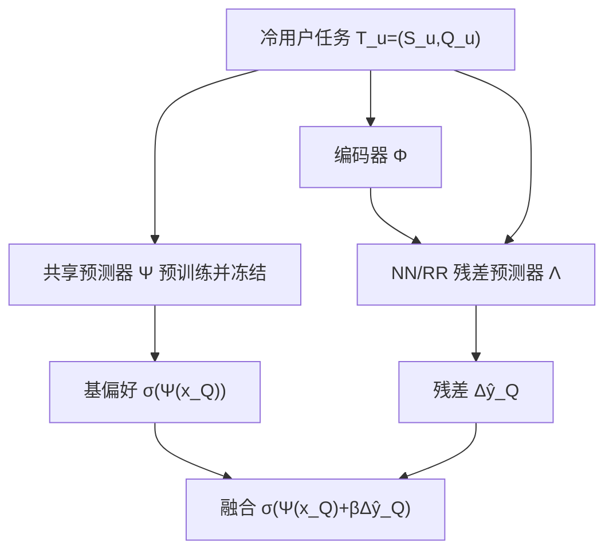
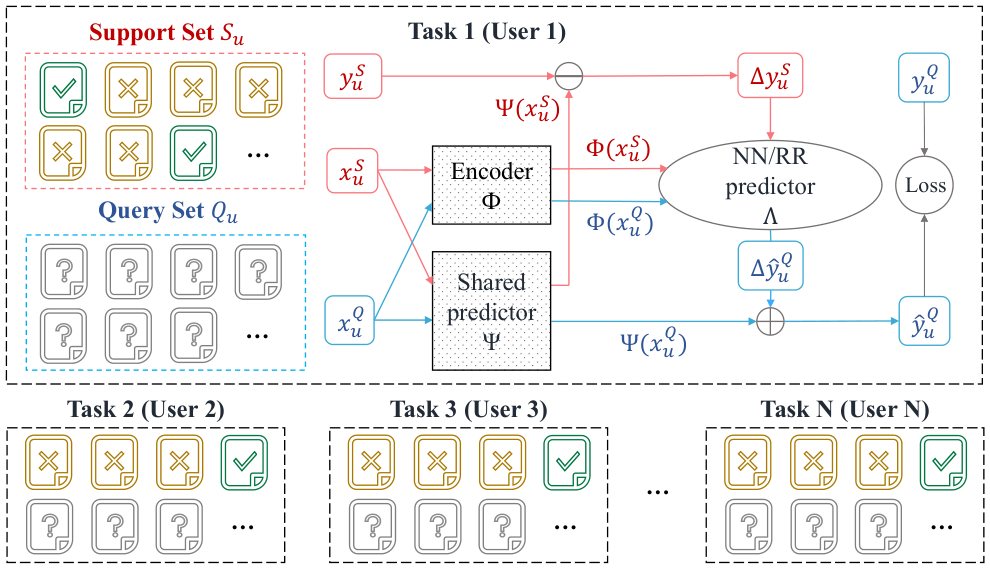

# RESUS: Warm-Up Cold Users via Meta-Learning Residual User Preferences in CTR Prediction (通过元学习残差用户偏好暖启冷用户CTR预测)

- **会议/期刊**: TOIS 2022 (ACM TOIS)
- **作者与机构**: Yanyan Shen, Lifan Zhao, Weiyu Cheng, Zibin Zhang, Wenwen Zhou, Kangyi Lin；上海交通大学 & 腾讯微信
- **推荐链路定位**: 精排 / CTR预估（冷用户）
- **研究方向**: 冷启动与长尾推荐 / CTR预估与特征交叉
- **论文原文**: [https://arxiv.org/abs/2210.16080v1](https://arxiv.org/abs/2210.16080v1)
- **开源代码**: [https://github.com/MogicianXD/RESUS](https://github.com/MogicianXD/RESUS)

## TL;DR (1分钟核心速览)

RESUS针对冷用户CTR中支持集过小、现有元学习存在表示压缩信息损失或MAML类高阶优化/测试微调昂贵、且忽视全局用户偏好知识的问题，提出解耦“全局基偏好+用户残差偏好”：共享预测器预训练后冻结，NN/岭回归从少量支持集快速拟合残差。按用户7:2:1划分、在query曝光样本上以AUC/Logloss评测，在Movielens/Frappe/Taobao冷启动三阶段优于LWA/NLBA/JTCN/MeLU/MAMO/Meta-Embedding；如Movielens Cold-III AUC 0.7793 vs. 0.7710。

## Background & Motivation (背景与核心矛盾)

- **主流范式**: 冷用户CTR常被建模为few-shot任务，分为few-shot用户表示学习（LWA/NLBA/JTCN）与优化型元学习（MeLU/MAMO/Meta-Embedding）。
- **前人局限**: 表示学习把支持集压缩为定长向量，易信息损失；MAML类需高阶梯度训练且测试时仍需微调，推理昂贵；二者均未显式利用跨用户的全局偏好知识。
- **核心洞察 (Key Insight)**: 与few-shot图像分类不同，CTR任务共享“点击/未点击”两个标签，故不同用户任务间存在可迁移的全局物品偏好；当query远离所有support时，该全局先验可补足用户特定信息。
- **本文切入点**: 将偏好拆为共享预测器给出的基偏好与支持集拟合的残差偏好，既保留全局知识又实现轻量个性化。

## Method (核心方法设计)

### 1. 整体框架 (Overall Architecture)

对每个冷用户任务 $T_u=(S_u,Q_u)$，先用所有训练用户交互预训练共享CTR预测器$\Psi$并冻结，以吸收全局偏好；特征编码器$\Phi$与$\Psi$默认采用DeepFM。对支持集样本计算残差$\Delta y_u^S=y_u^S-\sigma(\Psi(x_u^S))$，NN或RR预测器只拟合该残差；查询样本最终由基偏好与残差加权融合。训练在meta-train任务上端到端更新$\Phi,\theta/\lambda,\beta$，测试时不做梯度微调。

图3给出RESUS概览：$\Psi$与$\Phi$ 跨任务共享，NN/RR为任务特定模块。
<figure class="paper-figure" markdown="span">
  <figcaption>图3. RESUS概览。注意，共享预测器和编码器用点状背景标出，表示这两个模块在所有任务间共享。相比之下，NN/RR预测器是任务特定模块。</figcaption>
</figure>

### 2. 关键设计拆解 (Key Designs)

1. **基偏好-残差偏好解耦**：痛点在于support过小时匹配器会随机猜测；本文将预测写成 $\hat{y}_u^Q=\sigma(\Psi(x_u^Q)+\beta\Delta\hat{y}_u^Q)$，其中$\Psi$由全体用户预训练给出粗估，残差器仅学习用户特定修正。预训练后冻结$\Psi$ 可避免随机初始化噪声污染残差目标，类似boosting但并非模型集成。
2. **NN残差预测器**：对query与support做相似度加权，$\Delta\hat{y}_u^Q=\sum_i\alpha_i\Delta y_i^S$，$\alpha_i=\frac{\exp\{g_\theta(\Phi(x_Q),\Phi(x_i))\}}{\sum_j\exp\{g_\theta(\Phi(x_Q),\Phi(x_j))\}}$，$g_\theta(v_1,v_2)=\mathbf{w}^\top\|v_1-v_2\|+b$。其优势是测试时零微调，且可降低不相关support权重。
3. **RR残差预测器**：用岭回归闭式解做任务内快速适应，$w_u^*=\Phi(X_S)^\top(\Phi(X_S)\Phi(X_S)^\top+\lambda I)^{-1}\Delta y_S$，$\Delta\hat{y}_Q=\Phi(x_Q)^\top w_u^*$；Woodbury将$K\times K$求逆转为$|S|\times|S|$，复杂度$O(|S|^2K+|S|^3)$。总损失为按query数加权的BCE：$\mathcal{L}_{RESUS}=\sum_{T_u}|Q_u|\mathcal{L}_{T_u}/\sum_{T_u}|Q_u|$；支持集大小从冷用户分布或$U\{1,\tau\}$采样，CTR日志直接使用点击/未点击标签，无额外负采样；推理按用户批处理为$O((B+|S|)(|W_\Psi|+|W_\Phi|))$。

## Experimental Setup & Evaluation Protocol (实验设置与评估协议)

- **数据集与预处理**: 过滤交互数少于100的物品，以聚焦冷用户而非冷物品。

| 数据集 | #Users | #Items | #Interactions | 稀疏度 | 特征/场景说明 |
| :--- | ---: | ---: | ---: | ---: | :--- |
| Movielens | 6,040 | 3,706 | 1,000,209 | 95.53% | 评分≥3为正；用户/电影/类型/年份等7字段 |
| Frappe | 957 | 4,082 | 288,609 | 92.61% | App使用日志，含上下文，无时间戳；10字段 |
| Taobao | 1,141,729 | 846,811 | 26,557,961 | 99.99% | 广告曝光/点击日志，用户画像+商品特征；16字段 |

- **数据划分与防穿越**: 按user ID做7:2:1非重叠划分；Movielens/Taobao按时间排序，前$|S_u|$个交互为support、其余为query；Frappe随机采样support。冷启动阶段：Movielens/Frappe取$|S_u|\in\{1..10\},\{11..20\},\{21..30\}$，Taobao取$\{10..50\},\{60..100\},\{110..150\}$。
- **排名评测协议**: CTR点估计协议，非全库Full-Ranking；在query曝光样本上计算Logloss、AUC与RelaImpr，直接使用日志正负例，不做采样负例排序。
- **对比基线与超参设置**: 基线含LWA、NLBA、JTCN、MeLU、MAMO、Meta-Embedding；嵌入维度10，Adam学习率0.001，batch 1024，默认DeepFM，early stopping，10次平均，$p<0.05$显著性检验。

## Key Experimental Results (实验关键数据)

### 1. 主实验对比 (Main Results)

AUC（Cold Start-I/II/III；ML=Movielens，Fr=Frappe，TB=Taobao）：

| 方法 | ML-I | ML-II | ML-III | Fr-I | Fr-II | Fr-III | TB-I | TB-II | TB-III |
| :--- | ---: | ---: | ---: | ---: | ---: | ---: | ---: | ---: | ---: |
| LWA | .7216 | .7498 | .7510 | .7732 | .8098 | .8302 | .5777 | .5730 | .5669 |
| NLBA | .7302 | .7528 | .7542 | .8430 | .8435 | .8440 | .5664 | .5736 | .5720 |
| JTCN | .7518 | .7494 | .7476 | .8306 | .8248 | .8277 | .5850 | .5768 | .5687 |
| MeLU | .7574 | .7689 | .7707 | .8459 | .8520 | .8596 | .5971 | .6219 | .6307 |
| MAMO | .7575 | .7691 | .7710 | .8340 | .8535 | .8674 | .5880 | .6130 | .6210 |
| Meta-Embedding | .7577 | .7625 | .7655 | **.8640** | .8663 | .8715 | .6000 | .6051 | .6020 |
| RESUS_NN | .7638 | .7745 | .7771 | .8542 | **.8746** | **.8931** | .6086 | .6250 | **.6335** |
| RESUS_RR | **.7645** | **.7772** | **.7793** | .8524 | .8669 | .8713 | **.6109** | **.6272** | .6276 |

平均RelaImpr：RESUS_RR在Movielens较MAMO提升2.9%；RESUS_NN在Frappe/Taobao较最强基线提升1.8%/5.0%。

### 2. 消融实验 (Ablation Study)

Movielens AUC：

| 变体 | CS-I | CS-II | CS-III |
| :--- | ---: | ---: | ---: |
| 仅共享预测器 $\Psi$ (DeepFM) | .7527 | .7510 | .7497 |
| MUS（去掉 $\Psi$） | .5969 | .6677 | .6771 |
| RESUS_NN w/o pretrain | .7580 | .7714 | .7735 |
| RESUS_NN | .7638 | .7745 | .7771 |
| RESUS_RR w/o pretrain | .7568 | .7702 | .7747 |
| RESUS_RR | **.7645** | **.7772** | **.7793** |

### 3. 关键实验发现 (Key Findings)

- **全局基偏好是主要增益来源**：MUS在ML Cold-I仅.5969，RESUS_NN升至.7638（+0.1669 AUC）；仅$\Psi$为.7527，加入残差后仍提升，说明全局先验与用户残差互补而非替代。
- **预训练并冻结$\Psi$可稳定残差学习**：去掉预训练后ML Cold-I/II/III从.7638/.7745/.7771降至.7580/.7714/.7735；Taobao Cold-I从.6086降至.6008，验证随机初始共享预测器会向残差目标注入噪声。
- **效率与鲁棒性突出**：RESUS_RR训练438s+预训练20s、测试10s，远低于MAMO 4641s/104s与MeLU 820s/34s；当support-query距离增大时，RESUS性能平稳且持续优于MUS/Meta-Embedding（图4）。

## Highlights & Limitations (亮点、对比与审稿批判)

- **与代表作对比 (vs. Prior Work)**: LWA/NLBA/JTCN把support压成定长向量，易信息损失；MeLU/MAMO/Meta-Embedding依赖MAML式初始化与测试微调，成本高；RESUS以全局预测器+残差匹配避免测试梯度更新，且显式利用跨用户标签共享。
- **可迁移亮点**: “全量用户预训练全局CTR模型并冻结，再用support拟合残差”可迁移到其他冷启动精排；Woodbury岭回归闭式解适合轻量在线个性化。
- **审稿级局限批判**: 仅覆盖有少量交互的冷用户，zero-shot完全冷用户未解；共享预测器架构与预训练质量影响较大，RR在support较大时矩阵开销上升；实验全为离线日志，缺少线上A/B与极端长尾物品验证。

## Rating (四维评分)

- **方法创新性 (Novelty)**: ⭐⭐⭐⭐ （将CTR冷启动解耦为全局基偏好与残差偏好，NN/RR双实现简洁且有元学习视角）
- **评估协议与实验扎实度 (Protocol & Experiments)**: ⭐⭐⭐⭐ （三数据集、三冷启动阶段、10次平均与显著性检验完整；但仅离线CTR点估计）
- **写作与数学规范度 (Clarity & Rigor)**: ⭐⭐⭐⭐ （公式、复杂度与训练流程清晰；RR的Woodbury推导与β/λ作用解释充分）
- **工业落地与复现价值 (Industrial & Practical Value)**: ⭐⭐⭐⭐ （开源代码，测试零微调、10s级推理，适合冷用户精排；需关注预训练与支持集采样工程）

