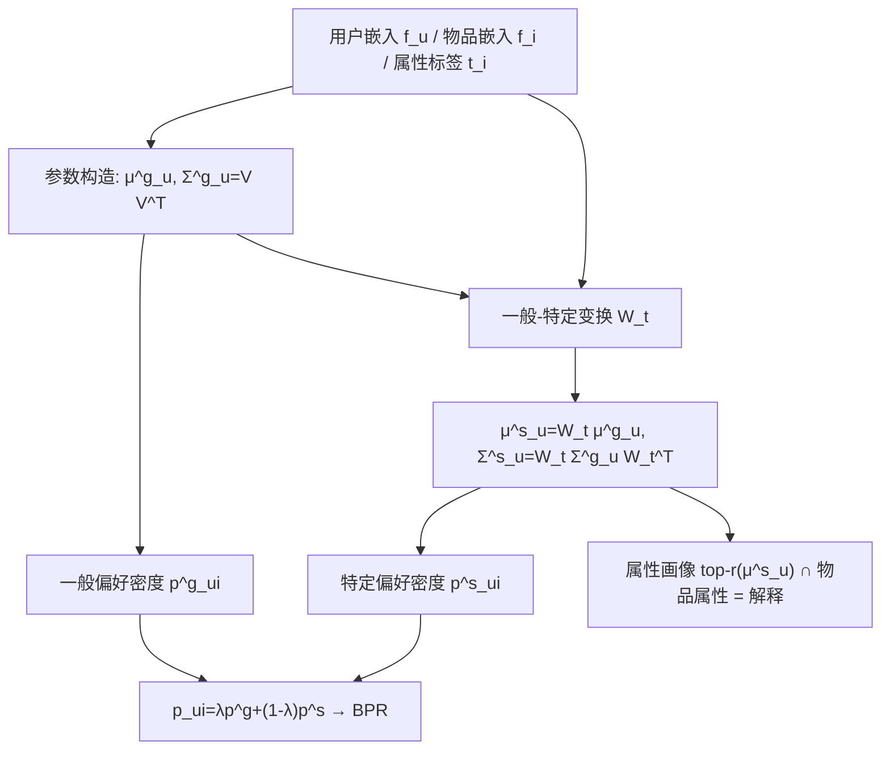
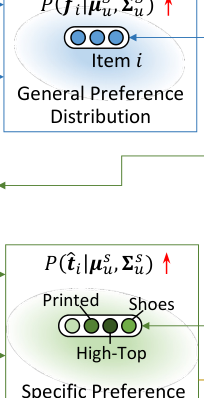

# Dual Preference Distribution Learning for Item Recommendation (面向物品推荐的双偏好分布学习)

- **会议/期刊**: ACM Transactions on Information Systems (TOIS)
- **作者与机构**: Xue Dong, Xuemeng Song (通讯), Na Zheng, Yinwei Wei, Zhongzhou Zhao；山东大学软件学院 / 新加坡国立大学 / 阿里巴巴达摩院
- **推荐链路定位**: 精排（Top-N 打分与排序）
- **研究方向**: 协同过滤 / 可解释推荐理由生成
- **论文原文**: [https://arxiv.org/abs/2201.09490v4](https://arxiv.org/abs/2201.09490v4)
- **开源代码**: 暂未开源

## TL;DR (1分钟核心速览)

现有 CF 把用户压成单向量、只建模"整体喜好"，细粒度属性方法（AMCF/NARRE）用注意力加权属性却也丢掉了"用户不同偏好之间彼此相关"这一结构信息。DUPLE 以多元高斯分布同时刻画用户对**物品**的一般偏好 $G(\boldsymbol{\mu}^g_u,\boldsymbol{\Sigma}^g_u)$与对**属性**的特定偏好$G(\boldsymbol{\mu}^s_u,\boldsymbol{\Sigma}^s_u)$，用协方差矩阵显式建模属性偏好间的正/负相关，并以物品向量与属性向量的线性映射把两个分布耦合起来。在 6 个 Amazon/MovieLens 数据集、Leave-One-Out + 1:100 采样排序协议下，NDCG@10 相对最强基线提升 1.68%–13.78%，并用 126 人主观实验验证解释可读性（88% 认为合理）。

## Background & Motivation (背景与核心矛盾)

- **主流范式**: MF/BPR 及 GCN 类方法用向量内积刻画"用户对物品的一般偏好"；属性增强方法（AMCF 投影属性做多任务监督、NARRE 注意力融合属性词向量）试图捕获"对属性的细粒度偏好"。
- **前人局限**: ① 向量化表征把多维偏好挤进一个点，无法表达"喜欢黑色 ⇒ 大概率喜欢性感款"这类**偏好间相关性**；② 注意力权重只是逐属性的独立标量，天然假设属性偏好相互独立；③ 可解释方法是**判别式**的——针对给定 $(u,i)$ 事后找理由，而非先总结用户画像再匹配。
- **核心洞察 (Key Insight)**: 若把用户偏好看作属性空间上的一个概率分布，则**均值定位"喜欢什么"、协方差天然编码"哪些偏好捆绑出现"**，且高斯密度可直接作为偏好打分，无需额外解释模块。
- **本文切入点**: 用两个高斯分布（一般/特定）联合建模，并以物品→属性的线性映射把一般分布"投影"成特定分布，实现双偏好互相参照 + 免费解释。

## Method (核心方法设计)

### 1. 整体框架 (Overall Architecture)

输入为用户/物品 ID 嵌入 $\boldsymbol{f}_u,\boldsymbol{f}_i\in\mathbb{R}^D$与物品属性的 BOW 标签$\boldsymbol{t}_i\in\mathbb{R}^{|\mathcal{A}|}$。蓝色主路：参数构造模块由$\boldsymbol{f}_u$生成一般偏好分布的$(\boldsymbol{\mu}^g_u,\boldsymbol{\Sigma}^g_u)$，物品向量在该分布下的概率密度即$p^g_{ui}$。绿色支路：训练一个线性映射$W_t$把物品向量投到属性空间，并用属性标签 BPR 监督；再把$(\boldsymbol{\mu}^g_u,\boldsymbol{\Sigma}^g_u)$经同一$W_t$变换得到$(\boldsymbol{\mu}^s_u,\boldsymbol{\Sigma}^s_u)$，属性预测向量在该分布下的密度即$p^s_{ui}$。两路按$\lambda$加权得最终打分，BPR 排序损失端到端训练；推理阶段取$\boldsymbol{\mu}^s_u$的 top-$r$ 维作为用户属性画像，与推荐物品属性求交即解释。

<figure class="paper-figure" markdown="span">
  <figcaption>图1. 所提出的面向可解释物品推荐的双偏好分布学习框架（DUPLE）示意图，该框架联合学习用户对一般物品（蓝色流程）和特定属性（绿色流程）的偏好，以获得更好的推荐。</figcaption>
</figure>

### 2. 关键设计拆解 (Key Designs)

1. **参数构造模块（让协方差合法且可学）**：协方差必须对称半正定，无法像均值那样直接 FC 回归。作者改为先由列变换得到低秩因子 $\boldsymbol{V}_u\in\mathbb{R}^{D\times D'}$（$D'<D$），再令$\boldsymbol{\Sigma}^g_u=\boldsymbol{V}_u\boldsymbol{V}_u^{\top}$，其中$\boldsymbol{v}^j_u=W^j_\Sigma\boldsymbol{f}_u+\boldsymbol{b}^j_\Sigma$。于是$\boldsymbol{x}\boldsymbol{\Sigma}^g_u\boldsymbol{x}^{\top}=\lVert\boldsymbol{x}\boldsymbol{V}_u\rVert^2\ge0$自动成立；低秩分解同时把参数量从$O(D^2)$降到$O(DD')$，起到结构正则作用。一般偏好打分为高斯密度$\propto\exp(-\tfrac12(\boldsymbol{f}_i-\boldsymbol{\mu}^g_u)^{\top}(\boldsymbol{\Sigma}^g_u)^{-1}(\boldsymbol{f}_i-\boldsymbol{\mu}^g_u))$——直觉上这是**马氏距离**：偏好越不确定的方向（方差大）惩罚越小，等价于学习了一个用户专属的度量张量。

2. **一般-特定变换（把"物品喜好"翻译成"属性喜好"）**：不另开分支重建属性分布，而是复用物品→属性映射 $\hat{\boldsymbol{t}}_i=W_t\boldsymbol{f}_i$，并证明（原文 Proof 1/2，基于线性映射的可加性与齐次性）
   $\boldsymbol{\mu}^s_u=W_t\boldsymbol{\mu}^g_u,\qquad \boldsymbol{\Sigma}^s_u=W_t\boldsymbol{\Sigma}^g_u W_t^{\top}$恰为投影后属性集合的经验均值与协方差。好处是：属性空间维度$|\mathcal{A}|\gg D$却只需一套参数；且$W_t$由标签监督、分布由交互监督，两条信号互为约束。$W_t$用 BPR 式属性损失学习：$\mathcal{L}_t=\sum_{i\neq j}-\log\sigma\big(\mathrm{cos}(\hat{\boldsymbol{t}}_i,\boldsymbol{t}_i)-\mathrm{cos}(\hat{\boldsymbol{t}}_i,\boldsymbol{t}_j)\big)$，即物品自身属性相似度须高于他人属性。

3. **解释生成与训练目标**：属性画像 $\mathcal{A}_u=\{a_{e_1},\dots,a_{e_r}\},(e_1,\dots,e_r)=\arg\max_r(\boldsymbol{\mu}^s_u)$，解释为$\mathcal{A}_u\cap\mathcal{A}_i$（如"你可能喜欢它的 Balance、Men、Shoes"）；对角元越小表示该属性上密度越尖，偏好越强。总损失为 BPR 排序项加属性项：$\mathcal{L}=\mathcal{L}_t+\sum_{(u,i,j)}-\log\frac{p_{ui}}{p_{ui}+p_{uj}}$，$p_{ui}=\lambda p^g_{ui}+(1-\lambda)p^s_{ui}$。**负采样**：每个正样本随机采 1 个未交互物品（Uniform，非 hard negative）；**推理开销**为每用户一次$D\times D$与$|\mathcal{A}|\times|\mathcal{A}|$ 矩阵求逆/行列式，且高斯密度非线性，**无法套用内积 ANN 索引**，这是其相对 MF 的显著工程代价。

## Experimental Setup & Evaluation Protocol (实验设置与评估协议)

| 数据集 | #Users | #Items | #Interactions | #Attributes | 密度 |
| :--- | :---: | :---: | :---: | :---: | :---: |
| Women's Clothing | 19,972 | 285,508 | 326,968 | 1,095 | 0.01% |
| Men's Clothing | 4,807 | 43,832 | 70,723 | 985 | 0.03% |
| Cell Phone & Acc. | 9,103 | 51,497 | 132,422 | 1,103 | 0.03% |
| MovieLens-small | 579 | 6,296 | 48,395 | 698 | 1.33% |
| MovieLens-1M | 5,950 | 3,532 | 574,619 | 543 | 2.73% |
| MovieLens-10M | 66,028 | 10,254 | 4,980,475 | 446 | 0.74% |

- **预处理**: 仅保留评分 $>3$的可靠正反馈；过滤交互数$<10$ 的用户与物品（类 10-core）；数据集本身无属性标注，取出现于 >0.1% 物品文本描述中的高频词作伪属性（去停用词与噪声符号）。
- **数据划分**: `Leave-One-Out`——每用户随机留 1 个交互作验证、1 个作测试，其余训练。
- **排名评测协议**: `Sampled Ranking`，候选集 = 1 个真值 + **100 个随机负样本**（1:100），指标为 AUC / MRR / HR@10 / NDCG@10，三次随机初始化取均值；**未做 Full-Ranking，也未报告显著性检验**。
- **基线与超参**: SP-based（BPR、AMR、DVMF）vs DP-based（ex-DVMF、AMCF、NARRE）；嵌入维度 $D=64$，前置两层 MLP，Adam，lr$10^{-4}$，batch 256；$D'\in\{2,4,8,16,32\}$、$\lambda\in[0,1]$ 步长 0.1 按数据集调优。

## Key Experimental Results (实验关键数据)

### 1. 主实验对比 (Main Results)

| 方法 | Women MRR | Women NDCG | Men MRR | Men NDCG | Cell MRR | Cell NDCG | ML-s MRR | ML-s NDCG | ML-1M MRR | ML-1M NDCG | ML-10M MRR | ML-10M NDCG |
| :--- | :---: | :---: | :---: | :---: | :---: | :---: | :---: | :---: | :---: | :---: | :---: | :---: |
| BPR | 6.73 | 6.49 | 6.50 | 6.12 | 13.06 | 14.89 | 12.12 | 13.49 | 15.26 | 17.23 | 15.17 | 17.47 |
| AMR | 7.79 | 11.25 | 7.35 | 7.09 | 13.60 | 15.65 | 12.66 | 13.85 | 15.37 | 18.52 | 16.15 | 18.39 |
| DVMF | 8.32 | 12.41 | 8.97 | 13.27 | 15.55 | 16.28 | 13.07 | 15.98 | 17.15 | 20.34 | 22.31 | 26.72 |
| ex-DVMF | 11.72 | 13.33 | 11.24 | 12.54 | 15.29 | 18.31 | 15.30 | 18.28 | 18.59 | 21.91 | 23.34 | **28.03** |
| AMCF | 9.85 | 10.86 | 9.46 | 10.20 | 13.45 | 15.61 | 11.91 | 17.04 | 15.42 | 18.79 | 16.68 | 20.68 |
| NARRE | 17.95 | 21.13 | 18.30 | 21.20 | 18.70 | 22.11 | 13.23 | 17.41 | 17.45 | 20.55 | 22.22 | 26.41 |
| **DUPLE** | **20.35** | **23.60** | **19.35** | **23.62** | **20.38** | **25.14** | **16.43** | **20.80** | **18.80** | **22.28** | **23.74** | **28.10** |
| Improv.% | +13.37 | +11.68 | +5.73 | +11.41 | +8.98 | +13.70 | +7.38 | +13.78 | +1.12 | +1.68 | +1.71 | +0.07 |

AUC/HR@10 同趋势：Cell Phone 上 AUC 80.65（vs NARRE 77.53）、HR@10 45.47（+10.49%）；ML-10M 上 AUC 84.70 与 ex-DVMF 84.74 基本持平（−0.04%）。

### 2. 消融实验 (Ablation Study)

| 变体 | Women NDCG | Men NDCG | Cell NDCG | ML-s NDCG | ML-1M NDCG | ML-10M NDCG | ML-10M MRR |
| :--- | :---: | :---: | :---: | :---: | :---: | :---: | :---: |
| DUPLE-iden ($\boldsymbol{\Sigma}=E$) | 21.09 | 20.38 | 24.00 | 19.32 | 19.57 | 20.93 | 17.57 |
| DUPLE-diag (仅对角) | 21.22 | 22.16 | **25.65** | 18.11 | 17.57 | 21.74 | 18.48 |
| **DUPLE (满协方差)** | **23.60** | **23.62** | 25.14 | **20.80** | **22.28** | **28.10** | **23.74** |

### 3. 关键实验发现 (Key Findings)

1. **分布表征 > 向量表征**：把协方差退化为单位阵（DUPLE-iden 等价于只剩均值向量，即传统向量式建模）后，ML-10M 的 NDCG@10 从 28.10 掉到 20.93（−25.5%），性能回落到 BPR/DVMF 档位，直接量化了"概率分布描述力"的增益。
2. **非对角元承载偏好关联，且与数据域相关**：仅保留对角（属性独立假设）时 ML-10M NDCG@10 为 21.74（−22.6%），说明属性间相关性是主要信息来源；但 Cell Phone 上 diag（25.65）反超 full（25.14），因为"喜欢黑色手机"与"喜欢 LED 屏"近乎独立，多出的 $O(D^2)$ 参数只带来过拟合——提示协方差建模应当按域自适应稀疏化。
3. **属性信息是稀疏域的补偿器**：Amazon 三个极稀疏数据集上 DP-based 相对 SP-based 的增益（Women's Clothing NDCG@10 +11.68%）显著大于稠密 MovieLens-1M（+1.68%），因为交互不足以学好物品向量时，属性标签提供了额外监督信号；同时 NARRE/AMCF 这类"仅注意力融合属性"仍弱于 DUPLE，说明**显式建模双偏好分布**比"把属性塞进物品向量"更有效。定性上，126 名志愿者中 88% 认为 DUPLE 的解释合理，失败案例集中在把年份"1997"当理由、以及把品牌 New Balance 拆成属性"Balance"。

## Highlights & Limitations (亮点、对比与审稿批判)

- **与代表作对比 (vs. Prior Work)**: 与 BPR/DVMF 相比，DUPLE 把"点估计"换成"分布估计"并额外获得协方差语义（DVMF 仅有对角/单分布，无属性侧）；与 AMCF/NARRE 相比，它不靠注意力权重当偏好代理，而是给出属性空间上的显式分布并复用同一 $W_t$ 双向耦合两路偏好；与 KGAT/路径推理类可解释方法相比，它不做图上游走，而是"先总结画像再取交集"，解释成本近乎为零。
- **可迁移亮点**: ① $\boldsymbol{\Sigma}=\boldsymbol{V}\boldsymbol{V}^{\top}$ 的低秩列变换构造法可复用于任何需要 PSD 约束的模块（如不确定性建模、度量学习）；② "用同一线性映射把一般分布投影为特定分布"可迁移到多模态/跨域场景（如把物品分布投影为品牌、类目分布），既省参数又可解释。
- **审稿级局限批判**: ① 评估仅为 1:100 采样排序，且无显著性检验，稠密集上提升微弱（ML-10M NDCG@10 +0.07%），说服力有限；② 属性来自高频词伪标注，噪声直接污染 $W_t$与解释质量（作者亦自认）；③ 高斯密度需矩阵求逆、非线性打分，无法接入 Faiss 类内积 ANN，且$\lambda$、$D'$ 逐数据集调参，工业级全库召回/精排成本偏高。

## Rating (四维评分)

- **方法创新性 (Novelty)**: ⭐⭐⭐⭐ （用协方差矩阵编码"偏好间相关性"并给出投影合法性证明，视角新颖；但高斯+马氏距离骨架在 DVMF/DVNE 中已有雏形）
- **评估协议与实验扎实度 (Protocol & Experiments)**: ⭐⭐⭐ （6 个真实数据集 + 消融 + 主观用户研究较完整，但仅 1:100 采样排序、无 Full-Ranking 与显著性检验，稠密集增益偏小）
- **写作与数学规范度 (Clarity & Rigor)**: ⭐⭐⭐⭐ （PSD 构造与分布投影两处均给出形式化证明，符号表清晰；缺复杂度与参数量分析，公式 (5)(9) 的归一化常数对排序无影响的说明略欠）
- **工业落地与复现价值 (Industrial & Practical Value)**: ⭐⭐⭐ （代码承诺开源但未放出；解释生成几乎零成本、画像可解释性好，但矩阵求逆 + 无法 ANN 索引限制大规模在线部署）

