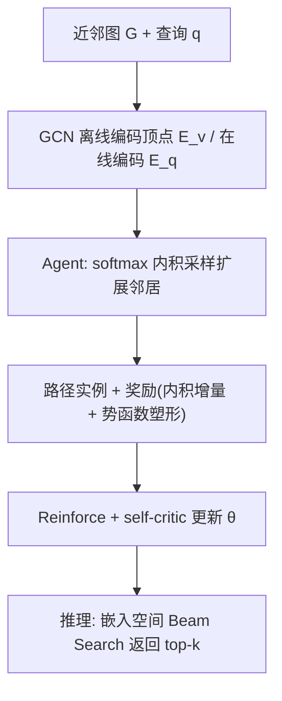
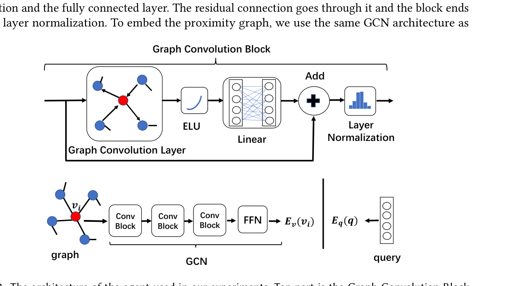
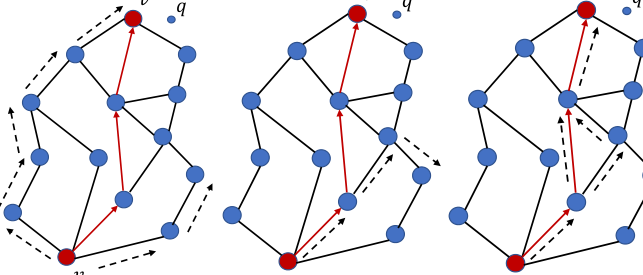

# Reinforcement Routing on Proximity Graph for Efficient Recommendation (面向高效推荐的近邻图强化路由)

- **会议/期刊**: ACM Transactions on Information Systems (TOIS)
- **作者与机构**: Chao Feng, Defu Lian, Enhong Chen (中国科学技术大学)；Xiting Wang, Zheng Liu, Xing Xie (微软亚洲研究院)
- **推荐链路定位**: 召回（双塔内积的全库 ANN 检索）
- **研究方向**: 协同过滤与双塔召回 / 图神经网络与图路由
- **论文原文**: [https://arxiv.org/abs/2201.09290v1](https://arxiv.org/abs/2201.09290v1)
- **开源代码**: [https://github.com/benfred/implicit](https://github.com/benfred/implicit)（该仓库仅为论文所用的 ALS 分解工具；路由模型本身暂未开源）

## TL;DR (1分钟核心速览)

MIPS 是双塔召回的核心算子，但图 ANN 上的贪心/束搜索只看一跳邻居，在近似 Delaunay 图上极易陷入局部最优；唯一可学习的路由方案 ILTR 又要求**全部**训练查询的精确 ground truth，大规模库不可行。本文把路由建成 MDP，用 Reinforce + self-critic baseline 训练一个由 GCN 提供全局视野的智能体，再用 potential-based 奖励塑形把少量 ground truth 注入。在 MovieLens/Amazon/Echonest 上按固定内积计算次数（IPC=128/256/512）评测 Recall 10@10，ip-NSW 图上最高相对提升 **+337.8%**，仅 5% ground truth 时相对 ILTR 优势超过 50%。

## Background & Motivation (背景与核心矛盾)

- **主流范式**: 为 MIPS 构造近似 s-Delaunay 图（ip-NSW / IPDG / Möbius 变换图），查询时在图上做贪心或束搜索，每步仅比较当前点邻居的内积。
- **前人局限一**: 内积定义在非度量空间（不满足同一性与三角不等式），精确 s-Delaunay 图构造代价 $\Omega(n^{\lceil d/2\rceil})$ 且随维度升高退化为完全图，因此实际只能用稀疏近似图——贪心在此类图上做的是**短视决策**，缺少全图全局信息。
- **前人局限二**: ILTR 用模仿学习强制智能体逐步沿最短路走向目标点，但目标点（式 (1) 的解）必须对每个训练查询穷举求得；库越大所需训练查询越多，成本不可承受。
- **核心洞察 (Key Insight)**: 图上的"到目标的剩余最短路长度" $L(s,v^*)$天然是一个势函数$\Phi(s)=-\alpha L(s,v^*)$，把它作为塑形奖励**不会改变原 MDP 的最优策略**（Ng et al. 的 potential-based shaping 定理），因此少量 ground truth 可以只作为"方向稠密信号"使用，而不必作为硬标签。
- **本文切入点**: 无标注查询走纯 RL，少量有标注查询走塑形奖励，两类数据在同一目标里融合。

## Method (核心方法设计)

### 1. 整体框架 (Overall Architecture)

给定已构建的近邻图与查询，先用 GCN（3 个 Graph Convolution Block + FFN，带残差与 LayerNorm）离线编码**全部**顶点得到 $E_v(\cdot)$，查询在线编码一次（实验证明恒等映射最优，即$E_q(q)=q$）；智能体在当前位置的未访问邻居集合上按嵌入内积的 softmax 采样扩展，走完整条路径即得到一个训练实例；用 Reinforce + self-critic baseline 更新策略参数$\theta$；推理阶段改用束搜索，在候选集中选$\arg\max_{c}\langle E_q(q),E_v(c)\rangle$扩展，预算耗尽后返回访问集 top-$k$。

<figure class="paper-figure" markdown="span">
  <figcaption>图 2. 我们实验中使用的智能体架构。顶部是图卷积块，由图卷积层、ELU 非线性和全连接层组成。残差连接穿过该块。左下部分是 GCN，用于将图上的顶点嵌入到新空间。它由三个与顶部类似的图卷积块组成，后接一个前馈网络（FNN），该网络包含两个带 ELU 非线性的全连接层。右下部分是查询的嵌入部分。</figcaption>
</figure>

### 2. 关键设计拆解 (Key Designs)

1. **GCN 全局视野的路由策略（对抗 myopic 决策）**: 若仅凭一跳邻居内积决策，近似图上的局部结构会导致错误扩张。本文把整图送入 GCN，用归一化邻接 $\tilde{D}^{-\frac{1}{2}}\tilde{A}\tilde{D}^{-\frac{1}{2}}$ 做多跳传播，再以
   $P(c_i\mid \text{Cand},q;\theta)=\frac{\exp(\langle E_v(c_i),E_q(q)\rangle/\tau)}{\sum_{c\in \text{Cand}}\exp(\langle E_v(c),E_q(q)\rangle/\tau)}$采样。直觉是$E_v$已把多跳可达性压缩进打分，等价于给贪心搜索装上"全局地形图"；$\tau$ 控制探索-利用。
2. **势函数奖励塑形（把少量 GT 变成稠密信号）**: 朴素奖励 $r=\langle s',q\rangle-\langle s,q\rangle$ 只奖励内积增量，路径可能很长甚至走不到目标；只用塑形项又泛化差、走错一步无法纠偏。合并为
   $r(s,a,s')=\langle s',q\rangle-\langle s,q\rangle-\alpha\big(\gamma L(s',v^*)-L(s,v^*)\big)$其中$L(\cdot,v^*)$由 Dijkstra/BFS 预计算，$\Phi(s)=-\alpha L(s,v^*)$且$\Phi(s_T)=0$，满足式 (9) 的 potential-based 形式，故不改变最优策略，仅加速收敛并提供纠偏能力。<figure class="paper-figure" markdown="span">
  <figcaption>图 3. 𝑣0、𝑣∗ 分别为源节点和目标节点。红色箭头表示最短路径，黑色虚线箭头表示智能体规划的路由路径。左子图：智能体根据朴素奖励函数 E.q.(6) 沿路径进行路由。所收集路径可能很长（即左侧虚线箭头），或者智能体无法到达目标节点（即右侧虚线箭头）；中间子图：仅使用塑形函数作为奖励。这会导致泛化能力较差。当智能体在第二步做出错误决策时，它无法正确修正方向；右子图</figcaption>
</figure>
3. **训练目标、采样与推理开销**: 采用同分布再采 $b=4$个候选的平均奖励作 baseline$b(s)$，累计回报$G_t=\sum_{i=t}^{N}\gamma^{i-t}\big(r(s_{t-1},s_t)-b(s_t)\big)$，梯度上升$\theta\leftarrow\theta+\eta G_t\nabla_\theta\pi$（免额外 critic 网络、降方差）。顶点嵌入离线预计算，在线仅一次查询编码 + 每步一次内积，推理开销与标准束搜索同阶。

## Experimental Setup & Evaluation Protocol (实验设置与评估协议)

- **数据集与预处理**（用户按 80%/10%/10% 随机划分为训练/验证/测试查询）：

| 数据集 | #Base Items | #Ratings | #Train Queries | #Val | #Test | 特征/场景说明 |
| :--- | :---: | :---: | :---: | :---: | :---: | :--- |
| MovieLens 25M | 59,047 | 25,000,095 | 130,032 | 16,254 | 16,255 | 隐式反馈，无 5-core 过滤 |
| Amazon Movies&TV | 79,851 | 1,828,551 | 111,177 | 13,907 | 13,898 | 用户/物品双侧 5-core |
| Echonest | 60,654 | 4,422,471 | 174,372 | 21,796 | 21,798 | 用户侧 5-core，音乐品味 |

- **向量化方式**: 用 `implicit` 的 ALS 对隐式矩阵分解得 96 维用户/物品向量；物品向量为数据库点、用户向量为查询，物品向量除以全库平均 $L_2$ 范数、查询归一化为单位向量（不改变 MIPS 解）。
- **排名评测协议**: 无偏 **Full-Ranking**——测试查询的真实 top-$M$由穷举全库精确求得作为$T(q)$，指标为$\text{Recall }M@N=\frac{1}{|Q|}\sum_q\frac{|R(q)\cap T(q)|}{|T(q)|}$；公平性通过**固定内积计算次数 IPC** 而非墙钟时间保证。
- **对比基线与超参**: ip-NSW / IPDG / Möbius 三种图上的束搜索，以及 ILTR 模仿学习路由；图最大出度 16，$\gamma=0.9$，$\alpha\in\{0.7,1.0,2.7\}$，$\tau\in\{0.15,0.5,1.0\}$，$b=4$，Adam 学习率 0.001 指数衰减，批大小 30 条查询、共 60,000 批。

## Key Experimental Results (实验关键数据)

### 1. 主实验对比 (Main Results)

Recall 10@10，同一图内对比（加粗为该图内更优）：

| 数据集 | IPC | ip-NSW | **Ours** | IPDG | **Ours** | Möbius | **Ours** |
| :--- | :---: | :---: | :---: | :---: | :---: | :---: | :---: |
| MovieLens | 128 | 0.0800 | **0.3502** | 0.1383 | **0.2864** | 0.0771 | **0.1886** |
| | 256 | 0.3542 | **0.6943** | 0.6541 | 0.6462 | 0.1824 | **0.5939** |
| | 512 | 0.7171 | **0.8962** | 0.8836 | **0.8889** | 0.6856 | **0.8115** |
| Amazon | 128 | 0.3062 | **0.5209** | 0.2403 | **0.4901** | 0.0523 | **0.3624** |
| | 256 | 0.5495 | **0.7818** | 0.5274 | **0.7596** | 0.3295 | **0.6005** |
| | 512 | 0.7573 | **0.9171** | 0.6716 | **0.9074** | 0.6188 | **0.7888** |
| Echonest | 128 | 0.3296 | **0.6897** | 0.6121 | **0.6516** | 0.4196 | **0.4303** |
| | 256 | 0.5431 | **0.9120** | 0.7541 | **0.8956** | 0.6709 | 0.6346 |
| | 512 | 0.7301 | **0.9847** | 0.8106 | **0.9822** | 0.7844 | **0.7902** |

相对提升区间：MovieLens +25.0%~+337.8%，Amazon +21.1%~+593.1%，Echonest +0.7%~+109.3%；IPDG 在 MovieLens@256、Möbius 在 Echonest@256 是仅有的两处轻微退化。

### 2. 消融实验 (Ablation Study)

均以 ip-NSW 图为载体、IPC=256、指标 Recall 1@1：

| 变体 | MovieLens | Amazon | Echonest |
| :--- | :---: | :---: | :---: |
| **Full (RL + 塑形 + 30% GT)** | **0.757** | **0.850** | **0.951** |
| w/o 内积奖励（仅保留塑形） | 0.194 | 0.273 | 0.408 |
| w/o self-critic baseline | 0.267 | 0.255 | 0.167 |
| w/o GT（纯 RL，朴素奖励） | 0.701 | 0.820 | 0.934 |
| 用 ip-NSW 伪标签替代精确 GT | 0.681 | 0.823 | 0.868 |
| 查询嵌入至 $d'=64$（原 96） | 0.668 | 0.794 | 0.884 |
| 图换为 cos-NSW | 0.580 | 0.457 | 0.573 |
| 图换为 $l_2$-NSW | 0.000 | 0.000 | 0.126 |

### 3. 关键实验发现 (Key Findings)

1. **增益集中在低预算区**：MovieLens 上 ip-NSW 从 IPC=128 的 0.0800 提升到 0.3502（+337.8%），而 IPC=512 时仅从 0.7171 提升到 0.8962（+25.0%）。说明学习型路由的核心价值是用全局先验补偿 hops 不足，预算充足时贪心搜索已能逼近同一解，部署收益需按线上延迟预算评估。
2. **奖励两项缺一不可**：去掉内积项只留塑形，Recall 1@1 崩至 0.194/0.273/0.408；去掉 self-critic baseline 崩至 0.267/0.255/0.167，均远低于完整模型 0.757/0.850/0.951。即塑形只提供"方向"稠密信号，内积项负责与 MIPS 目标对齐，baseline 负责把 RL 方差压到可训练水平。
3. **GT 质量比数量更关键**：MovieLens 上 30% 精确 GT（0.757）> 无 GT（0.701）> ip-NSW 伪标签（0.681），Echonest 上差距更悬殊（0.951 vs 0.868）——近似 GT 会系统性误导智能体，甚至不如纯 RL；而 ILTR 在 5% GT 时被拉开 50% 以上差距，说明本文方法的优势恰在"标注稀缺"区间。

## Highlights & Limitations (亮点、对比与审稿批判)

- **与代表作对比**: ① vs **ILTR (Baranchuk et al.)**：后者需全量 GT 且只能用有标注查询，本文无 GT 可训、少量 GT 可注入，5% GT 下优势 >50%；② vs **ip-NSW/IPDG/Möbius**：不改图、只把束搜索的打分向量从原始向量换成 GCN 嵌入向量，即得稳定增益，属正交可插拔改进；③ vs **量化路线 (PQ/ScaNN)**：图路由与码本量化正交，理论上可叠加。
- **可迁移亮点**: ① 用"到目标的最短路距离"构造 potential-based 塑形奖励，可迁移到任意图上的多跳检索/推理式召回（如 KG 多跳、会话束搜索）；② 用同分布再采 $b$ 个候选的均值作 self-critic baseline，免去额外 critic 网络，工程上易实现。
- **审稿级局限批判**: ① 训练成本高（60,000 批 × 30 查询的 RL rollout，每步数百 IPC），且 $\alpha$从 0.7 到 2.7、$\tau$ 从 0.15 到 1.0 按数据集大幅调参，超参敏感度强；② 仅在 ≤8 万物品、96 维、三个 MF 隐式数据集上验证，未报告亿级工业库与真实 QPS，也未做时间戳切分（随机划分用户，存在未来交互信息）；③ GCN 需整图前向，物品增量插入后必须重新编码/重训，与流式更新的工业召回场景存在摩擦；④ 只报 Recall，缺 NDCG 与显著性检验。

## Rating (四维评分)

- **方法创新性 (Novelty)**: ⭐⭐⭐⭐ （首个用 RL + potential-based 奖励塑形求解 MIPS 图路由的工作，把"少量 GT"降格为势函数而非硬标签的思路很巧）
- **评估协议与实验扎实度 (Protocol & Experiments)**: ⭐⭐⭐ （固定 IPC 的公平比较与 Full-Ranking 精确 GT 是亮点，但仅 3 个数据集、单一 Recall 指标、无方差与显著性检验）
- **写作与数学规范度 (Clarity & Rigor)**: ⭐⭐⭐⭐ （MDP 五元组、塑形奖励与最优策略一致性定理引用规范，公式与超参交代清楚；beam search 与 agent 策略的衔接略含糊）
- **工业落地与复现价值 (Industrial & Practical Value)**: ⭐⭐⭐ （推理侧仅替换打分向量、可插拔且与束搜索同阶开销，但训练开销大、图更新需重训，且官方实现未开源）

