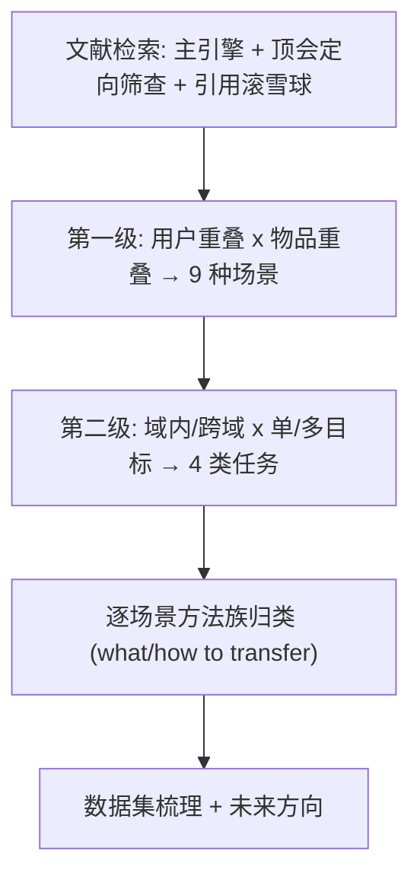
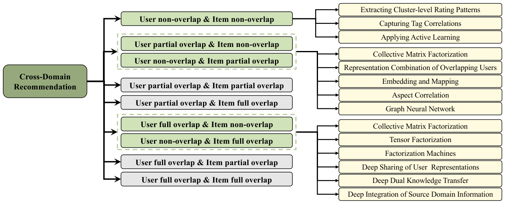

# A Survey on Cross-domain Recommendation: Taxonomies, Methods, and Future Directions (跨域推荐综述：分类体系、方法与未来方向)

- **会议/期刊**: ACM Transactions on Information Systems (TOIS), Vol. 37, No. 4
- **作者与机构**: Tianzi Zang, Yanmin Zhu, Haobing Liu, Ruohan Zhang, Jiadi Yu（上海交通大学）
- **推荐链路定位**: 召回 / 精排（跨业务域知识迁移层）
- **研究方向**: 跨域与多场景推荐 / 冷启动与长尾推荐
- **论文原文**: [https://arxiv.org/abs/2108.03357v2](https://arxiv.org/abs/2108.03357v2)
- **开源代码**: 暂未开源

## TL;DR (1分钟核心速览)

跨域推荐（CDR）长期缺少与近年深度学习方法匹配的系统性综述：旧综述把两域关系粗分为「无重叠 / 用户重叠 / 物品重叠 / 全重叠」四类，且不按场景组织方法。本文提出两级分类法：第一级把用户集、物品集的重叠各细分为**无重叠 / 部分重叠 / 完全重叠**，交叉出 9 种场景（去除 1 种退化为单域、2 对对称后仅 3 个有效场景）；第二级把任务拆为**域内 / 跨域 × 单目标 / 多目标**4 类。在此坐标下按场景归纳方法族（簇级评分模式、标签关联、主动学习；集体矩阵分解、重叠用户表征组合、嵌入映射、GNN、方面相关；CMF、张量分解、FM、深度共享与双迁移），并指出 3 个零研究场景。本文为综述，不含自有实验。

## Background & Motivation (背景与核心矛盾)

- **主流范式**: CDR 以「源域稠密知识 → 目标域稀疏/冷启动」为核心，主流做法是挖掘各域知识（what to transfer）并建立域间连接（how to transfer），连接媒介从重叠实体扩展到簇级模式与标签、评论等辅助信息。
- **前人局限**: ① 已有综述（Cremonesi 四场景、Khan、Zhu 等）把重叠关系二值化，无法定位「部分重叠」这一实际最普遍、也是深度方法最集中的场景；② 其覆盖面止于 2018–2019，遗漏大量 GNN、元学习、对抗与预训练时代的 CDR 工作；③ 不按场景归纳方法，导致读者误以为方法可跨场景通用。
- **核心洞察 (Key Insight)**: 「方法强绑定场景」——为无重叠场景设计的簇级模式迁移，在用户部分重叠场景并非最优；而依赖重叠用户训练映射函数的方法，在重叠比例极低时会失效。因此必须先场景化、再方法化。
- **本文切入点**: 用两级、双维度的细化分类法为全部 CDR 工作建立统一坐标，再逐场景做方法族归类与优缺点对比。

## Method (核心方法设计)

### 1. 整体框架 (Overall Architecture)

综述先以混合检索策略（Google Scholar 为主引擎 + NIPS/ICML/ICLR/KDD/WWW/AAAI/SIGIR/IJCAI/WSDM/RecSys 定向筛查 + 参考文献滚雪球，关键词含 cross-domain/cross-system/cross-network/cross-platform rec）建立文献池；随后用两级分类法为每篇工作打上「场景标签 + 任务标签」，最后在同一场景内做方法族归类与横向优缺点讨论，并整理数据集与开放问题。

<figure class="paper-figure" markdown="span">
  <figcaption>图2. 不同推荐场景下基于方法的分类。</figcaption>
</figure>

### 2. 关键设计拆解 (Key Designs)

1. **场景维度由二值细化为三值并做对称约简**：旧分类仅判「是否重叠」，无法区分 `U_A = U_B` 与 `U_A ≠ U_B 且 U_A∩U_B ≠ ∅`。本文改为

$$\mathcal{U}_A\cap\mathcal{U}_B=\varnothing \;\big|\; \mathcal{U}_A\neq\mathcal{U}_B,\ \mathcal{U}_A\cap\mathcal{U}_B\neq\varnothing \;\big|\; \mathcal{U}_A=\mathcal{U}_B$$

物品侧同理，交叉得 9 种场景。约简规则：`用户全重叠 & 物品全重叠` 等价于单域推荐；`用户无重叠 & 物品部分/完全重叠` 分别与 `用户部分/完全重叠 & 物品无重叠` 对称（交换用户与物品即可复用方法）。最终只需讨论 3 个有效场景，覆盖了绝大多数已有工作。

2. **任务维度两级正交，把「跨域冷启动」显式定义出来**：维度一判推荐物品是否与用户同域——`intra-domain`（对 $u\in\mathcal{U}_A$推荐$I_u\subseteq\mathcal{I}_A$）与 `inter-domain`（对$u\in\mathcal{U}_B$推荐$I_u\subseteq\mathcal{I}_A$）；后者因该用户在目标域无任何交互，等价于跨域冷启动用户推荐。维度二判目标域数量——`single-target`（稠密域作源、稀疏域作目标）与 `multi-target`（双稀疏、互为目标，无源目标之分）。

3. **方法族与场景的绑定关系（迁移算子层面）**：三条代表主线各有一个「迁移算子」原型。① 簇级模式迁移（无重叠场景）用 ONMTF 分解后构造共享码本并重建目标域：

$$\mathbf{B}=\big[\mathbf{U}_{aux}^{\top}\mathbf{X}_{aux}\mathbf{V}_{aux}\big]\oslash\big[\mathbf{U}_{aux}^{\top}\mathbf{1}\mathbf{1}^{\top}\mathbf{V}_{aux}\big],\quad \tilde{\mathbf{X}}_{tgt}=\mathbf{W}\circ\mathbf{X}_{tgt}+(\mathbf{1}-\mathbf{W})\circ[\mathbf{U}_{tgt}\mathbf{B}\mathbf{V}_{tgt}^{\top}]$$

② 嵌入映射（部分重叠，面向跨域冷启动）学一个映射函数把源域表征搬到目标域：$\min_\theta\sum_{u_i\in\mathcal{U}}L\big(f_U(\mathbf{U}^s_i;\theta),\mathbf{U}^t_i\big)$，推理时$\hat{\mathbf{U}}^t_i=f_U(\mathbf{U}^s_i;\theta)$；其改进集中在「映射函数的个性化/去偏」（TMCDR 元学习、PTUPCDR 用户级个性化映射、SSCDR 半监督扩样本）。③ 完全重叠场景普遍采用「共享 + 专属」分解：$u^{(s)}_i=\bar{u}_i+\Delta u^{(s)}_i$，共享部分承载跨域共性，专属部分保留域特性，避免强制$U_A=U_B$ 带来的负迁移。

- **训练目标、负采样与推理效率**: 综述本身无统一损失；各方法族沿用重构损失（MF/CMF 的 Frobenius 或 BPR 排序损失）、码本/张量重构损失或映射回归损失。稀疏场景多用隐式反馈 + 均匀负采样，排序类工作（CDCR、NSCR）用 BPR 成对采样。推理开销差异极大：映射类仅需一次前向映射（$O(d^2)$），GNN 类需跨域图卷积（内存与邻域采样开销最高，可扩展性受限），簇级模式类只需码本查表（最轻量但粒度粗，属粗粒度迁移）。

## Experimental Setup & Evaluation Protocol (实验设置与评估协议)

本文为综述，**不设自有实验与主表**；以下为其汇总的社区通行协议。

- **数据集与预处理**: 综述将常用数据集按域类型分组，典型统计口径如下（稀疏度普遍高于 99%）：

| 数据集 | 域构成 | 常用场景 | 特点 |
| :--- | :--- | :--- | :--- |
| Amazon | Book / Movie / Music / Electronics / Clothing / CD | 部分重叠、完全重叠 | 显式评分 + 评论，最常用于 EMCDR 系列 |
| Douban | Movie / Book / Music | 完全重叠、部分重叠 | 显式评分 + 标签，中文场景主流 |
| Epinions | 物品域 + 社交域 | 部分重叠 / 跨域社交推荐 | 含信任网络，用于 NSCR 类 |
| Netflix / MovieLens | 电影 + 辅助源 | 无重叠簇级迁移 | 早期码本类方法基准 |
| Yelp / Foursquare | POI + 社交 | 部分重叠 | 位置与社交信号融合 |

- **数据划分与防穿越 (Splitting Strategy)**: 主流为**按用户/物品比例划分（如 8:1:1）** 与 **`Leave-One-Out`**；跨域冷启动评测采用**冷启动划分**——重叠用户（或目标域交互数 ≥ 阈值者）作训练，目标域无交互用户作测试，仅用源域表征打分。时间敏感工作采用全局时间戳切分。
- **排名评测协议 (Ranking Protocol)**: 评分预测任务报 MAE/RMSE；Top-N 任务多数采用 `Sampled Ranking`（每正样本配 1:99 或 1:100 负样本）报 HR@10 / NDCG@10，部分工作用 `Full-Ranking` 全库排序。**综述明确指出这一不统一是横向比较困难的主因之一**。
- **对比基线与超参设置**: 各方法族基线分别为单域 MF/BPR、CMF、CBT/TALMUD（码本）、EMCDR（映射）、DTCDR（表征组合）、CoNet/DDTCDR（双迁移）；隐向量维度 $d$多在 10–64 之间，显著性检验多用配对 t 检验（$p<0.05$）。

## Key Experimental Results (实验关键数据)

### 1. 场景—方法定位表（替代主实验表）

由于综述无可比数值，此处给出原文 Table 1/4/5 的**方法族 × 场景覆盖矩阵**（★ 表示该场景下的主力方法族）：

| 方法族 | 无重叠 | 用户部分重叠 | 用户完全重叠 | 代表工作 |
| :--- | :---: | :---: | :---: | :--- |
| 簇级评分模式 / 码本迁移 | ★ | – | – | CBT, TALMUD, CLFM, PCLF, MINDTL |
| 标签 / 内容关联 | ★ | – | – | TagCDCF, ETagiCDCF, SCT, CATN |
| 主动学习（补实体对应） | ★ | – | – | MMMF-TL, RLMF-TL, MultiAL |
| 集体矩阵分解 | – | ★ | ★ | XPTRANS, JCSL, KerKT, CMF, SoRec, LSCD |
| 重叠用户表征组合 | – | ★ | – | DTCDR, GA-DTCDR |
| 嵌入与映射 | – | ★（约 13 篇，最集中） | – | EMCDR, DCDCSR, SSCDR, TMCDR, PTUPCDR, LACDR |
| 图神经网络 | – | ★ | – | HeroGRAPH, NSCR, ReCDR, ECHCDR, DA-GCN |
| 张量分解 / 因子分解机 | – | – | ★ | CDTF, HST, RB-JTF, FM-MCMC, CoFM |
| 深度共享 / 双知识迁移 | – | – | ★ | CoNet, ACDN, DDTCDR, π-Net, BiTGCF |

### 2. 「消融式」对照：方法族的适用边界

| 方法族 | 是否需重叠实体 | 是否需辅助信息 | 计算开销 | 典型失效场景 |
| :--- | :--- | :--- | :--- | :--- |
| 簇级码本迁移 | 否 | 否 | 低 | 用户粒度个性化缺失，粗粒度迁移上限低 |
| 标签/内容关联 | 否 | 是（标签/评论） | 中 | 无辅助信息时完全不可用 |
| 主动学习 | 需人工标注 | 否 | 高（人力预算） | 预算受限，效果依赖标注质量 |
| 嵌入映射 | 是（重叠用户） | 否 | 低（一次映射） | 重叠用户过少时映射函数过拟合 |
| 表征组合 | 是 | 可选 | 中 | 非重叠用户占多数时退化 |
| 图神经网络 | 是 | 可选 | 高 | 大规模图上的可扩展性瓶颈 |
| 深度双迁移 | 是（完全重叠） | 可选 | 中高 | 用户非全重叠时框架不适用 |

### 3. 关键实验发现 (Key Findings)

1. **研究热度极度倾斜**：有效 3 场景中，「用户部分重叠 & 物品无重叠」聚集了约 28 篇工作（嵌入映射一族独占约 13 篇），远超完全重叠场景；而 `用户部分重叠 & 物品部分重叠`、`用户部分重叠 & 物品全重叠`、`用户全重叠 & 物品部分重叠` 三个场景**至今零研究**，是分类法暴露出的最直接空白。
2. **迁移粒度决定性能上限**：簇级（group-level）迁移虽在无重叠场景通用，但因粒度粗导致个性化损失；方面级（aspect-level）与评论内容对齐的迁移粒度最细、效果最好，但强依赖内容可得性——即「迁移粒度 ↔ 数据可得性」是 CDR 的核心权衡。
3. **深度方法全面取代浅层方法但代价显性化**：GNN 类通过共享图传播在多数评测中取得最优，然而其显存与邻域采样成本使可扩展性受限；映射类以极低推理成本（一次前向）取得接近的表现，二者构成「效果—成本」的两端。

## Highlights & Limitations (亮点、对比与审稿批判)

- **与代表作对比 (vs. Prior Work)**: 相比 Cremonesi 的四场景划分，本文把重叠关系三值化并给出对称约简与退化规则，使方法定位从「4 桶」变为「9 格」且每格可判有效/无效；相比 Khan 等（2017）的「域类型 + 重叠场景 + 任务」三要素，本文把任务维度细化为域内/跨域 × 单/多目标的正交四类；相比 Zhu 等（2021）仅覆盖单目标 CDR 方法的分类，本文覆盖了多目标与深度方法全谱。
- **可迁移亮点**: ① 「对称约简 + 退化识别」的分类思路可直接迁移到多模态、多场景推荐的任务划分；② `u^{(s)} = \bar{u} + \Delta u^{(s)}` 的共享/专属分解，是可复用的抗负迁移通用算子；③ 将「重叠比例」作为一等公民纳入实验划分，可推广为跨域评测的标准切片。
- **审稿级局限批判**: ① 只覆盖两域情形，多域（>2）场景仅在记号层面声称「易扩展」，未给出方法级讨论；② 数据集章节仅做归类与用法说明，未提供统一下载/预处理脚本与统一划分，因此**无法解决综述反复指出的「评测协议不统一、结果不可比」问题**；③ 文献截止于 2021 年中，2022 年后兴起的 LLM 语义桥接、生成式跨域迁移、图基础模型等完全缺席；④ 作者在讨论中给出「哪类方法更好」的定性判断，但缺乏对同一数据集、同一划分下的再实现与显著性检验支撑。

## Rating (四维评分)

- **方法创新性 (Novelty)**: ⭐⭐⭐⭐ （分类法本身即为贡献：三值化重叠 + 对称约简 + 零研究场景的显式暴露，思路清晰且可复用）
- **评估协议与实验扎实度 (Protocol & Experiments)**: ⭐⭐ （综述无自有实验；虽系统汇总了划分与排名协议，但未推动统一 benchmark，跨方法结果仍不可比）
- **写作与数学规范度 (Clarity & Rigor)**: ⭐⭐⭐⭐ （9 场景 + 4 任务的坐标体系严谨，各方法族均给出范式级公式与示意，公式表述克制而准确）
- **工业落地与复现价值 (Industrial & Practical Value)**: ⭐⭐⭐⭐ （按场景查方法族的索引表对业务选型极友好，冷启动/多业务线迁移可直接对照；但无开源代码与统一实现，落地仍需自行复现）

