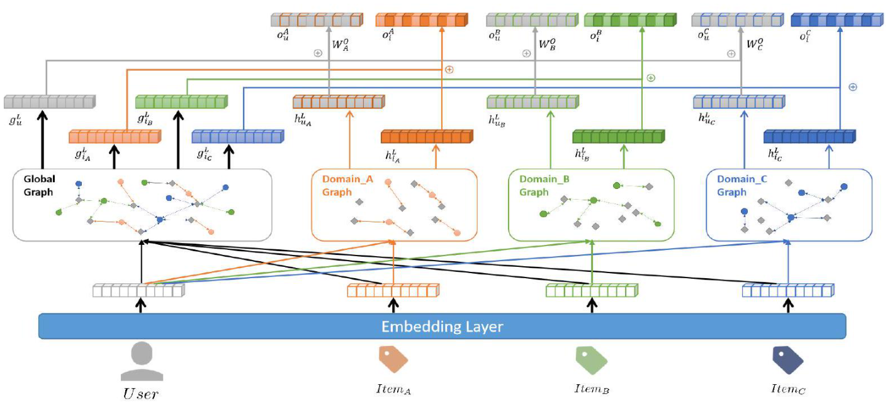
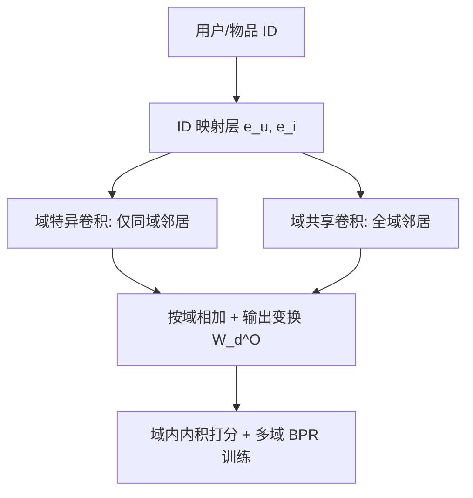

# Heterogeneous Graph-based Framework with Disentangled Representations Learning for Multi-target Cross Domain Recommendation (面向多目标跨域推荐的解耦表征异构图表征框架)

- **会议/期刊**: WWW 2023（arXiv v2, 2024 更新）
- **作者与机构**: Xiaopeng Liu, Juan Zhang, Chongqi Ren, Shenghui Xu, Zhaoming Pan, Zhimin Zhang（网易传媒技术，北京）
- **推荐链路定位**: 召回（multi-target matching module，线上替换原 matching 层）
- **研究方向**: 跨域与多场景推荐 / 图神经网络推荐
- **论文原文**: [https://arxiv.org/abs/2407.00909v2](https://arxiv.org/abs/2407.00909v2)
- **开源代码**: [https://github.com/NetEase-Media/HGCDR](https://github.com/NetEase-Media/HGCDR)

## TL;DR (1分钟核心速览)

针对 MTCDR（多目标跨域）场景中「跨域迁移难避免负迁移 + 多域同时提升困难」的痛点，HGDR 把多个域的用户与物品放进**一张共享异构全局图**（用户跨域共享、物品域内独占），只以 ID 为输入，用**域特异图卷积**（仅聚合同域邻居）与**域共享图卷积**（跨全部域聚合）两条通道解耦出 domain-specific / domain-shared 表征，按域相加后做 BPR 排序。在 Douban 三域与网易 APP 三场景上，采用 Leave-One-Out + 1:99 采样排序协议，HR@10 相对最强基线 GA-DTCDR 提升 2.4%～10.2%，Movie 域 NDCG@10 提升 12.0%；线上 5 天 A/B 让 CTR 由 7.48% 升至 8.35%、覆盖率 32.31%→34.10%。

## Background & Motivation (背景与核心矛盾)

- **主流范式**: 跨域推荐以 STCDR（源域→目标域非对称迁移）和 DTCDR（双域对称共享/私有分解）为主，代表作为 CoNet、DDTCDR、GA-DTCDR；图侧则用 RGCN 这类按边类型分参数的异构图卷积。
- **前人局限**: ①STCDR/DTCDR 天然是「一对一」结构，扩展到 K 个域时需要 O(K²) 的双域映射或大量重复建模，模型复杂度随域数爆炸；②不做域隔离的共享编码会把「某域特有偏好」当噪声灌入其他域，产生负迁移，稀疏域上尤其明显。
- **核心洞察 (Key Insight)**: 用户是跨域共享实体、物品是域内独占实体，因此「共享」与「特有的部分」在结构上本就存在天然的二分——把这种二分**显式编码进图卷积的邻居采样范围**，即可在不引入任何 side information 的情况下完成解耦。
- **本文切入点**: 一张全局异构图上跑双通道卷积，用「邻居范围」而不是「互信息正则」实现解耦，一次训练同时服务所有域。

<figure class="paper-figure" markdown="span">
  <figcaption>图 1：我们提出的 HGDR 框架</figcaption>
</figure>
图 1：HGDR 整体框架（映射层 → 域特异/域共享双通道卷积 → 融合输出）

## Method (核心方法设计)

### 1. 整体框架 (Overall Architecture)

模型只有 ID 输入：每个用户/物品 ID 映射为初始向量 $e_u, e_i$，多域交互共同构成一张异构全局图（边类型由「域 + 行为 + 方向」决定，如 user-click-music 与 music-clicked-by-user 视为两类边）。随后两条并行卷积通道分别沿「同域邻居」与「全部域邻居」传播$L=2$ 层，节点最终表征为两通道末层相加后过域相关输出矩阵，用域内 BPR 打分并以数据规模加权的多域损失联合优化；推理时域内向量内积即可做 ANN 召回。

### 2. 关键设计拆解 (Key Designs)

1. **域特异图卷积（挡住负迁移）**：痛点是跨域聚合会把无关偏好混入；本文为每个域 $d$单独配一套关系权重$W_d^{UU}, W_d^{IU}$且邻居集合限定为$N_u^d$（同域），使该通道只承载域内协同信号：$h_{u,d}^{l+1}=\mathrm{ReLU}\big(h_{u,d}^{l}W_d^{UU}+\sum_{i\in N_u^d}h_{i,d}^{l}W_d^{IU}\big)$。直觉：域内高阶平滑刻画「本域口味」，是打分的主信号源。

2. **域共享图卷积（低成本跨域迁移）**：痛点是 DTCDR 式双域映射无法扩展到 K 域；本文让共享通道在**所有域**上聚合，且边权仍按来源域区分（$W_d^{IU}$），实现「一次卷积、K 域信息汇聚」：$g_u^{l+1}=\mathrm{ReLU}\big(g_u^{l}W_s^{UU}+\sum_{d\in D}\sum_{i\in N_u^d}g_{i}^{l}W_d^{IU}\big)$。直觉：把稀疏域的用户表征由稠密域的共现物品「补全」，天然缓解冷用户稀疏。

3. **融合、损失与开销**：输出 $o_{u,d}=(h_{u,d}^{L}+g_{u}^{L})W_d^{O}$，打分$x_{ui}^d=o_{u,d}^{\top}o_{i,d}$；总损失$\mathcal{L}=\sum_{d}\beta_d\sum_{(u,i,j)}-\ln\sigma(x_{ui}^d-x_{uj}^d)+\lambda\|\Theta\|^2$，$\beta_d$按各域数据量设定。负采样为**均匀随机负采样**（每正例 1 负例，无难负样本挖掘），Adam 默认超参，$d=128$、2 层卷积，训练为全图式（非 batch 内负采样），推理仅需域内向量内积。

## Experimental Setup & Evaluation Protocol (实验设置与评估协议)

- **数据集与预处理**: Douban 取 Book/Music/Movie 三域（沿用 GA-DTCDR 设置，用户重叠、物品域内独占）；工业数据为网易 APP 单日三业务场景。稀疏度按交互/(用户×物品) 计，工业场景极稀疏（0.0035%～0.0141%）。

| 数据集 | #Users | #Items | #Interactions | 稀疏度 | 特征/场景说明 |
| :--- | :---: | :---: | :---: | :---: | :--- |
| Douban-Book | 2,110 | 6,777 | 96,041 | 0.67% | 仅 ID，三域用户部分重叠 |
| Douban-Music | 1,672 | 5,567 | 69,709 | 0.75% | 仅 ID |
| Douban-Movie | 2,712 | 34,893 | 1,278,401 | 1.35% | 最稠密域 |
| App-Scenario A | 88,491 | 193,521 | 2,417,083 | 0.0141% | 工业线上三场景 |
| App-Scenario B | 77,609 | 211,236 | 1,361,152 | 0.0083% | 同上 |
| App-Scenario C | 172,076 | 114,550 | 696,868 | 0.0035% | 最稀疏 |

- **数据划分与防穿越 (Splitting Strategy)**: `Leave-One-Out`——每测试用户取**最近一次**交互作为测试正例（保证时间序防穿越），其余作为训练集。
- **排名评测协议 (Ranking Protocol)**: `Sampled Ranking`，每测试正例随机采 **99 个未观测负例**，在 100 候选内排序，报告 HR@10 / NDCG@10；**未做 Full-Ranking 全库排序**。
- **对比基线与超参设置**: 基线覆盖单域 MF、双域 DDTCDR、图方法 RGCN（近似「不做解耦的异构图表征」）、MTCDR 强基线 GA-DTCDR；统一 $d=128$、2 层传播。论文未报告显著性检验与超参敏感性实验。

## Key Experimental Results (实验关键数据)

### 1. 主实验对比 (Main Results)

Exp.1 Douban（HR@10 / NDCG@10 %）：

| 方法 | Book | Music | Movie |
| :--- | :---: | :---: | :---: |
| MF | 0.577 / 0.351 | 0.330 / 0.197 | 0.404 / 0.245 |
| DDTCDR | 0.586 / 0.358 | 0.352 / 0.211 | 0.422 / 0.243 |
| RGCN | 0.697 / 0.438 | 0.420 / 0.235 | 0.474 / 0.287 |
| GA-DTCDR | 0.695 / 0.441 | 0.449 / 0.260 | 0.499 / 0.309 |
| **HGDR (Ours)** | **0.712 / 0.448** | **0.483 / 0.281** | **0.550 / 0.346** |
| Improv. vs 最强基线 | +2.4% / +1.6% | +7.6% / +8.1% | +10.2% / +12.0% |

Exp.2 网易 APP 三场景：

| 方法 | Scenario A | Scenario B | Scenario C |
| :--- | :---: | :---: | :---: |
| MF | 0.577 / 0.411 | 0.591 / 0.433 | 0.322 / 0.203 |
| RGCN | 0.697 / 0.513 | 0.665 / 0.503 | 0.751 / 0.613 |
| **HGDR (Ours)** | **0.721 / 0.534** | **0.692 / 0.529** | **0.775 / 0.629** |
| Improv. vs RGCN | +3.4% / +4.1% | +4.1% / +5.2% | +3.2% / +2.6% |

线上 5 天 A/B（target 域）：CTR 6.12→8.35%，人均时长 85.69s→94.78s，覆盖率 32.28%→34.10%。

### 2. 消融实验 (Ablation Study)

**原文未提供任何组件消融实验**。下表以结构最接近的 RGCN（同一异构全局图、同样按边类型分参数，但**无域特异/域共享解耦双通道**）作为「近似去解耦」替代对照，属审稿人重构而非作者报告：

| 配置（近似） | Douban Book | Douban Movie | App-Scenario C |
| :--- | :---: | :---: | :---: |
| w/o 解耦双通道 (RGCN 代理) | 0.697 / 0.438 | 0.474 / 0.287 | 0.751 / 0.613 |
| Full HGDR | 0.712 / 0.448 | 0.550 / 0.346 | 0.775 / 0.629 |
| w/o 域共享通道 | 未报告 | 未报告 | 未报告 |
| w/o BPR→点式损失 | 未报告 | 未报告 | 未报告 |

### 3. 关键实验发现 (Key Findings)

1. **解耦双通道的增益随目标域稀疏程度放大**：Movie（最稠密，1.35%）仅 +2.4% HR，而 Music（0.75%）+7.6%、Scenario C（0.0035%）+3.2% 却需对抗极稀疏，说明共享通道主要在「自身样本不足」时提供有效补全信号。
2. **域内平滑本身不是全部收益来源**：RGCN 已是 0.697/0.474，HGDR 在 Movie 上进一步 +0.076 HR（+16.0% 相对），把提升主要归因于共享/私有拆分而非「多用了图卷积」。
3. **线上收益小于离线但方向一致**：离线 Movie +10.2% HR，线上 CTR 仅 7.48%→8.35%（+0.87pp），且覆盖率仅 +1.8pp，提示离线 1:99 采样排序高估了实际增益——候选池从 100 扩到全库后，头部流量集中的问题依旧存在。

## Highlights & Limitations (亮点、对比与审稿批判)

- **与代表作对比 (vs. Prior Work)**: 相比 DDTCDR（成对域映射 + 多任务，K 域需 O(K²) 结构）与 GA-DTCDR（图嵌入 + 元素级 attention 的双域框架），HGDR 用一张图天然支持任意域数；相比 DisenCDR（互信息正则解耦），本文把解耦落到「邻居采样范围」这一结构算子，训练更简单、无需额外正则项，但牺牲了显式互信息约束带来的解耦保证。
- **可迁移亮点**: ①「用邻居范围而非损失项做解耦」的轻量思路可直接搬到多业务场景召回；②共享通道仍按来源域保留独立边权 $W_d^{IU}$，是兼顾扩展性与域区分度的实用工程技巧。
- **审稿级局限批判**: ①**实验方法学薄弱**：无组件消融、无 $\beta_d$/层数/维度的敏感性分析、无显著性检验，MTCDR 的核心贡献「解耦是否必要」缺乏直接证据；②**评估协议偏乐观**：仅 1:99 采样排序且均匀负采样、无难负例，未与 Full-Ranking 对齐，线上增益明显缩水；③论文自述仅用 ID、未探索 side/multimodal 信息，且「用户全域共享、物品域独占」的假设在跨域电商等重叠物品场景不成立。

## Rating (四维评分)

- **方法创新性 (Novelty)**: ⭐⭐⭐ （把 domain-shared/specific 解耦映射为图卷积的邻居范围，简洁且有结构合理性，但本质是 RGCN 分参数 + 双通道相加，理论刻画与解耦保证不足）
- **评估协议与实验扎实度 (Protocol & Experiments)**: ⭐⭐ （Leave-One-Out + 1:99 采样协议可复现，但完全缺失消融、超参敏感性与显著性检验，多域结论支撑力有限）
- **写作与数学规范度 (Clarity & Rigor)**: ⭐⭐⭐ （公式与框架图清晰、符号统一，但行文有较多重复叙述，卷积权重符号定义略显冗余，且版权/会议标注存在错印）
- **工业落地与复现价值 (Industrial & Practical Value)**: ⭐⭐⭐⭐ （代码开源、仅需 ID 输入、单图多域一次训练，且有大盘线上 A/B 与覆盖率佐证，工程迁移成本低）

