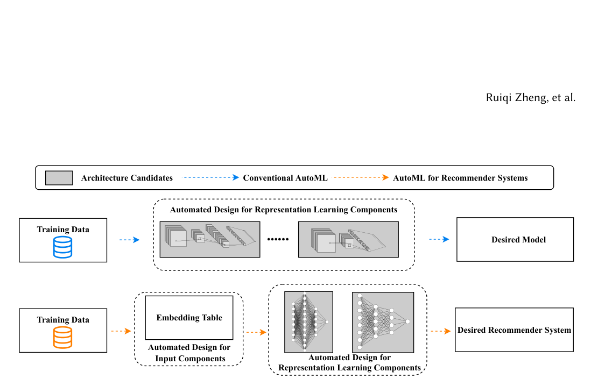
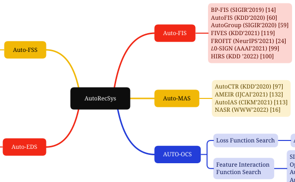
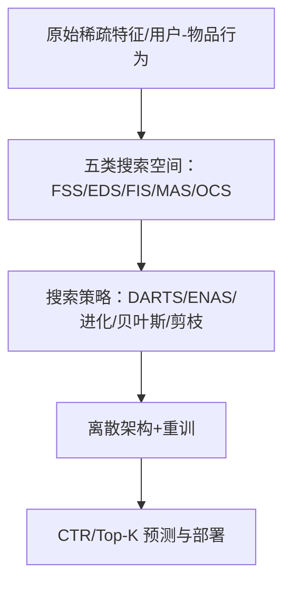

# AutoML for Deep Recommender Systems: A Survey (面向深度推荐系统的AutoML：综述)

- **会议/期刊**: ACM TOIS
- **作者与机构**: Ruiqi Zheng, Liang Qu, Bin Cui, Yuhui Shi, Hongzhi Yin；University of Queensland / Peking University / SUSTech
- **推荐链路定位**: 精排（CTR预估）为主，覆盖特征选择、嵌入、交互与整体架构自动化
- **研究方向**: CTR/CVR预估与特征交叉
- **论文原文**: [https://arxiv.org/abs/2203.13922v3](https://arxiv.org/abs/2203.13922v3)
- **开源代码**: 暂未开源

## TL;DR (1分钟核心速览)

本文是首篇系统梳理 AutoML for Deep Recommender Systems (AutoRecSys) 的综述：指出深度推荐手工设计依赖专家、嵌入表内存大、全阶交互噪声重，提出“特征选择—嵌入维度—特征交互—模型架构—其他组件”五类分类，并以搜索空间与搜索策略为主线横向对比代表方法。原文不提供统一排行榜，工业证据来自 AutoFIS 在华为应用商店的 10 天线上 A/B。

## Background & Motivation (背景与核心矛盾)

- **主流范式**: 深度推荐通常由输入层、嵌入层、交互层、预测层组成；CTR场景以 DeepFM/PNN/AutoInt 等手工特征交叉为主。
- **前人局限**: 均匀嵌入维度使长尾特征过参数化并放大内存；穷举二阶/高阶交互引入噪声；单层搜索无法保证整体架构最优。
- **核心洞察 (Key Insight)**: AutoRecSys 不同于 CV AutoML：推荐输入是超高维稀疏特征，嵌入表是内存主导项，因此“输入组件与交互结构”必须纳入搜索空间。
- **本文切入点**: 以“搜索空间设计 + 搜索策略效率”为统一线索，建立五类 taxonomy，并给出复杂度与工业适配分析。

<figure class="paper-figure" markdown="span">
  <figcaption>图 1. 面向推荐系统的 AutoML 与传统 AutoML 的示意图。</figcaption>
</figure>

## Method (核心方法设计)

### 1. 整体框架 (Overall Architecture)

综述将 AutoRecSys 抽象为：在部署预算下，从候选空间 $\mathcal{S}$采样架构$\mathcal{A}$，联合学习模型权重$\mathcal{W}$与架构参数，最终离散化、重训并部署。五类搜索分别作用于原始特征、嵌入维度、特征交互、整体网络及其他组件（损失/正则等）。核心闭环是“定义紧凑空间$\to$连续松弛或进化/贝叶斯搜索$\to$离散化$\to$ 重训上线”。

<figure class="paper-figure" markdown="span">
  <figcaption>图 2. AutoRecSys 方法的分类。</figcaption>
</figure>

### 2. 关键设计拆解 (Key Designs)

1. **AutoRecSys 抽象与五类 taxonomy**：作者把“自动设计深度推荐组件”形式化为双层优化，$\min_{\mathcal{A}\in\mathcal{S}}\mathcal{L}_{val}(\mathcal{W}^*(\mathcal{A}),\mathcal{A})$，s.t.$\mathcal{W}^*(\mathcal{A})=\arg\min_{\mathcal{W}}\mathcal{L}_{train}(\mathcal{W},\mathcal{A})$。其价值在于把零散 AutoML 工作统一到“空间—策略—任务”三维坐标系，避免只按模型名罗列。
2. **搜索空间压缩**：Auto-FSS 搜索 $2^F$原始特征子集；Auto-EDS 搜索$(S+1)^T$或$2^{Sd}$维度；Auto-FIS 从$O(2^{F^2})$二阶交互扩展到$O(2^{F^K})$高阶，PROFIT 用低秩 CP 分解把空间压到$O(RFK)$。核心直觉是：推荐交互空间随阶数指数爆炸，必须用门控、heredity 先验或低秩分解引入归纳偏置。
3. **搜索策略与训练目标**：常用 DARTS 连续松弛 $\bar{o}^{(i)}(\cdot)=\sum_{j=1}^{|\hat{\mathcal{O}}|}\frac{\exp(\alpha_j^{(i)})}{\sum_{n=1}^{|\hat{\mathcal{O}}|}\exp(\alpha_n^{(i)})}\hat{o}_j(\cdot)$，以及 Gumbel-Softmax、ENAS、进化搜索和单次剪枝。综述无统一损失；CTR 多用交叉熵，排序任务用 BPR；负采样随原文而异，未统一 Full/Sampled 协议。

## Experimental Setup & Evaluation Protocol (实验设置与评估协议)

- **数据集与预处理**: 本文为综述，未统一重跑数据集；覆盖 Criteo/Avazu 类 CTR 基准、Top-K 推荐基准及华为 App Store 工业场景。

| 数据集/基准 | #Users | #Items | #Interactions | 稀疏度/密度 | 特征/场景说明 |
| :--- | :---: | :---: | :---: | :---: | :--- |
| Criteo/Avazu 类 CTR | — | — | — | 高稀疏 | 方法常用，但原文未统一复现 |
| 华为 App Store | — | — | 十亿级 | 高稀疏 | AutoFIS 10 天线上 A/B |
| 各方法自建基准 | — | — | — | 不一 | 任务异构，无法合并统计 |

- **数据划分与防穿越 (Splitting Strategy)**: 综述不统一；CTR 常见留出/随机划分，Top-K 常见 Leave-One-Out，部分工业场景用时间切分；原文未做跨方法统一防穿越审计。
- **排名评测协议 (Ranking Protocol)**: CTR 以 AUC/LogLoss 为主，Top-K 以 HR/NDCG 为主；Full-Ranking 与 Sampled Ranking 混用，跨论文数值不可直接横向比较。
- **对比基线与超参设置**: 覆盖 AutoField、AdaFS、NIS、DNIS、SSEDS、AutoFIS、AutoGroup、PROFIT、AutoCTR 等；嵌入维度、学习率与搜索预算随原文；未报告统一显著性检验。

## Key Experimental Results (实验关键数据)

### 1. 主实验对比 (Main Results)

原文为综述，无统一指标主实验；下表为 8 个代表方法的机制横向对比（不伪造 AUC/NDCG）。

| 方法(年) | 自动化组件 | 搜索空间 | 搜索策略 | 任务/证据 |
| :--- | :--- | :--- | :--- | :--- |
| AutoField (WWW'22) | 原始特征选择 | $2^F$ | DARTS+Gumbel | CTR |
| NIS (KDD'20) | 嵌入维度 | $(S+1)^T$ | ENAS/A3C | Top-K/CTR |
| DNIS (ArXiv'20) | 嵌入维度 | $2^{Sd}$ | DARTS | Rating/Top-K/CTR |
| SSEDS (SIGIR'22) | 维度剪枝 | 单次显著性 | 剪枝+对齐重训 | CTR |
| AutoFIS (KDD'20) | 二阶交互 | $O(2^{F^2})$ | 梯度+GRDA | CTR/华为A/B |
| AutoGroup (SIGIR'20) | 高阶交互 | $O(2^{F^K})$ | 梯度 | CTR |
| PROFIT (NeurIPS'21) | 高阶低秩交互 | $O(RFK)$ | 渐进梯度 | CTR |
| AutoCTR (KDD'20) | 整体架构 | $O(4^n2^{n(n-1)/2})$ | 多目标进化 | CTR |

### 2. 消融实验 (Ablation Study)

综述无统一消融，下表为“组件替换/去除”的定性对比。

| 对比设置 | 代表方法 | 观察 |
| :--- | :--- | :--- |
| 全特征 vs 自动特征选择 | AutoField/AdaFS | 降冗余与推理开销，但控制器增加训练成本 |
| 均匀维度 vs 混合维度/剪枝 | NIS/DNIS/SSEDS | 省嵌入存储，但搜索或重训开销上升 |
| 全二阶 vs 门控交互 | AutoFIS | 去噪有效，搜索空间仍大 |
| 全高阶 vs 分组/低秩 | AutoGroup/PROFIT | 高阶可表达，低秩压缩依赖秩 $R$ |
| 手工架构 vs 整体搜索 | AutoCTR | 端到端但搜索最昂贵 |

### 3. 关键实验发现 (Key Findings)

- **参数预算矛盾**: 嵌入表是推荐模型内存主导项，均匀维度对长尾特征过参数化；Auto-EDS 三类路线（启发式/HPO/剪枝）均在“精度—存储”间取舍。
- **交互空间爆炸**: 二阶全交互 $O(2^{F^2})$到高阶$O(2^{F^K})$不可承受；AutoFIS 门控与 PROFIT 低秩$O(RFK)$是两种有效压缩，但前者仍重、后者对$R$ 敏感。
- **工业验证有但不可泛化**: AutoFIS 在华为 App Store 10 天 A/B 显示显著提升，说明 AutoRecSys 可落地；但综述未给统一复现实验，跨论文提升幅度不能直接比较。

## Highlights & Limitations (亮点、对比与审稿批判)

- **与代表作对比 (vs. Prior Work)**: 相较此前短综述，本文新增 MDE、SSEDS、$L_0$-SIGN、HIRS、NASR、OptInter 等，并首次以搜索空间复杂度与策略为主线横向比较；相比通用 NAS/DARTS 综述，本文强调推荐输入/嵌入表的特殊性。
- **可迁移亮点**: ①用“部署预算约束”设计搜索空间与剪枝目标，可直接迁移到召回/精排；②用低秩/heredity 先验压缩高阶交互空间，适合大模型推荐的特征交叉层。
- **审稿级局限批判**: ①无统一 benchmark 与复现实验，跨论文结论偏定性；②搜索成本、动态数据分布与冷启动场景缺少量化；③Auto-FSS 与 Auto-FIS 边界存在重叠，分类粒度可再细化。

## Rating (四维评分)

- **方法创新性 (Novelty)**: ⭐⭐⭐⭐ （首篇系统 AutoRecSys taxonomy，抽象与五类划分有框架价值，但非新算法）
- **评估协议与实验扎实度 (Protocol & Experiments)**: ⭐⭐⭐ （覆盖面广，但无统一数据集、划分与显著性检验，横向数值不可比）
- **写作与数学规范度 (Clarity & Rigor)**: ⭐⭐⭐⭐ （搜索空间/策略公式清晰，复杂度对比到位；部分分类边界略重叠）
- **工业落地与复现价值 (Industrial & Practical Value)**: ⭐⭐⭐⭐ （含华为 A/B 与剪枝/部署讨论，适合工业选型；复现需依赖各原文代码）

