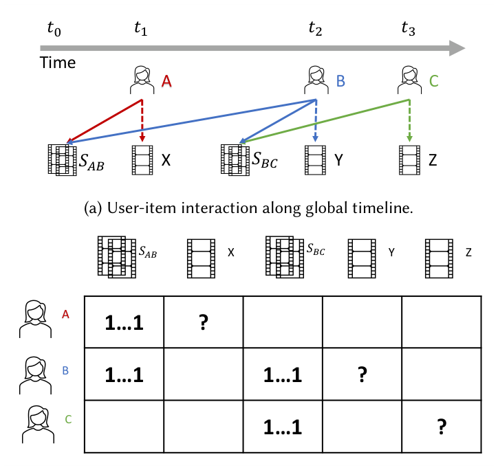
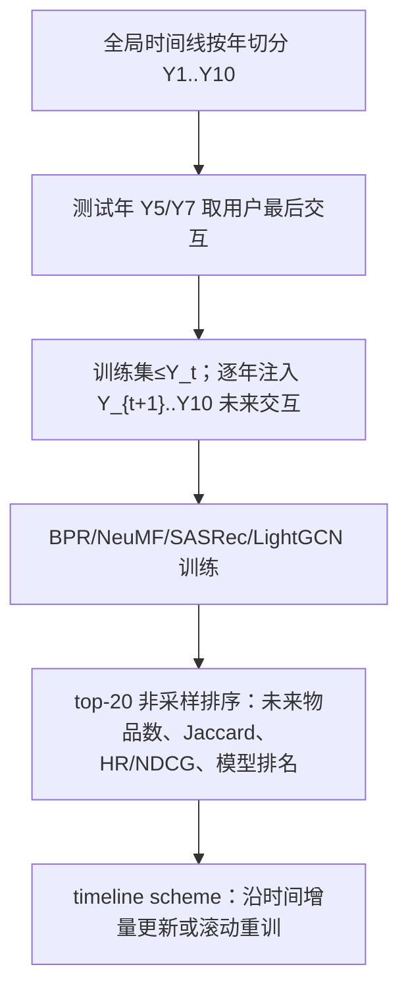
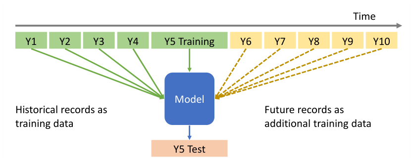

# A Critical Study on Data Leakage in Recommender System Offline Evaluation（推荐系统离线评估中的数据泄漏批判性研究）

- **会议/期刊**: ACM Transactions on Information Systems (TOIS) 2023；arXiv 2020
- **作者与机构**: Yitong Ji, Aixin Sun, Jie Zhang（Nanyang Technological University）；Chenliang Li（Wuhan University）
- **推荐链路定位**: 离线评估协议（召回/精排/序列推荐通用）
- **研究方向**: 去偏公平、可信隐私与工业架构 / 评测基准与数据泄漏
- **论文原文**: [论文原文链接](https://arxiv.org/abs/2010.11060v4)
- **开源代码**: [开源代码仓库链接](https://github.com/putatu/dataLeakageRec)

## TL;DR (1分钟核心速览)

本文针对离线推荐评估中普遍忽略全局时间线所导致的数据泄漏：在 leave-last-one-out 或随机划分下，CF 模型可从“未来交互”学习用户相似性，并把测试时点尚不可用的未来物品推荐给过去实例。作者用 BPR、NeuMF、SASRec、LightGCN 在 4 个十年跨度数据集上做受控泄漏实验，发现 top-20 中确实出现未来物品，且数据泄漏使 HR@20/NDCG@20 变化最高达 +89.5% 或 -29.0%，模型相对排序亦不稳定；进而提出按全局时间线增量训练/滚动重训的 timeline scheme。

## Background & Motivation (背景与核心矛盾)

- **主流范式**: 多数离线评测把训练集当静态整体，采用随机划分或 leave-last-one-out，只保证“用户局部历史在前”，未约束全局时间线。
- **前人局限**: 随机划分完全忽略时间；leave-last-one-out 虽保留用户最后交互作测试，但训练集中仍可能混入其他用户在测试时点之后产生的交互；split-by-timepoint 虽避免泄漏，却难以兼顾测试样本量与长测试期内的兴趣漂移。
- **核心洞察 (Key Insight)**: 物品发布、流行度和用户活跃期沿全局时间线高度动态；CF 可通过用户-物品二部图的相似链，把未来用户 C 的物品信息传播给过去用户 A。因此“局部时间线正确”不等于“全局无穿越”。
- **本文切入点**: 不比较划分策略本身，而是用“未来数据注入年数”控制泄漏严重度，量化泄漏对推荐列表、精度和模型排名的影响，再给出全局时间线评测方案。

<figure class="paper-figure" markdown="span">
  <figcaption>图5. 沿全局时间线的交互及其矩阵形式。</figcaption>
</figure>
图5：全局时间线上的交互与矩阵视图；用户 A 的测试点早于用户 C 的物品可用期，CF 仍可通过 A-B-C 相似链把未来物品传给 A。

## Method (核心方法设计)

### 1. 整体框架 (Overall Architecture)

本文是批判性评测框架而非新推荐模型。它将十年交互按年切成 $Y1,\ldots,Y10$，选$Y5$或$Y7$为测试年：测试用户取其在该年内发生的最后一次交互为测试实例；无泄漏训练集为截至$Y_t$的非测试交互。随后逐年把$Y_{t+1},\ldots,Y_{10}$ 的交互加入训练，模拟从轻到重的未来数据泄漏，并在四个代表性模型上记录 top-20 中的未来物品数、推荐列表 Jaccard 相似度、HR@20/NDCG@20 与模型排名。最后提出 timeline scheme：模型沿全局时间线接收数据，在遇到测试实例时只使用该时点前已见交互与当前可用物品池打分。

<figure class="paper-figure" markdown="span">
  <figcaption>图6. 以测试年份 𝑌5 为例的训练/测试数据划分。</figcaption>
</figure>
图6：以 $Y5$ 为测试年的训练/测试切分；绿色为历史训练数据，右侧为逐年注入的未来训练数据。

### 2. 关键设计拆解 (Key Designs)

1. **泄漏严重度控制（Future-Data Injection）**：痛点是把训练集静态化后，无法判断“未来信息”影响多大。本文定义测试年 $Y_t$、注入$k$年未来数据后的训练集$D^{(k)}_{\mathrm{train}}=\{d:\tau(d)\le Y_t+k\}\setminus D_{\mathrm{test}}$，其中$\tau(d)$为交互时间；$k=0$表示无泄漏，$k>0$ 表示训练可见测试时点之后的交互。这样可在同一测试集上观察泄漏单调/非单调影响，避免不同划分带来的混淆。
2. **未来物品与列表漂移度量**：对测试实例 $u$，其 top-$N$列表$L_u^N$中未来物品数为$F@N=\sum_{u\in\mathcal T}\sum_{i\in L_u^N}\mathbb{I}[\tau_i^{rel}>\tau_u^{test}]$，其中$\tau_i^{rel}$为物品首次可用时间。列表漂移用 Jaccard 相似度$J(L_A,L_B)=|L_A\cap L_B|/|L_A\cup L_B|$。作者进一步用同训练集不同随机种子的 intrinsic Jaccard 作参照，若 extrinsic Jaccard 明显更低，则说明差异来自泄漏而非训练随机性。
3. **Timeline 评测与训练/推理约束**：无泄漏评测要求 $L_u^N(t)=\mathrm{TopN}_{i\in\mathcal I_t} f_\theta(u,i\mid D_{<t})$，即打分只依赖$t$前数据与当前可见物品池$\mathcal I_t$；增量模型按$\theta_t=\mathrm{Update}(\theta_{t-1},D_{t-1:t})$ 更新，批量模型则需滚动重训。总损失沿用各基线原目标（BPR pairwise、NeuMF 二分类、SASRec next-item、LightGCN BPR），负采样沿用模型默认设置（BPR/NeuMF 1–4 个负例，序列/图模型常规负采样）。代价是训练次数随窗口数增加，在线/离线重训开销显著上升。

## Experimental Setup & Evaluation Protocol (实验设置与评估协议)

- **数据集与预处理**: 四个十年跨度数据集；Yelp/Amazon-electronic 用 10-core，Amazon-music 用 5-core，MovieLens-25M 不额外过滤。

| 数据集 | #Users | #Items | #Interactions | 密度 | 特征/场景说明 |
| :--- | :---: | :---: | :---: | :---: | :--- |
| MovieLens-25M | 62,202 | 56,774 | 9,808,925 | 0.278% | 电影评分，时间戳可靠性较弱 |
| Yelp | 116,655 | 61,027 | 3,127,215 | 0.044% | 本地商户评论，10-core |
| Amazon-music | 11,651 | 9,243 | 114,833 | 0.107% | 音乐评论，5-core，规模最小 |
| Amazon-electronic | 109,990 | 39,552 | 1,752,238 | 0.040% | 电子产品评论，10-core，含新品发布动态 |

- **数据划分与防穿越 (Splitting Strategy)**: 采用 **Leave-Last-One-Out within test year**：测试用户为在 $Y5$或$Y7$ 内发生最后一次交互者，取其最后交互为测试实例；训练集截至测试年，随后逐年加入未来年份交互模拟泄漏。该设置保留用户局部时间线，但不天然保证全局无穿越。
- **排名评测协议 (Ranking Protocol)**: **Full-Ranking / 非采样排序**，在训练中可见的全部物品池上排序，报告 HR@20、NDCG@20；未采用 sampled negatives，因此绝对指标低于常见采样评测。
- **对比基线与超参设置**: BPR、NeuMF、SASRec、LightGCN 分别代表矩阵分解、深度交互、序列建模和图卷积；每个模型随机搜索 50 次，验证集为测试用户倒数第二次交互。Embedding 维度搜索：BPR/NeuMF/LightGCN 8–128，SASRec 8–256。论文未报告显著性检验，采用 3 或 7 次随机种子平均降低噪声。

## Key Experimental Results (实验关键数据)

### 1. 主实验对比 (Main Results)

表1给出相对“无未来数据”参考的 HR@20/NDCG@20 最低与最高变化；正负号表示相对升高/降低。粗体为每行最大绝对变化（非“性能最优”）。

| 数据集 | 指标 | BPR | NeuMF | LightGCN | SASRec |
| :--- | :--- | :---: | :---: | :---: | :---: |
| MovieLens-25M | HR@20 | -8.0%, +2.3% | -4.1%, +0.9% | -3.8%, +11.1% | -5.3%, **+17.2%** |
| MovieLens-25M | NDCG@20 | -6.3%, +5.5% | -1.5%, +2.0% | **-9.3%**, +6.8% | -5.4%, +16.8% |
| Yelp | HR@20 | **-17.8%**, +9.2% | -6.1%, +18.3% | -0.3%, +10.8% | -13.6%, +1.9% |
| Yelp | NDCG@20 | -13.9%, +15.4% | -6.6%, +18.3% | -0.5%, +8.0% | **-29.0%**, -0.6% |
| Amazon-music | HR@20 | +19.3%, +37.2% | **+39.6%, +65.6%** | 0%, +22.8% | -5.4%, +3.3% |
| Amazon-music | NDCG@20 | +23.6%, +51.8% | **+40.2%, +89.5%** | +1.9%, +32.7% | -3.4%, +6.3% |
| Amazon-electronic | HR@20 | +6.4%, +22.9% | -38.1%, +14.3% | -9.7%, +22.4% | -7.5%, +62.5% |
| Amazon-electronic | NDCG@20 | +10.3%, +22.0% | -35.5%, +13.8% | -7.7%, +24.1% | -3.3%, **+73.0%** |

### 2. 消融实验 (Ablation Study)

本文无传统模块消融；“移除全局时间线约束、逐年注入未来数据”等价于泄漏严重度扫描。下表为 $Y5$ 测试集、Yelp 数据上 top-20 推荐中的未来物品总数。

| 训练可见至 | BPR | NeuMF | LightGCN | SASRec |
| :--- | :---: | :---: | :---: | :---: |
| $Y5$（无泄漏） | 0 | 0 | 0 | 0 |
| $Y6$ | 421 | 602 | 369 | 967 |
| $Y7$ | 829 | 1,631 | 739 | **3,074** |
| $Y8$ | 2,365 | 3,260 | 1,070 | 2,228 |
| $Y9$ | **5,048** | 3,542 | 1,257 | 3,162 |
| $Y10$ | 1,851 | **5,205** | 1,103 | 1,741 |

### 3. 关键实验发现 (Key Findings)

1. **未来物品是泄漏的直接证据**：Yelp 上 SASRec 仅注入 $Y6$后，top-20 未来物品即从 0 增至 967；NeuMF 在$Y10$ 达到 5,205。说明全局时间线缺失时，模型确实会把测试时点后才可用的物品推给过去实例。
2. **精度影响方向不可预测**：Amazon-music 上 NeuMF 的 NDCG@20 最高提升 +89.5%，而 Yelp 上 SASRec 的 NDCG@20 最大下降 -29.0%。更多未来数据既可能“抬高”也可能“拉低”离线指标，不能简单认为泄漏必然提分。
3. **模型相对排序被泄漏扰动**：MovieLens-25M 上 LightGCN 在无泄漏 $Y5$排名第 4，注入$Y6$后升至第 2，$Y7$又回第 4；Amazon-electronic 上 LightGCN 在$Y5$–$Y7$排名第 1，$Y8$ 降至第 2。加上 extrinsic Jaccard 随未来数据增加而低于 intrinsic 参照，表明推荐列表差异来自泄漏而非随机种子。

## Highlights & Limitations (亮点、对比与审稿批判)

- **与代表作对比 (vs. Prior Work)**: 相比仅指出随机/时间划分结果不同的工作，本文首次系统解释泄漏机制是“CF 跨全局时间线传播未来协同信号”，并用未来物品计数与 Jaccard 定量化；相比 split-by-timepoint 方案，本文进一步指出固定测试期仍难兼顾测试量与动态性，提出沿时间线增量评测。
- **可迁移亮点**: ①用“未来窗口注入”做泄漏严重度扫描，可迁移到 CTR/序列推荐的数据穿越审计；②intrinsic vs extrinsic Jaccard 可区分随机性与评测设置差异；③坚持非采样 Full-Ranking，避免采样负例掩盖排序退化。
- **审稿级局限批判**: ①timeline scheme 要求增量模型或频繁滚动重训，工业离线回测成本高，且文中未给出窗口长度、验证窗口选择与重训频率的实证方案；②实验仅覆盖 4 个批量模型与 4 个数据集，未报告显著性检验，MovieLens 时间戳可靠性也受限；③随机划分等策略主要由机制推演而非同等规模实验量化，外部效度仍需扩展。

## Rating (四维评分)

- **方法创新性 (Novelty)**: ⭐⭐⭐⭐ （非新模型，但把“全局时间线—CF 传播—未来物品”链条讲清，并提出可操作的 timeline 评测范式。）
- **评估协议与实验扎实度 (Protocol & Experiments)**: ⭐⭐⭐⭐ （四模型四数据集、非采样 Full-Ranking、多随机种子与泄漏严重度扫描较扎实，但缺显著性检验与更多划分策略实证。）
- **写作与数学规范度 (Clarity & Rigor)**: ⭐⭐⭐⭐ （问题定义、示例与度量公式清晰；timeline 方案仍偏概念化，窗口/重训策略未形式化。）
- **工业落地与复现价值 (Industrial & Practical Value)**: ⭐⭐⭐⭐ （代码数据开源，泄漏审计可直接用于工业离线评估；但增量重训开销与线上回放集成是主要落地门槛。）

