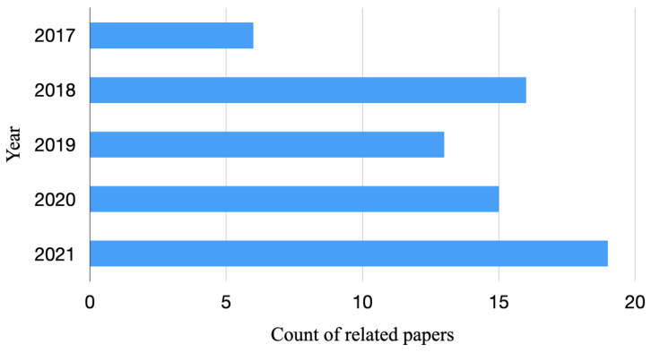
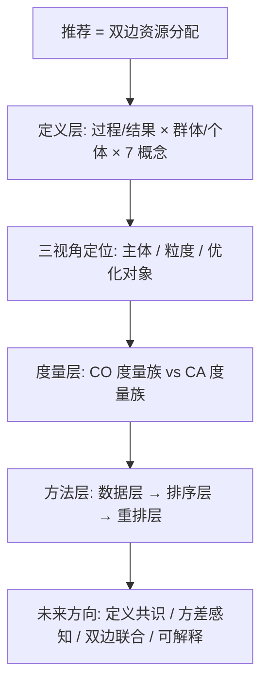

# A Survey on the Fairness of Recommender Systems (推荐系统公平性综述)

- **会议/期刊**: ACM Transactions on Information Systems (TOIS), Special Section on Trustworthy Recommendation and Search
- **作者与机构**: Yifan Wang, Weizhi Ma, Min Zhang, Yiqun Liu, Shaoping Ma（清华大学计算机系 / 清华大学 AIR）
- **推荐链路定位**: 全链路（数据层 → 排序层 → 重排层）
- **研究方向**: 去偏公平、可信隐私与工业架构 / 多任务学习与列表级重排
- **论文原文**: [https://arxiv.org/abs/2206.03761v2](https://arxiv.org/abs/2206.03761v2)
- **开源代码**: 暂未开源

## TL;DR (1分钟核心速览)

公平性已是推荐系统可信性的核心议题，但定义散乱、度量混用、方法各说各话。本文是首篇专门综述，覆盖 2017–2022 年 TOIS/SIGIR/WWW/KDD 等 **60+ 篇**论文，建立「过程/结果 × 群体/个体 × 七种公平概念」的定义体系、「主体/粒度/优化对象」三视角定位法，以及「数据层—排序层（正则/对抗/RL）—重排层（slot/user/global-wise）」方法分类学，并给出 30 余种度量的适用边界。综述无自建定量实验，其价值在于统一坐标系：它量化地指出现有研究高度集中于 **群体级 + 一致性公平 + 摊销粒度**，而双边联合公平与 impact-based 度量几近空白。

## Background & Motivation (背景与核心矛盾)

- **主流范式**: 推荐系统长期以效用（CTR、停留时长）为唯一目标，公平仅作为附加约束出现在排序或重排阶段。
- **前人局限**: ①推荐是**双边**资源分配（向用户分配信息、向物品分配曝光），单边公平模型无法覆盖 provider 侧；②推荐存在**动态反馈回路**与个性化需求，机器学习公平（以分类任务为主）的 Lipschitz 条件、均衡几率等定义难以直接迁移。此外，已有综述或止步 2018 年（Castillo），或聚焦 bias 而非 fairness（Chen et al.），度量与数据集均未覆盖。
- **核心洞察 (Key Insight)**: 公平问题之所以碎片化，根源是**缺少统一坐标系**——同一术语在不同论文指代不同的分配过程、主体与时间粒度。
- **本文切入点**: 先形式化定义（做什么），再用三视角定位（对谁、何时、优化什么），最后按流水线位置归类方法（怎么做）。

<figure class="paper-figure" markdown="span">
  <figcaption>图 1. 推荐公平性相关论文的统计。图中省略了 2022 年的工作，因为 2022 年的大部分工作尚未发表。</figcaption>
</figure>

## Method (核心方法设计)

### 1. 整体框架 (Overall Architecture)

综述以“推荐 = 双边资源分配”为总假设：先按**分配过程 vs 分配结果**切分（类比义务论 vs 目的论），再把结果公平沿**目标**（群体/个体）与**概念**（一致性、校准、反事实、无嫉妒、罗尔斯最大化、最大最小共享）二维展开，形成可比较的形式化格点；随后用**主体**（用户/物品/联合）、**粒度**（单次列表 single / 累积摊销 amortized）、**优化对象**（treatment 曝光 vs impact 反馈）三视角为任意一篇文献定位；最后按方法在流水线中的位置将其分为数据层、排序层（正则化/对抗学习/强化学习/其他）、重排层（slot-wise/user-wise/global-wise），并配套梳理度量族与数据集。

### 2. 关键设计拆解 (Key Designs)

1. **七概念形式化坐标系（消歧器）**：痛点源于同名不同义。作者为每个概念给出可比条件，如一致公平要求 $\min_{h} D_o(C_h(G_i),C_h(G_j))\approx 0$（相似者同等待遇），校准公平要求$\frac{V(C_h(i))}{M(i)}=\frac{V(C_h(j))}{M(j)}$（收益正比于 merit），罗尔斯最大化$h^{*}=\arg\max_{h\in H}\min_{i} V(C_h(i))$。价值在于任何论文都能被钉到 (概念, 目标) 唯一格点，度量选择随之确定。

2. **摊销粒度与 treatment/impact 切分（评价口径修正器）**：痛点在于“每个列表都必须公平”常常不可达且损伤效用。作者主张 amortized fairness——单次列表可失衡，但时间窗内累积曝光须满足公平，如用离散度 $\frac{1}{|V|^2}\sum_{v_x\neq v_y}(f(v_x)-f(v_y))^2$刻画$f(\cdot)$ 的分布一致性；并区分 treatment-based（只看曝光/预测分数）与 impact-based（看用户真实反馈）。直觉是：公平是一本时间窗口内的账本，而非一次排序的契约。

3. **度量间的可转换性与选型规则（无训练损失）**：本文无损失函数，替代方案是给出度量映射——CA 度量把理想分布 $p_f$设为均匀即退化为 CO 度量，CO 度量把$f(v)$替换为$p(v)/p_f(v)$即得 CA 度量。选型规则：两群体用 AD/KS，多群体用 Variance/MMD/ANOVA F，个体用 Gini/Jain/Entropy，位置敏感排序用 rND/rKL/rRD/NDKL。开销方面：数据层（antidote data 需梯度反解，最贵）> 全局重排（0-1 整数规划组合爆炸）> 排序层正则（$\mathcal{L}=\mathcal{L}_{rec}+\lambda\mathcal{L}_{fair}$，近零额外开销）。

## Experimental Setup & Evaluation Protocol (实验设置与评估协议)

- **说明**: 本文为综述，**不包含自建实验、主实验表与消融实验**。以下整理被评论文献的评估惯例与原文核心归纳表。
- **数据集**: 原文第 6 节汇总公平相关数据集，多以可获取用户敏感属性的数据为主，如 MovieLens 1M（性别/年龄，见 Ekstrand et al. 的重采样实验）、Last.FM、Amazon 等；综述未给出统一统计表。
- **数据划分**: 各文献沿用自身协议（Leave-One-Out 或比例划分），**综述未做统一规范**；这是作者在展望中明确点出的缺口。
- **排名评测协议**: 主流为 Top-N 全库排序（Full-Ranking），但公平侧多只报告群体级差异指标（AD、Gini、KL），**普遍缺少显著性检验与置信区间**，属可复现性短板。
- **度量与本方法类型的对应关系统计**（原表 5/8 归纳）：

| 公平概念 | 文献量（约） | 代表度量 | 方法覆盖 |
| :--- | :---: | :--- | :--- |
| 一致性 CO | ~60% | AD、Gini、Variance、rND/rKL | 全部三类 |
| 校准 CA | ~25% | KL、NDKL、MinSkew/MaxSkew、L1-norm | 全部三类 |
| 反事实 CF / 过程 PR | 1 / 2 | 属性分类器 AUC/F1 | 仅对抗学习 |
| 无嫉妒 EF | 4 | 无嫉妒用户比例、Mean Average Envy | slot/global 重排 |
| 罗尔斯 RMF | 3 | Bottom-N Average | global 重排 |
| 最大最小共享 MSF | 1 | 满足者比例 | global 重排 |

| 方法类型 | 代表工作 | 可解公平问题 | 主要代价 |
| :--- | :--- | :--- | :--- |
| 数据层 | [24] 重采样、[77] antidote data | CO | 需梯度反解，耗时长 |
| 排序-正则 | [120] FATR 正交约束、[6] pairwise 正则 | CO & CA | 灵活但易次优 |
| 排序-对抗 | [59] 反事实用户表征、[102] 图推荐公平表征 | PR & CF & CO | 训练不稳定 |
| 排序-RL | [32, 33, 63] | CO & CA | 仅 3 篇，长期公平起步 |
| slot-wise 重排 | [47, 90] MMR 类校准重排 | CO & CA & EF | 贪心近似，非全局最优 |
| global-wise 重排 | [65] 最大流、[103] 用户-提供者联合、[22] Lorenz 支配 | 全部 7 概念 | 整数规划组合爆炸 |

## Key Experimental Results (实验关键数据)

### 1. 主实验替代：文献分布统计（原文 Table 1/4）

- **概念分布**: CO 是绝对主流（Table 1 中约六成论文采用），CA 次之；CF(1)、EF(4)、RMF(3)、MSF(1)、PR(2) **五种概念合计仅 11 篇**。
- **主体分布**: 用户公平与物品公平各占相当比重，而**联合（joint）公平仅 4 篇**（[22, 75, 96, 103]）。
- **粒度与优化对象**: 摊销（amortized）远多于单次（single）；treatment-based 明显多于 impact-based，**同时考虑二者的工作极少**。

### 2. 消融替代：方法类型的“覆盖-空白”对照

| 方法类型 | 论文数（约） | 覆盖的概念数 | 空白 |
| :--- | :---: | :---: | :--- |
| 数据层 | 2 | 1 (CO) | 无法处理排序/曝光类公平 |
| 排序-正则 | 6 | 2 (CO/CA) | 不可微指标无法入损失 |
| 排序-对抗 | 7 | 3 (PR/CF/CO) | 训练不稳、缺理论保证 |
| 排序-RL | 3 | 2 (CO/CA) | 长期公平探索不足 |
| 重排（三类合计） | 24 | 7（全部） | 全局重排开销大 |

### 3. 关键实验发现 (Key Findings)

1. **概念多样性严重不足**：60+ 篇中非主流概念（CF/EF/RMF/MSF/PR）合计仅 11 篇，说明社区尚停留在“一致性公平”这一最易度量的格点，罗尔斯式“最差者优先”在推荐场景几乎未被工程化。
2. **双边公平的帕累托冲突被回避**：joint fairness 仅 4 篇，而文中明确指出“提升物品公平必然使部分用户公平持平或恶化”，即真正的双边最优点是当前最大空白。
3. **方法分布与场景需求错配**：数据层仅 2 篇、RL 仅 3 篇，而重排（24 篇）独大——意味着绝大多数方法只在**末端打补丁**，无法建模反馈回路下的长期公平，也无法解释公平性来源。

## Highlights & Limitations (亮点、对比与审稿批判)

- **与代表作对比 (vs. Prior Work)**: 相比 Castillo（2018，仅覆盖 IR 早期工作）与 Chen et al.（以 bias 为主、不含度量与数据集），本文是首个覆盖“定义—度量—数据集—方法—展望”全链的公平推荐综述；相较机器学习公平综述，它强调推荐特有的**双边性、动态反馈回路与个性化**三重差异，明确拒绝直接照搬分类公平定义。
- **可迁移亮点**: ①**摊销公平（amortized fairness）账本思想**，可直接迁移到曝光配额、创作者扶持等工业场景；②**度量可转换性**（均匀 $p_f$ 即退化为一致性度量），可让团队复用同一套指标实现两族公平的快速切换与对照。
- **审稿级局限批判**: ①全文无定量元分析、无统一 benchmark 复现，所有“主流/少数”的判断基于计数而非效应量，说服力弱于实证综述；②覆盖止于 2022 年中，LLM 推荐、生成式语义 ID 推荐中的公平（如生成式暴露偏差、prompt 层人口统计偏差）完全缺席；③未给出“多种公平定义冲突时如何择优”的判据，而这恰是工业落地最迫切的问题。

## Rating (四维评分)

- **方法创新性 (Novelty)**: ⭐⭐⭐⭐ （非提出新算法，但“过程/结果 × 目标 × 概念 + 三维定位”的组织方式确为领域首次，七概念形式化对照表具长期引用价值）
- **评估协议与实验扎实度 (Protocol & Experiments)**: ⭐⭐⭐ （本质为文献计量，无统一数据划分、无显著性检验、无复现实验，度量适用性矩阵是唯一“准实验”产出）
- **写作与数学规范度 (Clarity & Rigor)**: ⭐⭐⭐⭐⭐ （定义、符号表、度量公式与适用条件高度自洽，$p$与$p_f$ 的可转换推导干净利落）
- **工业落地与复现价值 (Industrial & Practical Value)**: ⭐⭐⭐ （无开源代码；但摊销公平账本、global-wise 重排的整数规划与联合公平的帕累托讨论，对双边平台治理与创作者扶持策略直接可用）

