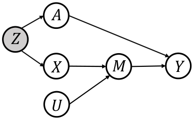
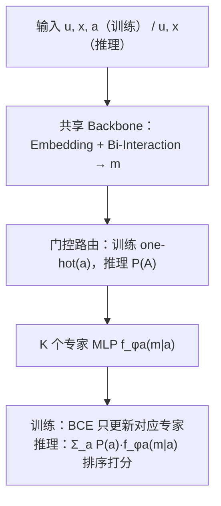
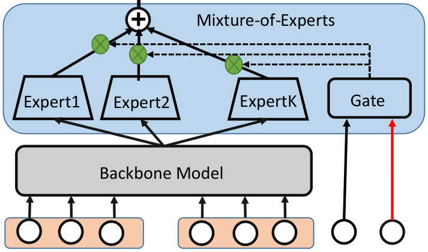

# Addressing Confounding Feature Issue for Causal Recommendation (混杂特征因果去偏推荐)

- **会议/期刊**: ACM TOIS (2022, 归档目录 TOIS 2023)
- **作者与机构**: Xiangnan He, Yang Zhang, Fuli Feng, Yongdong Zhang (USTC) ；Chonggang Song, Lingling Yi, Guohui Ling (腾讯微信)
- **推荐链路定位**: 精排 / 排序打分（可作为召回打分器复用）
- **研究方向**: 去偏公平与因果推荐 / CTR 特征交叉
- **论文原文**: [https://arxiv.org/abs/2205.06532v2](https://arxiv.org/abs/2205.06532v2)
- **开源代码**: [https://github.com/zyang1580/DCR](https://github.com/zyang1580/DCR)

## TL;DR (1分钟核心速览)

短视频时长、标题党封面这类**混杂特征 $A$** 会直接决定"是否播完/是否点击"，使交互标签并不反映真实偏好，而常规数据驱动模型要么直接拟合$P(Y|U,X,A)$被$A$带偏，要么去掉$A$仍被后门路径$X\leftarrow Z\rightarrow A\rightarrow Y$的虚假相关污染。本文提出 DCR：训练时拟合$P(Y|U,X,A)$，推理时用后门调整求$P(Y|U,do(X))=\sum_a P(Y|U,X,a)P(a)$，并用 MoE 让$K$ 个专家共享同一 backbone 使干预推理只比单模型多一倍 MLP 开销。在 Kwai 上较最优基线 FairGo 平均提升 26.9%，在 Wechat 上提升 5.0%。

## Background & Motivation (背景与核心矛盾)

- **主流范式**: 绝大多数特征型推荐模型（FM/NFM/DeepFM）直接拟合观测相关性 $P(Y|U,X,A)$，把$A$ 当作普通特征喂入。
- **前人局限 ①**: 建模 $P(Y|U,X,A)$会吃进$A\rightarrow Y$ 的直接影响，模型学到"短视频更优"的捷径，创作者可反向刷短视频攻击系统。
- **前人局限 ②**: 直接删掉 $A$改建模$P(Y|U,X)$也不行——$A$是$X$与$Y$之间的 confounder，删掉后$X\leftarrow Z\rightarrow A\rightarrow Y$的后门路径仍让 item 表征隐式编码$A$的语义；而 disentangle 方案（FairGo 对抗训练）无监督、无 inductive bias，会连带删掉$X$ 中对匹配有用的信息。
- **核心洞察 (Key Insight)**: 把交互生成过程抽象成因果图（图 1），$A$打开后门路径是偏置的根因；只要在推理阶段用 do-calculus 做后门调整，就能切掉"直接路 + 后门路"，只留$X$对$Y$ 的因果效应。
- **本文切入点**: 用 do-intervention 重构排序函数，并把"枚举所有 $A$取值"的开销从$|A|$次全模型前向降到 1 次 backbone +$|A|$ 次轻量专家。

<figure class="paper-figure" markdown="span">
  <figcaption>图1. 描述交互生成过程的因果图。𝑋←−𝑍−→𝐴−→𝑌是给𝑋和𝑌之间带来虚假相关性的后门路径。</figcaption>
</figure>

## Method (核心方法设计)

### 1. 整体框架 (Overall Architecture)

训练阶段把样本 $(u,x,a,y)$送入共享 backbone 得到匹配表征$\boldsymbol{m}=f_\Theta(u,x)$，再由门控（one-hot$a$）路由到第$a$号专家$f_{\phi_a}(\boldsymbol{m}|a)$计算交互概率，用 BCE 更新 backbone 与该专家参数（每个样本只激活一个专家，故训练开销与单模型相当）。推理阶段对同一候选$(u,x)$只算一次$\boldsymbol{m}$，并行跑全部$K$个专家，再用训练集统计的边际分布$P(A)$ 加权求和，得到去混淆的排序分。

<figure class="paper-figure" markdown="span">
  <figcaption>图2. 用于去混淆因果推荐的MoE模型架构示意图。在门控模块中，黑色箭头和红色箭头对应的输入分别用于模型训练和模型推理。</figcaption>
</figure>

### 2. 关键设计拆解 (Key Designs)

1. **后门调整的干预式推理 (Intervened Inference)**：痛点是把 $A$当特征拟合相关性会被直接效应污染。核心算子把排序函数从$P(Y|U,X)$换成$P(Y|U,do(X))$，由后门准则展开为
   $P(Y|U,do(X))=\sum_{a\in\mathcal{A}}P(Y|U,X,A=a)\,P(A=a)$，其中$P(A=a)$用样本频率$|\{(U,X,A,Y)|A=a\}|/|\mathcal{D}|$直接估计。直觉上等价于做一次随机对照试验：把所有候选的$A$强制重分布为$P(A)$，则 score 对$A$的取值不敏感，只剩$X$ 的因果效应。
2. **MoE 加速架构（保真 vs 效率的解耦）**：朴素实现需前向 $|A|$次；NWGM 近似$f(u,x,\sum_a aP(a))$虽只需 1 次，但把不同$A$值共用同一套参数，非线性下精度损失大。MoE 让计算量最大的$U$–$X$匹配（EB 层）全专家共享、只在末端 MLP 上分专家，从而一次$\boldsymbol{m}$广播给$K$个专家，同时保留每个$A$ 值独立的参数化，兼顾表达力与速度。
3. **训练目标与推理开销**：损失为 Bernoulli 负对数似然
   $\mathcal{L}=-\sum_{(u,x,a,y)\in\mathcal{D}}\big[y\log f(u,x,a)+(1-y)\log(1-f(u,x,a))\big]+\lambda\|\Theta\|_2^2$，无额外负采样设计；推理时 Kwai 上 DCR-MoE 只需 1 次 EB + 6 次 MLP（5.4s），对比 DCR-NFM 的 6 次 EB + 6 次 MLP（13.6s）与 DCR-NFM-A（NWGM，2.5s）。**Generality**：作者进一步证明当$A\to X$、$X\to A$（此时退化为 path-specific effect$\sum_a(P(Y|U,x,a)-P(Y|U,x^*,a))P(a|x^*)$）、以及$A\perp X$三种直接关系下，同一 do-intervention 仍能消除$A$ 的不良效应。

## Experimental Setup & Evaluation Protocol (实验设置与评估协议)

- **数据集与预处理**: 两套真实短视频数据，均以"播完"作训练标签（受时长直接影响），以另一个播放后反馈作测试标签（近似真实兴趣，即去偏评估）。

| 数据集 | #Users | #Items | #Interactions | 训练标签 $\rho_1$/ 测试标签$\rho_2$ | 特征/场景说明 |
| :--- | :---: | :---: | :---: | :---: | :--- |
| Kwai | 18,019 | 422,144 | 19,429,358 | $-0.085$/$0.014$| 时长离散为 6 桶作$A$；$X$ 仅 ID 可用 |
| Wechat | 20,000 | 96,539 | 7,195,486 | $-0.131$/$-0.015$|$A$同为 6 桶；$X$ 含 bgm_song_id 等离散特征 |

- **数据划分与防穿越**: 按 `6:2:2` 比例划分 train/valid/test，且同一 (user,item) 样本只出现一次，杜绝标签泄漏；无时间戳切分。
- **排名评测协议**: **非全库 Full-Ranking**——候选集仅限在验证/测试集中出现过的 item，属"观测候选内排序"（Recall/MAP/NDCG 上限受候选集限制）。Kwai 报 Recall/MAP/NDCG@10 与 @20，Wechat 报 @3 与 @5。
- **对比基线与超参**: NFM-WA（含 $A$）、NFM-WOA（去$A$）、IPW（重加权）、FairGo（对抗去敏感）、CR（反事实解耦）；Embedding$d=16$、MLP 隐层 256/128、Adagrad、batch 1024、lr$\in\{0.01,0.001\}$、早停 patience=10，Ray-ASHA 网格搜索。

## Key Experimental Results (实验关键数据)

### 1. 主实验对比 (Main Results)

| 方法 | Kwai R@10 | MAP@10 | NDCG@10 | Kwai R@20 | Wechat R@3 | MAP@3 | NDCG@3 | Wechat R@5 |
| :--- | :---: | :---: | :---: | :---: | :---: | :---: | :---: | :---: |
| NFM-WA | 0.0778 | 0.0247 | 0.0458 | 0.1530 | 0.1275 | 0.0910 | 0.1198 | 0.1584 |
| NFM-WOA | 0.0759 | 0.0228 | 0.0439 | 0.1494 | 0.1324 | 0.0950 | 0.1243 | 0.1609 |
| IPW | 0.0775 | 0.0250 | 0.0464 | 0.1474 | 0.1326 | 0.0941 | 0.1240 | 0.1600 |
| FairGo | 0.0876 | 0.0269 | 0.0506 | 0.1651 | 0.1291 | 0.0924 | 0.1213 | 0.1598 |
| CR | 0.0764 | 0.0244 | 0.0458 | 0.1492 | 0.1282 | 0.0915 | 0.1205 | 0.1584 |
| **DCR-MoE** | **0.1089** | **0.0353** | **0.0634** | **0.1936** | **0.1355** | **0.0976** | **0.1271** | **0.1646** |
| **Improv.** (vs 最优基线) | +24.3% | +31.2% | +25.3% | +17.3% | +2.2% | +2.7% | +2.3% | +2.3% |

按原文 RI 口径（三指标平均），Kwai 相对 FairGo 平均 **+26.9%**，Wechat 相对 NFM-WOA 平均 **+5.0%**。

### 2. 消融实验 (Ablation Study)

| 变体 / 对照 | Kwai R@10 | MAP@10 | NDCG@10 | Wechat R@3 | 说明 |
| :--- | :---: | :---: | :---: | :---: | :--- |
| NFM-WA（单模型 $P(Y\|U,X,A)$） | 0.0757 | 0.0240 | 0.0448 | 0.1286 | 相关性基线 |
| MoE（同参数量，无干预推理） | 0.0778 | 0.0247 | 0.0458 | 0.1275 | 仅换架构≈单模型 |
| DCR-NFM-A（NWGM 近似） | 低于 DCR-NFM | — | — | — | 快但精度损 |
| **DCR-MoE（干预 + MoE）** | **0.1089** | **0.0353** | **0.0634** | **0.1355** | 增益来自干预 |
| 推理耗时（Kwai / Wechat） | 5.4s / 1.1s | — | — | — | vs DCR-NFM 13.6s / 2.9s |

### 3. 关键实验发现 (Key Findings)

- **增益来自干预而非参数量**：MoE 仅把架构换成专家（同参数量、不做干预）时 Kwai R@10 为 0.0757，与 NFM-WA 的 0.0757 持平；而 DCR-MoE 跳到 0.1089，说明 +44% 的提升源自 do-干预，而非更大的模型容量。
- **MoE 的价值在长尾 $A$值上**：Kwai 的$A$分布极不均衡（$A=0,1$占绝大多数），MoE 在$A=2,3,4,5$这些尾桶上的 BCE 损失显著低于 NFM-WA（$L_2-L_1<0$），头部桶持平——分专家缓解了头桶样本主导参数、尾桶欠拟合的问题，从而让$\sum_a P(a)f(u,x,a)$ 的估计更准。
- **偏置被真正消除而非只是精度提升**：按 $A$ 分组平均打分后，GT（测试标签）曲线几乎水平，DCR-MoE 曲线最贴近 GT；NFM-WA/NFM-WOA 明显偏向短视频，IPW 仅轻微变平，CR 甚至在两数据集上方向相反，暴露其解耦失效。换成"非混杂特征"再次实验时 RI 骤降至 0.4%/1.0%（对照混杂特征时 30.7%/4.2%），进一步坐实因果归因。

## Highlights & Limitations (亮点、对比与审稿批判)

- **与代表作对比 (vs. Prior Work)**: 相较 PD/DecRS 一类的因果干预方法，DCR 不假设效应函数形式（PD 用部分线性模型）、也不用 NWGM 近似（DecRS 用其降复杂度），而是用 MoE 在保持表达力的同时把推理从 $|A|$次全前向降到 1 次 backbone；相较 FairGo 的对抗去敏，DCR 不损失$X$的任何信息，只剔除$A$ 的直接影响。
- **可迁移亮点**: ①"共享 backbone + 末端分专家"的 MoE 模式可无缝套用到任何 $|A|$ 枚举昂贵的因果调整场景（位置偏置、曝光偏置）；②用"替换为非混杂特征后增益应消失"作为因果归因的验证实验，是一个低成本、可复用的 sanity check。
- **审稿级局限批判**: ①**评估协议偏弱**——仅在测试集已出现的 item 内排序，未做全库 Full-Ranking，Recall 绝对值偏低且易高估去偏收益；数据集仅两套短视频场景，缺公开标准基准的横向可比。②**落地成本与假设**：推理需多跑 $K$个专家 MLP（$K=6$ 时 Kwai 耗时 2.2 倍于 NWGM 版），且强依赖"混杂特征已被人工识别且为离散单变量"这一前置假设，多混杂特征与连续特征的扩展留作未来工作。

## Rating (四维评分)

- **方法创新性 (Novelty)**: ⭐⭐⭐⭐ （把"混杂特征"作为独立因果问题形式化，并用 MoE 巧妙化解 do-calculus 的枚举瓶颈，理论 Generality 分析覆盖三种 $A$–$X$ 关系）
- **评估协议与实验扎实度 (Protocol & Experiments)**: ⭐⭐⭐ （双真实工业数据 + 主动/非活跃用户分组 + 非混杂特征对照实验设计巧妙，但仅观测候选内排序、缺乏全库排序与显著性检验）
- **写作与数学规范度 (Clarity & Rigor)**: ⭐⭐⭐⭐ （因果图、后门调整与 path-specific effect 推导清晰，符号统一，算法伪码完整）
- **工业落地与复现价值 (Industrial & Practical Value)**: ⭐⭐⭐⭐ （代码开源、训练开销与单模型持平、推理可控制在 2 倍内，微信/快手真实场景验证，工程可迁移性强）

