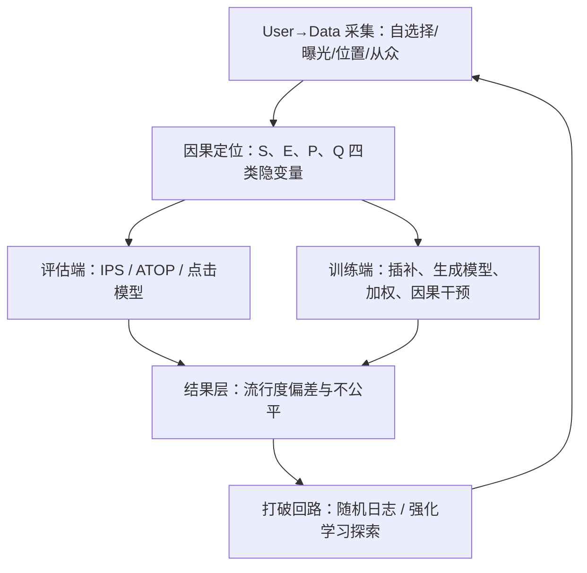

# Bias and Debias in Recommender System: A Survey and Future Directions (推荐系统中的偏差与去偏：综述与未来方向)

- **会议/期刊**: TOIS (ACM Transactions on Information Systems)，arXiv v2 于 2021-12 更新
- **作者与机构**: Jiawei Chen, Hande Dong, Xiangnan He (USTC)；Xiang Wang, Fuli Feng (NUS)；Meng Wang (HFUT)
- **推荐链路定位**: 贯穿采集–训练–服务全链路（重点落在精排训练与离线评估）
- **研究方向**: 去偏公平、可信隐私与工业架构 / 冷启动与长尾推荐
- **论文原文**: [arXiv:2010.03240v2](https://arxiv.org/abs/2010.03240v2)
- **开源代码**: [jiawei-chen/RecDebiasing](https://github.com/jiawei-chen/RecDebiasing)

## TL;DR (1分钟核心速览)

推荐系统在**观测数据**而非实验数据上训练，导致训练分布 $p_T$与理想测试分布$p_E$ 系统性错位，离线指标与线上收益长期割裂。本文不做新模型，而是以「用户–数据–模型」反馈回路为骨架，首次把分散在 180+ 篇文献中的偏差研究统一为 **7 类偏差**（4 类数据偏差 + 归纳偏差 + 流行度偏差/不公平），为每类给出**因果图级别的成因解释**与去偏方法分类学，并指出无偏评估（IPS/ATOP）与通用去偏是两大未解难题。

## Background & Motivation (背景与核心矛盾)

- **主流范式**: 2015 年后 CTR/CF 模型（MF、NCF、LightGCN 等）以拟合观测交互为目标，默认 i.i.d. 假设成立，经验风险 $\hat{L}_T(f)$是真实风险$L(f)$ 的无偏估计。
- **前人局限**: 其一，真实数据是观测性的，曝光机制与用户自选择使 $p_T(U,I,R)=p(U,I,R\mid S=1)\neq p_E(U,I,R)$，即使训练集无限大，收敛点$f_T$与最优$f^{*}$之间仍存在不可消除的间隙$\Delta L$（原文图 3）。其二，术语极度混乱——同一「selection bias」在不同文献分别指"评分值被扭曲"与"缺失非随机 (MNAR)"，大量实质去偏的工作甚至不出现 bias 字样，难以被检索。
- **核心洞察 (Key Insight)**: 偏差不是孤立噪声，而是沿反馈回路**自我强化**：数据偏差 → 数据不平衡 → 结果偏差（流行度/不公平）→ 反过来重塑用户曝光与判断，形成"强者愈强"的马太效应与信息茧房。
- **本文切入点**: 用一张因果图（$S/E/P/Q$ 四类隐变量）把 7 类偏差归因到"观测机制被扭曲"还是"用户判断被扭曲"，再据此对去偏技术分层。

<figure class="paper-figure" markdown="span">
  <figcaption>图 2. 推荐中的反馈回路，偏差在不同阶段产生。</figcaption>
</figure>

## Method (核心方法设计)

### 1. 整体框架 (Overall Architecture)

综述把推荐生命周期抽象为 User→Data（采集）、Data→Model（学习）、Model→User（服务）三段的闭环，偏差在这三段中产生并被回路放大。全文结构为：先以真实风险 $L(f)=\frac{1}{|\mathcal{U}||\mathcal{I}|}\sum_{u,i}\mathbb{E}_{r_{ui}}[\delta(f(u,i),r_{ui})]$为靶子，证明朴素经验风险$\hat{L}_T$ 有偏；再按"数据偏差（4 类）/模型偏差（归纳偏差）/结果偏差（流行度、不公平）/回路放大"四层定位问题；最后按"评估端去偏 vs 训练端去偏"两轴组织 180+ 篇方法，并给出查表式选型建议。

### 2. 关键设计拆解 (Key Designs)

1. **数据偏差的因果统一刻画（把"偏差"变成可识别的图结构）**：四类数据偏差共享同一病灶——条件化在观测节点 $S=1$上引入伪关联。选择偏差是**对撞结构**$(U,I)\rightarrow S\leftarrow R$，条件化后$U,I$与$R$产生虚假相关；曝光偏差是**混杂路径**$(U,I)\rightarrow E\rightarrow S$叠加在真实因果链$(U,I)\rightarrow R\rightarrow S$上；从众偏差走$I\rightarrow P\rightarrow R$篡改标签本身；位置偏差则同时污染$Q\rightarrow E\rightarrow S$与$Q\rightarrow R\rightarrow S$。这一分解的价值在于：只要判定偏差落在哪条边上，就自动确定了该用 IPS（去$E\rightarrow S$）、点击模型（拆$h_q$）还是去混杂（后门/前门调整）。

2. **IPS 家族：无偏性与方差的两难**：以观测概率的倒数作权重，可把有偏经验风险还原为真风险的无偏估计 $\hat{H}_{IPS}=\frac{1}{|\mathcal{U}||\mathcal{I}|}\sum_{s_{ui}=1}\delta(\hat{r}_{ui},r_{ui})/\rho_{ui}$，其无偏性依赖$\mathbb{E}_S[\cdot]$中$s_{ui}/\rho_{ui}$恰好抵消（原文式 12）。隐式反馈下正样本-无标签设定进一步给出$\hat{L}_{sur}$与双稳健估计$\mathcal{E}_{DR}$（插补或倾向二者之一准确即无偏）。直觉上，倒权重把"常见交互降权、稀有交互升权"以重建均匀总体；代价是$\rho_{ui}\to 0$时方差爆炸，且$\rho$ 估计错误则偏差回归。

3. **结果层与回路：从"改损失"到"改机制"**：流行度偏差被证明无法靠任意加权 $W_{ui}$消除（对任意$W$均有$\mathbb{E}[\hat{L}_W]\neq L$），故需正则（如 LapDQ 的$\mathrm{tr}(Q^{\top}L_DQ)$ 拉开热门/长尾嵌入）、对抗、因果图或重平衡；而回路层面的根治只有随机日志采集与 RL 长期探索，前者伤体验与营收，后者面临离线策略评估难题——这构成全文最强的开放问题。

## Experimental Setup & Evaluation Protocol (实验设置与评估协议)

本文为**综述，无自建实验、无基线模型与超参**；其"实验"体现为文献语料构建与对既有评估协议的批判性梳理。

- **语料构建协议**: 以 "recommend / collaborative filtering / ranking / search" 与 "bias / fairness / exposure" 组合为关键词，检索 WWW、WSDM、SIGIR、KDD、RecSys、CIKM、TOIS、TKDE 等 2010–2021 年文献，再沿引用图遍历扩充，最终保留 **180+ 篇**。

| 统计维度 | 结果（原文 图 1） | 说明 |
| :--- | :---: | :--- |
| 时间跨度 | 2010–2021 | 2015 年后数量急剧上升，SIGIR 2018/2020/2021 三届最佳论文均属此主题 |
| 主要 venue 占比 | SIGIR 14% / RecSys 13% / WWW 11% / WSDM 10% / KDD 9% / CIKM 6% | IR 与数据挖掘社区为主战场 |
| 偏差类型 | 7 类 | 数据 4 + 模型 1 + 结果 2 |
| 方法族 | 6 大类、20+ 子类 | 见下表 |

- **被综述的评估协议 (Ranking Protocol)**：作者重点批判了**朴素观测均值评估** $\hat{H}_{naive}$的无偏性失效（$\mathbb{E}_O[\hat{H}_{naive}]\neq H$），并对比两类修正：**IPS 加权评估**（需真实倾向$\rho_{ui}$，无偏但高方差）与 **ATOP**（仅需"高评分随机缺失 + 其余评分缺失概率更高"两条温和假设即可无偏估计平均召回）。全库排序 vs 采样排序下两者行为不同，原文未做统一复现。
- **无显著性检验**：综述层面无法给出 $p$ 值，仅在方法表中标注各方法的假设强度与失效条件。

## Key Experimental Results (实验关键数据)

### 1. 七类偏差定位表（原文 Table 1 精编）

| 偏差类型 | 产生阶段 | 成因 | 后果 | 主流解法 |
| :--- | :---: | :--- | :--- | :--- |
| Selection Bias | User→Data | 用户自选择评分（MNAR） | 观测评分分布偏斜 | 数据插补、IPS、联合生成模型、双稳健 |
| Exposure Bias | User→Data | 流行度、系统干预、社交背景 | 未观测≠负样本 | 启发式降权、采样、曝光模型 (EXMF)、IPS、因果 |
| Conformity Bias | User→Data | 从众/社会影响 | 标签偏离真实偏好 | 建模公众意见 $P$ 或社交影响并解耦 |
| Position Bias | User→Data | 信任并只浏览列表顶部 | 正样本不可靠 | 点击模型、位置 IPS、信任感知 (Affinity) |
| Inductive Bias | Data→Model | 人为设计假设 | 提升泛化/效率（非有害） | — |
| Popularity Bias | Model→User | 算法 + 数据不平衡 | 马太效应、多样性下降 | 正则、对抗、因果图、域适应 (ESAM) |
| Unfairness | Model→User | 群体表征失衡 | 系统性歧视 | 重平衡、正则、对抗去敏、反事实公平 |

### 2. 去偏方法族对照（原文 Table 2 精编）

| 方法族 | 代表工作 | 优势 | 关键短板 |
| :--- | :--- | :--- | :--- |
| IPS / 倾向性加权 | Steck 2010；Saito 2020 $\hat{L}_{sur}$；Wang 2019 DR | 理论无偏 | 需准确$\rho$；倒权重高方差 |
| 数据插补 | Steck 2010 常数插补；Saito 2020 非对称三训练 | 实现简单 | 对伪标签极敏感，误差会传播 |
| 联合生成模型 | Marlin 2007；Hernández-Lobato 2014 | 可解释、可建模缺失机制 | 结构靠启发式，训练困难 |
| 因果推断 | 后门 (Zhang 2021)、前门 (Xu 2021)、反事实 (Wang 2021)、信息瓶颈解耦 (Liu 2021) | 可解释、可去伪关联 | 依赖强因果假设 |
| 点击模型 | PBM/级联模型、深度生存模型 | 可解释位置效应 | 点击稀疏场景不可用，误设即有偏 |
| 结果层正则/对抗/重平衡 | LapDQ、INRS 均值匹配、Pearson 正则、ESAM | 直接改善长尾与公平 | 常以精度为代价，需权衡 |

### 3. 关键实验发现 (Key Findings)

1. **"加权万能论"被证伪**：对任意置信权重 $W_{ui}\in\mathbb{R}$均有$\mathbb{E}[\hat{L}_W]\neq L$，这解释了为何 WMF/BPR 式的启发式降权流行十余年却始终无法弥合离线-线上差距，只有显式引入倾向$\rho$的$\hat{L}_{sur}$ 才能理论无偏。
2. **无偏性与方差不可兼得**：IPS 类在 $\rho$精确时严格无偏，但当物品流行度或用户活跃度高度偏斜时$\rho_{ui}$极小、方差爆炸；DR 通过"插补+加权"把失效条件放宽为"二者之一正确"，是当前性价比最高的折中，但仍无法摆脱对$\rho$ 或伪标签的依赖。
3. **单偏差方法在多偏差真实数据上集体失效**：作者指出通用解需借助一小份无偏数据做域适应/蒸馏/元学习（Chen 等），而采集均匀数据必须用随机日志策略干预线上系统，直接损害用户体验与平台收入，形成"想无偏必先付代价"的成本悖论。

## Highlights & Limitations (亮点、对比与审稿批判)

- **与代表作对比 (vs. Prior Work)**: 相较 Steck 的 IPS 评估单点工作、Saito 的 $\hat{L}_{sur}$ 与 Zhang 的因果去偏，本文不提出新算子，而是首次把"偏差"从模糊口号变成**可定位的图结构 + 可查表的方法谱系**；相较已有的可解释推荐、知识图谱推荐、深度/强化推荐综述，它填补了偏差视角的空白。
- **可迁移亮点**: ①"先画因果图、再选去偏算子"的诊断流程，可直接用于诊断自家系统的离线-线上 gap；②GitHub 的 RecDebiasing 查表仓库可作为工业界选型 checklist。
- **审稿级局限批判**: ①全文**没有任何统一的受控实验**——不同方法在各自数据集、各自划分下报告结果，读者无法判断哪一族在同等预算下更优；②因果图假设（$p_E(R\mid U,I)=p_T(R\mid U,I)$、倾向可得）在真实系统中往往不成立，且 IPS 类方法在千万级候选上的方差与工程开销未被量化讨论；③覆盖面止于 2021 年，对 LLM4Rec 时代新出现的"生成式模型的 exposure 与 hallucinated popularity"未涉及。

## Rating (四维评分)

- **方法创新性 (Novelty)**: ⭐⭐⭐ （无新模型，但七类偏差的因果统一刻画与查表式分类学具备领域定义级价值）
- **评估协议与实验扎实度 (Protocol & Experiments)**: ⭐⭐⭐ （语料构建与检索协议清晰，但缺乏跨方法统一复现与显著性检验，结论多为定性）
- **写作与数学规范度 (Clarity & Rigor)**: ⭐⭐⭐⭐⭐ （真风险–经验风险–IPS 无偏性推导链条完整，因果图与术语去歧义处理堪称综述范本）
- **工业落地与复现价值 (Industrial & Practical Value)**: ⭐⭐⭐⭐ （方法选型表 + 开源仓库对工业排障极具指导性，但多数方案依赖线上随机日志，落地成本高）

