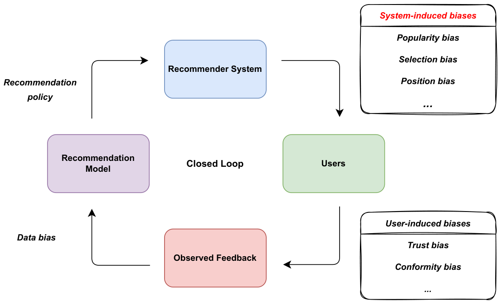
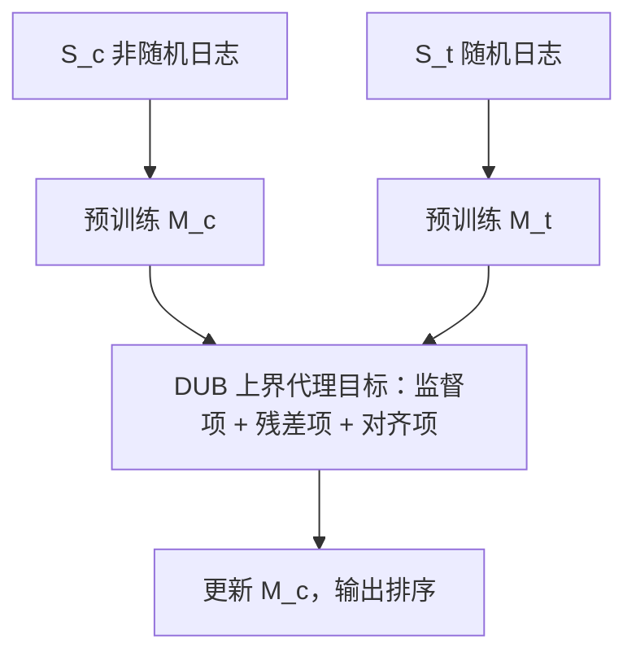

# Bounding System-Induced Biases in Recommender Systems with A Randomized Dataset (利用随机数据集界定推荐系统中的系统诱导偏差)

- **会议/期刊**: ACM Transactions on Information Systems (TOIS)
- **作者与机构**: Dugang Liu 等；深圳大学、华为诺亚方舟/2012实验室、清华大学、腾讯 FIT
- **推荐链路定位**: 精排/模型训练阶段（模型无关去偏）
- **研究方向**: 去偏公平、可信隐私与工业架构
- **论文原文**: [https://arxiv.org/abs/2303.11574v1](https://arxiv.org/abs/2303.11574v1)
- **开源代码**: [https://github.com/dgliu/TOIS_DUB](https://github.com/dgliu/TOIS_DUB)

## TL;DR (1分钟核心速览)

针对随机日志稀缺时系统诱导偏差难消除的问题，本文以均匀策略下的完整反馈 $R_t$ 构造理想损失，并推导三角不等式/可分性两类泛化上界，提出 DUB 直接优化可解上界项。Yahoo! R3 与 Product 上 DUB-MF 的 AUC 较最强基线提升约 1.0%/1.4%，且跨 MF、NCF 骨干稳定最优。

## Background & Motivation (背景与核心矛盾)

- **主流范式**: 用小规模随机日志辅助非随机日志训练，代表路线包括 IPS/插补标签、AutoDebias 多阶段训练、CausE/Bridge 联合训练。
- **前人局限**: 随机日志采集伤体验且极度稀缺；即使获得完整 $R_c$，其仍残留系统偏差，基于$R_c$ 的理想损失并非最终目标；现有法只优化上界子项或参数/预测代理，属“不充分优化”。
- **核心洞察 (Key Insight)**: 均匀策略下的完整反馈 $R_t$比$R_c$更接近无偏；但只能观测$S_t$，$S_c$在$R_t$ 下的标签是反事实，无法直接监督。
- **本文切入点**: 以 $R_t$ 定义理想损失，转而最小化其可解上界，并依据损失函数先验约束给出两类泛化误差界。图 1 显示系统策略偏差与用户偏差如何耦合进日志。

<figure class="paper-figure" markdown="span">
  <figcaption>图 1. 推荐系统中的反馈回路，其中观测到的反馈包含由系统引发的偏差和用户引发的偏差耦合而成的数据偏差。前者由推荐系统部署的随机推荐策略引起，后者取决于用户特征。</figcaption>
</figure>

## Method (核心方法设计)

### 1. 整体框架 (Overall Architecture)

输入非随机日志 $S_c$与随机日志$S_t$；先分别预训练推荐模型$M_c$与辅助模型$M_t$，再每轮从无观测集$S_u$采样辅助集$S_a$，按损失类型选择上界代理目标：三角不等式版同时更新$M_c,M_t$，可分性版主要更新$M_c$。实验采用交叉熵，故使用可分性目标。推理阶段仅部署$M_c$，开销与单模型相同；预训练用于缓解$|S_c|\gg|S_t|$ 导致的收敛不同步。

### 2. 关键设计拆解 (Key Designs)

1. **随机反馈理想损失（把去偏目标换成 $R_t$）**：痛点在于$R_c$仍含流行度/选择/位置偏差。本文定义$\mathcal{L}(R_t,\hat R_c)=\frac{1}{|\mathcal{D}|}\sum_{(u,v)\in\mathcal{D}}\ell(R^t_{uv},\hat R^c_{uv})$，用均匀策略完整反馈作理想标签；物理直觉是$R_t$ 近似“同一物品在所有曝光方式下的反馈”，能纠正伪负反馈。
2. **两类泛化上界（把不可解反事实变成可解项）**：当 $\ell$满足三角不等式，$\mathcal{L}(R_t,\hat R_c)\le \mathcal{L}_{S_t}(R_t,\hat R_c)+\mathcal{L}_{S_c}(R_t,R_c)+\mathcal{L}_{S_c}(R_c,\hat R_c)+\mathcal{L}_{S_u}(R_t,\hat R_t)+\mathcal{L}_{S_u}(\hat R_t,\hat R_c)$；当$\ell$满足可分性$L(c,a)\le L(b,a)+L(c-b,a)$，关键项变为$\mathcal{L}_{S_c}(R_t-R_c,\hat R_c)$与$\mathcal{L}_{S_t|S_t}(R_t-\hat R_t,\hat R_c)$。CausE/Bridge 仅覆盖其中部分项，DUB 则补齐可直接优化的$(a),(c),(d),(e)$ 项。
3. **训练目标与推理**：交叉熵下最小化 $\mathcal{L}_{S_t}(R_t,\hat R_c)+\mathcal{L}_{S_c}(R_c,\hat R_c)+\mathcal{L}_{S_t|S_t}(R_t-\hat R_t,\hat R_c)+\gamma\mathcal{L}_{S_u}(\hat R_t,\hat R_c)+\lambda_c Reg(W_c)$。其中残差项让$M_c$学习$M_t$在$S_t$上的预测误差，$\gamma$控制无观测对齐噪声；无 BPR 式负采样，$S_u$采样仅用于对齐，$S_a$ 规模与训练样本相同。

## Experimental Setup & Evaluation Protocol (实验设置与评估协议)

- **数据集与预处理**:

| 数据集 | #Users | #Items | #Interactions | 稀疏度/正负比 | 特征/场景说明 |
| :--- | :---: | :---: | :---: | :---: | :--- |
| Yahoo! R3 | 5,400 | 1,000 | 365,704 | $S_c$ 正样本 67.02%；随机子集约 9.05% | 评分以阈值 3 二值化；含随机子集 |
| Product | >2,000,000 | 217 | 5,146,329 | $S_c$ 12.97%；均匀子集约 0.99% | 真实广告 CTR；过滤位置 1、2 |

- **数据划分与防穿越**: Yahoo! R3 的随机子集按 10%/$S_t$、10%/$S_{va}$、80%/$S_{te}$划分；Product 同比例。$S_c$作有偏训练集，$S_c$与$S_t$ 去重叠。
- **排名评测协议**: 候选集为测试用户未交互物品，报告 P@5/10、R@5/10、nDCG、AUC，AUC 为主指标；原文未显式标注 Full-Ranking 或采样负例比例，可视为未交互候选集排序评测。
- **对比基线与超参**: MF、NCF 两种骨干；基线含 Unif、Combine、IPS、AutoDebias、CausE、Bridge。rank $\in\{50,100,200\}$，$\lambda,\gamma\in\{10^{-5},\dots,10^{-1}\}$；Adam，lr$10^{-3}$，早停 patience=5，显著性$p\le0.05$。

## Key Experimental Results (实验关键数据)

### 1. 主实验对比 (Main Results)

| 数据/骨干 | 方法 | AUC | nDCG | R@10 |
| :--- | :--- | ---: | ---: | ---: |
| Yahoo! R3 / MF | MF | 0.7282 | 0.0434 | 0.0332 |
| | Combine-MF | 0.7357 | 0.0489 | 0.0401 |
| | IPS-MF | 0.7300 | 0.0407 | 0.0344 |
| | AutoDebias-MF | 0.7502 | 0.0691 | 0.0683 |
| | CausE-MF | 0.7285 | 0.0445 | 0.0372 |
| | Bridge-MF | 0.7376 | 0.0557 | 0.0478 |
| | **DUB-MF** | **0.7578** | **0.0727** | **0.0770** |
| Product / MF | IPS-MF | 0.7274 | 0.0484 | 0.1114 |
| | CausE-MF | 0.7158 | 0.0470 | 0.1119 |
| | Bridge-MF | 0.7069 | 0.0438 | 0.1022 |
| | Unif-MF | 0.6372 | 0.0604 | 0.1332 |
| | **DUB-MF** | **0.7374** | **0.0729** | **0.1537** |

DUB-MF 相对 Yahoo! R3 最强基线 AUC **+1.01%**、nDCG **+5.21%**、R@10 **+12.74%**；Product 上 AUC **+1.37%**、nDCG **+20.70%**、R@10 **+15.40%**。NCF 骨干下 DUB 亦最优：Yahoo! R3 AUC 0.7421、Product AUC 0.7382。

### 2. 消融实验 (Ablation Study)

| 数据/骨干 | 变体 | AUC | nDCG | R@10 |
| :--- | :--- | ---: | ---: | ---: |
| Yahoo! R3 / MF | DUB | **0.7578** | **0.0727** | **0.0770** |
| | w/o $(e.2)$ | 0.7500 | 0.0702 | 0.0744 |
| | w/o $(a),(e.2)$（≈Bridge） | 0.7376 | 0.0557 | 0.0478 |
| Product / MF | DUB | **0.7374** | **0.0729** | **0.1537** |
| | w/o $(e.2)$ | 0.7091 | 0.0453 | 0.1039 |
| | w/o $(a),(e.2)$（≈Bridge） | 0.7069 | 0.0438 | 0.1022 |

### 3. 关键实验发现 (Key Findings)

1. **上界补全带来稳定增益**：Yahoo! R3 上 DUB-MF AUC 0.7578，高于 AutoDebias 0.7502 与 Bridge 0.7376；Product 上 0.7374 高于 IPS 0.7274，说明直接优化可解上界项优于仅优化子项/代理。
2. **残差项 $(e.2)$是 Product 关键**：移除后 nDCG 0.0729→0.0453（**-37.9%**）、R@10 0.1537→0.1039（**-32.4%**）；再移除$(a)$ 后退化为 Bridge，AUC 0.7374→0.7069（**-4.14%**）。
3. **排序效用改善明显**：Product 上 DUB-MF R@10 0.1537，较 IPS-MF 0.1114 提升 **37.9%**、较 Bridge-MF 0.1022 提升 **50.4%**；图 3 进一步显示 DUB 保留高效用热门物品，同时提升冷门物品命中效用。

## Highlights & Limitations (亮点、对比与审稿批判)

- **与代表作对比 (vs. Prior Work)**: CausE 仅优化 $(c),(e.1)$且用参数对齐代理$(d)$，约束过强；Bridge 优化$(c),(e.1),(d)$但缺$(a),(e.2)$；DUB 补齐可直接优化项，理论目标更充分。
- **可迁移亮点**: “随机日志定义理想损失→上界分解→只优化可解项”的范式可迁移到位置偏差、选择偏差等去偏任务；双模型预训练可缓解数据规模不同步。
- **审稿级局限批判**: ① 仍需稀缺随机日志与双模型训练，$S_t$很小时对齐项噪声大，$\gamma,\lambda$敏感；② 可分性界的$(b.2)$ 含不可观测量，仅近似处理，且评测以 AUC 为主、P@K 值较小，未明确 Full-Ranking 协议。

## Rating (四维评分)

- **方法创新性 (Novelty)**: ⭐⭐⭐⭐ （把随机数据去偏统一到理想损失上界最小化，并区分三角不等式/可分性两类先验，理论增量清晰）
- **评估协议与实验扎实度 (Protocol & Experiments)**: ⭐⭐⭐⭐ （公开+工业双数据、MF/NCF 双骨干、无偏测试与消融完整；但主指标偏 AUC，排序协议披露不足）
- **写作与数学规范度 (Clarity & Rigor)**: ⭐⭐⭐⭐ （上界逐项解释充分，和 CausE/Bridge 的项级对比清楚；符号较多、误差项略重）
- **工业落地与复现价值 (Industrial & Practical Value)**: ⭐⭐⭐⭐ （模型无关、代码开源、推理单模型；但依赖随机日志采集与双模型训练，AutoDebias 的 OOM 亦提示内存瓶颈）

