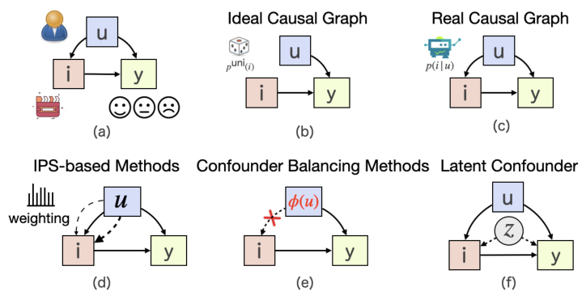
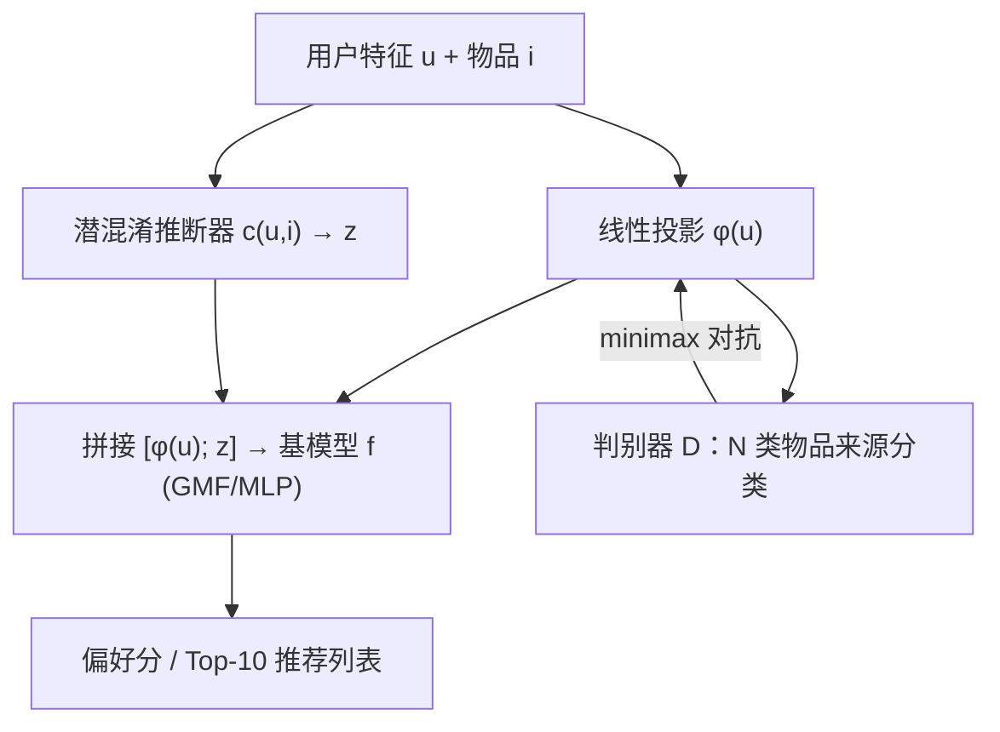

# Debiased Recommendation with User Feature Balancing (基于用户特征平衡的去偏推荐)

- **会议/期刊**: TOIS 2023（arXiv 预印本 2022-01）
- **作者与机构**: Mengyue Yang, Jun Wang (UCL)；Guohao Cai, Furui Liu, Zhenhua Dong, Xiuqiang He, Jianye Hao (华为诺亚方舟实验室)；Xu Chen (中国人民大学高瓴人工智能学院)
- **推荐链路定位**: 精排（打分模型训练阶段的样本分布校正）
- **研究方向**: 去偏公平、可信隐私与工业架构 / 协同过滤
- **论文原文**: [https://arxiv.org/abs/2201.06056v1](https://arxiv.org/abs/2201.06056v1)
- **开源代码**: 暂未开源

## TL;DR (1分钟核心速览)

针对 IPS 类去偏方法"倾向分难估、误差传播、高方差"的痛点，本文在潜在结果框架下引入用户投影函数 $\phi(\cdot)$，用 Jensen gap 推导出理想无偏目标的 IPM 上界：只要投影后用户分布在**任意物品对**上相等，即可切断因果图上的$u\to i$边，从而完全绕开 IPS 权重估计。为处理$O(N^2)$个平衡项，提出裁剪、采样与对抗（判别器 N 分类，复杂度降至$O(N)$）三种策略，并用显式网络推断潜混淆因子。在 Yahoo!R3 / Coat / PCIC 等 6 个数据集、GMF 与 MLP 双基模型下，NDCG@10 最高相对提升 6.50%（Coat），MLP 基模型四指标平均增益 10.88%/6.87%/4.21%/4.03%。

## Background & Motivation (背景与核心矛盾)

- **主流范式**: 用 IPS/SNIPS/DR 对离线曝光样本重加权，使观测分布逼近"物品对每个用户均匀曝光"的理想分布；另一支为 Direct/ATT 类反事实插补。
- **前人局限**: ① 推荐场景的倾向分只能从极稀疏、含噪的日志中估计，权重误差会直接污染下游排序模型，Direct 类插补模型同样依赖噪声数据（Coat 上 Direct 的 NDCG 仅 0.5012，远低于 Base）；② IPS 目标的高方差问题使其在复杂环境下脆弱。
- **核心洞察 (Key Insight)**: 从因果图看，IPS 只是"平滑" $u\to i$的因果边，并未切断它；若能把用户特征投影到与物品统计独立的空间，$u\to i$边直接消失，无需任何倾向分。理想目标$\mathcal{L}_{\text{ideal}}=\mathbb{E}_{u}[\mathbb{E}_{i\sim p_{\text{uni}}}[\delta(r_{ui},f(\phi(u),i))]]$ 本身不可解，但其上界可仅用离线数据优化。
- **本文切入点**: 用混淆变量平衡（confounder balancing）构造可解上界，这是去偏推荐中首次以平衡而非重加权为机制。

<figure class="paper-figure" markdown="span">
  <figcaption>图1. (a) 潜在结果框架下推荐任务的示意图。(b) 理想无偏学习目标的因果图。(c) 生成离线数据集的因果图。(d)-(e) 基于IPS的方法与混杂因素平衡方法在去偏机制上的比较。(f) 潜在结果框架中潜在混杂因素的示意图。</figcaption>
</figure>

## Method (核心方法设计)

### 1. 整体框架 (Overall Architecture)

模型输入为 $(u,i)$：用户侧类别特征经 one-hot + Embedding、连续特征经线性权重得到向量，再由线性投影$\phi$映射到$d$维"平衡空间"；同时用两层 MLP$c(u,i)$推断潜混淆$z$，与$\phi(u)$拼接后送入基模型$f$（GMF 或 MLP）输出偏好分。训练时同时优化三项：交叉熵排序损失（含$1/p(i_t)$频次校正）、投影分布的 IPM/对抗平衡项、以及潜混淆的曝光似然项。平衡项通过 N 类判别器$D$的 minimax 博弈实现，内外层交替更新$D$与$f,\phi,c,s$。推理时仅保留$\phi$与$f$，判别器丢弃，无额外在线开销。

### 2. 关键设计拆解 (Key Designs)

1. **IPM 上界：把"不可解"换成"可解的分布对齐"**：痛点是不存在 $u\to i$边的反事实数据。作者用 Jensen gap（Lemma 3.1 对任意可微$\delta$成立）与 Lemma 3.2 把不可观测的交叉项$\epsilon^{CF}_i$用观测项$s_i$ 加分布距离上界住，得到
$\mathcal{L}_{\text{ideal}}\le \frac{1}{N}\sum_i s_i+\frac{1}{N}\sum_{i\neq i'}\{p(i)+p(i')\}B_\phi\,\mathrm{IPM}_G(p_i^\phi,p_{i'}^\phi)+C$其中$s_i=\int_u l_{f,\phi}(u,i)p(u|i)\mathrm{d}u$完全基于离线数据。最优解$p_1^\phi=\dots=p_N^\phi$即$\phi(u)\perp i$——这就是"切断因果边"的数学形式，且对交叉熵、RMSE 等任意损失通用，突破了既有平衡方法只适配 MSE + 二值 treatment 的限制。$\phi$ 兼任"分布校正器"与"表征学习器"，测试时的分布漂移也被投影到训练期已对齐的目标分布上。

2. **三种平衡项策略与对抗化：$O(N^2)\to O(N)$**：物品数$N$巨大时逐对 IPM 不可行（全量项在实验中最慢时单 epoch 超 10 小时）。**Clipping** 按重要性$p_{ii'}=p(i)+p(i')$保留 Top-$K_1$对；**Sampling** 每 epoch 按$p_{ii'}$概率随机抽$K_2$ 对，未入选对仍有被优化机会，鲁棒性更好但更耗时；**Adversarial** 引入 N 类判别器，目标为
$\min_{\theta_f,\theta_\phi}\max_{\theta_D}\ \frac{1}{T}\sum_t \frac{1}{p(i_t)}\delta(y_t,f(\phi(u_t),i_t))+\gamma\sum_{i=1}^{N}\mathbb{E}_{u\sim p(u|i)}[\log D_i(\phi(u))]$作者证明其全局最优解等价于多分布 JSD 最大化，即$p_1^\phi=\dots=p_N^\phi$，与逐对平衡同解，而参数只有$O(N)$。

3. **潜混淆建模、总损失与训练开销**：促销、情绪等未观测因素同时影响曝光与反馈，仅平衡可观测用户特征无法消除。模型令 $z_t=c(u_t,i_t)$（不使用$y_t$，因在线时不可得），并加入曝光似然$-\frac{1}{T}\sum_t\log p_s(i_t|u_t,z_t)$作为$z$的自监督信号，最终目标为$\mathcal{L}^{\text{conf}}_{\text{emp}}$= 加权交叉熵 + 对抗平衡项 + 曝光似然 + 各参数$\ell_2$。训练用交叉熵隐式反馈损失，**不做显式负采样**，而以$1/p(i_t)$（$p(i)\approx T_i/T$）校正物品曝光频次——注意这仍是 IPS 式重加权，只是不再需要单独训练倾向分模型；推理零额外成本。

## Experimental Setup & Evaluation Protocol (实验设置与评估协议)

| 数据集 | #Users | #Items | #Interactions(密度) | 类型/场景 |
| :--- | :---: | :---: | :---: | :--- |
| Synthetic | 10,000 | 32 | 1.756% | 全合成，可控偏差 $\alpha$与混淆度$\beta$ |
| Yahoo! R3 | 14,877 | 1,000 | 0.812% | 真实音乐，含随机曝光测试集 |
| Coat | 290 | 300 | 5.333% | 真实服装，含随机曝光测试集 |
| PCIC | 1,000 | 1,720 | 0.241% | 真实电影，华为均匀曝光竞赛数据 |
| Amazon | 1,323,884 | 61,275 | 0.003% | 半合成（仅测试集重采样为均匀） |
| Anime | 73,516 | 12,294 | 0.86% | 半合成（同上） |

- **数据划分与防穿越**: Yahoo!R3 / Coat / PCIC 直接采用官方**均匀曝光测试集**；Synthetic 按 3:1 划分训练/测试，测试集对每个用户均匀推荐物品；Amazon / Anime 按用户 70%/10%/20% 划分 train/valid/test，并用逆物品频率重采样测试集模拟均匀曝光。
- **排名评测协议**: 每个模型输出 Top-10 列表，报告 NDCG@10 / Recall@10 / AUC / ACC；测试集本身是均匀曝光的，因此属于**去偏后的全库式评估**（非采样负例），但未显式报告显著性检验。
- **对比基线与超参**: Base（无去偏）、IPS、SNIPS、Direct、DR、ATT、CVIB 共 7 个基线 + CBR(-g) 变体；基模型 GMF 与 MLP，Embedding 维度 $d=32$，学习率$\{10^{-1},\dots,10^{-4}\}$、batch$\{64,\dots,1024\}$、$\lambda,\lambda_k$ 网格搜索，16 核 CPU + RTX 5000。

## Key Experimental Results (实验关键数据)

### 1. 主实验对比 (Main Results)

以 MLP 基模型为例（GMF 结论一致且平均增益更大）：

| 模型 | Synthetic NDCG@10 | Synthetic Recall@10 | Coat NDCG@10 | Coat Recall@10 | PCIC NDCG@10 | PCIC Recall@10 |
| :--- | :---: | :---: | :---: | :---: | :---: | :---: |
| Base | 0.8777 | 0.5822 | 0.6277 | 0.6775 | 0.4821 | 0.8279 |
| IPS | 0.8991 | 0.5750 | 0.6312 | 0.6850 | 0.5381 | 0.8279 |
| SNIPS | 0.9016 | 0.5726 | 0.6290 | 0.6976 | 0.5404 | **0.8664** |
| Direct | 0.8783 | 0.5355 | 0.5012 | 0.6178 | 0.3125 | 0.7317 |
| DR | 0.8946 | 0.5641 | 0.6207 | 0.6876 | 0.5139 | 0.8151 |
| ATT | 0.8804 | 0.5881 | 0.6244 | 0.6818 | 0.5381 | 0.8292 |
| CVIB | 0.9004 | 0.5746 | 0.6324 | 0.7030 | 0.5443 | 0.8279 |
| CBR(-g) | 0.8916 | 0.5939 | 0.6314 | 0.7037 | 0.5389 | 0.8485 |
| **CBR** | **0.9047** | **0.5987** | **0.6735** | **0.7318** | **0.5661** | 0.8305 |
| *Improv. vs 最强基线* | *+0.48%* | *+1.80%* | *+6.50%* | *+4.10%* | *+4.01%* | *-4.14%* |

### 2. 消融实验 (Ablation Study)

原文以图 2(a) 曲线呈现，下表按原文结论给出定性排序（仅 PCIC/GMF 处有可引数值）：

| 变体 | 平衡项处理 | 每 epoch 复杂度 | PCIC NDCG@10 (GMF) | 相对表现 |
| :--- | :--- | :---: | :---: | :--- |
| CBR(clipping) | 固定 Top-$K_1$对 |$O(K_1)$，最低 | 未报告逐点值 | 最弱：未入选项永久失优 |
| CBR(sampling) | 每 epoch 抽 $K_2$对 | 中（采样开销大） | 未报告逐点值 | 优于 clipping，$K$ 增大持续提升 |
| CBR(-g) | 对抗平衡，无潜混淆 | 低 | 0.5142 | 优于 clipping/sampling |
| **CBR** | 对抗平衡 + 潜混淆 | $O(N)$ | — | 综合最优，速度最快 |

### 3. 关键实验发现 (Key Findings)

1. **偏差越重，收益越大**：合成数据上 $\alpha$从 1.0 降到 0.0 时 CBR 与 Base 的 AUC 差距单调扩大；即使$\alpha=1.0$（完全随机曝光）仍有小幅增益，作者归因于潜混淆项$z$仍在校正未被$\alpha$ 覆盖的混杂。
2. **潜混淆存在"可行区间"**：$\beta\in[0.3,0.5]$时去偏增益显著；$\beta\ge0.7$时协同信号被混杂淹没，CBR 与 Base 同样失效——说明去偏不能替代 CF 信号本身。消融亦显示去掉$z$后（CBR(-g)）在 Amazon/GMF 上 NDCG 从 0.9345 掉到 0.8307，验证$z$ 在超大物品空间下的必要性。
3. **稀疏度决定主导矛盾**：$\tau\le0.5$时所有模型同步退化（稀疏为主导）；$\tau\to1.0$ 后偏差成为主要瓶颈，去偏收益才显现，与 Amazon（密度仅 0.003%）上 CBR 仍达 0.9345/0.9777（GMF，NDCG/Recall）相印证。

## Highlights & Limitations (亮点、对比与审稿批判)

- **与代表作对比 (vs. Prior Work)**: 与 IPS/SNIPS 的本质差别是"切断"而非"平滑" $u\to i$ 边，且不需单独倾向分模型，避免两级误差累积；与 Direct/ATT 相比不依赖反事实插补模型的质量（Coat 上 Direct 崩到 0.5012）；与 CVIB 相比多了显式潜混淆建模，但在 PCIC Recall 上仍不及 SNIPS（0.8305 vs 0.8664），说明平衡项对召回覆盖的收益不稳定。相对因果推断领域的 DragonNet/CFR 类平衡方法，本文把目标函数从 MSE+二值 treatment 推广到任意损失 + 大 treatment 空间。
- **可迁移亮点**: ① 用 N 类判别器把 $O(N^2)$成对分布对齐压到$O(N)$的对抗技巧，可直接迁移到多场景/多域分布对齐；② 以曝光似然$p_s(i|u,z)$作为潜变量的自监督推断信号（不使用标签$y$），是脱敏式混淆建模的可复用套路。
- **审稿级局限批判**: ① 上界经验目标仍含 $1/p(i_t)$重加权，"绕开 IPS" 的表述略强，方差问题只是被转移而非消除，未见方差分析或 SNIPS 化消融；②$\phi$明确设为**线性函数**，对高维非线性用户特征的去偏能力存疑，且缺乏$\phi$ 容量敏感性实验；③ 合成数据仅 32 个物品，与"大 treatment 空间"的核心动机相悖；主实验无显著性检验、无线上 A/B，Amazon/Anime 的均匀测试集为人工重采样，评估可信度弱于 Yahoo!R3/Coat/PCIC。

## Rating (四维评分)

- **方法创新性 (Novelty)**: ⭐⭐⭐⭐ （首次将混淆变量平衡引入推荐去偏，IPM 上界对任意损失与大 treatment 空间通用，并给出对抗解与逐对平衡同解的 JSD 证明，理论链条完整）
- **评估协议与实验扎实度 (Protocol & Experiments)**: ⭐⭐⭐⭐ （6 个数据集覆盖合成/半合成/真实与 4 个数量级密度差异，双基模型交叉验证；扣分在无显著性检验、部分测试集为人工重采样、消融仅有曲线无逐点数值）
- **写作与数学规范度 (Clarity & Rigor)**: ⭐⭐⭐⭐ （三阶段上界推导（Lemma 3.1→3.2→定理 1）逻辑清晰，但符号 $k_1/k_2/s_i/t_{ii'}/\epsilon^{CF}$层层堆叠、正文与附录记号$u_t$ 混用，阅读成本偏高）
- **工业落地与复现价值 (Industrial & Practical Value)**: ⭐⭐⭐⭐ （推理阶段零额外开销、训练可借对抗把复杂度降到线性，工程友好；但未开源，且 $1/p(i)$ 权重与判别器交替训练对超大物品集仍带来调参成本）

