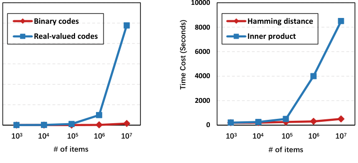
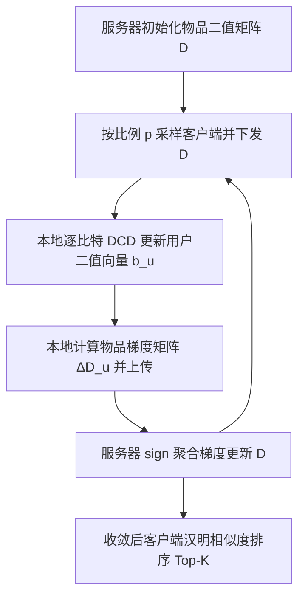
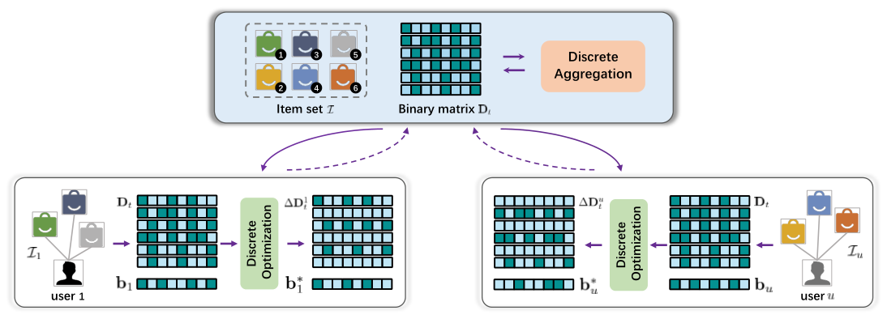

# LightFR: Lightweight Federated Recommendation with Privacy-preserving Matrix Factorization（轻量隐私保护联邦矩阵分解推荐）

- **会议/期刊**: ACM Transactions on Information Systems (TOIS)
- **作者与机构**: Honglei Zhang, Fangyuan Luo, Jun Wu, Yidong Li（北京交通大学）；Xiangnan He（中国科学技术大学）
- **推荐链路定位**: 召回（客户端 Top-K 向量检索）
- **研究方向**: 去偏公平、可信隐私与工业架构 / 协同过滤与双塔召回
- **论文原文**: [https://arxiv.org/abs/2206.11743v2](https://arxiv.org/abs/2206.11743v2)
- **开源代码**: 暂未开源

## TL;DR (1分钟核心速览)

联邦推荐（FRS）沿用实值嵌入内积检索，在物品规模上亿时，资源受限客户端的存储、通信与推理开销同步线性膨胀；同时实值梯度上传可被反演攻击还原评分。LightFR 将学习哈希引入联邦场景，把用户/物品表征压成 $\{\pm1\}^f$ 二值码，用汉明相似度替代内积，并设计"本地离散坐标下降 + 服务器 sign 聚合"的联邦离散优化算法。在 4 个真实数据集、HR@10/NDCG@10 的采样排序协议下，相对最强联邦基线 PrivRec 提升 0.03%–0.67%，同时在 Ciao 上存储开销仅为 FCF 的 8%、推理速度快约 7 倍。

## Background & Motivation (背景与核心矛盾)

- **主流范式**: FCF/FedMF/FedRec 在客户端本地更新用户隐向量、在服务器聚合物品隐向量与梯度；MetaMF/PrivRec 用元学习或蒸馏压缩客户端模型规模。
- **前人局限 (一)**: 无论怎么压缩参数量，在线检索仍是连续欧氏空间的内积，候选集为全量物品时推理时间随 $m$ 线性增长，元学习类方法（如 MetaMF 需前向传播）反而更慢。
- **前人局限 (二)**: 上传的是实值梯度/参数，FedMF 已证明两轮实值梯度可联立方程解出 $r_{ui}$；而加同态加密或差分隐私的方案又带来 1024 位密钥维度的存储与通信膨胀。
- **核心洞察 (Key Insight)**: 如图 1 所示，把 64 维实值码换成 64 位二值码后，存储/通信随物品数增长被压平，汉明距离可用 XOR+popcount 硬件指令完成，检索时间几乎与物品规模解耦。
- **本文切入点**: 效率与隐私两个痛点的共同根源是"欧氏空间的实值重参数化"，因此换空间而非加补丁——直接在汉明空间学表征并做离散优化。

<figure class="paper-figure" markdown="span">
  <figcaption>图 1. 在不同规模物品上，针对汉明距离（二进制码）与内积（实值码）的存储、通信开销（左图）和推理时间（右图）比较。实验通过随机生成长度为 64 的二进制码和实值向量，在 10^5 个用户与 10^3−10^7 个物品上进行，并报告 5 次重复的平均结果。由于物品数量范围较广，x 轴以指数区间形式均匀展示。</figcaption>
</figure>

## Method (核心方法设计)

### 1. 整体框架 (Overall Architecture)

服务器初始化全局物品二值矩阵 $\mathbf{D}\in\{\pm1\}^{f\times m}$；每轮按比例$p$采样客户端，下发最新$\mathbf{D}$。客户端本地先逐比特更新私有二值向量$\boldsymbol{b}_u$，再基于本地交互计算物品梯度矩阵$\Delta\mathbf{D}_u$上传；服务器执行 sign 聚合更新$\mathbf{D}$，进入下一轮。推理阶段客户端下载$\mathbf{D}$，用汉明相似度排序返回 Top-K。全流程只交换$\pm1$ 比特，不上传原始评分与实值梯度。

<figure class="paper-figure" markdown="span">
  <figcaption>图 2. 我们提出的 LightFR 方法的框架。首先，在中央服务器中初始化全局物品二进制矩阵 D，然后分发给分布式客户端进行本地更新。随后，每个本地客户端接收最新的物品二进制矩阵 D，并（在第一轮）初始化其自身的私有二进制向量 b𝑢。之后，每个客户端更新其自身的私有二进制向量 b𝑢，并通过（本地）离散优化模块计算待上传的物品梯度矩阵 ΔD𝑢。在接收到所有被选客户端上传的梯度矩阵后，更新过程……</figcaption>
</figure>

### 2. 关键设计拆解 (Key Designs)

1. **汉明相似度重参数化 + 平衡约束（把"学表征"变成"学位"）**：二值约束下常规 $\|\mathbf{B}\|_F^2+\|\mathbf{D}\|_F^2$退化为常数，无法抑制过拟合，也易出现比特坍缩。本文用比特一致率定义相似度并线性化为内积形式$sim(\boldsymbol{b}_u,\boldsymbol{d}_i)=\frac{1}{2}+\frac{1}{2f}\boldsymbol{b}_u^{\top}\boldsymbol{d}_i$，目标改为加权平方误差加比特平衡项：
$$\mathcal{L}=\sum_{u\in\mathcal{U}}\frac{|\mathcal{I}_u|}{N}\sum_{i\in\Omega_u}\left(r_{ui}-sim(\boldsymbol{b}_u,\boldsymbol{d}_i)\right)^2+\lambda\left(\Big\|\sum_u\boldsymbol{b}_u\Big\|^2+\Big\|\sum_i\boldsymbol{d}_i\Big\|^2\right),\ \text{s.t.}\ \boldsymbol{b}_u,\boldsymbol{d}_i\in\{\pm1\}^f .$$
   直觉上平衡项最大化每比特的信息熵（每维正负各半），使 $f$ 位码字容量被充分使用，这也是二值模型能逼近实值精度的关键。

2. **联邦离散坐标下降（Local DCD，绕开两阶段量化损失）**：直接对 $\{\pm1\}^f$做组合搜索是 NP-hard 的$O(2^{(m+n)f})$。作者采用交替优化：固定$\boldsymbol{d}_i$时，固定$\boldsymbol{b}_u$其余$f-1$位后，目标关于单比特$\boldsymbol{b}_{uk}$ 是线性的，于是有闭式符号解
$$b_{uk}=\mathrm{sign}\Big(\underbrace{\sum_{i\in\Omega_u}\tfrac{1}{f}\big(r_{ui}-\tfrac{1}{2}-\tfrac{1}{2f}\boldsymbol{d}_{i\bar{k}}^{\top}\boldsymbol{b}_{u\bar{k}}\big)d_{ik}}_{\text{本地残差信号}}-2\lambda\sum_{k'}b_{uk'}\Big),$$
   其中 $b_{uk}=0$ 时保持原位以避免震荡。相比"先学实值再 sign 阈值"的两阶段法，逐位直接优化避免了不可逆的量化误差累积。

3. **梯度聚合与隐私、训练开销**：客户端只上传逐比特梯度 $\Delta d^{u}_{ik}=\big(r_{ui}-\frac{1}{2}-\frac{1}{2f}\boldsymbol{b}_{u\bar{k}}^{\top}\boldsymbol{d}_{i\bar{k}}\big)b_{uk}$，服务器做$\mathbf{D}=\mathrm{sign}\big(\frac{1}{f}\sum_u\Delta\mathbf{D}_u-2\lambda\mathbf{D}'\big)$（Agg$_{grad}$），文中另给出直接聚合本地二值矩阵的变体 Agg$_{para}$。隐私直觉：FedMF 的实值反演需解出连续标量$p_{uk}$满足两轮方程，而$\mathrm{sign}(\cdot)$不可逆、不可微，服务器只能观测到比特翻转方向而非幅值，方程无解。整体训练复杂度$O(T\cdot E\cdot f^2\cdot(|\Omega_u|+m))$，对物品数线性、对客户端数可并行消除；冷启动用户/物品只需去掉平衡项按同一 DCD 在线微调，无需重训全局。

## Experimental Setup & Evaluation Protocol (实验设置与评估协议)

- **数据集与预处理**: 每用户按时间戳切分，无额外 k-core 过滤；用户即客户端。

| 数据集 | #Users | #Items | #Interactions | 密度 | 场景说明 |
| :--- | :---: | :---: | :---: | :---: | :--- |
| MovieLens-1M | 6,040 | 3,952 | 1,000,209 | 4.19% | 稠密，评分 1–5 |
| Filmtrust | 1,508 | 2,071 | 35,497 | 1.14% | 小规模，评分 0.5–4 |
| Douban-Movie | 2,964 | 39,695 | 894,888 | 0.76% | 中等物品池，人均 302 条 |
| Ciao | 7,375 | 105,096 | 282,619 | 0.04% | 极稀疏、最大物品池 |

- **数据划分与防穿越 (Splitting Strategy)**: 逐用户按时间戳排序后 `80%/10%/10%` 比例划分（非 Leave-One-Out），验证/测试集不再泄漏未来交互。
- **排名评测协议 (Ranking Protocol)**: `Sampled Ranking`——为每个正样本随机采样固定数量负样本后计算 HR@10 与 NDCG@10，**非 Full-Ranking**，故不同论文数值不可直接横向比较。
- **对比基线与超参**: 集中式 PMF / SVD++ / DDL / NCF 与联邦式 FCF / FedMF / FedRec / MetaMF / PrivRec 共 9 个基线；实值模型 $d=32$、二值模型码长$f=64$；联邦侧全局轮$T=50$、本地 epoch$E=1$、客户端采样比$p=0.6$，超参按验证集调优。

## Key Experimental Results (实验关键数据)

### 1. 主实验对比 (Main Results)

| 方法 | ML-1M HR@10 / NDCG@10 | Filmtrust | Douban | Ciao |
| :--- | :---: | :---: | :---: | :---: |
| PMF (集中式) | 0.5124 / 0.2768 | 0.8704 / 0.6610 | 0.3011 / 0.1678 | 0.4636 / 0.2434 |
| SVD++ (集中式) | 0.5291 / 0.2826 | 0.8793 / 0.6777 | 0.3118 / 0.1886 | 0.4692 / 0.2463 |
| NCF (集中式最优) | **0.5342 / 0.2901** | **0.8827 / 0.6907** | **0.3223 / 0.2097** | **0.4732 / 0.2513** |
| FCF | 0.4945 / 0.2625 | 0.8543 / 0.6376 | 0.2921 / 0.1615 | 0.4492 / 0.2304 |
| FedMF | 0.4836 / 0.2534 | 0.8601 / 0.6563 | 0.2786 / 0.1443 | 0.4461 / 0.2272 |
| FedRec | 0.4893 / 0.2612 | 0.8503 / 0.6304 | 0.2832 / 0.1593 | 0.4474 / 0.2301 |
| MetaMF | 0.4994 / 0.2691 | 0.8566 / 0.6389 | 0.2937 / **0.1669** | 0.4503 / 0.2402 |
| PrivRec | 0.4989 / 0.2688 | 0.8605 / 0.6563 | 0.2931 / 0.1666 | 0.4534 / 0.2411 |
| **LightFR** | **0.5014 / 0.2709** | **0.8615 / 0.6565** | 0.2934 / 0.1665 | **0.4556 / 0.2413** |
| Improv.% (vs 最强联邦) | +0.40 / +0.67 | +0.12 / +0.03 | −0.10 / −0.24 | +0.49 / +0.08 |

效率对比（Ciao 数据集，客户端侧，数值为相对 LightFR 的倍数，源自图 3）：存储开销 FCF/FedRec/PrivRec ≈12.5×、MetaMF ≈12.3×、FedMF ≈32×；推理时间 FCF/FedRec/PrivRec ≈7×、FedMF ≈30×、MetaMF ≈100×。通信开销趋势与存储一致，LightFR 只需传输 $m\times f$比特而非$m\times f\times64$ 比特。

### 2. 消融与敏感性实验 (Ablation & Sensitivity)

原文消融小节在可得文本中被截断，具体数值未披露，下表仅保留可核实的设计维度与结论：

| 变体 / 维度 | 对照 | 原文结论 |
| :--- | :--- | :--- |
| Agg$_{grad}$（梯度聚合） | vs. Agg$_{para}$（参数聚合） | 两种聚合机制均被实现并对比，梯度聚合为默认主方案 |
| 去掉平衡约束 $\lambda$ | vs. 完整模型 | 平衡项用于最大化比特熵、防止码字坍缩 |
| 逐位 DCD | vs. 两阶段 sign 阈值量化 | 直接离散优化规避量化损失 |
| 冷启动变体 | vs. 全量重训 | 去平衡项在线 DCD 即可近似最优，无需重训全模型 |
| 码长 $f$（图 4） | 不同$f$ | 精度随码长增加而提升并趋于饱和 |
| 权衡参数 $\lambda$（图 5） | 不同$\lambda$ | 在合理区间内性能平稳，不敏感 |
| 客户端采样比 $p$（图 6） | 不同$p$| 性能随$p$ 增大而提升，但整体鲁棒 |

### 3. 关键实验发现 (Key Findings)

1. **"精度不掉队、开销降一档"是主卖点而非精度突破**：LightFR 在 ML-1M/Filmtrust/Ciao 上 HR@10 相比最强联邦基线仅提升 0.12%–0.49%，但与集中式 NCF 仍差 2.1–3.3 个点（ML-1M 0.5014 vs. 0.5342，Filmtrust 0.8615 vs. 0.8827），说明二值化在联邦聚合噪声之上又叠加了一层量化损失，尚未被完全补偿。
2. **收益随物品规模与稀疏度放大**：在物品池 10.5 万、密度仅 0.04% 的 Ciao 上 LightFR 反超所有联邦基线（0.4556 vs. PrivRec 0.4534），推理快 7–100 倍；而在物品池 3.97 万的 Douban-Movie 上略低于 MetaMF（0.2934 vs. 0.2937），印证"汉明检索的优势来自候选集规模"这一动机。
3. **效率增益可量化归因于比特运算替代浮点内积**：存储仅为 FedMF 的 3.1%、MetaMF 的 8.1%、FCF/FedRec/PrivRec 的 8%，推理快 7–100 倍，即精度代价 < 1 个 HR 点、资源代价降低近一个数量级，这一 trade-off 在端侧部署中是可接受的。

## Highlights & Limitations (亮点、对比与审稿批判)

- **与代表作对比 (vs. Prior Work)**: 与 FCF/FedRec 相比，本文不在欧氏空间做加密或虚拟填充，而是换到汉明空间，从根上移除实值上传通道；与 FedMF 相比，隐私不靠同态加密（1024 位密钥导致存储膨胀 32 倍），而靠 sign 的不可逆性；与 MetaMF/PrivRec 相比，压缩的是**在线检索**而非仅训练参数，因而推理时间真正下降。
- **可迁移亮点**: ①"离散参数 + sign 聚合"这一模式可迁移到任何需要限制上传带宽的联邦/边缘推荐场景（如端侧广告粗排）；②闭式逐位 DCD 更新可直接套用到其他二值召回（RQ-VAE 码本、语义 ID）的码字精调。
- **审稿级局限批判**: ①隐私仅有理论论证与三类情形的定性分析，缺少实测攻击（如梯度反演、成员推断）的成功率曲线，"理论上不可解"不等于"实践中安全"；②二值模型 $f=64$对比实值模型$d=32$，容量不同但存储比又被报为 8%，两套口径（每维 1 bit vs. 64 bit，及$\times f$差异）在文中未完全对齐，效率结论的归因需谨慎；③评测为采样排序而非 Full-Ranking，且逐用户 80/10/10 切分对二值码的冷启动鲁棒性检验偏弱；④精度增益普遍 < 0.7%，对超参$f$与$\lambda$ 的实际选取成本缺乏报告。

## Rating (四维评分)

- **方法创新性 (Novelty)**: ⭐⭐⭐⭐ （首次把学习哈希与联邦离散优化统一到 FRS，逐位闭式 DCD 解决了 $\{\pm1\}^f$ 组合搜索难题）
- **评估协议与实验扎实度 (Protocol & Experiments)**: ⭐⭐⭐ （4 个不同规模数据集 + 9 个基线与三类效率指标齐全，但采样排序、消融数值缺失、无实测隐私攻击）
- **写作与数学规范度 (Clarity & Rigor)**: ⭐⭐⭐⭐ （汉明相似度线性化、逐位偏导推导与隐私三情形论证完整，复杂度分析清晰）
- **工业落地与复现价值 (Industrial & Practical Value)**: ⭐⭐⭐⭐ （比特级存储与 XOR 检索极易端侧部署，但未开源、冷启动依赖少量暖交互）

