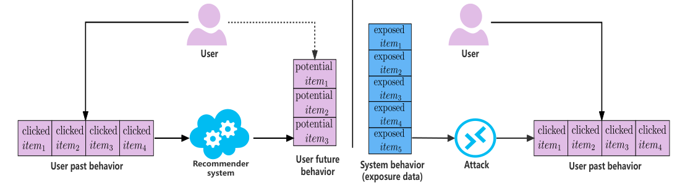
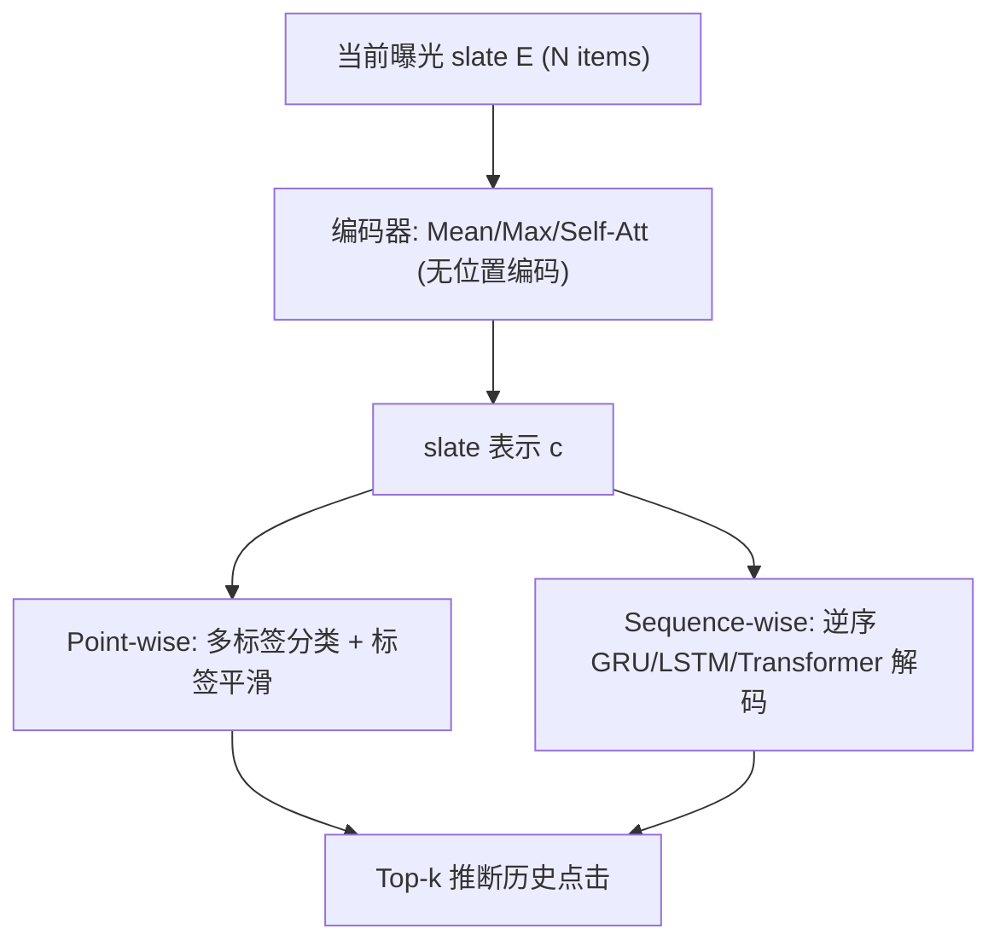

# On the User Behavior Leakage from Recommender System Exposure (论推荐系统曝光数据造成的用户行为泄露)

- **会议/期刊**: ACM TOIS (Special Section on Trustworthy Recommendation and Search)
- **作者与机构**: Xin Xin, Jiyuan Yang 等，山东大学 + 美团
- **推荐链路定位**: 召回/曝光层（服务端曝光日志的安全与保护）
- **研究方向**: 去偏公平、可信隐私与工业架构 / 序列推荐
- **论文原文**: [https://arxiv.org/abs/2210.08435v2](https://arxiv.org/abs/2210.08435v2)
- **开源代码**: [https://github.com/nancheng58/On-the-User-Behavior-Leakage-from-Recommender-System-](https://github.com/nancheng58/On-the-User-Behavior-Leakage-from-Recommender-System-)

## TL;DR (1分钟核心速览)

以往隐私研究只保护"用户侧行为数据"，却忽略了服务端自产、体量巨大、跨部门共享范围更广的**系统曝光日志**。本文首次把"当前曝光 slate $\to$ 用户过去点击序列"定义为一个反向推断任务，用极简编码器-解码器黑盒攻击在 Zhihu/MIND 上取得 Recall@10 达 **23.59%/87.72%**（MIND Recall@20 高达 98.09%），证明历史行为几乎可以从曝光中"读出来"；随后提出"位置选择 + 物品替换"两阶段曝光扰动，在损失约 20% 推荐精度的代价下削减约 40% 泄露风险。

## Background & Motivation (背景与核心矛盾)

- **主流范式**: 隐私保护集中在用户侧——同态加密、差分隐私扰动用户画像、联邦学习本地训练，以及针对推荐系统的成员推断攻击防御。
- **前人局限**: ① 这些工作全部默认"用户行为数据"是唯一泄露源，而"曝光数据"由系统生成、数量比点击大一个量级（MIND 点击率仅 4%），访问权限反而更松；② 曝光与用户历史点击之间天然存在强相关性（相似性/序列性），因此曝光本身就是历史行为的"影子副本"。
- **核心洞察 (Key Insight)**: 攻击者不需要知道曝光列表中哪些物品被点击，也无需知道推荐算法本身（黑盒），仅凭一次曝光 slate 就能反推用户点击过什么——即估计 $p(b_1,\dots,b_M \mid e_1,\dots,e_N)$，它与序列推荐$p(b_{t+1}\mid b_1,\dots,b_t)$ 的输入输出**来自不同信息源**，且曝光无强序列顺序。
- **本文切入点**: 用最朴素的编码器-解码器验证"风险是否系统性存在"，再以注入随机曝光的方式做推理阶段防护。

<figure class="paper-figure" markdown="span">
  <figcaption>图 2. 推荐系统 (a) 旨在根据历史用户交互预测用户未来行为。本文中，攻击场景 (b) 侧重于从系统行为数据推断用户过去行为的隐私。</figcaption>
</figure>

## Method (核心方法设计)

### 1. 整体框架 (Overall Architecture)

输入为用户 $u$当前的一次曝光 slate$E_i^u=(e_1,\dots,e_N)$，经 embedding 查表后由编码器（Mean / Max / 自注意力三种，均**不引入位置编码**，因为曝光是同时下发的）压成 slate 级表示$\mathbf{c}$；解码器分两支：point-wise 支把它当作$|\mathcal{I}|$维多标签分类，sequence-wise 支则以$\mathbf{c}$为条件、按**逆序**自回归生成历史序列$(\langle start\rangle,b_M,\dots,b_1)$。训练仅用曝光-点击配对，推理时取 top-$k$与真实$M$ 个历史点击比对。

### 2. 关键设计拆解 (Key Designs)

1. **逆序序列化解码（Reverse-Order Decoding）**：痛点在于用户历史点击有先后语义，而 point-wise 把它当无序集合、丢失了兴趣漂移信号。本文把序列补成 $(\langle start\rangle,b_M,\dots,b_1)$并以$(\langle b_M,\dots,b_1,\langle end\rangle)$为监督（teacher forcing），推理时用上一步输出喂下一步；**逆序**的直觉是"越近的行为与当前曝光的因果关联越强，先猜近的再往前推"更稳。损失为逐位置交叉熵$\mathcal{L}=-\sum_{m=1}^{M}\sum_{j=1}^{|\mathcal{I}|}y_{mj}\log q_{mj}$。
2. **标签平滑的 Point-wise 解码**：$|\mathcal{I}|$ 维 softmax 在稀疏正例下极易过自信。将真实标签软化为
$y_j=(1-\varepsilon)/M$if$j\in B_i^u$else$\varepsilon/(|\mathcal{I}|-M)$，$\varepsilon=1/|\mathcal{I}|$，显著抑制过拟合并提升泛化——这是让"简单攻击也能奏效"的关键一招。
3. **两阶段曝光保护（Position Selection + Item Replacement）**：先按比例 $L$选定$m=\lceil N\cdot L\rceil$个位置，再替换。相似度选择用 SASRec 学到的物品向量做用户行为中心$\mathbf{b}_u=\frac{1}{|B^u|}\sum_j \mathbf{b}_{uj}$，并按
$s(u,i)=\mathrm{softmax}\!\left(\frac{\mathbf{e}_i\cdot \mathbf{b}_u}{\max(\|\mathbf{e}_i\|_2\|\mathbf{b}_u\|_2,\ \omega)}\right)$**优先替换低相似度位置**，把用户真正可能点击的物品留下；替换源可选均匀采样或（全局/批内）流行度采样。总损失即上述 CE，无额外负采样；攻击模型为全库$|\mathcal{I}|$ 维 softmax，无 ANN 近似。

## Experimental Setup & Evaluation Protocol (实验设置与评估协议)

- **数据集与预处理**:

| 数据集 | #Users | #Items | #Impressions | #Clicks | 稀疏度/场景说明 |
| :--- | :---: | :---: | :---: | :---: | :--- |
| Zhihu | 7,963 | 64,573 | 1,000,026 | 271,725 | 点击率 27.2%；答案推荐，答案含隐含问题 |
| MIND | 94,057 | 34,376 | 8,584,442 | 347,727 | 点击率 4.05%；新闻推荐 |

默认 $M=5$、$N=10$，得到 213,172（Zhihu）/ 291,595（MIND）组$[B_i^u|E_i^u]$配对；嵌入维度$d=128$，Adam，lr=0.001，dropout=0.1，2 头注意力，编码与 softmax 共享物品嵌入，每实验跑 3 次取均值。
- **数据划分与防穿越**: **按用户划分**（8:1:1），80% 用户训练、10% 验证、10% 测试，避免同一用户跨集造成信息短路；曝光 $E$与历史$B$按时间戳严格前后切分（$t$前$M$次点击为标签，$t$后$N$ 条曝光为输入）。
- **排名评测协议**: **Full-Catalog Ranking**——对全物品集 $|\mathcal{I}|$做 softmax 排序，取 top-$k$（含$k\times M$个候选）与真实$M$个历史点击比对，报告 Recall@$\{5,10,20\}$、NDCG、MRR；保护实验另计$acc^*_u=|E^{*u}\cap B^u|/|E^{*u}|$。
- **对比基线**: 本文无外部 SOTA 基线，实验矩阵即 3 种编码（Mean/Max/Att）× 4 种解码（Point-wise/LSTM/GRU/Transformer）共 12 组自比较；相似度保护复用 SASRec 嵌入。

## Key Experimental Results (实验关键数据)

### 1. 主实验对比 (Main Results)

下表为各编码器-解码器组合的 Recall@10（NDCG@10），加粗为列最优：

| 解码器 | Zhihu-Mean | Zhihu-Max | Zhihu-Att | MIND-Mean | MIND-Max | MIND-Att |
| :--- | :---: | :---: | :---: | :---: | :---: | :---: |
| Point-wise | 0.1282 (0.0597) | 0.1236 (0.0580) | 0.1364 (0.0640) | 0.6684 (0.3282) | 0.6631 (0.3259) | 0.6683 (0.3271) |
| GRU | 0.1578 (0.0767) | 0.1792 (0.0878) | 0.1523 (0.0733) | 0.8429 (0.4255) | **0.8506** (0.4422) | 0.8110 (0.4291) |
| LSTM | 0.1634 (0.0809) | 0.1930 (0.0955) | 0.2063 (0.1021) | **0.8772** (0.4541) | 0.8719 (0.4432) | 0.8158 (0.4269) |
| Transformer | **0.2359** (0.1235) | 0.2339 (0.1213) | 0.2293 (0.1161) | 0.8232 (0.4524) | 0.8208 (**0.4526**) | 0.8119 (0.4443) |

自 Point-wise 最优 0.1364 → 序列化解码最优 0.2359（Zhihu，**+72.9%**），MIND 由 0.6684 → 0.8772（**+31.2%**）。

### 2. 消融实验 (Ablation Study)

| 配置（其余固定） | Zhihu Rec@10 | MIND Rec@10 |
| :--- | :---: | :---: |
| 去掉序列化解码（Point-wise，Mean 编码） | 0.1282 | 0.6684 |
| GRU 解码（Mean 编码） | 0.1578 | 0.8429 |
| LSTM 解码（Mean 编码） | 0.1634 | **0.8772** |
| Transformer 解码（Mean 编码，完整） | **0.2359** | 0.8232 |
| 替换为 Max 池化编码 | 0.2339 | 0.8208 |
| 替换为自注意力编码 | 0.2293 | 0.8119 |
| 曝光长度 $N=5$/$15$/$20$（Transformer, Zhihu） | 0.1341 / 0.2105 / 0.1786 | 0.7666 / 0.7820 / 0.7791 |

### 3. 关键实验发现 (Key Findings)

1. **序列建模是泄露放大器**：Point-wise 到 LSTM 在 MIND 上 Recall@10 从 0.6684 跃至 0.8772（+31.2%），说明"历史点击的顺序"几乎被曝光完全编码，攻击者无需任何复杂结构即可利用。
2. **朴素编码足以击穿，风险是系统性的而非模型性的**：MIND 上 Mean 池化 + LSTM（0.8772）反而优于自注意力编码（0.8158，**+7.5%**）；Zhihu 上自注意力仅在 Point-wise/LSTM 下略有优势——意味着即使服务端做复杂化处理也无法靠"提高攻击门槛"防御。
3. **保护存在清晰权衡**：随机选位 + 均匀替换在 $L=0.2$时于 Zhihu 削减约 40% 泄露（Rec/NDCG 比值降至 ~0.6）却保留约 80% 推荐精度；均匀替换降攻击最狠，批内流行度替换精度损失最小；相似度选位比随机选位在同等$L$下保住更高精度。$N=10$ 为攻击最优——太小信号弱、太大引入噪声。

## Highlights & Limitations (亮点、对比与审稿批判)

- **与代表作对比 (vs. Prior Work)**: 与差分隐私/联邦学习类工作相比，本文的攻击面与防御面都从"用户数据"移到"系统曝光数据"，是首个系统侧视角；与成员推断攻击 (Zhang et al.) 判定"数据是否被使用"不同，本文直接**重建历史点击内容**，信息粒度更细、危害更直接。攻击模型刻意保持最简（无位置编码、无复杂采样），意在证明风险具普遍性。
- **可迁移亮点**: ① 标签平滑 + 逆序 teacher forcing 的组合可作为"序列内容重建"任务的通用强基线；② "低相似度位置优先替换"给出了一个低成本、免重训的推理期隐私加固范式，可直接嵌入线上曝光生成层。
- **审稿级局限批判**: ① 保护机制仅在**推理阶段事后扰动**曝光，未与推荐模型联合训练，$L$稍大即精度断崖，缺少自适应$L$或可学习扰动策略；② 评测仅用 Recall/NDCG/MRR 与一个粗糙的$acc^*$，缺乏对多样性、流行度偏置以及真实线上 A/B 的验证，且未讨论曝光本身受位置/流行度偏置影响时攻击性能的稳健性。

## Rating (四维评分)

- **方法创新性 (Novelty)**: ⭐⭐⭐⭐ （首次把"系统曝光 $\to$ 用户历史"定义为攻击任务，问题定义本身的价值高于模型复杂度；但攻击/防御模块均为现成组件的组合）
- **评估协议与实验扎实度 (Protocol & Experiments)**: ⭐⭐⭐⭐ （两个真实工业数据集 + 按用户划分 + 全库排序 + 3 次重复取均值，防穿越设计严谨；缺外部 SOTA 基线与显著性检验）
- **写作与数学规范度 (Clarity & Rigor)**: ⭐⭐⭐⭐ （符号表、任务形式化与 12 组编码-解码组合的对照极为清晰，代价是公式多为标准 LSTM/GRU/Transformer 复述，理论分析偏薄）
- **工业落地与复现价值 (Industrial & Practical Value)**: ⭐⭐⭐⭐⭐ （代码与数据链接齐全，攻击模型训练成本极低，两阶段保护可即插即用于曝光生成环节，对跨部门日志共享场景有直接警示价值）

