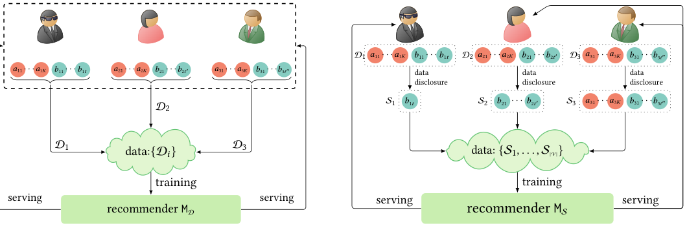
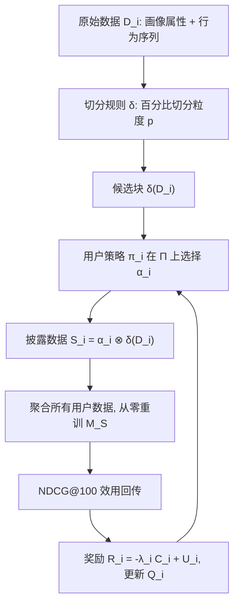

# Studying the Impact of Data Disclosure Mechanism in Recommender Systems via Simulation (基于模拟的推荐系统数据披露机制影响研究)

- **会议/期刊**: ACM TOIS (2022)
- **作者与机构**: Ziqian Chen, Fei Sun (通讯), Yifan Tang, Haokun Chen, Jinyang Gao, Bolin Ding — 阿里巴巴达摩院 / 罗汉堂
- **推荐链路定位**: 数据供给层（训练数据采集机制设计，而非排序模型本身）
- **研究方向**: 去偏公平、可信隐私与工业架构 / 强化学习与动态探索推荐
- **论文原文**: [https://arxiv.org/abs/2204.00279v2](https://arxiv.org/abs/2204.00279v2)
- **开源代码**: 暂未开源（正文注明“评审后放出”，实际未检索到仓库）

## TL;DR (1分钟核心速览)

针对 GDPR/CCPA 落地后平台普遍采用的“全有或全无”二元授权机制，本文提出**隐私感知推荐框架**：用户按隐私计算理论在“隐私成本 vs 推荐收益”间权衡，主动选择披露哪些隐式行为；平台则以机制 $G=<\delta,\Pi>$（切分规则 + 选择空间）约束可选动作。因真实上线代价高，作者用$\epsilon$-greedy 多智能体 bandit 模拟三类敏感度用户在 ML-100k/Yelp、GRU4Rec/BiSA/NCF 上的决策。结果显示细粒度切分 + 自由披露（separate,$p=1/8$）在 ML-100k 上 NDCG@100 达 20.21%，比“全披露”19.45% 更高，却只用了 46.46% 的行为数据。

## Background & Motivation (背景与核心矛盾)

- **主流范式**: 隐私保护推荐集中在“模型侧”，用联邦学习、差分隐私防止数据泄露；而合规侧只提供 opt-in/opt-out 的二元开关。
- **前人局限**: ①二元机制下敏感用户直接退出，既得不到个性化服务，平台也永久损失这批用户的训练数据与收入；②联邦学习仍可被梯度反演、成员推断攻击，差分隐私则以精度下降为代价。
- **核心洞察 (Key Insight)**: 隐私文献反复指出“控制感 (control)”本身能显著降低用户隐私顾虑。若把控制粒度从“是否披露”细化到“披露哪一段”，用户可自行丢弃对推荐无用的数据，等价于让用户替平台做**数据最小化**。
- **本文切入点**: 不做新隐私算法，而是把“数据披露机制”当作可设计变量，用模拟回答：机制如何影响用户决策？更好的模型能否换取更多数据？

<figure class="paper-figure" markdown="span">
  <figcaption>图1. 两个不同推荐系统框架的示例。</figcaption>
</figure>

## Method (核心方法设计)

### 1. 整体框架 (Overall Architecture)

用户数据被拆为画像属性 $D_{i,a}$与行为序列$D_{i,b}$；平台机制$G=<\delta,\Pi>$先用切分规则$\delta$把原始数据重组为候选块，再以选择空间$\Pi$限定用户可提交的 0/1 组合。用户策略$\pi_i$在$\Pi$上做决策，产出披露数据$S_i$；所有用户的$\{S_i\}$聚合后从零重训推荐模型$M_S$，其排序结果回传为用户效用。由于用户间相互影响且无法通信，问题退化为部分可观测的多臂老虎机：每个 epoch 用户选动作、平台重训、奖励按效用减去隐私成本计算，直至策略收敛。

### 2. 关键设计拆解 (Key Designs)

1. **机制参数化 $G=<\delta,\Pi>$（把隐私策略变成可比较的设计变量）**：痛点在于现实机制无法用统一语言描述，故用$\delta$统一“切多细”、用$\Pi$统一“能怎么选”。剖面上属性保持独立；行为按百分比粒度$p$切成$1/p$段，第$j$块为$S_{i,bj}=\{b_{i,\lfloor 0.1t_i(j-1)\rfloor+1},\dots,b_{i,\lfloor 0.1t_ij\rfloor}\}$。披露数据由动作与切分结果的聚合算子给出：
$$S_i=\alpha_i\otimes\delta(D_i)=\bigcup_{o_k=1,\,o_k\in\Pi_j} S_{i,k}$$
三种策略分别为 separate（$2^{|\delta_b(D_i,b)|}$种组合）、oldest/latest continuous（仅$|\delta_b(D_i,b)|$ 种、“必须连续从最早或最晚开始”）。直觉：粒度决定“愿披露的人数”，策略决定“披露得是否精准”。

2. **隐私计算目标与敏感权重标定（让 $\lambda_i$ 可比、可复现）**：用户目标直接取自隐私计算理论，隐私成本按披露比例线性计：
$$R_i(S_i)=-\lambda_i C_i(S_i)+U_i(S_i),\qquad C_i(S_i)=\frac{|S_{i,b}|}{|D_{i,b}|}$$
关键增量为 $\lambda_i$的**标定式**——用“全披露 vs 不披露”的效用/成本比锚定基准，再乘用户类型系数$w_i$：
$$\lambda_i=w_i\cdot\frac{U(D_i)-U(\varnothing)}{C(D_i)-C(\varnothing)}$$
这样 $w_i=1$恰好表示“维持原状即可接受”，$w_i>1$ 为敏感型。物理直觉：把绝对隐私成本转化为相对“性价比”，使不同活跃度用户处在同一尺度上。

3. **训练目标、模拟与推理开销**：无监督损失，只用排序模型自身损失（BPR/CE + 16 负采样），核心是外层 MARL 循环：$\alpha_i^{t+1}=\arg\max_{\alpha_i}Q_i^t(\alpha_i)$（概率$1-\epsilon$），否则按逆访问计数采样$\mathbb{P}_i^t(\alpha)=1/(N_i^{t-1}(\alpha)+1)$归一化，$Q$以增量均值更新$Q_i^t(\alpha)=Q_i^{t-1}(\alpha)+\frac{1}{N_i^t(\alpha)}(R_i^{t-1}-Q_i^{t-1}(\alpha))$，$\epsilon=0.5^{t/(3|\Pi|)}$。代价明确：Assumption 2 要求每轮从零重训（或机器遗忘），$|\Pi|$大时收敛极慢（separate$p=1/8$ 需 3000 轮 vs 常规 400 轮），故后续实验统一把选择数压到 ≤16。

## Experimental Setup & Evaluation Protocol (实验设置与评估协议)

- **数据集与预处理**: 评分/评论统一二值化为隐式反馈，按时间戳排序构造行为序列；过滤交互数 <40 的用户、交互数 <5 的物品，Yelp 再抽样至 8338 用户。

| 数据集 | #Users | #Items | #Interactions | 稀疏度/密度 | 特征/场景说明 |
| :--- | :---: | :---: | :---: | :---: | :--- |
| ML-100k | 637 | 1,278 | 90,554 | 11.12% | 含 4 个画像属性（性别/年龄/职业/邮编） |
| Yelp | 8,338 | 35,476 | 760,635 | 0.26% | 商家点评，极度稀疏、长序列 |

- **数据划分与防穿越 (Splitting Strategy)**: `Leave-One-Out`——每人最后一个物品为测试；披露数据内部的最后一个交互作验证，其余训练。测试集固定，不随用户披露策略变化（Assumption 1 静态假设）。
- **排名评测协议 (Ranking Protocol)**: ML-100k 用无偏 `Full-Ranking` NDCG@100（全物品集）；Yelp 因候选过大改用 `Sampled Ranking`（1 正 : 1000 负），作者引用文献称与全库排序一致。
- **对比基线与超参设置**: 基线不是某个 SOTA 模型，而是**机制维度**的对照：`all`（全披露上界）、`latest/oldest continuous`、`separate` × 粒度 $p\in\{1,1/2,1/4,1/8,1/16\}$；模型侧对照 NCF（非序列弱模型）、GRU4Rec、BiSA（双向自注意力 SOTA）。统一$d=128$、dropout 0.2、负采样 16、Adam（BiSA 用$3\times10^{-4}$，其余$10^{-3}$）、早停；结果为最后 20 轮平均，未报告显著性检验。

## Key Experimental Results (实验关键数据)

### 1. 主实验对比 (Main Results)

ML-100k、GRU4Rec、GRU 基准效用 $U(D_i)$ 下的机制对比（“dis.%”为平均披露比例）：

| 机制 / 粒度 | NDCG@100 (all) | dis.% | NDCG (敏感用户) | Improv. (vs. $p=1$) |
| :--- | :---: | :---: | :---: | :---: |
| all（全披露，上界） | 19.45 | 100 | 17.46 | — |
| latest continuous $p=1$（“全有或全无”等价） | 11.30 | 43.37 | 6.72 | 基准 |
| latest continuous $p=1/16$ | 16.31 | 40.45 | 12.01 | +44.3% |
| oldest continuous $p=1/16$ | 17.33 | 46.89 | 12.88 | +53.4% |
| separate $p=1/4$ | 16.36 | 44.12 | 9.44 | +44.8% |
| **separate $p=1/8$** | **20.21** | **46.46** | **14.93** | **+78.9%** |
| separate $p=1/8$（Yelp） | 23.23 | 48.34 | 13.97 | +69.6%（Yelp$p=1$: 13.70） |

模型侧对照（Table 6，统一选择数 ≤16）：

| 策略 | NCF | GRU4Rec | BiSA |
| :--- | :---: | :---: | :---: |
| latest continuous $p=1/16$ | 12.10 | 16.31 | **18.16** |
| oldest continuous $p=1/16$ | 11.93 | 17.33 | **18.64** |
| separate $p=1/4$ | 12.25 | 16.36 | **17.17** |

### 2. 消融实验 (Ablation Study)

用户群体构成的“消融”（ML-100k，NDCG@100 / 披露率%，Table 7）：

| 策略 | 100% 非敏感 | 100% 普通 | 100% 敏感 | 1:1:1 混合 |
| :--- | :---: | :---: | :---: | :---: |
| latest $p=1/16$ | 19.45 / 100 | 16.64 / 15.7 | 10.50 / 11.7 | 16.31 / 71.0 |
| oldest $p=1/16$ | 19.45 / 100 | **18.76** / 24.6 | 11.87 / 15.9 | 17.33 / 66.9 |
| separate $p=1/4$ | 19.45 / 100 | 19.28 / 25.4 | 9.27 / 15.1 | 16.36 / 68.1 |
| —— 画像属性消融 —— | NCF 12.69→12.65, GRU 19.89→19.87, BiSA 19.90→20.06（带/不带画像属性） | | | |

### 3. 关键实验发现 (Key Findings)

1. **“全有或全无”在所有策略、所有数据集上都是最差或接近最差**：$p=1$时整体 NDCG 仅 11.30%，敏感用户只有 6.72%，远低于全披露上界 19.45%；而 separate$p=1/8$ 只用 46.46% 的数据反而**反超上界 +3.9%**——用户主动丢弃噪声行为，起到了数据最小化的正则作用。
2. **粒度收益主要来自“披露人数”而非“每人披露量”**：细粒度使愿披露用户比例从 43.80%（$p=1$）升至 79.48%（separate$p=1/8$，ML-100k），而人均披露比例几乎不变（43.37% → 46.46%）。反之 latest$p=1/16$（40.45%）优于$p=1/2$（43.57%），说明“少而准”胜过“多而杂”。
3. **模型变强能撬动敏感用户，但对普通用户出现边际效用递减**：BiSA 相比 GRU4Rec 在三策略上把敏感用户 NDCG 从 12.01/12.88/9.44 提到 14.55/13.35/9.64；但 latest continuous 下 BiSA 并未让普通用户披露更多（15.61% vs 16.22%），因强序列模型本就不依赖早期行为。用户构成比机制影响更大：全敏感用户时 NDCG 仅 9–12%，远低于混合的 16–17%。

## Highlights & Limitations (亮点、对比与审稿批判)

- **与代表作对比 (vs. Prior Work)**: 相较联邦学习/差分隐私类工作，本文不改进模型、不注入噪声，而是改“授权交互协议”，正交于加密/扰动路线；相较经济学与 HCI 的隐私问卷研究，本文首次把**隐式反馈的细粒度披露**纳入可计算的推荐闭环；相较文献 [78] 的“公开用户/私密用户”二分设定，本文将控制粒度细化到行为子序列并聚焦平台机制。
- **可迁移亮点**: ①“机制 = 切分规则 × 选择空间”的二元参数化，可直接套用到任何需要用户授权的数据采集场景（如日志上报、埋点开关）；②$\lambda_i$ 的相对标定式，把异质隐私偏好压缩成单一可调系数，便于做敏感性分析。
- **审稿级局限批判**: ①**模拟外推风险大**：理性人 + 静态数据 + 周期性重训三项假设剥离了信任演化、决策疲劳与 UI 摩擦，真实用户未必能解出最优策略；②**工程代价未量化**：Assumption 2 要求每轮从零重训或机器遗忘，separate $p=1/8$ 需 3000 轮且动作空间指数级，文中仅以“限制到 16 个选项”回避，缺乏延迟/成本的实测；③基线只有 NCF/GRU4Rec/BiSA 三个较老模型，缺少 SASRec/BERT4Rec 等更强的序列基线，且未做显著性检验；④Yelp 采用 1000 负采样，跨数据集数值可比性受限。

## Rating (四维评分)

- **方法创新性 (Novelty)**: ⭐⭐⭐⭐ （问题新颖——把“隐私机制设计”而非“隐私算法”作为研究对象，隐私计算 + MARL 模拟的闭环首次用于隐式反馈细粒度披露）
- **评估协议与实验扎实度 (Protocol & Experiments)**: ⭐⭐⭐ （Leave-One-Out 与 Full-Ranking 规范，机制×模型×用户类型三维扫描较全，但纯模拟无真人/线上验证，且无显著性检验）
- **写作与数学规范度 (Clarity & Rigor)**: ⭐⭐⭐⭐ （$G=<\delta,\Pi>$、$\lambda_i$ 标定式与 Q 更新写得干净，假设逐条显式声明；隐私成本的线性形式论证略依赖经济学文献而非实证）
- **工业落地与复现价值 (Industrial & Practical Value)**: ⭐⭐⭐ （“细粒度披露优于二元开关”对合规产品设计有直接指导价值，但未开源、且重训/遗忘开销与动作空间爆炸使即时落地困难）

