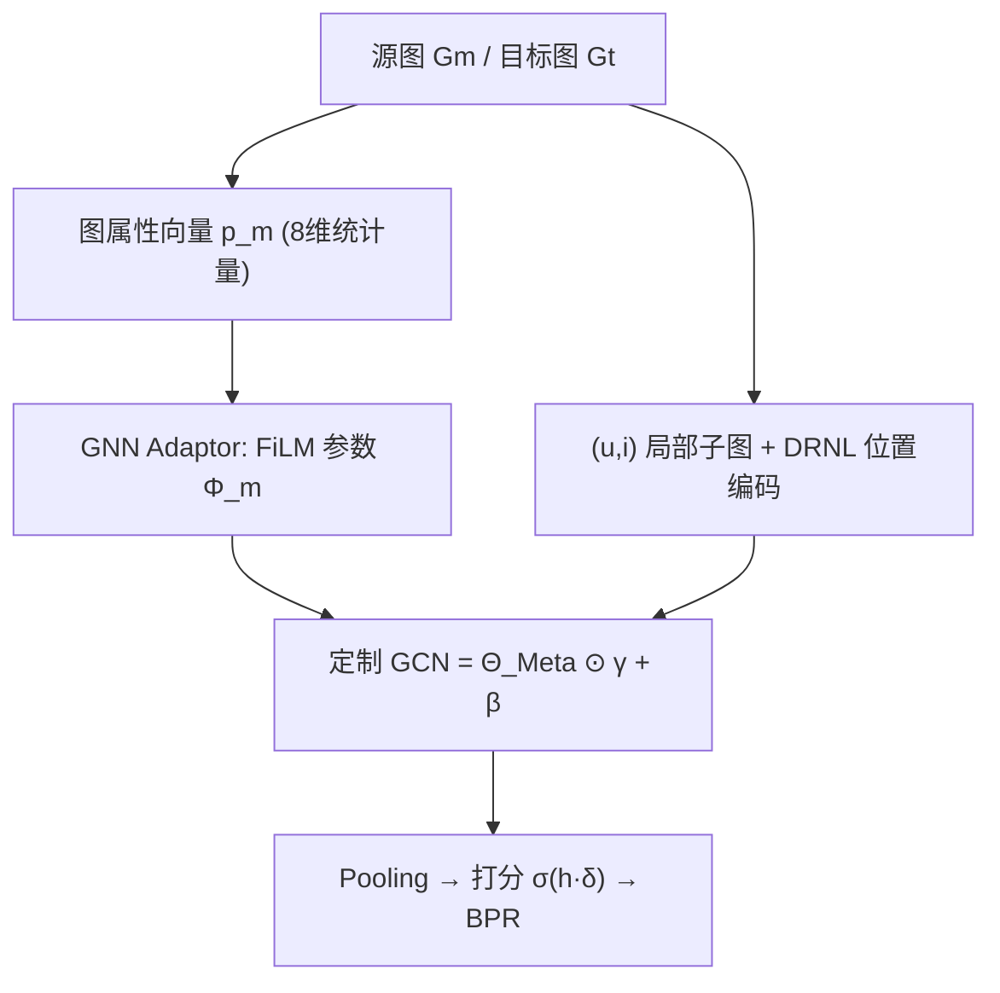

# An Adaptive Graph Pre-training Framework for Localized Collaborative Filtering (面向局部协同过滤的自适应图预训练框架)

- **会议/期刊**: ACM TOIS (arXiv 2021-12-14)
- **作者与机构**: Yiqi Wang (MSU), Chaozhuo Li / Zheng Liu / Mingzheng Li / Xing Xie (MSRA, Microsoft), Jiliang Tang (MSU), Lei Chen (HKUST), Philip S. Yu (UIC)
- **推荐链路定位**: 召回（用户-物品对打分）
- **研究方向**: 图神经网络与知识图谱推荐 / 跨域与多场景推荐
- **论文原文**: [https://arxiv.org/abs/2112.07191v1](https://arxiv.org/abs/2112.07191v1)
- **开源代码**: 暂未开源

## TL;DR (1分钟核心速览)

现有 GNN 推荐（NGCF/LightGCN）的核心参数是用户/物品嵌入，而不同推荐任务的用户集合与物品集合完全不相交，导致"NLP 式共享词表、CV 式共享特征提取器"的预训练范式无法直接搬用。本文提出 ADAPT：把预测改为「以目标用户-物品对为中心抽取局部子图 → DRNL 位置编码作节点特征 → GCN+Pooling → 打分」，从而完全不学用户/物品嵌入，只迁移"如何在小图上卷积"的算子知识；再用 8 维图属性经 adaptor 生成 FiLM 调制参数，为每张图生成定制 GCN。在 Tianchi/MovieLens 五个高度稀疏目标图上，采样排序 (`1:49`, HR@5) 协议下相对最强从头训练基线最高提升 **81.70%**，且训练数据从 60% 降到 40% 时增益反而更大。

## Background & Motivation (背景与核心矛盾)

- **主流范式**: 将交互记录视为二部图，用 NGCF/LightGCN 做邻居聚合，同时学习用户/物品嵌入 $\mathbf{H}$与卷积参数$\boldsymbol{\Theta}_{GNN}$，以内积打分。
- **前人局限**: ① 嵌入与具体 ID 绑定，跨任务不可迁移，图预训练缺失了一个可共享的"语义载体"；② 不同交互图的节点数、物品数、密度、度同配性差异极大（图 5 显示 Tianchi 60 张图从上千节点到上万边不等），硬共享一套卷积参数必然负迁移。
- **核心洞察 (Key Insight)**: 决定一次推荐的协同信号其实编码在 $(u,i)$ 的**局部邻域结构**里（共同邻居、路径长度），而不在某个固定的 ID 向量里；因此"结构→分数"的映射是可跨图迁移的通用知识。同时作者用实验（图 6）证实 NGCF/LightGCN 随稀疏度上升性能单调下滑，确认稀疏是核心痛点。
- **本文切入点**: 用"局部子图 + 位置编码"取代嵌入查表，让模型参数与 ID 解耦；用图级统计量条件化卷积参数，实现"共性共享 + 个性调制"。

## Method (核心方法设计)

### 1. 整体框架 (Overall Architecture)

ADAPT 分两阶段。**预训练**：从 $N$张源交互图中随机抽一张$G_m$，用其 8 维图属性向量$\boldsymbol{p}_m$经 GNN adaptor 生成逐层 FiLM 参数$\boldsymbol{\Phi}_m$，与共享的 meta-LGNN 参数$\boldsymbol{\Theta}_{\text{Meta-LGNN}}$合成该图的定制 GCN；再采样 BPR 三元组反向传播，同时更新 meta-LGNN、adaptor 与打分层。**微调**：给定稀疏目标图$G_t$，用同一个 adaptor 依$\boldsymbol{p}_t$生成定制模型$\boldsymbol{\Theta}^t_{GNN}$，两种策略——ADAPT-D 只微调定制模型，ADAPT-J 联合微调 meta-LGNN 与 adaptor（test-time training 思路）。推理时对候选$(u,i)$ 现采子图并前向打分。

### 2. 关键设计拆解 (Key Designs)

**创新设计一：meta-LGNN —— 无嵌入的局部协同过滤**。痛点：嵌入不可跨图迁移。做法：从 $u$、$i$分别带重启随机游走采样邻域并合并，得到局部图$A_{sub}(u,i)$（限制采样规模以保证可扩展性）；节点特征不用任何 side info，而用 DRNL 位置标签刻画"离两个目标点多远"：

$$x_t = 1+\min(d_u,d_i)+(d/2)^2,\quad d=d_u+d_i,\quad x_u=x_i=1$$

随后 $h_{(u,i)}=\mathrm{pool}(A_{sub},\mathbf{H}^L_{sub})$，$s(u,i)=\sigma(h_{(u,i)}\cdot\boldsymbol{\delta})$。直觉：位置标签是纯拓扑量，任何交互图都天然具备，故模型参数与 ID 集合彻底解耦，这是可预训练的前提。

**创新设计二：图属性驱动的 GNN adaptor（FiLM 调制）**。痛点：多图属性差异导致负迁移。做法：以 8 维属性（节点数、边数、用户物品比、密度、度同配系数、聚类系数、连通分量数、全局效率）经前馈网络生成每层 $\boldsymbol{\phi}^l_m\in\mathbb{R}^{2d_{l-1}d_l}$，拆成$\boldsymbol{\gamma}^l_m,\boldsymbol{\beta}^l_m$ 后对共享卷积核做逐元素仿射：

$$\boldsymbol{\theta}^{l}_{\mathrm{conv},m}=\boldsymbol{\theta}^{l}_{\mathrm{conv}}\odot\boldsymbol{\gamma}^{l}_{m}+\boldsymbol{\beta}^{l}_{m}$$

直觉：共享的 $\boldsymbol{\theta}^l$承载跨图通用卷积骨架，$\boldsymbol{\gamma},\boldsymbol{\beta}$ 只用极少量参数按图"调味"，既保留共性又避免硬共享的相互抵消。

**创新设计三：训练目标、负采样与推理开销**。预训练与微调均用 pairwise BPR（均匀负采样，每正样本配一个未交互负样本）：

$$\min_{\boldsymbol{\Omega},\boldsymbol{\Theta}_{\text{Meta-LGNN}},\boldsymbol{\delta}}\sum_{(u,i,i')\in\mathcal{O}}-\ln\sigma\big(s(u,i)-s(u,i')\big)$$

打分层为线性变换，meta-LGNN 为 3 层 GCN。推理无需嵌入表，但每个候选对都要现采子图 + 前向，成本显著高于 LightGCN 的查表内积，实际需靠候选裁剪或子图缓存控制延迟。

## Experimental Setup & Evaluation Protocol (实验设置与评估协议)

- **数据集与预处理**: 按商品/电影类别切出多张二部图，Tianchi 取 60 张、MovieLens 取 6 张作预训练图，另选 5 张为目标图（表 1）：

| 数据集 | #Users | #Items | #Interactions | 稀疏度/密度 | 特征/场景说明 |
| :--- | :---: | :---: | :---: | :---: | :--- |
| Tianchi-174490 | 2,267 | 285 | 3,826 | 极稀疏 | 阿里行为日志，单品类子图 |
| Tianchi-61626 | 2,305 | 764 | 3,270 | 极稀疏 | 同上 |
| Tianchi-3937919 | 1,846 | 158 | 2,980 | 极稀疏 | 同上 |
| Tianchi-2798696 | 2,579 | 94 | 2,988 | 极稀疏 | 同上 |
| MovieLens-War | 2,970 | 89 | 4,240 | 极稀疏 | 战争片品类子图 |

- **数据划分与防穿越**: 目标图按 **比例划分**，验证/测试各占 5%，其余按 60% 或 40% 随机采样作训练集（模拟数据稀缺），并约束不产生孤立用户/物品，明确排除冷启动设置。
- **排名评测协议**: **Sampled Ranking（采样排序）**，每个测试正样本配 49 个未交互负样本（1:49），以 HR@5 为主指标，5 个随机种子取均值±标准差；未报告 Full-Ranking 与 NDCG。
- **对比基线与超参**: 从头训练组 MF / NGCF / LightGCN，预训练组 GCC（同为拓扑自监督，微调目标与本文一致）。3 层 GCN、batch 256、Adam、lr $\in\{5e-4,10^{-3}\}$、dropout$\in[0,0.3]$。

## Key Experimental Results (实验关键数据)

### 1. 主实验对比 (Main Results)

训练数据保留 60%（HR@5 %，粗体为同组最优）：

| 数据集 | MF | NGCF | LightGCN | GCC | ADAPT-D | ADAPT-J | Improv. |
| :--- | :---: | :---: | :---: | :---: | :---: | :---: | :---: |
| Tianchi-174490 | 33.51 | 46.39 | 47.22 | 37.17 | **60.94** | 58.64 | +29.05% |
| Tianchi-61626 | 17.30 | 28.34 | 34.11 | 33.37 | **50.06** | 49.81 | +46.77% |
| Tianchi-3937919 | 21.75 | 26.71 | 40.20 | 35.57 | 57.72 | **59.60** | +48.25% |
| Tianchi-2798696 | 30.81 | 35.97 | 28.99 | 45.10 | **47.38** | 46.84 | +31.72% |
| MovieLens-War | 62.94 | 63.41 | 62.94 | 64.93 | 73.93 | **75.99** | +19.84% |

训练数据仅保留 40%（模拟更强稀疏）：

| 数据集 | LightGCN | GCC | ADAPT-D | ADAPT-J | Improv. |
| :--- | :---: | :---: | :---: | :---: | :---: |
| Tianchi-174490 | 37.64 | 33.40 | 57.70 | **60.07** | +41.82% |
| Tianchi-61626 | 28.83 | 32.27 | 49.94 | **52.39** | +81.70% |
| Tianchi-3937919 | 35.44 | 34.90 | 49.13 | **58.79** | +65.90% |
| Tianchi-2798696 | 27.11 | 46.17 | **48.66** | 46.58 | +46.16% |
| MovieLens-War | 56.78 | 50.76 | **71.85** | 71.47 | +11.97% |

### 2. 消融实验 (Ablation Study)

| 变体 | 174490 | 61626 | 3937919 | 2798696 | 平均 |
| :--- | :---: | :---: | :---: | :---: | :---: |
| ADAPT-best（60 张图 + adaptor） | 60.07 | 52.39 | 58.79 | 48.66 | **54.98** |
| w/o adaptor（60 张图预训练） | 32.25 | 44.78 | 38.12 | 47.36 | 40.63 |
| w/o adaptor（1 张图预训练） | 43.04 | 43.81 | 48.59 | 45.64 | 45.27 |
| w/o adaptor + 仅在目标图从头训练 | 53.92 | 49.57 | 58.25 | 47.25 | 52.24 |

另有"不微调"迁移探针（表 5，平均 HR）：随机初始化 14.22、纯 meta-LGNN 15.38、经 adaptor 定制后的 GNN **25.77**。

### 3. 关键实验发现 (Key Findings)

1. **增益随稀疏度放大，说明补的是数据缺口而非模型容量**：60% 训练时五个数据集平均相对提升约 35%，降到 40% 时升至约 49%（Tianchi-61626 高达 +81.70%），且图 7 中 ADAPT 的性能-稀疏度曲线近乎水平，而 NGCF/LightGCN 持续下滑。
2. **adaptor 是负迁移的开关**：去掉 adaptor 后用 60 张图预训练平均仅 40.63，反而**低于**单图预训练 45.27，也低于完全不预训练的 52.24——图越多、属性越杂，硬共享卷积核越有害，只有条件化调制才能把"多图"从噪声变成信息。
3. **预训练目标必须与推荐对齐**：GCC 采用同样的微调流程却仅 33–51 HR，在 Tianchi-174490 上甚至低于 LightGCN（37.17 vs 47.22），说明通用子图对比目标迁移不到推荐；而本文"局部对 + BPR"在零微调下已把 HR 从 14.22 抬到 25.77。此外预训练图数量 1→6→60 单调上升、300 张时回落，存在规模上限。

## Highlights & Limitations (亮点、对比与审稿批判)

- **与代表作对比**: 相较 LightGCN/NGCF，ADAPT 首次把可迁移对象从"嵌入"换成"局部结构→分数的算子"，从而绕开 ID 不相交的鸿沟；相较 GCC，它不做整图对比自监督，而是直接在局部对上学 BPR，并用 adaptor 显式建模图间差异，而非把所有图当同分布。
- **可迁移亮点**: ① DRNL/位置编码作为"零语义节点特征"，是任何跨图、跨域迁移场景的通用去 ID 化技巧；② 用少量图级统计量生成 FiLM 参数，可直接搬到多场景/多业务建模中作为轻量条件化模块。
- **审稿级局限批判**: ① 评测仅为 1:49 采样排序 + HR@5，未做 Full-Ranking、未报 NDCG/Recall，采样偏置可能放大绝对数值；② 目标图规模仅数百至数千节点、单品类切分，与真实工业图差若干数量级，且每个候选对需在线采子图与多次前向，延迟成本未做定量分析；③ adaptor 输入 8 维人工统计量、meta-LGNN 固定为 GCN 与均匀负采样，超参/结构敏感性（论文自陈未来可换 GIN、区分用户/物品标签、共享节点跨图预训练）尚未验证。

## Rating (四维评分)

- **方法创新性 (Novelty)**: ⭐⭐⭐⭐ （"局部子图 + 位置编码取代嵌入"与"图属性 FiLM 调制"两点组合，把图预训练从表征共享转为算子共享，思路新颖但组件本身成熟）
- **评估协议与实验扎实度 (Protocol & Experiments)**: ⭐⭐⭐ （五个真实数据集、两种稀疏度、5 seed 方差与消融齐备，但仅 1:49 采样排序 + HR@5，缺 Full-Ranking 与更多排序指标）
- **写作与数学规范度 (Clarity & Rigor)**: ⭐⭐⭐⭐ （DRNL、FiLM 适配与 BPR 三式定义清楚，算法伪代码完整；图属性选取与 adaptor 容量分析偏经验）
- **工业落地与复现价值 (Industrial & Practical Value)**: ⭐⭐⭐ （框架契合多业务跨场景冷启动，但无开源代码，且逐对子图推理的工程开销与在线延迟仍是落地门槛）

