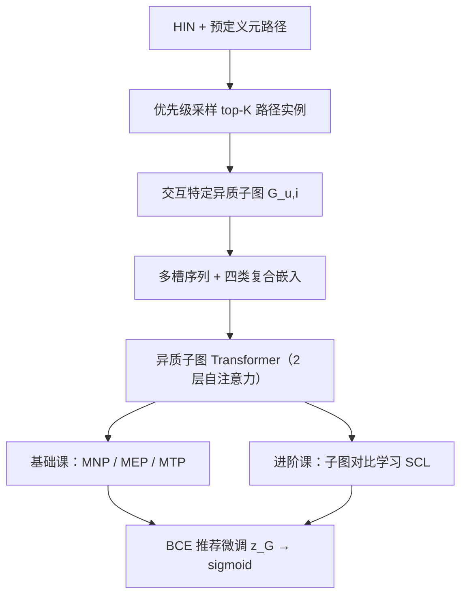
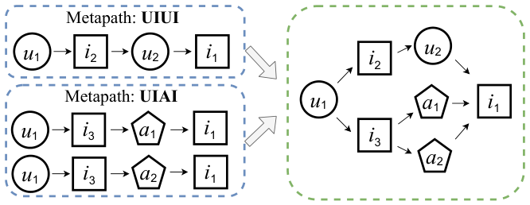
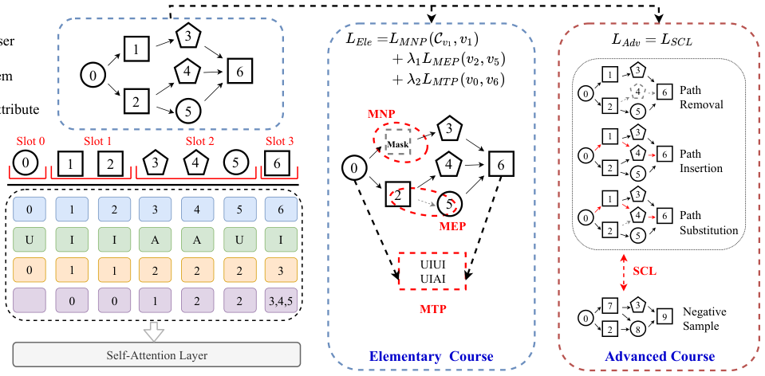

# Curriculum Pre-Training Heterogeneous Subgraph Transformer for Top-N Recommendation (面向 Top-N 推荐的课程式异质子图 Transformer)

- **会议/期刊**: TOIS 2023（arXiv 预印本 2021）
- **作者与机构**: Hui Wang, Kun Zhou, Wayne Xin Zhao, Jingyuan Wang, Ji-Rong Wen（中国人民大学信息学院 / 高瓴人工智能学院、北航）
- **推荐链路定位**: 精排（user-item 对级重打分）
- **研究方向**: 图神经网络与知识图谱推荐 / 自监督对比学习与交互去噪
- **论文原文**: [https://arxiv.org/abs/2106.06722v1](https://arxiv.org/abs/2106.06722v1)
- **开源代码**: [HIN 数据集仓库](https://github.com/librahu/HIN-Datasets-for-Recommendation-and-Network-Embedding)（模型代码承诺评审后释放）

## TL;DR (1分钟核心速览)

异质信息网络（HIN）推荐长期陷入两难：基于元路径的方法只截取有限上下文，图表示学习则把与任务无关的节点/边一起聚合进来带来噪声，且预训练目标与推荐任务脱节。CHEST 为每个 (u,i) 对单独抽取「交互特定异质子图」，用四类复合嵌入 + 两层自注意力编码为多槽序列，再以「基础课 MNP/MEP/MTP → 进阶课子图对比学习」的由易到难课程式预训练注入局部到全局语义。在 Movielens/Amazon/Yelp 上，Leave-One-Out + 1000 负采样协议下 HR@20 相对最强基线 MTRec 提升 9.9%/25.0%/15.5%。

## Background & Motivation (背景与核心矛盾)

- **主流范式**: HIN 推荐分两派——路径式（HERec/MCRec/LGRec）采样元路径实例建模路径语义；图表示学习式（HAN/HGT/NGCF）在全图或元路径虚拟边上做邻域聚合。
- **前人局限**: ① 路径式方法彼此独立建模路径，丢失跨路径的图结构与节点关联，且完全依赖推荐损失学习，稀疏场景易过拟合；② 图表示学习在全图上做任务无关聚合，任务无关节点/边被无差别吸入，且预训练（如 PF-HIN 的 masked node、GCC 的同质图对比）不感知下游推荐目标。
- **核心洞察 (Key Insight)**: 对每个交互而言，「充分性」与「相关性」必须同时满足——把 HIN 裁剪成以 (u,i) 为端点的紧凑子图，既不丢路径语义又天然剔除无关节点；而子图内部语义天然分层（节点 → 边 → 路径 → 整图），适合用课程学习由局部到全局渐进吸收。
- **本文切入点**: 用「数据刻画（交互特定子图）+ 表示模型（异质子图 Transformer）+ 学习算法（课程式预训练）」三位一体替代以往全局图上的单阶段训练。

## Method (核心方法设计)

### 1. 整体框架 (Overall Architecture)

流程分三段。离线阶段：用 metapath2vec 预学节点隐向量，对每条预定义元路径以「优先级」概率采样 top-$K$条路径实例，把连接同一 (u,i) 的所有路径合并为交互特定异质子图$\mathcal{G}_{u,i}$；在线编码：节点按其在路径中相对起始用户的槽位索引排成多槽序列，叠加节点 ID / 类型 / 槽位 / 前驱四类嵌入，经两层多头自注意力得到整图表示；训练：先在子图上跑基础课三任务、再跑进阶课子图对比，最后用 BCE 在推荐数据上微调。

<figure class="paper-figure" markdown="span">
  <figcaption>图1. 交互特定异质子图示意图，该子图由基于元路径的路径实例构建。</figcaption>
</figure>

### 2. 关键设计拆解 (Key Designs)

1. **交互特定异质子图 + 多槽复合嵌入**：解决「路径式信息碎片化、全图式信息冗余」。子图由元路径引导的优先级采样给出（metapath2vec 余弦相似度作为优先级），随后把图结构压成序列式张量：

$\mathbf{E} = \mathbf{E}_V + \mathbf{E}_A + \mathbf{E}_S + \mathbf{E}_P$四分量分别编码节点身份、节点类型、距起始用户的槽位距离、以及子图中的前驱（入边），从而用$\mathbf{E}_S$表达路径位置、用$\mathbf{E}_P$ 表达子图内部边的有向结构——这是让 Transformer 能吃下「图」而非仅仅「序列」的关键。直觉上，槽位给模型一个「离目标用户多远」的标尺，前驱嵌入则显式注入边语义，二者互补。

<figure class="paper-figure" markdown="span">
  <figcaption>图2. 我们提出的 Transformer 模型与课程式预训练策略概览。基础课程为三个预训练目标：（1）掩码节点预测（MNP），（2）掩码边预测（MEP）和（3）元路径类型预测（MTP）。高级课程为子图对比学习（SCL）任务。</figcaption>
</figure>

2. **课程式预训练：基础课（局部）→ 进阶课（全局）**：解决「预训练目标与推荐任务脱节 + 一次性多任务难以协调」。基础课三任务分别锚定节点、边、路径三个粒度：掩码节点预测 $\mathcal{L}_{MNP}=-\log(\sigma(\mathbf{F}_t^\top\mathbf{W}_N\mathbf{e}_{v_t})-\sigma(\mathbf{F}_t^\top\mathbf{W}_N\mathbf{e}_{\tilde v}))$用负节点做对比；掩码边预测$\mathcal{L}_{MEP}=-\log(\sigma(\mathbf{F}_j^\top\mathbf{W}_E\mathbf{F}_k)-\sigma(\mathbf{F}_j^\top\mathbf{W}_E\mathbf{F}_{k'}))$让相邻节点对被重建、非邻居对被推开；元路径类型预测$\mathcal{L}_{MTP}$ 是多标签 BCE，逼子图表示显式记住「哪些元路径类型连通了 u 与 i」。进阶课用路径移除/插入/替换三种增强生成正子图，对比损失

$\mathcal{L}_{SCL}=-\log\dfrac{\exp(\mathrm{sim}(\mathbf{z}_{\mathcal{G}},\mathbf{z}_{\mathcal{G}^+})/\tau)}{\exp(\mathrm{sim}(\mathbf{z}_{\mathcal{G}},\mathbf{z}_{\mathcal{G}^+})/\tau)+\sum_{\mathcal{G}^-}\exp(\mathrm{sim}(\mathbf{z}_{\mathcal{G}},\mathbf{z}_{\mathcal{G}^-})/\tau)}$

正样本抑制结构扰动带来的敏感性，负样本（同用户不同物品的子图）则把表示推离。物理直觉：基础课把节点放到「能被上下文推断」的正确位置，进阶课再把整张子图的决策边界校准到「这个用户是否真的会与这个物品交互」上；若顺序颠倒（Reverse Courses）或四任务混训（Multi-task），模型缺少「简单模式先收敛」的支撑，实验均证实退化。

3. **训练目标、负采样与推理效率**：微调阶段 $\mathcal{L}_{rec}=-\log\Pr(u,i)-\log(1-\Pr(u,i'))$，其中$\Pr(u,i)=\sigma(\mathbf{z}_{\mathcal{G}_{u,i}})$，$i'$为每个正样本随机配一个负样本（1:1 均匀负采样）。子图构造用 alias table 实现$O(1)$的类别采样，单条路径期望耗时$O(\bar L)$；子图节点数被控制在 50 以内，预训练与微调开销与标准 Transformer 序列建模同阶。在线推理仍需为候选集逐一编码子图，因此属于「高质量精排」而非全库召回。

## Experimental Setup & Evaluation Protocol (实验设置与评估协议)

- **数据集与预处理**：复用 MTRec/LGRec 系工作的预处理版本，每条边按关系类型统计，元路径在最后一列给出。

| 数据集 | #Users | #Items | #Interactions | 稀疏度 | 元路径 |
| :--- | :---: | :---: | :---: | :---: | :--- |
| Movielens | 943 | 1,682 | 100,000 | 1.58% | UMUM / UMMM / UOUM / UMGM |
| Amazon | 3,584 | 2,753 | 50,903 | 0.52% | UPUP / UPVP / UPBP / UPCP |
| Yelp | 16,239 | 14,284 | 198,397 | 0.086% | UBUB / UUUB / UBCiB / UBCaB |

- **数据划分与防穿越**: `Leave-One-Out`——每个用户随机留一条交互作测试、一条作验证，其余训练；未采用时间戳切分，存在轻度未来信息泄露风险。
- **排名评测协议**: `Sampled Ranking`——每个测试用户与 1000 个随机未交互负样本混合排序，报告 HR@{10,20} 与 NDCG@{10,20}；非 Full-Ranking，绝对数值偏乐观。
- **对比基线与超参**: 四类基线共 14 个——CF 系（BPR/FM/NCF/NGCF/LightGCN）、异质 GNN（HGT/HAN）、路径系（HERec/LGRec/MCRec）、预训练/辅助监督系（PF-HIN/GCC/Graph-BERT/MTRec）。CHEST 用 2 层自注意力、2 头、嵌入 64 维，MNP/MEP 掩码率 0.4/0.2，三任务权重 0.4/0.2/0.4，温度 $\tau=1$，预训练 lr=1e-3、微调 lr=1e-4；提升均通过$p<0.01$ 显著性检验。

## Key Experimental Results (实验关键数据)

### 1. 主实验对比 (Main Results)

| 数据集 | 模型 | HR@10 | HR@20 | NDCG@20 |
| :--- | :--- | :---: | :---: | :---: |
| Movielens | LightGCN | 0.3977 | 0.5514 | 0.2753 |
| | HAN | 0.3065 | 0.4358 | 0.1915 |
| | MCRec | 0.3828 | 0.5345 | 0.2601 |
| | GCC | 0.3860 | 0.5408 | 0.2612 |
| | Graph-BERT | 0.3712 | 0.5270 | 0.2591 |
| | MTRec | 0.3955 | 0.5440 | 0.2608 |
| | **CHEST** | **0.4401** | **0.5981** | **0.2892** |
| | Improv. | +11.3% | +9.9% | +10.9% |
| Amazon | LightGCN | 0.1028 | 0.1605 | 0.0664 |
| | MCRec | 0.0951 | 0.1277 | 0.0634 |
| | GCC | 0.0715 | 0.1206 | 0.0449 |
| | MTRec | 0.1062 | 0.1412 | 0.0706 |
| | **CHEST** | **0.1204** | **0.1765** | **0.0844** |
| | Improv. | +13.4% | +25.0% | +19.5% |
| Yelp | MCRec | 0.2193 | 0.3064 | 0.1528 |
| | LGRec | 0.1908 | 0.2762 | 0.1292 |
| | GCC | 0.1956 | 0.3006 | 0.1349 |
| | MTRec | 0.2245 | 0.3142 | 0.1556 |
| | **CHEST** | **0.2441** | **0.3630** | **0.1711** |
| | Improv. | +8.7% | +15.5% | +10.0% |

（Improv. 为相对最强基线 MTRec 的提升；Movielens 上 HR@10 的最强基线实为 LightGCN，对标其为 +10.7%。）

### 2. 消融实验 (Ablation Study)

| 变体 | ML HR@20 | ML NDCG@20 | AMZ HR@20 | AMZ NDCG@20 |
| :--- | :---: | :---: | :---: | :---: |
| **CHEST 完整版** | **0.5981** | **0.2892** | **0.1765** | **0.0844** |
| w/o Node Type | 0.5928 | 0.2835 | 0.1666 | 0.0817 |
| w/o Slot | 0.5811 | 0.2887 | 0.1601 | 0.0765 |
| w/o Precursor | 0.5811 | 0.2855 | 0.1485 | 0.0696 |
| w/o MTP | 0.5938 | 0.2830 | 0.1703 | 0.0790 |
| w/o MEP | 0.5875 | 0.2849 | 0.1703 | 0.0803 |
| w/o MNP | 0.5239 | 0.2437 | 0.1587 | 0.0724 |
| w/o SCL | 0.5896 | 0.2859 | 0.1715 | 0.0807 |
| 四任务多任务混训 | 0.5589 | 0.2715 | 0.1640 | 0.0819 |
| 逆序课程（进阶→基础） | 0.5758 | 0.2823 | 0.1700 | 0.0829 |

### 3. 关键实验发现 (Key Findings)

- **MNP 是四任务中的绝对核心**：Movielens 上去掉 MNP 使 HR@20 从 0.5981 骤降至 0.5239（−12.4%），远大于去掉 MTP（−0.7%）或 MEP（−1.8%），说明「用上下文重建被掩节点」是让复合嵌入真正对齐结构语义的前提，另三个任务主要起精修作用。
- **课程顺序本身就是一种正则**：四任务多任务混训仅得 0.5589（比完整课程低 6.6%），逆序课程得 0.5758（低 3.7%），二者都优于去掉 SCL 的 0.5896 之外的多数消融配置，证明「局部先收敛、全局后校准」的顺序不可替换，而非简单堆任务。
- **图结构信号在稀疏域更吃重**：Amazon 上去掉 precursor 嵌入使 HR@20 从 0.1765 跌至 0.1485（−15.9%），跌幅显著大于同数据集上的槽位（−9.3%）与类型（−5.6%）嵌入，说明在交互极稀疏时，子图内的入边/前驱拓扑比节点身份属性更能提供判别性证据。
- **低资源下优势放大**：在 Movielens 仅用 20% 训练数据时，CHEST 仍优于 GCC 与 MTRec，说明课程式预训练把 HIN 内在相关性当作辅助监督，是对抗数据稀疏的直接手段（这也与图 5 的稀疏度曲线一致）。

## Highlights & Limitations (亮点、对比与审稿批判)

- **与代表作对比**: 相比 MCRec 仅用 CNN + co-attention 独立建模单条路径，CHEST 把多条路径重组为可跨路径交互的子图；相比 LightGCN/NGCF 在全图上无差别传播、容易吸入任务无关节点，CHEST 的上下文经过「优先级采样 + 子图为界」双重过滤；相比 MTRec 用链接预测作单一辅助任务，CHEST 用四任务 + 严格课程顺序，兼顾局部与全局语义。
- **可迁移亮点**: ①「以交互端点为锚的优先级子图裁剪」可低成本套用到任何 KG/社交辅助推荐，无需改主干；②「掩码节点 → 掩码边 → 类型分类 → 图级对比」的任务递进序列，可作为其他图预训练框架的默认课程设计范式。
- **审稿级局限批判**: ① 每个候选 (u,i) 对都要现编一张子图，在线打分成本远高于双塔内积，论文只给了构造阶段的复杂度、未给出端到端 QPS 或与 LightGCN 的延迟对比；② 评测采用 1000 负采样排序 + 随机 Leave-One-Out（非时间切分），既高估绝对指标又存在未来交互泄露，且仅在三个中小规模数据集上验证，缺少大规模工业验证；③ 代码"评审后释放"实际未落地到本仓库，复现门槛偏高。

## Rating (四维评分)

- **方法创新性 (Novelty)**: ⭐⭐⭐⭐ （交互特定子图 + 多槽复合嵌入 + 由易到难课程三者自洽组合，把「图 → 序列」的降维做得有依据，虽各组件单独看无全新算子）
- **评估协议与实验扎实度 (Protocol & Experiments)**: ⭐⭐⭐⭐ （14 个基线覆盖四大类、消融细到单任务与课程顺序、含稀疏度分桶分析，但 1000 负采样与非时间切分削弱了结论强度）
- **写作与数学规范度 (Clarity & Rigor)**: ⭐⭐⭐⭐ （符号表完整、各损失函数动机交代清晰、复杂度有讨论，但 Learning 章节未给出总损失权重组合的最终形式）
- **工业落地与复现价值 (Industrial & Practical Value)**: ⭐⭐⭐ （子图节点控制在 50 以内、alias table 采样 $O(1)$ 具备工程可行性，但逐对编码的在线开销与缺失的模型代码限制了直接落地）

