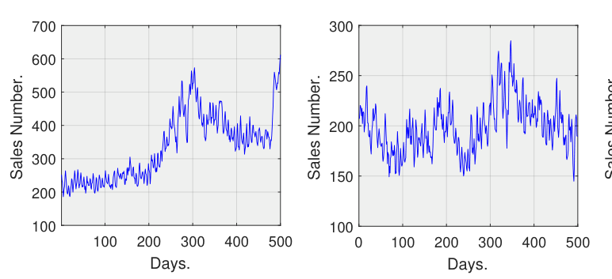
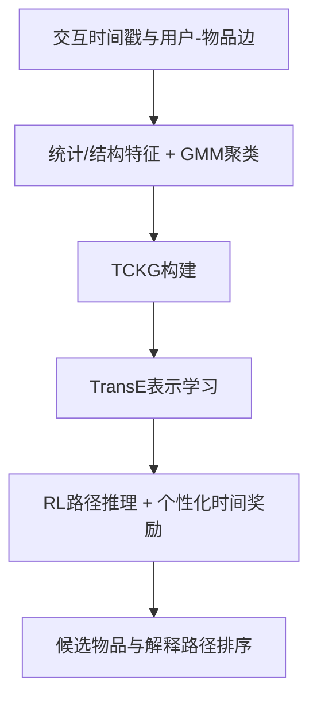
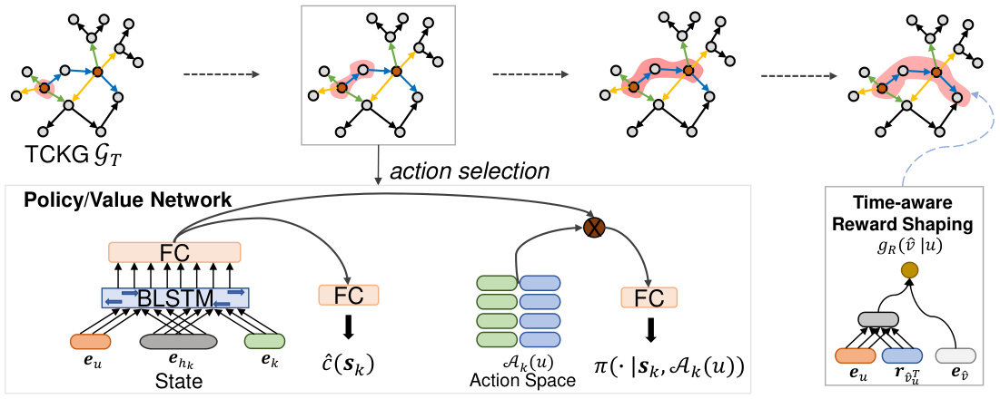

# Time-aware Path Reasoning on Knowledge Graph for Recommendation (面向推荐的时间感知知识图谱路径推理)

- **会议/期刊**: ACM Transactions on Information Systems (TOIS)
- **作者与机构**: Yuyue Zhao, Xiang Wang, Jiawei Chen, Yashen Wang, Wei Tang, Xiangnan He, Haiyong Xie; 中国科学技术大学等
- **推荐链路定位**: 召回（路径候选生成）+ 可解释排序
- **研究方向**: 图神经网络与知识图谱推荐 / 强化学习与动态探索推荐
- **论文原文**: [https://arxiv.org/abs/2108.02634v2](https://arxiv.org/abs/2108.02634v2)
- **开源代码**: [https://github.com/Go0day/TPRec](https://github.com/Go0day/TPRec)

## TL;DR (1分钟核心速览)

针对 PGPR/ADAC 等 KG 路径推理忽略购买/推荐时间、导致解释路径不合时宜的问题，TPRec 将交互时间戳映射为统计+结构特征并用 GMM 聚成有限时间关系，构建 TCKG；再用用户历史时间簇权重生成个性化奖励，引导 RL 在 TCKG 上搜索路径。Amazon 三数据集 @10 上，最佳变体较 ADAC 最高提升 14.71% NDCG、13.89% Recall，并提升解释 F1。

## Background & Motivation (背景与核心矛盾)

- **主流范式**: 基于协同知识图谱（CKG）的 RL 路径推理，以 PGPR、ADAC 为代表，用多跳路径同时完成推荐与解释。
- **前人局限**: 将用户-物品的 Purchase 边视为静态关系，忽略购买时间与推荐时间；同时原始时间戳数量巨大，且“线性时间距离”无法表达季节、购物节等行为相似性。
- **核心洞察 (Key Insight)**: Amazon 销售呈明显季节/节日周期（图 2）；同一季节跨年相似，购物节比邻近日期更相似，因此时间应作为“行为模式”而非普通特征。
- **本文切入点**: 把时间戳聚类为有限关系类型注入 KG，并将时间簇分布用于个性化奖励塑形。

<figure class="paper-figure" markdown="span">
  <figcaption>图 2. 三个 Amazon 数据集中的销售行为。</figcaption>
</figure>

## Method (核心方法设计)

### 1. 整体框架 (Overall Architecture)

TPRec 先做时间感知交互关系抽取：对每个时间戳构造统计与结构特征，GMM 聚成 $L$ 类，替换 CKG 中的 Purchase 边得到 TCKG；再用 TransE 学习实体/关系表示。随后 RL 智能体在 TCKG 上从用户出发，按策略采样下一跳；到达物品后用个性化时间奖励塑形。预测时把推荐时间映射到时间簇，生成推荐关系并排序候选物品及解释路径。

<figure class="paper-figure" markdown="span">
  <figcaption>图 4. 所提出 TPRec 模型的整体训练方法。对于每个时间步 𝑘 的用户 𝑢，如 TCKG 粉色阴影部分所示，智能体基于时间约束选择下一跳，即根据 𝜋(· | s𝑘, A𝑘(𝑢)) 采样一条链接 𝑎𝑘。智能体停在物品 ˆ𝑣 时获得奖励 𝑔𝑅(ˆ𝑣| 𝑢)。粉色阴影路径从用户 𝑢 开始并在物品 ˆ𝑣 结束，展示了我们的 TPRec 模型为何推荐</figcaption>
</figure>

### 2. 关键设计拆解 (Key Designs)

1. **时间感知交互关系抽取（TCKG）**：痛点是把每个时间戳当关系会导致关系爆炸，且线性时间距离语义模糊。本文将时间戳映射到 $T=f_{stat}\Vert f_{stru}$，其中$f_{stat}$拼接年/季/月/周，$f_{stru}$用$z'_{gap}(t)$、$z''_{gap}(t)$刻画销量趋势与动量；再用 GMM 得到$r_t=\mathcal{V}_U[\arg\max_l w_{t,l}]$，以 BIC 选$L$。这样聚类捕获的是季节/节日等行为模式，而非简单时间远近。

2. **个性化时间感知奖励**：标准路径奖励 $g(\hat v|u)=(e_u+r_{interact})^\top e_{\hat v}+b_{\hat v}$无法确定用户该用哪类$r_{interact}\in\mathcal{V}_U$。本文由历史$h_u$估计簇权重$w^l_{h_u}=\frac{1}{q}\sum_{i=1}^{q}\mathbb{I}(v_i^u=\mathcal{V}_U^l)$，构造$r_{\hat vTu}=W_{h_u}\mathcal{V}_U$，奖励为$g_R(\hat v|u)=(e_u+r_{\hat vTu})^\top e_{\hat v}+b_{\hat v}$。预测时同理用推荐时间$\hat T$得到$r_{W_{\hat T}}$，按$(e_u+r_{W_{\hat T}})^\top e_{\hat v}$ 排序。

3. **训练目标、负采样与推理效率**：TCKG 表示用 pairwise 损失 $\mathcal{L}_{tckg}=\sum_{(h,r,t,t')\in S}-\ln\sigma(g_r(h,t')-g_r(h,t))$，其中$g_r(h,t)=\|e_h+r-e_t\|_2^2$，负例为随机替换尾实体。RL 部分用 REINFORCE，BLSTM 编码状态，策略/价值网络输出动作概率与 baseline；动作空间剪枝至$\le250$，路径长 3、历史长 1。推理时采样$K_1=25,K_2=5,K_3=1$ 条路径后排序，RL 本身不做负采样。

## Experimental Setup & Evaluation Protocol (实验设置与评估协议)

- **数据集与预处理**: Amazon 三品类标准 `5-core` 数据，含用户评论、品牌/类目等 KG 边与时间戳。

| 数据集 | #Users | #Items | #Interactions | 密度 | 特征/场景说明 |
| :--- | :---: | :---: | :---: | :---: | :--- |
| Clothing | 39,387 | 23,033 | 278,677 | 0.031% | 服饰；时间簇 $L=24$，关系类型 77 |
| Cell Phones | 27,879 | 10,429 | 194,439 | 0.067% | 手机；$L=14$，关系类型 47 |
| Beauty | 22,363 | 12,101 | 198,502 | 0.073% | 美妆；$L=14$，关系类型 47 |

- **数据划分与防穿越**: 主实验随机取 70% 交互训练，训练集内再取 10% 验证，剩余 30% 测试；序列对比实验按用户序列前 60%/次 10%/后 30% 切分，存在 OOD 偏移。
- **排名评测协议**: 非全库 `Full-Ranking`；由 RL 路径采样生成候选集（$K_1=25,K_2=5,K_3=1$）后排序，报告$K=10$ 的 NDCG/Recall/HR/Precision。解释评估用评论词 TF-IDF 过滤后与路径词实体计算 Recall/Precision/F1。
- **对比基线与超参设置**: 对比 BPR、RippleNet、TransRec、PGPR、ADAC 及 GRU4Rec/BERT4Rec/SASRec/GC-SAN/NextItNet/SR-GNN/TimelyRec 等；$d=100$，时间特征维度$m=25$，路径长 3，历史长 1，动作空间$\le250$，lr=$10^{-4}$，batch=32，$\gamma=0.99$，三次重复$p<0.05$。

## Key Experimental Results (实验关键数据)

### 1. 主实验对比 (Main Results)

| 模型 | Clothing NDCG | Clothing Recall | Cell NDCG | Cell Recall | Beauty NDCG | Beauty Recall |
| :--- | :---: | :---: | :---: | :---: | :---: | :---: |
| BPR | 0.598 | 1.086 | 1.892 | 3.363 | 2.704 | 4.927 |
| RippleNet | 0.627 | 1.112 | 1.935 | 3.858 | 2.458 | 5.251 |
| TransRec | 1.245 | 2.078 | 3.361 | 6.279 | 3.218 | 4.853 |
| PGPR | 2.871 | 4.827 | 5.042 | 8.416 | 5.573 | 8.476 |
| ADAC | 3.048 | 5.027 | 5.220 | 8.943 | 6.080 | 9.424 |
| TPRec-$\boldsymbol{f}_{stru}$ | 3.074 | 5.132 | **5.988** | **10.185** | **6.185** | **9.582** |
| TPRec | **3.109** | **5.298** | 5.643 | 9.572 | 5.963 | 9.184 |
| Improv.% (最佳变体 vs ADAC) | +2.01 | +5.39 | +14.71 | +13.89 | +1.73 | +1.68 |

### 2. 消融实验 (Ablation Study)

| 变体 | Clothing P / R | Cell P / R | Beauty P / R |
| :--- | :---: | :---: | :---: |
| PGPR | 0.723 / 4.827 | 1.274 / 8.416 | 1.744 / 8.476 |
| w/o R（去个性化时间奖励） | 0.191 / 1.374 | 0.317 / 1.909 | 0.712 / 3.031 |
| w/o L（去BLSTM） | 0.786 / 5.205 | 1.450 / 9.534 | 1.927 / 9.200 |
| w/ $\boldsymbol{f}_{stru}$ | 0.778 / 5.132 | **1.528 / 10.185** | **2.023 / 9.582** |
| w/ $\boldsymbol{f}_{stat}$ | 0.781 / 5.144 | 1.471 / 9.714 | 1.928 / 9.227 |
| TPRec | **0.798 / 5.298** | 1.463 / 9.572 | 1.919 / 9.184 |

### 3. 关键实验发现 (Key Findings)

- **个性化时间奖励是命门**：去掉 $W_{h_u}$ 后，Cell 上 Precision/Recall 分别下降 78.3%/80.1%，甚至低于 PGPR；说明仅把时间聚成边类型不够，必须按用户历史差异化使用时间关系。
- **结构特征比统计特征更稳**：仅用 $f_{stru}$ 在 Cell/Beauty 上取得最佳 NDCG/Recall（5.988/10.185、6.185/9.582），因为销量趋势直接刻画购物节/周末等行为相似性；统计特征有噪声，仅在 Clothing 等场景作补充。
- **时间推理减少无效路径**：TPRec 的 invalid users 持续少于 PGPR，且对动作空间 $\epsilon$ 更鲁棒；Beauty 上 PGPR 仅 3 个 invalid users，故 TPRec 增益较小，而 Clothing/Cell 上 PGPR 有 24/29 个，时间信息的收益更大。

## Highlights & Limitations (亮点、对比与审稿批判)

- **与代表作对比 (vs. Prior Work)**: PGPR 在静态 CKG 上做路径推理，ADAC 用对抗 actor-critic 加速收敛但仍无时间意识；TPRec 的关键差异是把时间戳离散成 KG 关系并用历史簇权重塑形奖励，路径本身即可解释“为何此时推荐”。
- **可迁移亮点**: 时间戳 GMM 聚类为有限关系类型，可迁移到 POI、新闻、短视频等强周期场景；用用户历史簇分布构造个性化 reward，可迁移到其他 RL 召回/重排任务。
- **审稿级局限批判**: GMM 的 $L$ 依赖 BIC 且逐数据集调参，时间特征在噪声场景可能不稳；推理需路径采样与 RL rollout，开销高于静态向量召回，且主实验并非全库 Full-Ranking；解释评估仅用评论词重叠，缺少人工可信度评估。

## Rating (四维评分)

- **方法创新性 (Novelty)**: ⭐⭐⭐⭐ （首个将时间感知路径推理用于可解释推荐，时间关系抽取+个性化奖励组合有新意）
- **评估协议与实验扎实度 (Protocol & Experiments)**: ⭐⭐⭐⭐ （三 Amazon 5-core、四指标、显著性检验齐全；但路径采样排序与解释评估仍偏弱）
- **写作与数学规范度 (Clarity & Rigor)**: ⭐⭐⭐⭐ （模块与公式清晰；部分表格中完整 TPRec 与结构特征变体结论存在不一致，需读者自行辨析）
- **工业落地与复现价值 (Industrial & Practical Value)**: ⭐⭐⭐⭐ （代码开源、流程可复现；GMM+TransE 离线可行，RL 路径采样在线开销是主要工程门槛）

