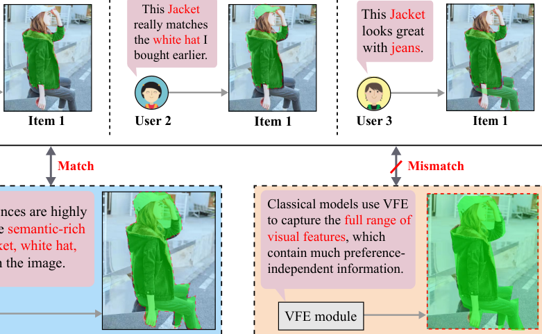
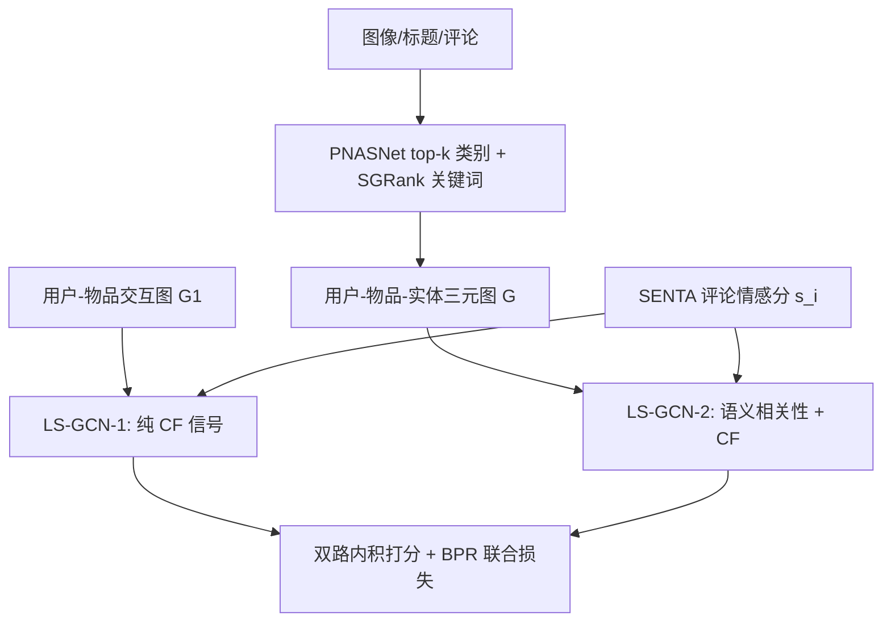
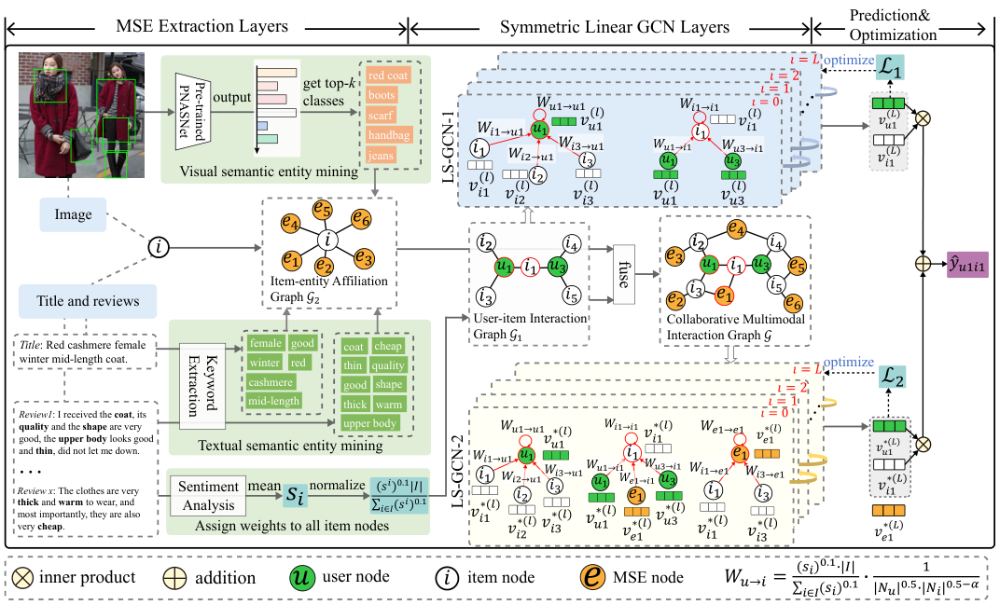

# MEGCF: Multimodal Entity Graph Collaborative Filtering for Personalized Recommendation (多模态实体图协同过滤)

- **会议/期刊**: ACM TOIS (arXiv 2022-10)
- **作者与机构**: Kang Liu, Feng Xue, Dan Guo, Le Wu, Shujie Li, Richang Hong（合肥工业大学）
- **推荐链路定位**: 召回（Top-K 排序）
- **研究方向**: 多模态推荐 / 图神经网络推荐
- **论文原文**: [论文原文链接](https://arxiv.org/abs/2210.07443v1)
- **开源代码**: [开源代码链接](https://github.com/hfutmars/MEGCF)

## TL;DR (1分钟核心速览)

多模态推荐的主流做法是把预训练 CNN 抽取的**完整深度视觉/文本特征**直接灌进用户兴趣建模，但 MFE 面向上游分类任务、是内容导向且非个性化的，与用户导向的 UIM 存在**失配**，引入大量偏好无关噪声并污染嵌入。MEGCF 改用"语义实体"替代稠密特征：从图像分类模型 top-k 类别与标题/评论关键词中抽取实体，挂接到用户-物品图上构成三元图，再用**情感加权 + 流行度感知归一化的对称线性 GCN** 双分支传播。在 Beauty/Art/Taobao 三数据集、留一法 + 1:99 采样排序协议下，NDCG@10 相对最强基线 GRCN 最高提升 8.87%，平均提升 4.40%。

## Background & Motivation (背景与核心矛盾)

- **主流范式**: 多模态推荐分 Separated Framework（VBPR/CKE/MMGCN，预抽取特征后注入 MF 或 GCN）与 End2end Framework（DVBPR/DeepCoNN，联合优化 CNN 与推荐模块）两类。
- **前人局限**: ① 完整深度特征是**内容导向**的，包含背景、亮度、相对位置等与偏好无关的信息，直接注入会污染嵌入；② EF 虽能用交互引导特征学习，但多模态推荐本就处在稀疏/冷启动场景，海量可学习参数难以优化，且训练与推理效率下降。
- **核心洞察 (Key Insight)**: 真正触发购买的是图像中**语义丰富的实体**（夹克、白帽子、牛仔裤），而非整幅图像的低层视觉统计量；评论中的**情感/质量信号**是典型的偏好相关文本特征。二者均可作为"用户导向"的多模态桥梁。
- **本文切入点**: 用离散语义实体 + 情感权重把 MFE 改造成偏好相关的过程，并通过 item 节点把多模态实体图与交互图缝合，用线性 GCN 同时捕获高阶语义相关性与 CF 信号。

<figure class="paper-figure" markdown="span">
  <figcaption>图 1. 一个示例，用于说明处理视觉内容时用户偏好与视觉特征提取（VFE）模块之间的不匹配，其中 VFE 通常是在大规模视觉数据集上预训练的卷积神经网络；用户 1、用户 2 和用户 3 是共同与项目 1 交互的用户。</figcaption>
</figure>

## Method (核心方法设计)

### 1. 整体框架 (Overall Architecture)

MEGCF 分三层：先做**多模态语义实体抽取**，视觉侧用 ImageNet 预训练 PNASNet 输出 1000 类概率取 top 类别作为视觉实体，文本侧对标题直接分词、对评论用 SGRank 抽关键词作为文本实体；随后以 item 为桥，把用户-物品二部图与物品-实体二部图融合为**用户-物品-实体三元图** $\mathcal{G}=\{(u,r_{ui},i),(i,r_{ie},e)\}$；再在该图与原始交互图上分别跑 LS-GCN-1 与 LS-GCN-2 两条对称线性图卷积分支，最后一层嵌入做双路内积求和打分，用两个 BPR 损失联合训练。

<figure class="paper-figure" markdown="span">
  <figcaption>图 3. 所提出 MEGCF 的示意图。目标用户和项目分别为 𝑢1 和 𝑖1，MSE 表示多模态语义实体，𝐿 为图卷积层的最大数量。</figcaption>
</figure>

### 2. 关键设计拆解 (Key Designs)

1. **语义实体图替代完整深度特征**：痛点是用 CNN 全量特征做 UIM 会放大偏好无关噪声（MMGCN 在 Art 上 NDCG 甚至弱于 NGCF，正是噪声被高阶传播放大的证据）。本文把多模态内容离散化为实体集合 $\mathcal{E}=\mathcal{E}_V\cup\mathcal{E}_T$与关联矩阵$r_{ie}$，使相似度可由新路径度量——原本无路径的$u_1,u_2$通过$\langle u_1,i_2,e_2,i_3,u_2\rangle$建立语义相关$C_{u_1u_2}$。直觉：实体是稀疏、可解释、与购买动机直接对齐的语义单元，等价于在抽取阶段就完成一次"去偏好无关信息"的过滤。

2. **情感加权 + 流行度感知归一化的对称线性 GCN**：痛点是 GCN 默认图拉普拉斯归一化只用度数（流行度）分配邻居权重，而 GAT 式自注意力只用交互、捕捉不到物品整体质量。本文先用 SENTA 计算物品平均情感分 $s_i=\frac{1}{|T_i|}\sum_{t\in T_i}f(t)$，再以静态权重$w_i=\frac{(s_i)^{\gamma}}{\sum_{i\in\mathcal{I}}(s_i)^{\gamma}}$（$\gamma=0.1$平滑）乘进聚合，并把归一化改为$w_i\cdot\frac{1}{|N_u|^{0.5}|N_i|^{0.5-\alpha}},\ \alpha\in(0,0.5)$，$\alpha$ 越大越敏感于流行度：
$\boldsymbol{v}_u^{(l)}=\sum_{i\in N_u\cup\{u\}}w_i\,|N_u|^{-0.5}|N_i|^{-(0.5-\alpha)}\,\boldsymbol{v}_i^{(l-1)}$。
LS-GCN-2 中 item 还需按邻居类型拆分为用户邻居与实体邻居两路求和，避免异质消息混叠。线性结构去掉非线性与权重矩阵，保证高阶信号可传播；情感权重是**静态无参**的，不像 GAT 引入额外参数导致后期过拟合。

3. **训练目标、负采样与推理效率**：双分支各自建 BPR 损失 $\mathcal{L}_1$（交互图）与$\mathcal{L}_2$（三元图），总损失$\mathcal{L}=\mathcal{L}_1+\mathcal{L}_2$，负样本采用均匀采样（每正样本 1 个未交互 item）。打分函数为$\hat{y}_{ui}=(\boldsymbol{v}_u^{(L)})^{\top}\boldsymbol{v}_i^{(L)}+(\boldsymbol{v}_u^{*(L)})^{\top}\boldsymbol{v}_i^{*(L)}$。训练复杂度约$O\!\left(2(|E|+|E_m|)Lds|E|/B+4|E|ds\right)$，即卷积部分随边数近似翻倍、BPR 部分为 LightGCN 的 2 倍，推理仍是纯内积召回，无在线额外开销。

## Experimental Setup & Evaluation Protocol (实验设置与评估协议)

- **数据集与预处理**: 三个数据集全部采用 `5-core` 过滤：

| 数据集 | #Users | #Items | #Interactions | 稀疏度/密度 | 特征/场景说明 |
| :--- | :---: | :---: | :---: | :---: | :--- |
| Beauty (Amazon) | 15,576 | 8,678 | 139,318 | 0.00103 | 图+标题+评论，视觉/文本实体 1,080 / 11,450 |
| Art (Amazon) | 25,165 | 9,324 | 201,427 | 0.00086 | 图+标题+评论，实体 962 / 11,215 |
| Taobao | 12,539 | 8,735 | 83,648 | 0.00076 | 图+标题（**无评论**，故不加情感权重） |

- **数据划分与防穿越 (Splitting Strategy)**: `Leave-One-Out` —— 每用户随机 1 个物品为测试、1 个为验证、其余训练。
- **排名评测协议 (Ranking Protocol)**: `Sampled Ranking`，每用户随机采 **99 个未交互物品**（正负比 1:99）参与排序，报告 HR@{5,10,20} 与 NDCG@{5,10,20}；**未使用 Full-Ranking 全库排序**。
- **对比基线与超参设置**: 基线覆盖 MF 类（BPRMF、SVD++）、多模态分离式（VBPR、CKE、MMGCN）、GCN-CF（NGCF、LightGCN）与多模态 GCN SOTA（GRCN）。所有方法嵌入维度 $d=64$、batch=2048，学习率搜$\{10^{-4},\dots,1\}$，$L_2$系数搜$\{10^{-5},\dots,1\}$，GCN 层数搜$\{1,\dots,6\}$，Xavier 初始化。

## Key Experimental Results (实验关键数据)

### 1. 主实验对比 (Main Results)

| 模型 | Beauty HR@10 | Beauty NDCG@10 | Art NDCG@10 | Taobao HR@10 | Taobao NDCG@10 |
| :--- | :---: | :---: | :---: | :---: | :---: |
| BPRMF | 0.5173 | 0.3634 | 0.5829 | 0.4049 | 0.2733 |
| SVD++ | 0.5520 | 0.3895 | 0.5916 | 0.4293 | 0.2819 |
| VBPR | 0.5670 | 0.3973 | 0.6078 | 0.4364 | 0.2928 |
| CKE | 0.5894 | 0.4002 | 0.6030 | 0.4550 | 0.2941 |
| NGCF | 0.5820 | 0.4089 | 0.6141 | 0.4593 | 0.2986 |
| MMGCN | 0.6067 | 0.4081 | 0.5945 | 0.4695 | 0.3047 |
| LightGCN | 0.6063 | 0.4152 | 0.6153 | 0.4893 | 0.3176 |
| GRCN | 0.6204 | 0.4272 | 0.6208 | 0.4996 | 0.3225 |
| **MEGCF** | **0.6464** | **0.4590** | **0.6398** | **0.5212** | **0.3397** |
| Improv.% (vs. GRCN) | +4.19% | +7.44% | +3.06% | +4.32% | +5.33% |

### 2. 消融实验 (Ablation Study)

| 变体 | Beauty HR@20 | Beauty NDCG@20 | Art HR@20 | Art NDCG@20 | Taobao HR@20 | Taobao NDCG@20 |
| :--- | :---: | :---: | :---: | :---: | :---: | :---: |
| w/o V&T | 0.7105 | 0.4391 | 0.8250 | 0.6327 | 0.6329 | 0.3549 |
| w/o V | 0.7271 | 0.4589 | 0.8466 | 0.6391 | 0.6362 | 0.3603 |
| w/o T | 0.7118 | 0.4574 | 0.8421 | 0.6383 | 0.6316 | 0.3617 |
| w/o $g_1$ | 0.7093 | 0.4415 | 0.8314 | 0.6340 | 0.6244 | 0.3557 |
| w/o $g_2$ | 0.7345 | 0.4400 | 0.8448 | 0.6304 | 0.6217 | 0.3540 |
| w/o $\mathcal{L}_1$ | 0.7171 | 0.3930 | 0.8455 | 0.5504 | 0.6355 | 0.3030 |
| w/o $\mathcal{L}_2$ | 0.7214 | 0.4522 | 0.8139 | 0.6173 | 0.6387 | 0.3587 |
| w/o PN | 0.7358 | 0.4763 | 0.8557 | 0.6493 | 0.6404 | 0.3665 |
| **MEGCF** | **0.7448** | **0.4838** | **0.8651** | **0.6588** | **0.6516** | **0.3726** |

### 3. 关键实验发现 (Key Findings)

1. **语义实体主要改善"排序"而非"命中"**：去掉全部多模态实体后，Beauty 的 HR@20 从 0.7448 降至 0.7105（−4.6%），而 NDCG@20 从 0.4838 降至 0.4391（−9.2%），降幅约为前者的两倍；这解释了主表中 MEGCF 的 NDCG 提升（+7.44%）系统性高于 HR 提升（+4.19%），说明语义相关性帮助模型把真正感兴趣的物品推到列表更前位置。
2. **双分支互补而非冗余**：仅保留 $g_1$（纯 CF）得 0.7093/0.4415，仅保留$g_2$（语义+CF）得 0.7345/0.4400，二者在 HR 与 NDCG 上各有胜场，说明$g_2$中的 CF 信号只是语义传播的"辅助项"、纯度低于$g_1$，必须双路并存；去掉$\mathcal{L}_1$ 会使 Art 的 NDCG@20 崩至 0.5504（−16.4%），说明缺了纯 CF 监督，语义分支无法独立支撑排序。
3. **情感加权可迁移且在小 $k$与 NDCG 上收益更大**：把同一情感权重移植到其它 GCN，Beauty HR@5 上 NGCF 提升 0.52%、LightGCN 提升 0.76%、MMGCN 提升 0.95%；而在双分支的 MEGCF 上提升达 2.01%（w/o S 0.5332 → 0.5439），NDCG@5 提升 2.95%，验证"两个分支各自受益"的叠加效应，也说明静态情感权重优于 GAT 自注意力（$\text{MEGCF}_{gat}$ 曲线与 w/o S 接近，且 700 epoch 后因参数增多而轻微过拟合下降）。

## Highlights & Limitations (亮点、对比与审稿批判)

- **与代表作对比 (vs. Prior Work)**: 与 VBPR/CKE/MMGCN 的本质差异在于**不用完整深度特征**，而是用离散语义实体做"信息瓶颈式"过滤；与 GRCN 的差异在于 GRCN 只把多模态特征用于加权低阶聚合，MEGCF 则让实体进入图结构参与高阶传播并叠加情感权重；与 LightGCN 相比多了语义分支与流行度可调归一化。
- **可迁移亮点**: ① "预训练分类器 top-k 类别 + 关键词抽取"这一零标注实体化管线，可低成本迁移到短视频标签、图文电商类目增强；② 评论情感分作为静态邻居权重，不增加任何可学习参数即可为任意 GCN 变体加权，适合工业侧快速试水。
- **审稿级局限批判**: ① 实体抽取精度受限于上游 ImageNet 1000 类分类器，存在错检/漏检，且推荐数据无标注难以微调，实体粒度粗（"coat""jeans"级别），对细粒度品类（如美妆色号）可能失效；② 评估仅用 1:99 采样排序而非 Full-Ranking，指标偏乐观，且缺乏线上 A/B 与推理时延实测；训练复杂度随实体边数近似翻倍，实体表规模增长时图存储与传播开销需重新评估。此外 Taobao 无评论，情感模块在该数据集上实际未被验证。

## Rating (四维评分)

- **方法创新性 (Novelty)**: ⭐⭐⭐⭐ （"MFE-UIM 失配"问题定义清晰且切中多模态推荐痛点，实体图+情感静态加权组合新颖，但线性 GCN 与 BPR 主体沿用 LightGCN 范式）
- **评估协议与实验扎实度 (Protocol & Experiments)**: ⭐⭐⭐ （三数据集 + 8 基线 + 6 组消融较完整，但仅 1:99 采样排序、无全库排序与显著性检验、无线上验证）
- **写作与数学规范度 (Clarity & Rigor)**: ⭐⭐⭐⭐ （公式推导与复杂度分析清楚，符号统一，情感权重与 PN 归一化的作用解释到位；$\gamma$、$\alpha$ 敏感性分析略简）
- **工业落地与复现价值 (Industrial & Practical Value)**: ⭐⭐⭐⭐ （代码与数据全开源，实体抽取可离线预处理、推理仍为内积召回，工程改造成本低，适合作为多模态召回基线）

