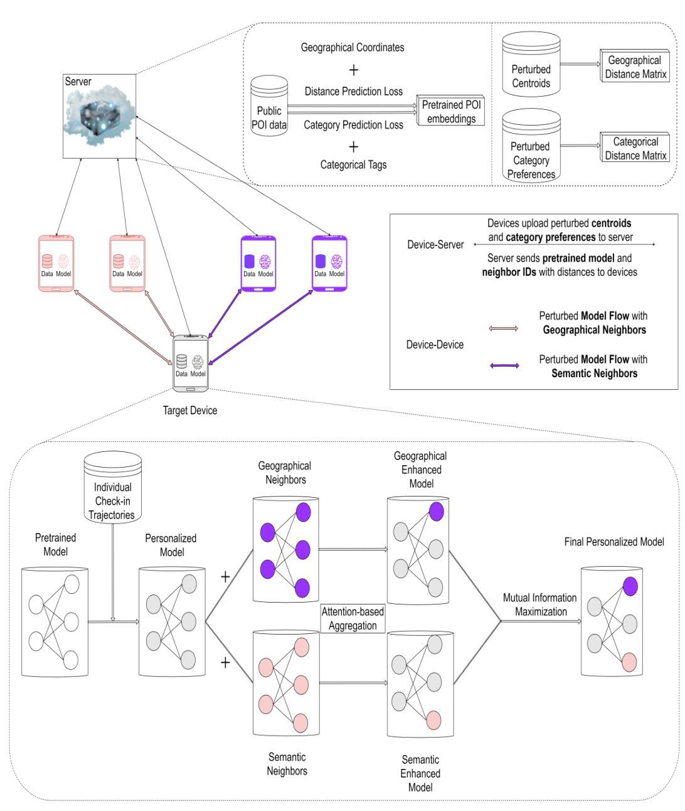
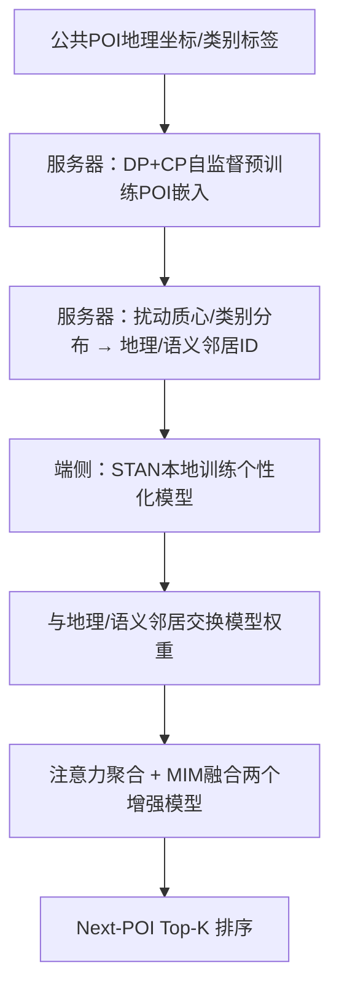

# Decentralized Collaborative Learning Framework for Next POI Recommendation (面向下一 POI 推荐的去中心化协同学习框架)

- **会议/期刊**: TOIS 2023
- **作者与机构**: Jing Long, Tong Chen, Nguyen Quoc Viet Hung, Hongzhi Yin；The University of Queensland / Griffith University
- **推荐链路定位**: 端侧召回/个性化精排（Next-POI Top-K 排序）
- **研究方向**: 时空轨迹与POI本地生活推荐 / 自监督对比学习与交互去噪
- **论文原文**: [论文原文链接](https://arxiv.org/abs/2204.06516v4)
- **开源代码**: 暂未开源

## TL;DR (1分钟核心速览)

针对集中式 Next-POI 依赖云端、端侧数据稀疏且联邦聚合仍重的问题，DCLR 下沉模型到设备：服务器仅用公共地理/类别信息自监督预训练并下发扰动邻居 ID；端侧以 STAN 本地训练，按地理/语义双邻居注意力聚合，再用 MIM 融合。Weeplace/Yelp 的 1:200 采样排序下，DCLR 超 DMF、LLRec、PREFER，较 STAN 提升 1.0–2.2% / 2.9–5.5%。

## Background & Motivation (背景与核心矛盾)

- **主流范式**: 云端集中式 STAN/RNN/GNN 用全量轨迹训练；端侧 DMF/LLRec/PREFER 分别用地理邻居、教师蒸馏、联邦聚合。
- **前人局限**: 集中式存在隐私、资源与网络脆弱性；端侧个体轨迹极稀疏，DMF 仅地理邻居、LLRec 共享压缩模型、PREFER 云端聚合全局模型仍重且忽略个性化。
- **核心洞察 (Key Insight)**: POI 的地理坐标与类别标签是公开且相对稠密的侧信息；用户相似性可由多质心地距和类别分布 KL 刻画；地理与语义两类邻居知识互补。
- **本文切入点**: 服务器只做公共数据预训练 + 隐私感知邻居发现，设备间交换模型并以 MIM 融合双邻居。

## Method (核心方法设计)

### 1. 整体框架 (Overall Architecture)

整体闭环分三段：①服务器用 POI 坐标与类别标签，以距离预测（DP）和类别预测（CP）预训练 POI 嵌入；②服务器接收用户扰动的多质心与类别分布，计算地理/语义距离，下发 q 个邻居 ID；③每台设备加载预训练 STAN，用本地签到序列优化，再分别与两类邻居做亲和力加权聚合，得到 $\Theta_n^{geo}$与$\Theta_n^{cat}$，用 MIM 互学习后平均为最终个性化模型，推理只在端侧对候选 POI 打分排序。整体流程如图1所示。

图1：DCLR 总体框架（端侧存轨迹，服务器仅预训练与邻居发现）。

<figure class="paper-figure" markdown="span">
  <figcaption>图1. 我们提出的DCLR概览。所有个体签到轨迹存储在设备端。服务器负责提供使用公共数据（即POI的地理坐标和类别标签）预训练的模型参数，并以隐私保护方式为每个客户端识别邻居。在接收到预训练模型和邻居ID后，每个设备首先利用个体签到数据优化个性化模型，并进一步利用来自两类邻居的知识增强模型。</figcaption>
</figure>

### 2. 关键设计拆解 (Key Designs)

1. **双自监督 POI 预训练**：端侧单用户轨迹过稀，STAN 直接本地训练易过拟合。服务器用公开坐标与类别：DP 将 POI 对距离分 3 档，$\hat{\mathbf{y}}_{ij}=\mathrm{Softmax}(\mathbf{w}_{DP}(\mathbf{e}_{p_i}^{\top}\mathbf{e}_{p_j}))$，$\mathcal{L}_{DP}=-\sum_{p_i,p_j}\sum_{l=1}^{3}y_{ijl}\log\hat{y}_{ijl}$；CP 把 POI 与类别视作两视图，$f_{CP}(p,c)=\sigma(\mathbf{e}_p^{\top}\mathbf{W}_{CP}\mathbf{e}_c)$，以 InfoNCE 最大化互信息。直觉：类别交互更密，距离约束刻画移动转移，二者为稀疏端侧模型提供强先验。

2. **隐私感知双邻居发现**：若只看地理，跨城兴趣用户会漏；只看语义，又忽略物理可达性。服务器对每个用户访问 POI 做 k-means 得多质心，$d_{geo}(u_n,u_m)=\min_{o_n\in O(u_n),o_m\in O(u_m)}\mathrm{Haversine}(o_n,o_m)$；类别分布用 KL，$d_{cat}(u_n,u_m)=\sum_c cp_{n,c}\log(cp_{n,c}/cp_{m,c})$。取各 q 近邻并只上传扰动质心/分布（$\mathrm{Lap}(\Delta f/\epsilon)$），避免原始轨迹出端。

3. **注意力聚合 + MIM 融合**：两类邻居知识异质，直接平均会丢信息。先按亲和力 $s(u_n,u_m)=1/(1+d_{geo}(u_n,u_m))$归一化得$w(\Theta_m)$，$\Theta_n^{geo}\leftarrow(1-\mu)\Theta_n+\mu\sum_m w(\Theta_m)\Theta_m$，语义侧同理；再对同 POI 双视图嵌入做 InfoNCE：$\mathcal{L}_{comb}=-\sum_i\log\frac{\exp(f_{comb}(\mathbf{e}^{geo}_{p_i},\mathbf{e}^{cat}_{p_i}))}{\sum_{j\neq i}\exp(f_{comb}(\mathbf{e}^{geo}_{p_i},\mathbf{e}^{cat}_{p_j}))+\sum_{j'\neq i}\exp(f_{comb}(\mathbf{e}^{geo}_{p_{j'}},\mathbf{e}^{cat}_{p_i}))}$，最后$\Theta_u=(\Theta_u^{geo}+\Theta_u^{cat})/2$。训练：预训练$\mathcal{L}_{DP}+\mathcal{L}_{CP}$，端侧$\mathcal{L}_{POI}$，融合$\mathcal{L}_{comb}$；负采样数 5；推理只端侧打分，MIM 仅聚合时约增 6 秒/用户/轮，不影响推理。

## Experimental Setup & Evaluation Protocol (实验设置与评估协议)

- **数据集与预处理**: 过滤签到少于 10 的用户与访问少于 10 的 POI；两数据集均含 NY/LA/Chicago 三城签到。

| 数据集 | #Users | #POIs | #Interactions | 稀疏度/密度 | 特征/场景说明 |
| :--- | :---: | :---: | :---: | :---: | :--- |
| Weeplace | 4504 | 35675 | 886408 | 0.552% | LBSN 签到，450 类 POI |
| Yelp | 6070 | 46527 | 951832 | 0.337% | LBSN 签到，428 类 POI |

- **数据划分与防穿越 (Splitting Strategy)**: `Leave-One-Out` 序列划分：每条序列最后 1 个 POI 测试、倒数第 2 个验证、其余训练；最大序列长度 200。
- **排名评测协议 (Ranking Protocol)**: `Sampled Ranking`，每个 ground truth 配 200 个“距最后签到最近”的未访问 POI，候选集 201，1:200 正负比，报告 HR@5/10、NDCG@5/10；不是全库 Full-Ranking。
- **对比基线与超参设置**: 集中式 POP/DIS/MF/LSTM/STAN，端侧 DMF/LLRec/PREFER；主表保留 6 个代表性基线。$d=32$，$q=30$，$\mu=0.3$默认（Yelp 敏感最优 0.5），$\epsilon=0.1$，lr 0.002，dropout 0.2，batch 16，epoch 50，$N_{neg}=5$。原文未报告显著性检验。

## Key Experimental Results (实验关键数据)

### 1. 主实验对比 (Main Results)

| 方法 | Wee HR@5 | Wee NDCG@5 | Wee HR@10 | Wee NDCG@10 | Yelp HR@5 | Yelp NDCG@5 | Yelp HR@10 | Yelp NDCG@10 |
| :--- | :---: | :---: | :---: | :---: | :---: | :---: | :---: | :---: |
| MF | 0.1493 | 0.1035 | 0.1966 | 0.1387 | 0.1312 | 0.0897 | 0.1534 | 0.0996 |
| LSTM | 0.3368 | 0.2256 | 0.4430 | 0.2926 | 0.2763 | 0.1893 | 0.3765 | 0.2399 |
| STAN | 0.4398 | 0.3017 | 0.5512 | 0.3818 | 0.4155 | 0.2889 | 0.5201 | 0.3521 |
| DMF | 0.1741 | 0.1577 | 0.2374 | 0.1984 | 0.1769 | 0.1125 | 0.1991 | 0.1252 |
| LLRec | 0.4117 | 0.2733 | 0.5022 | 0.3421 | 0.4124 | 0.2726 | 0.4935 | 0.3461 |
| PREFER | 0.4285 | 0.2989 | 0.5297 | 0.3761 | 0.4263 | 0.2880 | 0.5180 | 0.3595 |
| **DCLR** | **0.4452** | **0.3083** | **0.5569** | **0.3861** | **0.4388** | **0.3031** | **0.5466** | **0.3794** |

相对各数据集最优基线，DCLR 的 `Improv.` 为 Weeplace +1.23%/+2.19%/+1.03%/+1.13%，Yelp +2.93%/+4.92%/+5.09%/+5.54%（按 HR@5/NDCG@5/HR@10/NDCG@10 顺序）。

### 2. 消融实验 (Ablation Study)

| 变体 | Wee HR@10 | Wee NDCG@10 | Yelp HR@10 | Yelp NDCG@10 |
| :--- | :---: | :---: | :---: | :---: |
| **DCLR** | **0.5569** | **0.3861** | **0.5466** | **0.3794** |
| w/o CP | 0.5253 | 0.3584 | 0.5139 | 0.3593 |
| w/o DP | 0.5027 | 0.3498 | 0.4951 | 0.3433 |
| w/o AN | 0.3183 | 0.2450 | 0.3491 | 0.2252 |
| w/o GN | 0.3959 | 0.3033 | 0.4282 | 0.2746 |
| w/o SN | 0.4135 | 0.3199 | 0.4534 | 0.2979 |
| w/o MIM | 0.5251 | 0.3741 | 0.5123 | 0.3597 |
| w/o PP | 0.5746 | 0.4059 | 0.5648 | 0.3878 |

### 3. 关键实验发现 (Key Findings)

- 去除全部邻居（w/o AN）使 Weeplace HR@10 从 0.5569 降至 0.3183、Yelp 从 0.5466 降至 0.3491，平均降 39%，说明端侧协同交换是主增益；仅地理/仅语义分别平均降 24%/20%，地理邻居略更重要。
- 自监督中 w/o DP 平均降 9%、w/o CP 平均降 6%，距离预测比类别预测更关键；二者把公开地理/类别先验注入 POI 嵌入，缓解单设备稀疏。
- MIM 相较简单平均（w/o MIM）平均降 7%（Wee HR@10 0.5569→0.5251）；去掉差分隐私（w/o PP）仅平均升 3%，表明 $\epsilon=0.1$ 以很小精度代价换取强隐私。

## Highlights & Limitations (亮点、对比与审稿批判)

- **与代表作对比 (vs. Prior Work)**: DMF 仅用随机游走地理邻居 + MF；本文双邻居 + 自监督 + MIM。LLRec 共享云端压缩模型，本文全个性化端侧模型。PREFER 联邦仍需云端聚合全局模型，本文服务器只预训练和发邻居 ID。
- **可迁移亮点**: 用公开 side-info 做端侧预训练；多质心 + KL 的隐私邻居发现；双视图 MIM 融合异质邻居，可迁移到端侧序列推荐与联邦多源知识融合。
- **审稿级局限批判**: 评估为 1:200 最近邻采样排序而非全库，未报告显著性；服务器仍收扰动质心/类别分布，弱 $\epsilon$下隐私与效用需权衡；$q=30$模型交换通信线性于$|P|$，MIM 端侧开销约 6 秒/用户/轮，且仅两数据集验证。

## Rating (四维评分)

- **方法创新性 (Novelty)**: ⭐⭐⭐⭐ （端侧去中心化 + 地理/语义双邻居 + MIM 融合的组合较新，但基座 STAN 与 InfoNCE 非全新）
- **评估协议与实验扎实度 (Protocol & Experiments)**: ⭐⭐⭐ （Leave-One-Out 与多基线完整，但 1:200 最近邻采样排序非全库且无显著性检验）
- **写作与数学规范度 (Clarity & Rigor)**: ⭐⭐⭐⭐ （模块、公式与算法流程清晰，复杂度分析完整；差分隐私敏感度推导略简）
- **工业落地与复现价值 (Industrial & Practical Value)**: ⭐⭐⭐ （隐私友好、服务器依赖低，但无开源代码，端侧模型交换与 MIM 开销需工程优化）

