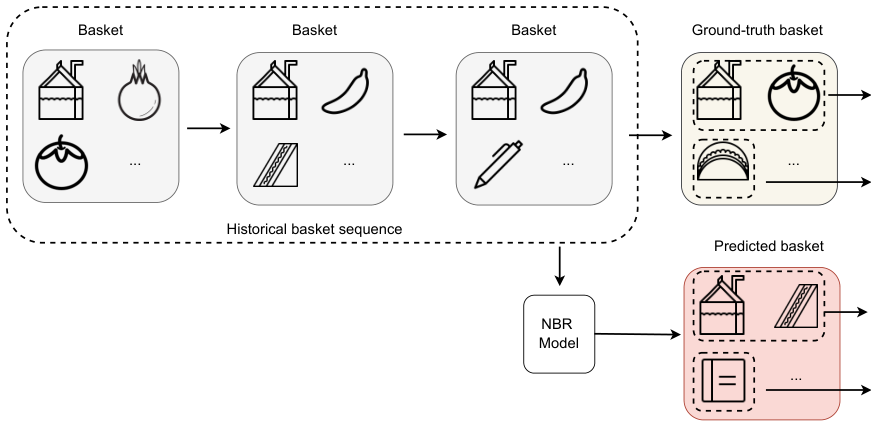
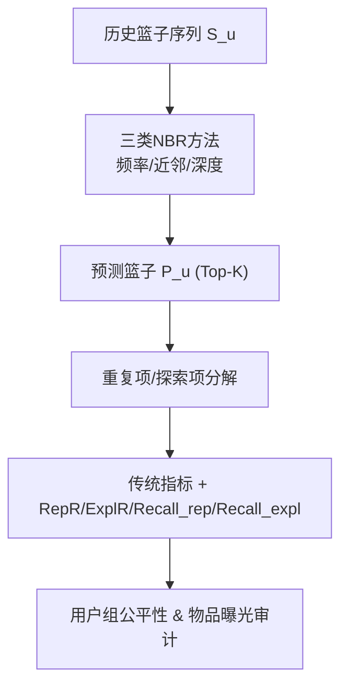

# A Next Basket Recommendation Reality Check (下一购物篮推荐的真实性检验)

- **会议/期刊**: ACM TOIS 2023 (ACM Transactions on Information Systems)
- **作者与机构**: Ming Li, Sami Jullien, Mozhdeh Ariannezhad, Maarten de Rijke; University of Amsterdam, AIRLab
- **推荐链路定位**: 召回/推荐评估协议（篮子级生成）
- **研究方向**: 序列与会话推荐 / 去偏公平与可信评估
- **论文原文**: [论文原文链接](https://arxiv.org/abs/2109.14233v2)
- **开源代码**: [开源代码仓库链接](https://github.com/liming-7/A-Next-Basket-Recommendation-Reality-Check)

## TL;DR (1分钟核心速览)

本文质疑NBR深度模型的真实增益：统一复现频率、近邻、深度三类方法，提出重复/探索分解指标与新基线GP-TopFreq，在TaFeng/Dunnhumby/Instacart全物品Top-K排序下发现无方法一致最优；相对GP的Recall@10增益仅约1.3%–26.0%，且多数提升来自重复项而非复杂表征。

## Background & Motivation (背景与核心矛盾)

- **主流范式**: NBR按用户篮子序列预测下一篮，主流从G/P-TopFreq、TIFUKNN/UP-CF@r到Dream/Sets2Sets/DNNTSP等深度篮子表征。
- **前人局限**: 深度方法多只比G-TopFreq，忽略更强的P/GP；数据集、指标与划分不一致，甚至使用采样指标；只报整体分数，不看推荐篮由重复项还是探索项构成。
- **核心洞察 (Key Insight)**: 下一篮通常由重复项与探索项混合构成；重复项更易预测，数据集重复率会放大“进步”，模型偏向重复项即可在平均指标上占优。
- **本文切入点**: 在同一协议下复现8篇代表方法，补GP-TopFreq基线，用任务特定RepR/ExplR与Recall_rep/Recall_expl重审NBR。

<figure class="paper-figure" markdown="span">
  <figcaption>图1. 下一购物篮推荐中的四类物品。</figcaption>
</figure>
图1：下一购物篮中的四类物品（历史/真值/预测 × 重复/探索）。

## Method (核心方法设计)

### 1. 整体框架 (Overall Architecture)

本文不是新排序器，而是可复现评估框架：按用户72/8/20独立划分并重复5次，固定篮子大小$K\in\{10,20\}$；对频率、近邻、深度三类NBR方法用原代码/原超参训练与推理；将预测篮$P_u$与真值$T_u$按历史交互拆为重复/探索子集，同时计算Recall/NDCG/PHR与RepR/ExplR/Recall_rep/Recall_expl，再做用户组与物品曝光审计。

### 2. 关键设计拆解 (Key Designs)

1. **GP-TopFreq基线（校准频率基线）**：P-TopFreq只从用户历史取TopK，当用户历史唯一项不足K时留下空槽；原文表2显示$K=10$仍用92.39%–96.70%槽，$K=20$降至79.71%–90.48%，与深度方法比较不公平。做法是先取$P^{\text{pers}}_u=\text{TopK}(S_u)$，剩余槽用全局流行$G=\text{TopK}(\mathcal{I})$补齐，即$P_u=P^{\text{pers}}_u\cup G_{\text{fill}}$。直觉：同时校准个性化重复与全局探索，成为“真实增益”基线。

2. **重复/探索审计指标（分解整体Recall）**：定义$P_u=P^{\text{rep}}_u\cup P^{\text{expl}}_u$，$I^{\text{rep}}_{u,t}=\cup_{\tau\le t}B_{u,\tau}$，$I^{\text{expl}}_{u,t}=\mathcal{I}\setminus I^{\text{rep}}_{u,t}$；$\text{RepR}=\frac{1}{N}\sum_j|P^{\text{rep}}_{u_j}|/K$，ExplR同理。再分别算Recall_rep/Recall_expl与PHR_rep/PHR_expl。直觉：定位性能来自重复记忆还是探索泛化，而非只看总Recall。

3. **训练目标、负采样与推理效率**：本文无统一新损失，沿用各方法原损失与原训练负采样/采样策略；评估为全物品打分取Top-K，未用采样排序。推理开销随各方法而变：频率基线无需训练，DNNTSP需图+自注意力训练，复现成本高。

## Experimental Setup & Evaluation Protocol (实验设置与评估协议)

- **数据集与预处理**: 用户篮子长度限定3–50；移除稀有/不流行物品，保留后覆盖>95%交互。

| 数据集 | #Users | #Items | #Interactions | 平均篮长 | 平均篮数 | 重复/探索比 | 稀疏度 |
| :--- | :---: | :---: | :---: | :---: | :---: | :---: | :---: |
| TaFeng | 13,858 | 11,997 | 未报告 | 6.27 | 6.58 | 0.188/0.812 | — |
| Dunnhumby | 22,530 | 3,920 | 未报告 | 7.45 | 9.53 | 0.409/0.591 | — |
| Instacart | 19,435 | 13,897 | 未报告 | 9.61 | 13.21 | 0.597/0.403 | — |

- **数据划分与防穿越 (Splitting Strategy)**: 按用户划分72%/8%/20%训练/验证/测试，用户互不重叠，重复5次独立实验；沿用NBR常用策略，不做全局时间戳切分，避免切断篮子序列。
- **排名评测协议 (Ranking Protocol)**: 全物品打分后取Top-K（$K=10/20$），未采用采样负例排序；报告用户平均Recall/NDCG/PHR及分解指标。
- **对比基线与超参设置**: 三类共10个方法：G/P/GP-TopFreq、TIFUKNN、UP-CF@r、Dream、Beacon、CLEA、Sets2Sets、DNNTSP；严格沿用原论文/仓库超参，UP-CF@r网格搜索，TIFUKNN用建议最优参数；配对t检验$p<0.05$。

## Key Experimental Results (实验关键数据)

### 1. 主实验对比 (Main Results)

| 方法 | TaFeng R@10 | Dunnhumby R@10 | Instacart R@10 |
| :--- | :---: | :---: | :---: |
| G-TopFreq | 0.0831 | 0.0982 | 0.0710 |
| P-TopFreq | 0.1069 | 0.2319 | 0.3260 |
| GP-TopFreq | 0.1211 | 0.2356 | 0.3269 |
| UP-CF@r | 0.1249 | **0.2428** | 0.3506 |
| TIFUKNN | 0.1251 | 0.2396 | **0.3601** |
| Dream | 0.1134 | 0.0950 | 0.0712 |
| Sets2Sets | 0.1349 | 0.1691 | 0.2125 |
| DNNTSP | **0.1526** | 0.2404 | 0.3330 |

加粗为该数据集最优；原文用*标注显著优于次优（paired t-test, $p<0.05$）。最优相对GP的Recall@10增益：TaFeng DNNTSP +26.0%，Dunnhumby UP-CF@r +3.1%，Instacart TIFUKNN +10.1%；但DNNTSP对GP在Dunn/Instacart仅约2%以内（原文口径1.3%/1.9%）。

### 2. 消融实验 (Ablation Study)

原文无传统组件消融；以重复/探索分解与GP校准替代。下表为Recall_rep/Recall_expl@10。

| 方法 | TaFeng Rep/Expl | Instacart Rep/Expl |
| :--- | :---: | :---: |
| G-TopFreq | 0.1268/0.0573 | 0.1002/0.0382 |
| P-TopFreq | 0.5234/0.0000 | 0.5388/0.0000 |
| GP-TopFreq | 0.5234/0.0157 | 0.5388/0.0014 |
| CLEA | 0.1442/0.0935 | 0.1715/0.0337 |
| Sets2Sets | 0.5647/0.0271 | 0.3515/0.0005 |
| DNNTSP | 0.5291/0.0556 | 0.5477/0.0018 |
| TIFUKNN | 0.5616/0.0176 | **0.5931**/0.0018 |
| UP-CF@r | **0.6046**/0.0086 | 0.5805/0.0011 |

### 3. 关键实验发现 (Key Findings)

1. **无一致赢家，GP校准后增益缩水**：TaFeng上DNNTSP R@10=0.1526，较GP的0.1211提升26.0%；但Dunn/Instacart对GP仅约1.3%–1.9%（原文口径），且Dunn最佳为UP-CF@r 0.2428、Instacart最佳为TIFUKNN 0.3601，深度方法并未全面胜出。
2. **重复项主导且更易**：Instacart上TIFUKNN的Recall_rep=0.5931，而Recall_expl=0.0018，差距约329倍；Dunn/Instacart上TIFUKNN/UP-CF@r/DNNTSP的重复正确项贡献>97%。Dream/Beacon/CLEA探索偏置，在Dunn R@10仅0.0950/0.0995/0.1552，均低于GP的0.2356。
3. **用户组与物品曝光双重不公**：TaFeng重复率(0.8,1]用户仅占5.5%，却贡献18.8%–36.8%平均性能；Dunn[0,0.2]用户占31.4%，重复偏置方法CAP仅3.1%–5.0%。物品端头部少量物品占据大部分曝光，CLEA等在TaFeng给大量物品零曝光。

## Highlights & Limitations (亮点、对比与审稿批判)

- **与代表作对比 (vs. Prior Work)**: Dacrema/Jannach复现item/sequential rec；本文把复现审计推进到篮子级NBR，并引入重复/探索分解。相对DNNTSP/TIFUKNN/CLEA等SOTA，本文不提出更强模型，而是用GP-TopFreq与分解指标校准其增益，揭示“复杂模块”主要提升重复项。
- **可迁移亮点**: GP-TopFreq式“个性化TopK+全局补槽”可作为多物品集合推荐的公平基线；RepR/ExplR与Recall_rep/Recall_expl可迁移到会话、套餐、购物篮等集合推荐评估。
- **审稿级局限批判**: 未比较训练/推理执行时间，原文框架不同难以公平计时；重复/探索仅二元定义，未按历史频次做细粒度；用户回放只评下一篮短期效用，未测长期探索收益；仅3个公开数据集，且排除辅助信息方法。

## Rating (四维评分)

- **方法创新性 (Novelty)**: ⭐⭐⭐⭐ （非新模型，但重复/探索评估视角与GP基线对NBR有范式价值）
- **评估协议与实验扎实度 (Protocol & Experiments)**: ⭐⭐⭐⭐ （3数据集5次划分+配对t检验+多方法复现扎实，但缺执行时间与长期在线验证）
- **写作与数学规范度 (Clarity & Rigor)**: ⭐⭐⭐⭐ （指标定义清晰、表格丰富，部分结论依赖二元重复定义）
- **工业落地与复现价值 (Industrial & Practical Value)**: ⭐⭐⭐⭐ （开源代码数据齐全、GP基线零训练易部署，曝光公平仍需线上验证）

