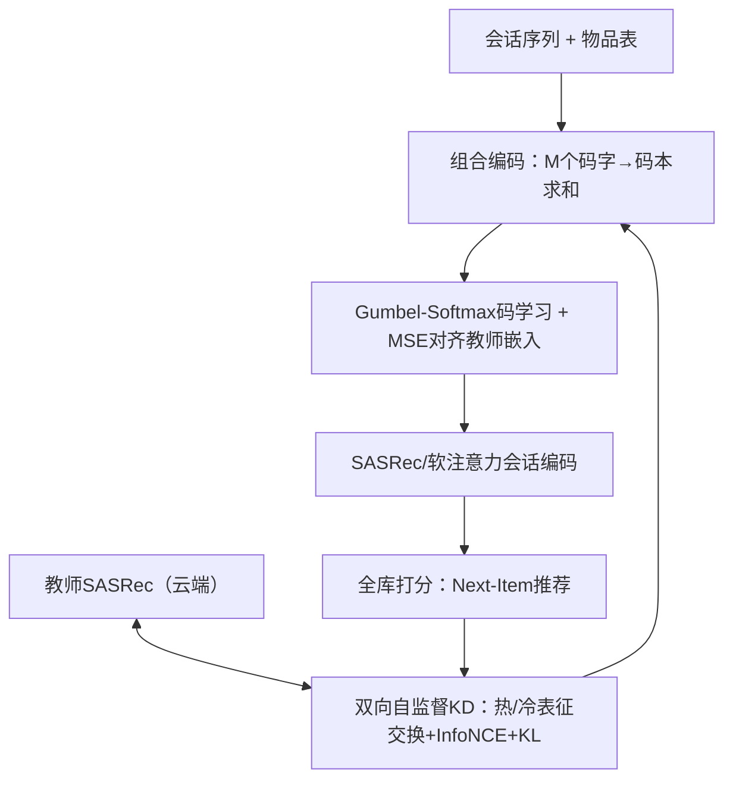
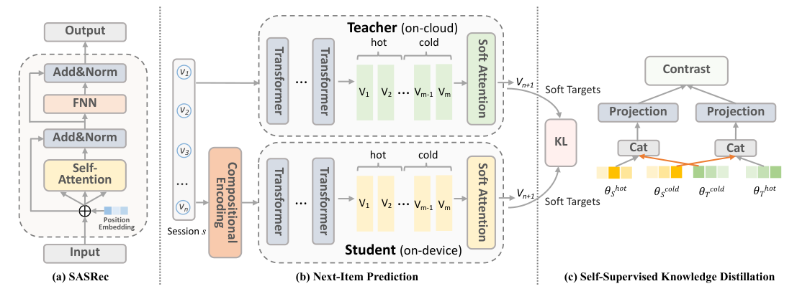

# Efficient On-Device Session-Based Recommendation (高效的端侧会话推荐)

- **会议/期刊**: ACM Transactions on Information Systems (TOIS)
- **作者与机构**: Xin Xia, Junliang Yu, Qinyong Wang, Chaoqun Yang, Quoc Viet Hung Nguyen, Hongzhi Yin；The University of Queensland, Baidu, Griffith University
- **推荐链路定位**: 端侧实时精排（会话 Next-Item 全库排序）
- **研究方向**: 序列与会话推荐 / 自监督对比学习与交互去噪
- **论文原文**: [https://arxiv.org/abs/2209.13422v4](https://arxiv.org/abs/2209.13422v4)
- **开源代码**: [https://github.com/xiaxin1998/EODRec](https://github.com/xiaxin1998/EODRec)

## TL;DR (1分钟核心速览)

针对端侧会话推荐中张量分解压缩导致嵌入重建慢、难以实时响应的问题，本文用“\(M\) 个码字组合成物品嵌入”的组合编码把物品表压成码矩阵+小码本，并用双向自监督蒸馏（热/冷会话表征交换+对比+软目标）补偿精度。在 Tmall/RetailRocket 全库排序下，30×压缩仍获 6–8×推理加速，RetailRocket 四项指标全面超越 OD-Rec。

## Background & Motivation (背景与核心矛盾)

- **主流范式**: 云端训练 SASRec/GRU/GNN 等会话推荐模型，端侧用 tensor-train 分解（TTD）压缩物品嵌入表以适配手机内存。
- **前人局限**: ① TTD 重建嵌入需先算索引列表再做多次张量乘，压缩比越高、端侧推理越慢；② 传统 KD 假设教师总优于学生，且学生容量受压缩限制，难以稳定保真。
- **核心洞察 (Key Insight)**: 推荐模型参数绝大部分在物品嵌入表；若用少量共享码本向量组合出物品嵌入，则端侧只需保存码矩阵和码本，重建退化为一次矩阵乘。
- **本文切入点**: 用离散组合编码替代半张量分解，并把单向教师→学生蒸馏升级为双向自监督蒸馏。

## Method (核心方法设计)

### 1. 整体框架 (Overall Architecture)

云端先训 SASRec 教师；学生把每个物品 \(v\) 映射为 \(M\) 维离散码 \(C_v\)，\(M\) 个码本各含 \(K\) 个 \(N\) 维向量，物品嵌入为对应码字向量之和。码矩阵和码本远小于 \(|\mathcal{V}|\times N\)。Gumbel-Softmax 将离散查表重参数化，MSE 拉近组合嵌入与教师嵌入；训练时用 \(\eta\) mixup 注入教师嵌入，测试只用组合嵌入。随后师生进入双向自监督 KD：按热度切热/冷子会话，交换冷会话表征构造增广，InfoNCE 对齐师生表征、KL 蒸馏软目标，教师也更新。推理仅保存码矩阵+码本，做一次矩阵乘得到全库物品嵌入并全库排序。

<figure class="paper-figure" markdown="span">
  <figcaption>图1. 所提方法概览。</figcaption>
</figure>

### 2. 关键设计拆解 (Key Designs)

1. **组合编码压缩（Compositional Encoding）**：物品 \(v\) 的嵌入为 \(\boldsymbol{e}_{v}=\sum_{i=1}^{M}\mathbf{E}_{i}(C_{v}^{i})\)，码本总内存 \(MKN\)，码矩阵 \(M|\mathcal{V}|\)，压缩率约 \(|\mathcal{V}|N/(MKN+M|\mathcal{V}|)\)。直接最小化 \(\mathcal{L}_{mse}=\frac{1}{|\mathcal{V}|}\sum_v\|\boldsymbol{e}_v-\mathbf{X}_v\|_2^2\)，并用 Gumbel-Softmax 使离散码可端到端训练；直觉是共享码字让相似物品共享统计强度，而非为每个物品存独立向量。训练时 \(\boldsymbol{e}'_{v}=\eta\odot\mathbf{X}_{v}+(1-\eta)\odot\boldsymbol{e}_{v}\)，测试仅用 \(\boldsymbol{e}_v\)。

2. **双向自监督知识蒸馏（Bidirectional Self-Supervised KD）**：取热度前 20% 为 hot，其余 cold；会话拆成 hot/cold 子会话，分别软注意力得 \(\boldsymbol{\theta}_{hot},\boldsymbol{\theta}_{cold}\)。交换冷表征：\(\boldsymbol{z}^{tea}_{s}=[\boldsymbol{\theta}^{tea}_{hot},\boldsymbol{\theta}^{stu}_{cold}]\)，\(\boldsymbol{z}^{stu}_{s}=[\boldsymbol{\theta}^{stu}_{hot},\boldsymbol{\theta}^{tea}_{cold}]\)。InfoNCE 把同会话两重组表征作正例、批内其他会话作负例；KL 蒸馏教师软目标。双向更新让教师也从学生排序中获益，缓解教师误排。

3. **训练目标、负采样与推理效率**：总损失 \(\mathcal{L}=\mathcal{L}_{rec}+\mathcal{L}_{mse}+\beta\mathcal{L}_{con}+\gamma\mathcal{L}_{soft}\)；推荐用全库 softmax 交叉熵，无负采样；对比任务用批内负例。推理为码矩阵×码本，\(O(|\mathcal{V}|MKN)\)；TTD 索引+乘为 \(O(|\mathcal{V}|^2+|\mathcal{V}|R)\)，故端侧更快。

## Experimental Setup & Evaluation Protocol (实验设置与评估协议)

- **数据集与预处理**:

| 数据集 | #训练会话 | #测试会话 | #Items | 平均长度 | 过滤/场景 |
| :--- | :---: | :---: | :---: | :---: | :--- |
| Tmall | 351,268 | 25,898 | 40,728 | 6.69 | 电商购物日志；去长度 1、item 频次<5 |
| RetailRocket | 433,643 | 15,132 | 36,968 | 5.43 | 浏览行为；去长度 1、item 频次<5 |

- **数据划分与防穿越 (Splitting Strategy)**: `Leave-One-Out` 取每会话最后交互为测试，验证集从训练集随机抽 10%；训练/测试均按序列切分构造多标签样本。
- **排名评测协议 (Ranking Protocol)**: 无偏 `Full-Ranking`（对全物品 softmax 排序），报告 P@5/10、NDCG@5/10；无采样负例，对比任务用批内负例。
- **对比基线与超参设置**: GRU4Rec、NARM、STAMP、SR-GNN、SASRec、OD-Rec；嵌入维度 128/256，Adam 1e-3，Gumbel 温度 0.3；未报告显著性检验。

## Key Experimental Results (实验关键数据)

### 1. 主实验对比 (Main Results)

| 方法 | Tmall P@5 | Tmall N@5 | Tmall P@10 | Tmall N@10 | Retail P@5 | Retail N@5 | Retail P@10 | Retail N@10 |
| :--- | :---: | :---: | :---: | :---: | :---: | :---: | :---: | :---: |
| GRU4Rec | 16.48 | 9.25 | 19.58 | 9.93 | 32.37 | 19.36 | 39.35 | 20.53 |
| NARM | 16.84 | 10.96 | 19.68 | 11.66 | 32.94 | 20.07 | 39.18 | 21.53 |
| STAMP | 17.45 | 12.92 | 22.61 | 13.34 | 33.57 | 20.50 | 39.75 | 22.97 |
| SR-GNN | 19.39 | 14.29 | 23.79 | 15.81 | 35.68 | 27.19 | 43.31 | 29.67 |
| SASRec | 20.23 | 15.11 | 25.13 | 16.59 | 36.37 | 27.54 | 43.55 | 29.20 |
| Teacher | 22.47 | 18.05 | **27.86** | 19.53 | 36.51 | 27.77 | 43.59 | 30.03 |
| OD-Rec | **23.68** | **18.86** | 25.22 | 19.43 | 35.17 | 28.45 | 36.81 | 28.93 |
| Student | 23.66 | 18.49 | 27.76 | **19.67** | **37.72** | **28.60** | **44.55** | **30.83** |

Student vs OD-Rec：Tmall P@10 +10.1%、N@10 +1.2%；Retail P@10 +21.0%、N@10 +6.6%；Tmall P@5/N@5 略低于 OD-Rec。Teacher 为未压缩云端参考，非端侧基线。

### 2. 消融实验 (Ablation Study)

| 变体 | Tmall P@10 | Tmall N@10 | Retail P@10 | Retail N@10 |
| :--- | :---: | :---: | :---: | :---: |
| Stu-base（无 KD） | ≈25.1 | ≈17.9 | ≈41.1 | ≈27.8 |
| w/o contrastive | <Full | <Full | <Full | <Full |
| w/o bidirectional | <Full | <Full | <Full | <Full |
| w/o soft targets | <Full | <Full | <Full | <Full |
| w/o embedding mixup | <Full | <Full | <Full | <Full |
| Full Student | **27.76** | **19.67** | **44.55** | **30.83** |

注：原文图 3 只给曲线，≈ 由文中相对提升反推；各 w/o 变体均低于 Full。

### 3. 关键实验发现 (Key Findings)

- **压缩与延迟同时收益**：30× 压缩下，Tmall 端侧预测 0.021s/100 会话 vs OD-Rec 0.169s（约 8×），Retail 0.012s vs 0.081s（约 6.75×）；组合编码把 TTD 的索引表+多次张量乘替换为码矩阵×码本一次乘。
- **M/K 存在尺寸-精度权衡**：Tmall \(M=4,K=32\)（CR29）获 P@10=27.76、N@10=19.67，已超 OD-Rec CR27 的 25.22/19.43；Retail \(M=3,K=256\)（CR31）四项全面超 OD-Rec。增大 \(M\) 降压缩但提精度，增大 \(K\) 也普遍提精度，且 \(M\) 影响更大。
- **KD 是保容关键**：Full vs Stu-base 在 Tmall 提升 P@10 +10.55%、N@10 +10.20%，Retail +8.29%、+10.90%；去掉 embedding mixup 掉幅最大，说明嵌入级直接迁移最关键；\(\eta=0.8/0.7\) 最优，0.9 时梯度过小导致欠拟合。

## Highlights & Limitations (亮点、对比与审稿批判)

- **与代表作对比 (vs. Prior Work)**: OD-Rec 用半张量分解压缩但推理仍慢；本文用码本查表+求和，把端侧重建简化为矩阵乘。传统 KD4Rec 多传 top-K/rank-aware 采样，本文用热/冷表征交换和双向教师更新。
- **可迁移亮点**: 码矩阵+码本的嵌入压缩可迁移到任意大物品表推荐；热/冷子会话交换可作为序列推荐的表示级数据增广。
- **审稿级局限批判**: 仅两个电商数据集，未给显著性检验与线上 A/B；端侧速度在模拟 Pixel 2 上测得，未覆盖多设备；\(\beta,\gamma,\eta\) 较敏感，且端侧模型更新问题未解决。

## Rating (四维评分)

- **方法创新性 (Novelty)**: ⭐⭐⭐⭐ （组合编码+双向自监督 KD 的组合有新意，但码本量化与对比蒸馏均为已有组件的有效迁移）
- **评估协议与实验扎实度 (Protocol & Experiments)**: ⭐⭐⭐ （两个基准+全库排序较规范，但缺显著性检验、线上验证与更多设备实测）
- **写作与数学规范度 (Clarity & Rigor)**: ⭐⭐⭐⭐ （压缩率、复杂度、训练算法与损失定义清晰，公式与消融逻辑完整）
- **工业落地与复现价值 (Industrial & Practical Value)**: ⭐⭐⭐⭐ （代码开源，30×压缩与6–8×加速对端侧推荐有直接价值；设备覆盖与模型更新仍需补足）

