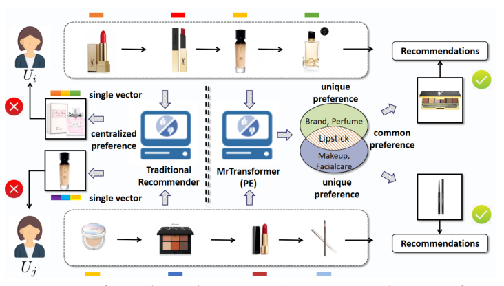
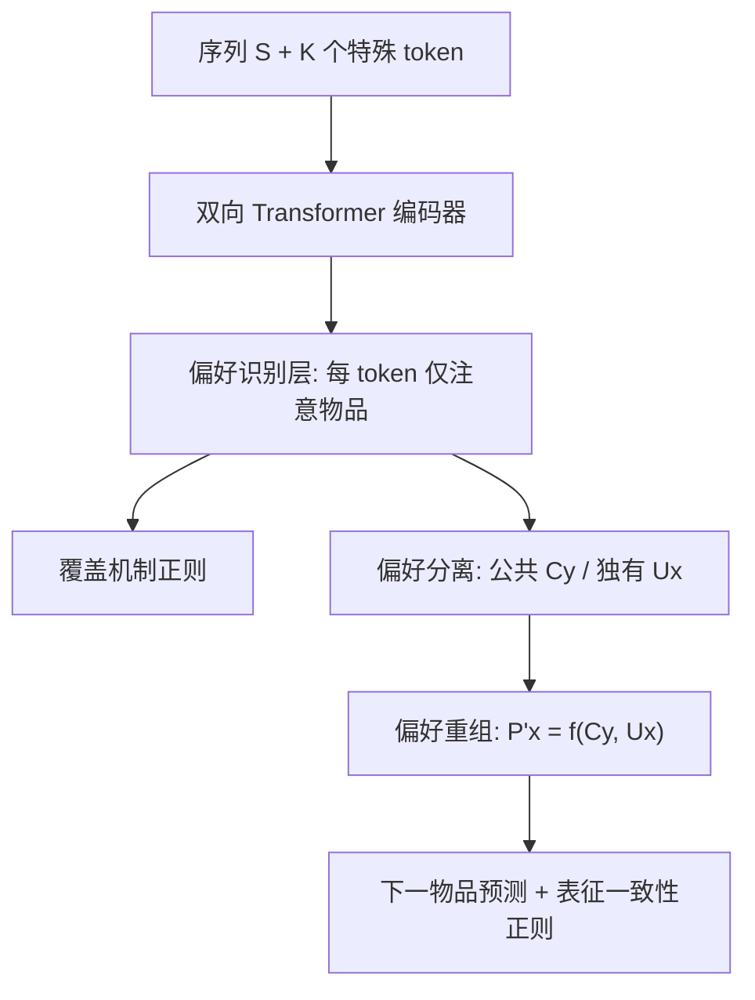
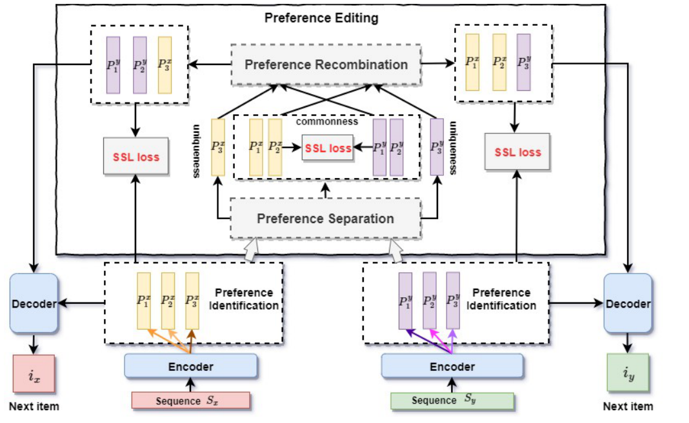

# Improving Transformer-based Sequential Recommenders through Preference Editing (通过偏好编辑改进 Transformer 序列推荐器)

- **会议/期刊**: ACM Transactions on Information Systems (TOIS)
- **作者与机构**: Muyang Ma, Pengjie Ren, Zhumin Chen, Zhaochun Ren, Jun Ma (山东大学)；Huasheng Liang (腾讯微信)；Maarten de Rijke (阿姆斯特丹大学 / Ahold Delhaize)
- **推荐链路定位**: 召回（Next-Item 序列召回，含自监督预训练）
- **研究方向**: 序列与会话推荐 / 自监督对比学习与交互去噪
- **论文原文**: [https://arxiv.org/abs/2106.12120v1](https://arxiv.org/abs/2106.12120v1)
- **开源代码**: [https://github.com/mamuyang/MrTransformer](https://github.com/mamuyang/MrTransformer)

## TL;DR (1分钟核心速览)

现有 Transformer 序列推荐只用"下一个物品"这一条监督信号，且默认把用户偏好压缩成单一向量，无法区分不同序列间的共性与个性。本文提出 MrTransformer：在序列头部拼接 $K$ 个特殊 token 表征多偏好并加覆盖正则；配套提出"偏好编辑"自监督——先分离两条序列的公共/独有偏好，再交换公共偏好重组并预测原目标。在 5 个数据集、Leave-One-Out + 100 负采样协议下，Beauty Recall@20 相较最优基线提升 5.70%（0.4070→0.4302），ML-100k Recall@5 较 SSE-PT 提升 19.35%。

## Background & Motivation (背景与核心矛盾)

- **主流范式**: SASRec/BERT4Rec 类双向或单向自注意力模型，以序列末尾位置或 `[mask]` 位置的隐向量作为唯一用户表征；SSL 增强路线则分为掩码物品预测 (MIP，如 BERT4Rec、S3-Rec) 与物品对比学习 (ICL，如 CL4SRec/CoSeRec 系)。
- **前人局限**: (1) **偏好集中化假设**——一条序列仅用一个向量概括，长序列中混杂的多个兴趣维度被强行平均；(2) **监督信号局限于单序列内部**——MIP 无语法约束易学成噪声重建，ICL 强依赖负采样质量，二者都未利用"两条序列之间"的关联。
- **核心洞察 (Key Insight)**: 真实用户对同一品类既有**公共偏好**（如都喜欢口红），也有**独有偏好**（香水 vs 面霜）。若模型能显式地把二者拆开并做"编辑式重组"，就能被迫学到可解耦、可迁移的偏好因子。
- **本文切入点**: 把偏好当作可分解、可交换的槽位 (slot)，用交叉序列的"公共槽位互换"作为免负采样的自监督信号。

<figure class="paper-figure" markdown="span">
  <figcaption>图 1. 传统推荐系统与 MrTransformer (PE) 的示意图比较。传统推荐系统将用户偏好建模为单一向量。MrTransformer (PE) 识别不同交互序列中的共同偏好和独特偏好。</figcaption>
</figure>

## Method (核心方法设计)

### 1. 整体框架 (Overall Architecture)

输入序列前拼接 $K$个可学习特殊 token$[P_1],\dots,[P_K]$，经$L$层双向 Transformer 编码（物品位置对特殊 token 做 mask，特殊 token 对全序列可见）；再由单独的"偏好识别层"让每个$[P_k]$仅对物品位置做注意力，得到偏好矩阵$\mathbf{P}\in\mathbb{R}^{K\times h}$与注意力矩阵$\mathbf{A}$，并以覆盖损失抑制多槽位关注同一批物品；解码端对$\mathbf{P}$ 求和后与物品嵌入内积做全库 softmax。训练分两阶段：先用偏好编辑的 SSL 损失预训练，再以推荐损失微调（共享嵌入层与 Transformer 层参数）。

<figure class="paper-figure" markdown="span">
  <figcaption>图 2. 偏好编辑概览。第 3.3 节包含对该图的逐步说明。</figcaption>
</figure>

### 2. 关键设计拆解 (Key Designs)

1. **多偏好槽位 + 覆盖机制 (Preference Coverage)**：若不加约束，$K$个特殊 token 会塌缩到同一批显著物品，表征冗余。作者借鉴覆盖注意力，累计每个槽位的历史注意力$c_{k,\tau}=\sum_{j=1}^{\tau-1}a_{k,j}$，并用$\mathcal{L}_{cov}=\sum_{k}\sum_{\tau}\min(a_{k,\tau},c_{k,\tau})$惩罚重复关注，等价于强制$K$ 个槽位在物品轴上"分工覆盖"整条序列。
2. **偏好分离与重组 (Preference Separation & Recombination)**：给定一对有交集序列 $S_x,S_y$，先算$K\times K$ 相似度矩阵并用行/列 softmax 得到交叉门控：
$I_{ij}=\mathbf{W}_I^{\top}[\boldsymbol{p}_i;\boldsymbol{p}_j;\boldsymbol{p}_i\odot\boldsymbol{p}_j],\quad \mathbf{C}_x=\mathbf{B}_y\odot\mathbf{P}_x,\ \mathbf{U}_x=(1-\mathbf{B}_y)\odot\mathbf{P}_x$其中$\mathbf{B}_y=\mathrm{softmax}_{col}(\mathbf{I})$。随后交换公共部分$\mathbf{P}'_x=\mathrm{combine}[\mathbf{C}_y;\mathbf{U}_x;\mathbf{C}_y\odot\mathbf{U}_x]$，同理得$\mathbf{P}'_y$。直觉上"公共偏好"被证明是可替换的共享因子，模型必须把与用户身份真正相关的信息压进$\mathbf{U}$，从而学到解耦表征。
3. **训练目标与推理开销**：总损失 $\mathcal{L}_{all}=\mathcal{L}_{rec}+\alpha\mathcal{L}_{cov}+\mathcal{L}_{pred}+\lambda\mathcal{L}_{reg}$，其中$\mathcal{L}_{reg}$由三项 MSE 组成：$\|\mathbf{P}_x-\mathbf{P}'_x\|^2$、$\|\mathbf{P}_y-\mathbf{P}'_y\|^2$保证重组后语义不回退，$\|\mathbf{C}_x-\mathbf{C}_y\|^2$拉近公共偏好。$\mathcal{L}_{pred}$ 用重组表征再做一次 next-item 预测，实现**免负采样**的跨序列监督。序列对通过 0/1 物品向量 + FAISS 近邻检索采样（每序列 20 个），保证有交集也有差异。推理时仅走单序列前向，无额外开销。

## Experimental Setup & Evaluation Protocol (实验设置与评估协议)

- **数据集与预处理**: 统一按 5-core 过滤（用户/物品交互数 $\geq 5$），序列按时间戳排序，最大长度截断为 50：

| 数据集 | #Users | #Items | #Interactions | 平均长度 | 场景说明 |
| :--- | :---: | :---: | :---: | :---: | :--- |
| Beauty | 40,226 | 54,542 | 353,962 | 8.8 | 美妆评论，偏好集中 |
| Sports | 25,598 | 18,357 | 296,337 | 6.3 | 户外运动 |
| Toys | 19,412 | 11,924 | 167,597 | 6.6 | 玩具，稀疏度高 |
| ML-100k | 943 | 1,349 | 99,287 | 103.2 | 电影，兴趣漂移强 |
| Yelp | 30,431 | 20,033 | 316,354 | 8.4 | 2019 年后商户点评 |

- **数据划分与防穿越**: `Leave-One-Out`——最后 1 次交互为测试、倒数第 2 次为验证，其余训练；验证集拼接进训练后预测测试项。
- **排名评测协议**: `Sampled Ranking`，每个正样本按**流行度分布**采 100 个负样本，报告 Recall@$\{5,10,20\}$、MRR@$\{5,10,20\}$、NDCG@$\{5,10,20\}$。注意此处非 Full-Ranking，指标绝对值偏高。
- **对比基线与超参**: POP / BPR-MF / Item-KNN / SASRec / SSE-PT / FISSA / BERT4Rec / S3-Rec；$d=64$、2 层、2 头、dropout 0.5、Adam ($lr=10^{-4}$)、batch 256；$t$-test$p<0.05$ 标 `*`。

## Key Experimental Results (实验关键数据)

### 1. 主实验对比 (Main Results)

| 数据集 | 模型 | R@5 | R@10 | R@20 | MRR@10 | NDCG@10 |
| :--- | :--- | :---: | :---: | :---: | :---: | :---: |
| Beauty | SASRec | 0.1934 | 0.2653 | 0.3724 | 0.1220 | 0.1633 |
| Beauty | FISSA | 0.2116 | 0.3079 | 0.4289 | 0.1325 | 0.1734 |
| Beauty | BERT4Rec | 0.2137 | 0.2964 | 0.3971 | 0.1408 | 0.1773 |
| Beauty | S3-Rec | 0.2173 | 0.2909 | 0.3926 | 0.1445 | 0.1789 |
| Beauty | MrTransformer | 0.2220 | 0.2989 | 0.4070 | 0.1540 | 0.1879 |
| Beauty | **MrTransformer (PE)** | **0.2286** | **0.3126** | **0.4302*** | **0.1555*** | **0.1923*** |
| Sports | SASRec | 0.1622 | 0.2788 | 0.3908 | 0.1042 | 0.1532 |
| Sports | FISSA | 0.2133 | 0.3180 | 0.4592 | 0.1367 | 0.1726 |
| Sports | S3-Rec | 0.2072 | 0.3250 | 0.4817 | 0.1276 | 0.1734 |
| Sports | **MrTransformer (PE)** | **0.2320*** | **0.3456*** | **0.5000*** | **0.1504*** | **0.1958*** |
| ML-100k | SSE-PT | 0.3017 | 0.4688 | 0.6723 | 0.2046 | 0.2599 |
| ML-100k | BERT4Rec | 0.3003 | 0.4662 | 0.6506 | 0.1926 | 0.2562 |
| ML-100k | S3-Rec | 0.3012 | 0.4761 | 0.6755 | 0.1748 | 0.2448 |
| ML-100k | **MrTransformer (PE)** | **0.3601*** | **0.5005** | **0.6808*** | **0.2211*** | **0.2866*** |
| Yelp | FISSA | 0.4520 | 0.6153 | 0.7757 | 0.2974 | 0.3631 |
| Yelp | BERT4Rec | 0.4561 | 0.6138 | 0.7621 | 0.2914 | 0.3673 |
| Yelp | **MrTransformer (PE)** | **0.4640*** | **0.6312** | **0.7972*** | **0.2965** | **0.3752*** |

相对提升：Beauty 较 FISSA 在 R@5/MRR@5/NDCG@5 上 +8.03%/+20.53%/+16.08%，较 S3-Rec 在 R@5 上 +9.58%；ML-100k 较 SSE-PT 在 R@5/MRR@5/NDCG@5 上 +19.35%/+15.96%/+14.71%。

### 2. 消融实验 (Ablation Study)

| 配置 | Beauty R@10 | Beauty NDCG@10 | ML-100k R@5 | ML-100k MRR@5 | Yelp R@20 |
| :--- | :---: | :---: | :---: | :---: | :---: |
| w/o 偏好编辑 (仅 MrTransformer) | 0.2989 | 0.1879 | 0.3436 | 0.1929 | 0.7771 |
| w/o 覆盖机制 | 0.2913 | 0.1846 | 0.3351 | 0.1916 | 0.7901 |
| Full (PE + coverage) | **0.3126** | **0.1923** | **0.3601** | **0.2031** | **0.7972** |

### 3. 关键实验发现 (Key Findings)

1. **偏好编辑是主贡献，覆盖机制是必要补丁**：去掉 PE 使 Beauty NDCG@20 降 3.11%、ML-100k Recall@5 降 4.80%、Yelp MRR@20 降 4.37%；而去掉覆盖机制在 Beauty Recall@10 上降 7.31%，但 Yelp 上仅降 1.31%——PE 决定上限，coverage 在物品相似度高的数据集上才显著。
2. **长序列与兴趣漂移场景获益最大**：ML-100k（平均长度 103.2）提升最大，长度段 [20,30) 的 MRR@5 从 0.1949 升至 0.2430（+24.67%）；Sports 在 [30,40) 段 Recall@5 +14.91%。而长度 >50 后性能全面陡降，暴露了 $K$ 槽位信息瓶颈。
3. **$K$呈数据集相关的弱敏感性**：最优$K$=3 (Beauty/ML-100k)、9 (Sports)、11 (Toys)、1 (Yelp)，Beauty 上最好与最差$K$ 的 Recall@20 差距仅 4.54%，说明多偏好机制鲁棒但收益并非来自参数量膨胀。

## Highlights & Limitations (亮点、对比与审稿批判)

- **与代表作对比**: 相比 BERT4Rec/S3-Rec 在**单序列内部**做掩码或属性级对比，本文首次把监督信号搬到**序列对之间**，且无需负采样即可避免表征坍缩；相比 FISSA 融合物品相似度做全局偏好，本文用可交换槽位实现显式解耦，机制更接近"因果因子替换"。
- **可迁移亮点**: (1) "公共/独有因子分离 + 交换重组 + 一致性正则"可直接搬到跨域推荐与多场景建模作为域共享/域私有解耦的轻量实现；(2) 用 FAISS 按物品共现构建"有交集但不相同"的序列对，是一种低成本、免负采样样本构造范式。
- **审稿级局限批判**: (1) **评估协议偏乐观**——100 负样本按流行度采样，未做 Full-Ranking，且 ML-100k 仅 943 用户，$t$-test 显著性在该规模下的稳健性存疑；(2) **两阶段训练 + 序列对采样带来额外预处理开销**，论文未报告预训练耗时与$K$、$\alpha$、$\lambda$的联合敏感度，也未在超长序列（$>50$）上给出可行的分块或层次化方案。

## Rating (四维评分)

- **方法创新性 (Novelty)**: ⭐⭐⭐⭐ （把偏好当作可编辑槽位、用跨序列"公共因子互换"构建 SSL 信号，思路新颖且免负采样）
- **评估协议与实验扎实度 (Protocol & Experiments)**: ⭐⭐⭐ （5 个数据集 + 长度分桶 + $K$ 敏感性较完整，但采样排序与单数据集显著性削弱说服力）
- **写作与数学规范度 (Clarity & Rigor)**: ⭐⭐⭐⭐ （分离/重组算子与三重正则定义清晰，符号统一；缺少复杂度与收敛性分析）
- **工业落地与复现价值 (Industrial & Practical Value)**: ⭐⭐⭐⭐ （推理零额外开销、代码与数据均已开源，仅预训练阶段的序列对检索需离线建索引）

