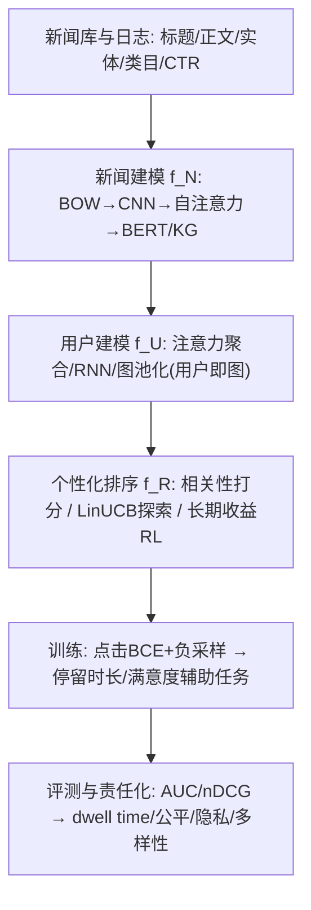
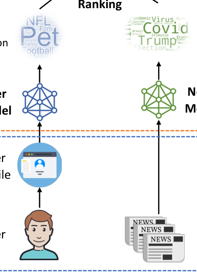

# Personalized News Recommendation: Methods and Challenges (个性化新闻推荐：方法与挑战)

- **会议/期刊**: ACM TOIS 2023（arXiv 2106.08934, 2021）
- **作者与机构**: Chuhan Wu, Yongfeng Huang（清华大学电子工程系/BNRist）；Fangzhao Wu, Xing Xie（微软亚洲研究院）
- **推荐链路定位**: 召回 → 排序 → 展示 → 画像更新的全链路综述
- **研究方向**: 序列与会话推荐 / 大语言模型推荐（PLM 增强文本理解）
- **论文原文**: [https://arxiv.org/abs/2106.08934v3](https://arxiv.org/abs/2106.08934v3)
- **开源代码**: 暂未开源

## TL;DR (1分钟核心速览)

本文是新闻推荐领域的系统性综述：针对新闻"生命周期极短、富文本、隐式反馈噪声大、兴趣漂移"四大痛点，放弃传统 CF/内容/混合三分法，改以**七个核心问题**（新闻建模→用户建模→个性化排序→模型训练→评测→数据集→责任化）重构技术版图；横向对比 100+ 篇工作，厘清 MIND/Adressa/plista 上的协议差异（采样 AUC vs 全库 nDCG）与离线-在线鸿沟，并归纳 PLM 表征、点击去噪与责任化三条主线。

## Background & Motivation (背景与核心矛盾)

- **主流范式**: 新闻平台"召回候选 → 依据用户画像排序 → 展示 → 回收行为更新画像"闭环（图 1）；方法层面长期沿用协同过滤/内容/混合三分法，近十年由 CNN、自注意力走向预训练语言模型（PLM）。
- **前人局限**: ① 三分法无法刻画同类别内的范式演进——"content-based" 里同时塞进了 TF-IDF、上下文 bandit 与 BERT，且完全丢失**排序与训练**这两个关键环节；② 既有综述以特征工程方法为主，DL 覆盖严重不足（原文表 1 逐一对比）。
- **核心洞察 (Key Insight)**: 新闻推荐的瓶颈不在"用协同还是用内容"，而在"哪一个核心问题的算子没解好"；新闻 ID 覆盖率极低（仅 DNA、DeepJoNN 两篇敢直接用 ID 嵌入），故新闻/用户建模必须走"内容 + 时序 + 知识"路线。
- **本文切入点**: 以系统开发的功能链为主轴做问题导向综述，并把责任化（隐私、公平、多样性）与评测协议一并纳入统一框架。

<figure class="paper-figure" markdown="span">
  <figcaption>图1. 个性化新闻推荐系统的示例工作流程。</figcaption>
</figure>

## Method (核心方法设计)

### 1. 整体框架 (Overall Architecture)

本文不提出新模型，而是把任意个性化新闻推荐方法规范化为一组可对照的功能映射：

$$\hat{y} = f_R\big(f_U(\{\,f_N(c_k)\}_{k\in\mathcal{H}_u}),\; f_N(c)\big)$$

其中 $f_N$为新闻编码器（TF-IDF/CNN/Transformer/PLM/KG 嵌入），$f_U$为用户兴趣聚合器（注意力/RNN/图池化），$f_R$为排序打分器（内积、MLP、LinUCB 探索），再叠加训练目标$\mathcal{L}$与评测函数$\mathcal{E}$。这一分解使"换掉某个算子"与"性能演进"一一对应，从而能跨范式比较（如 NAML 的多视图注意力 vs NRMS 的自注意力）。流程如下：

<figure class="paper-figure" markdown="span">
  <figcaption>图2. 开发个性化新闻推荐模型的关键组件框架。</figcaption>
</figure>

### 2. 关键设计拆解 (Key Designs)

1. **新闻/用户双端表征算子（增量在"候选感知"）**：痛点是新闻冷启动使 ID 表征失效、且用户兴趣多样。新闻侧用多头自注意力建模词上下文再加性注意力加权 $\mathbf{n}=\sum_{i}a_i\mathbf{w}_i$，$a_i\propto\exp(\mathbf{q}^{\top}\tanh(\mathbf{W}\mathbf{w}_i))$；用户侧把候选新闻当 query 做 candidate-aware 注意力$\alpha_k\propto\exp(\mathbf{n}_c^{\top}\mathbf{W}\mathbf{n}_k)$，$\mathbf{u}=\sum_k\alpha_k\mathbf{n}_k$。直觉：以"本次决策"为条件才能把泛兴趣收窄，并天然压低无关/误点行为的权重。

2. **知识、图与序列结构的引入**：痛点是纯文本模型不懂实体与常识，且行为间的高阶关系被忽略。实体侧从"直接拼实体词向量（DAN）"演进到"KG 嵌入（TransD/TransE, DKN/CAGE）"再到"话题增强 KG + 图注意力（TEKGR/KRED）"；用户侧从 RNN 建模兴趣漂移，走向"用户即图"——把单用户点击行为建成异构图并用 HG-Pool 池化（User-as-Graph），或按行为簇做子图 GCN 池化（CNE-SUE）。局限是静态图对新新闻不友好。

3. **训练目标、负采样与推理效率**：主流是点击二分类 + 负采样，NRMS 类工作每正样本配 4 个负样本，$\mathcal{L}=-\sum[y\log\hat{y}+(1-y)\log(1-\hat{y})]$；痛点是点击 ≠ 满意，故 CPRS/FeedRec 增加停留时长/满意度辅助项$\mathcal{L}+\lambda\mathcal{L}_{eng}$。排序侧用 bandit 换掉贪心相关性：$a_t=\arg\max_a\big(\mathbf{x}_a^{\top}\boldsymbol{\theta}+\gamma\sqrt{\mathbf{x}_a^{\top}\mathbf{A}^{-1}\mathbf{x}_a}\big)$，用置信上界换取多样性、缓解 filter bubble。工程上新闻塔可离线预计算并缓存，用户塔在线聚合，PLM 只编码新闻侧即可控制延迟。

## Experimental Setup & Evaluation Protocol (实验设置与评估协议)

- **数据集与预处理**（综述汇总的公开基准；精确统计见原文数据集章节）：

| 数据集 | #Users | #Items | #Interactions | 稀疏度/密度 | 特征/场景说明 |
| :--- | :---: | :---: | :---: | :---: | :--- |
| MIND-Large | ≈1.0M | ≈161K | ≈24.3M clicks | 极稀疏 | 英文，含标题/摘要/正文/实体/类目，配套公开榜单 |
| MIND-Small | ≈50K | ≈65K | ≈0.35M clicks | 极稀疏 | 同上，调试用子集 |
| Adressa | ≈74K | ≈17K | ≈2.6M clicks | 稀疏 | 挪威语，含 dwell time 与富上下文 |
| plista | 十万级 | 万级 | 百万级 | 稀疏 | 德语，CLEF NewsREEL 竞赛数据 |

- **数据划分与防穿越 (Splitting Strategy)**: MIND 走**官方时间切分**（train/valid/test 按日志时间划分，候选集=每次 impression 的展示列表，正样本为点击、其余为曝光未点击）；Adressa/plista 多见于 NRMS 系工作的 `Leave-One-Out`（末次点击作测试、按时间排序）或全局时间戳切分。原文特别强调：静态随机划分会引入未来信息泄漏。
- **排名评测协议 (Ranking Protocol)**: MIND 榜单为 `Sampled Ranking`（每正样本采样 4 个负样本，报 AUC）；NRMS 系论文同为 1:4 采样并报 AUC/MRR/nDCG@5；两阶段工作（如 UniRec）召回阶段用 `Full-Ranking` 全库排序。原文明确指出采样 AUC 与全库排序不可直接比较。
- **对比基线与超参设置**: 对比跨四大类——特征工程（CF-IDF/SF-IDF/LDA）、神经文本（EBNR/DSSM/CNN）、注意力与 PLM（NPA/NAML/NRMS/PLM-NR/UNBERT）、图与知识（DKN/CAGE/User-as-Graph）。常见设定 $d=64\sim300$（GloVe 300d、BERT 768d）、Adam、每正样本 4 负采样；**综述本身未做统一复现与显著性检验**，跨论文数字仅具量级参考意义。

## Key Experimental Results (实验关键数据)

### 1. 主实验对比 (Main Results)

原文以"信息源 × 模型结构"对照代表方法，并附各方法在 MIND-Large 测试集上公开报告的 AUC（同协议，1:4 采样）：

| 方法 | 年份 | 新闻侧信息 | 用户侧聚合 | MIND-L AUC |
| :--- | :---: | :--- | :--- | :---: |
| NPA | 2019 | 标题（CNN） | 个性化词/新闻注意力 | 0.6303 |
| NAML | 2019 | 标题+正文+类目（多视图注意力） | 新闻级注意力 | 0.6602 |
| LSTUR | 2019 | 标题+类目（CNN） | GRU + 用户 ID 嵌入 | **0.6775** |
| NRMS | 2019 | 标题（多头自注意力） | 多头自注意力 + 加性注意力 | 0.6694 |
| HieRec | 2021 | 标题+实体（层次兴趣） | 层次注意力（子话题→话题） | —（未报同协议） |
| PLM-NR / UNBERT | 2021 | 标题（BERT） | 与 NRMS 同构 / CLS 表征 | —（线上 A/B 报告显著增益） |

### 2. 消融与覆盖度分析 (Component Coverage, 原文表 2–4 引用计数)

综述无自建消融实验，但其文献统计等价于"组件必要性的群体证据"：

| 组件/特征 | 采用工作数(≈) | 代表工作 | 移除后的典型退化 |
| :--- | :---: | :--- | :--- |
| BOW/XF-IDF 文本特征 | 30 | CF-IDF/SF-IDF | 语义表达力弱，无法建模词序与上下文 |
| 实体/关键词 | 30 | DKN/DAN/KRED | 丢失常识与新实体泛化能力 |
| 类目/簇 | 30 | NAML/LSTUR | 话题层面兴趣无法刻画 |
| 主题分布（LDA） | 18 | SCENE/LOGO | 长期兴趣刻画变粗 |
| 流行度 / 时效性 | 17 / 19 | PP-Rec/CTX/DCAN | 冷启动与"热点"判断失准 |
| 停留时长 | 7 | CPRS/FeedRec | 点击噪声无法抑制，满意度下降 |
| 用户-新闻图 / 异构图 | 12 | IGNN/GNewsRec/User-as-Graph | 高阶协同信号缺失，新新闻更难 |
| CTR / 偏置 / 视觉 | 1 / 1 / 1 | CTX / DebiasRec / MM-Rec | 位置偏置、多模态信息完全空白 |

### 3. 关键实验发现 (Key Findings)

- **结构红利已近饱和，表征算子比信息源更值钱**：LSTUR 相对 NPA 提升 +7.5% AUC，但四个神经基线全部挤在 0.63–0.68 的窄带；而只用标题的 NRMS（0.6694）反超用标题+正文+类目的 NAML（0.6602），说明自注意力这类算子带来的收益大于堆砌特征。
- **高价值信息源严重欠开发**：实体/文本/类目各被约 30 篇工作使用，而近实时 CTR、展示偏置、视觉多模态各仅 1 篇——这恰是 PP-Rec/DebiasRec/MM-Rec 少量工作即取得显著增益的原因，也是最大的研究空档。
- **点击标签是当前最大天花板**：绝大多数方法只用点击 BCE 训练，而引入停留时长/满意度辅助目标（CPRS、FeedRec）与 bandit 长期收益（LinUCB、DRN+DBGD）的工作普遍报告线上 engagement 提升；同时离线 AUC 与线上满意度常不同向，暴露了综述反复强调的离线-在线鸿沟。

## Highlights & Limitations (亮点、对比与审稿批判)

- **与代表作对比 (vs. Prior Work)**: 相较 Li et al. (2019) 与 Feng et al. (2020) 停留在 CF/内容/混合三分法与特征工程层面，本文把排序、训练目标、评测协议、责任化纳入同一坐标；相较知识图谱专题综述（2021），它覆盖了 PLM 与图神经两条最新主线。
- **可迁移亮点**: ①"candidate-aware 注意力"可迁移到任何长历史序列 + 单候选打分场景（电商、短视频）；②把"用户即图 + 图池化"用于画像聚合，比 mean-pooling 更能压噪；③用文献引用计数做"组件覆盖率分析"，是一种低成本评估子方向饱和度的元研究方法。
- **审稿级局限批判**: ① 无统一复现实验、无显著性检验，表格中的跨论文数字混用了采样 AUC 与全库排序、不同划分，横向可比性打折；② 覆盖截止于 2021 年中，LLM 指令微调/生成式推荐、语义 ID 等 2023 年后的主线完全缺席；③ 责任化章节以"要点清单"形式给出，缺少公平性/多样性的量化基准与指标定义对比。

## Rating (四维评分)

- **方法创新性 (Novelty)**: ⭐⭐⭐⭐ （问题导向分类框架与"责任化纳入综述"确有新意，但本质是组织视角创新，无新模型或理论支撑）
- **评估协议与实验扎实度 (Protocol & Experiments)**: ⭐⭐⭐ （细致辨析了 Leave-One-Out/时间切分与采样/全库排序的差异，但自身无复现实验、无显著性检验）
- **写作与数学规范度 (Clarity & Rigor)**: ⭐⭐⭐⭐⭐ （功能链分解清晰、术语统一，表 2–4 的引用计数式统计信息密度极高）
- **工业落地与复现价值 (Industrial & Practical Value)**: ⭐⭐⭐⭐ （无开源代码，但"新闻塔离线缓存 + 用户塔在线聚合"的部署结论与冷启动/去噪/责任化清单对工业新闻流直接可用）

