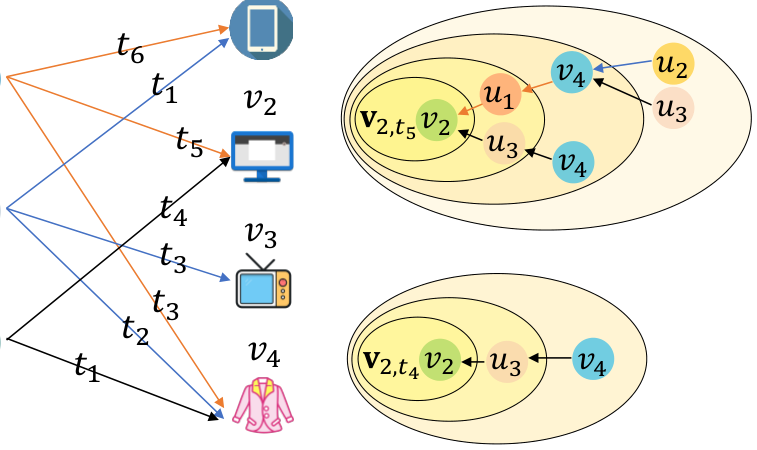
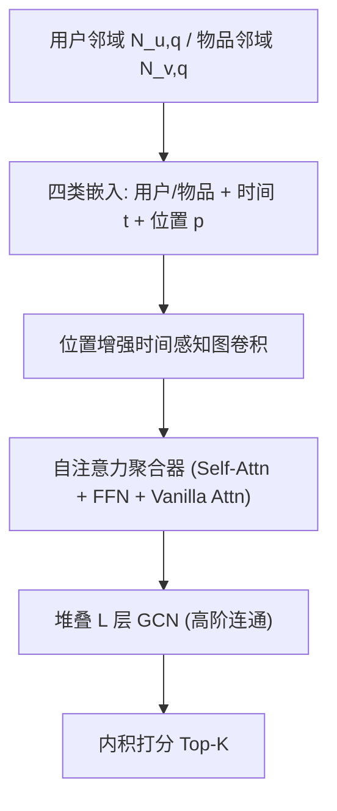
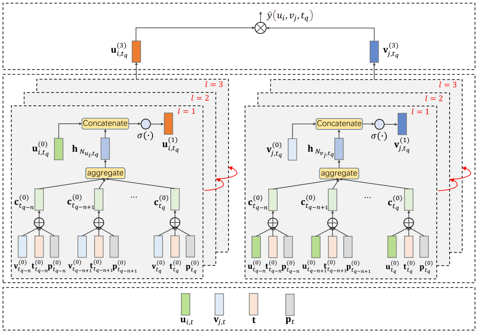

# Position-enhanced and Time-aware Graph Convolutional Network for Sequential Recommendations (位置增强与时间感知图卷积序列推荐)

- **会议/期刊**: ACM TOIS (arXiv 2107.05235v2)
- **作者与机构**: Liwei Huang, Yutao Ma, Yanbo Liu, Bohong (Danny) Du, Shuliang Wang, Deyi Li（北京理工大学、武汉大学、斯坦福大学、中国工程院）
- **推荐链路定位**: 召回（Next-Item 序列召回）
- **研究方向**: 序列与会话推荐 / 图神经网络推荐
- **论文原文**: [arXiv:2107.05235v2](https://arxiv.org/abs/2107.05235v2)
- **开源代码**: [drhuangliwei/PTGCN](https://github.com/drhuangliwei/PTGCN)

## TL;DR (1分钟核心速览)

针对现有序列推荐"只建模用户动态、忽略物品随时间演化"及"仅用一阶交互、忽视高阶协同信号"两大痛点，PTGCN 在用户-物品**二部图**上定义位置增强+时间感知的图卷积，用**自注意力聚合器**同时学习用户与物品在每个时刻的动态表示，并联手多层 GCN 捕获高阶连通性。在 MovieLens、Amazon CDs_and_Vinyl、Movies_and_TV 三数据集上，以 R@5/10 与 NDCG@5/10 全面超越 DGCF 等 9 个基线，R@10 相对提升 9.05%–11.12%。

## Background & Motivation (背景与核心矛盾)

- **主流范式**: 序列推荐当前以 RNN/CNN/Transformer（GRU4Rec+、Caser、SASRec、BERT4Rec、TiSASRec）建模用户行为序列，近期 GCN（DGCF、DHCN）引入协同信号。
- **前人局限之一（用户中心）**: 上述模型几乎只建模用户侧偏好动态，将物品视为静态 embedding，无法刻画物品流行度增长、主题漂移等**时间演化属性**。
- **前人局限之二（一阶交互）**: 仅用直接 user-item 交互定义损失，忽视"**同一时刻 $v_2$经$u_1$/$u_3$桥接与$v_4$形成的高阶相似性**"这一协同信号（图 1），而该信号恰恰对推荐$v_2$给$u_2$ 至关重要。
- **核心洞察 (Key Insight)**: 物品的高阶邻居结构**本身随时间 $t$变化**——如$v_2$在$t_4$与$t_5$ 拥有不同的邻居路径；因此时间信息与图结构必须**联合卷积**而非后融合。
- **本文切入点**: 直接在带时间戳的二部图上定义"位置增强+时间感知"的图卷积，让每一次邻居聚合都同时编码**时间间隔**与**相对位置**。

<figure class="paper-figure" markdown="span">
  <figcaption>图1. 用户-物品交互图中高阶连通性的示例。</figcaption>
</figure>
图 1. 用户-物品二部图高阶连通性示意（$t_4$与$t_5$时刻$v_2$ 的邻居树不同）。

## Method (核心方法设计)

### 1. 整体框架 (Overall Architecture)

输入是用户 $u_i$与物品$v_j$在时刻$t_q$之前最近$n$条交互构成的**用户邻域$N_{u_i,q}$和物品邻域$N_{v_j,q}$**。嵌入层同时生成四类向量：用户/物品 ID 嵌入、按指数时长切片离散化后查表的时间嵌入$\mathbf{t}$、以及正弦位置编码$\mathbf{p}$。卷积层将$\{(\mathbf{v}_{j,q}^{(l-1)}, \mathbf{t}, \mathbf{p}_{j,q})\}$送入自注意力聚合器，得到"位置增强+时间感知"的邻居聚合表示，再经类型特异变换矩阵$\mathbf{W}_U,\mathbf{W}_{U2}$更新节点，堆叠$L$层实现$L$跳高阶协同。预测层用内积$\hat{r}=(\mathbf{z}_{u_i,t_N})^T\mathbf{z}_{v_j,t_N}$ 打分，端到端以 1:1 负采样+BCE 训练。

<figure class="paper-figure" markdown="span">
  <figcaption>图2. PTGCN 的整体框架。</figcaption>
</figure>
图 2. PTGCN 整体架构：嵌入层 → 卷积层 → 预测层。

### 2. 关键设计拆解 (Key Designs)

1. **位置增强+时间感知图卷积（PT-Graph Conv）**: 常规 GCN 的邻域无序且无时序，PTGCN 将用户邻域视为**按时间排序的序列**，重构卷积为
$\mathbf{h}_{N_{i,q}}^{(l)} = \text{AGGREGATE}(\{(\mathbf{v}_{j,q}^{(l-1)},\mathbf{t},\mathbf{p}_{j,q}) \mid i_{u_i,v_j,t} \in N_{u_i,q}\})$,
$\mathbf{u}_{i,q}^{(l)} = \sigma(\mathbf{W}_{U2}\cdot(\mathbf{W}_U\cdot\text{CONCAT}(\mathbf{u}_{i,q}^{(l-1)},\mathbf{h}_{N_{i,q}}^{(l)})))$。
直觉：时间 $\mathbf{t}$与位置$\mathbf{p}$ 进入**每一次**邻居聚合，使表示对"何时、在哪一位"敏感，从而在单层内即编码序列语义。

2. **自注意力聚合器（Self-Attention Aggregator）**: 痛点在于邻域节点对中心节点贡献不同且随位置衰减，PTGCN 用 $K$个自注意力层加权融合，第$k$ 层为
$\mathbf{x}_j^{(l,k)} = \sum_{r=1}^{n}\alpha_{jr}^{(l,k)}\mathbf{x}_r^{(l,k-1)},\ \mathbf{x}_j^{(l,0)}=\mathbf{v}_{j,q}^{(l)}+\mathbf{t}+\mathbf{p}_{j,q}$,
$\alpha_{jr}^{(l,k)} = \text{softmax}\big(\mathbf{x}_j^{(l,k-1)}(\mathbf{x}_r^{(l,k-1)})^T/\sqrt{d}\big)$。
随后用 vanilla attention 对 $K$层输出做最终聚合$\mathbf{h}_{N_{i,q}}^{(l)}=\sum_j\alpha_{ij}^{(l)}\mathbf{s}_j^{(l,K)}$。相比 GRU/CNN 固定感受野，注意力权重随位置与时间自适应，能同时捕获短时冲击与中长期偏好。

3. **训练目标、负采样与推理效率**: 每一正样本采 1 个负样本 $v_j'$，损失为带 L2 的 BPR 式交叉熵
$\mathcal{L}=-\sum_{s\in D}[\log\sigma(\hat{r}(u_i,v_j,t))+\log(1-\sigma(\hat{r}(u_i,v_j',t)))]+\lambda\|\mathbf{W}\|^2$。
模型**归纳式**：新交互到来时只需前向更新 embedding，无需重训；参数量仅 1.84M（DGCF 的 1/21），单批训练耗时约 22ms（DHCN 需 700ms），支持在线会话级部署。

## Experimental Setup & Evaluation Protocol (实验设置与评估协议)

- **数据集与预处理**:

| 数据集 | #Users | #Items | #Interactions | 稀疏度/密度 | 特征/场景说明 |
| :--- | :---: | :---: | :---: | :---: | :--- |
| MovieLens-1M | 6,040 | 3,416 | 999,611 | 4.85% | 5-core 过滤，电影评分转化为隐式反馈 |
| Amazon CDs_and_Vinyl | 17,965 | 14,253 | 444,285 | 0.17% | 10-core 过滤，音乐电商 |
| Amazon Movies_and_TV | 84,115 | 30,881 | 1,890,004 | 0.07% | 10-core 过滤，视频电商 |

- **数据划分与防穿越 (Splitting Strategy)**: 论文采用基于**样本随机**的 80/10/10 划分（"Sample instances were randomly split..."），前文提及"最后一条交互测试"作为对齐 [5][9] 的替代方案；严格意义上随机划分存在时间穿越隐患，需在复现时加以注意。
- **排名评测协议 (Ranking Protocol)**: 报告 R@k、NDCG@k（k=5,10），每个正样本对应 1 个负样本，论文定义 $\hat{r}$时视$|V_u|=1$ 做 Top-K 命中评估，实际更接近**全库排序 + 单负样本对照**；训练负采样为**均匀随机 1:1**（TiSASRec 式），未使用 hard negative。
- **对比基线与超参设置**: 9 个基线涵盖非序列（BPR）、一阶 MC（FPMC）、RNN/CNN（GRU4Rec+、Caser）、自注意力（SASRec、BERT4Rec、TiSASRec）、GCN（DGCF、DHCN）。统一 $d=160$、batch=64、lr=1e-4、dropout=0.1；PTGCN 取$L=2$、8 头、6 非线性层、1 自注意力层；早停 patience=25。

## Key Experimental Results (实验关键数据)

### 1. 主实验对比 (Main Results)

| 数据集 | 指标 | DGCF (最佳基线) | TiSASRec | DHCN | PTGCN | Improv. vs DGCF |
| :--- | :--- | :---: | :---: | :---: | :---: | :---: |
| MovieLens | R@5 | 0.6827 | 0.6246 | 0.6012 | **0.7651** | **12.07%** |
| MovieLens | NDCG@10 | 0.5673 | 0.5235 | 0.5012 | **0.6351** | **11.95%** |
| MovieLens | R@10 | 0.7912 | 0.7591 | 0.7348 | **0.8746** | **10.54%** |
| CDs_and_Vinyl | R@10 | 0.6917 | 0.6824 | 0.6645 | **0.7686** | **11.12%** |
| CDs_and_Vinyl | NDCG@10 | 0.4923 | 0.4486 | 0.4213 | **0.5342** | **8.51%** |
| Movies_and_TV | R@10 | 0.7347 | 0.6482 | 0.6349 | **0.8012** | **9.05%** |
| Movies_and_TV | NDCG@10 | 0.5236 | 0.4267 | 0.4118 | **0.5722** | **9.28%** |

### 2. 消融实验 (Ablation Study)

**(a) 物品时间动态（PTGCN-1-user 冻结物品为静态 vs PTGCN-1 同步更新）**

| 数据集 | 指标 | PTGCN-1-user | PTGCN-1 | 平均提升 |
| :--- | :--- | :---: | :---: | :---: |
| MovieLens | NDCG@10 | 0.5876 | **0.6432** | +9.46% |
| CDs_and_Vinyl | R@5 | 0.5332 | **0.5876** | +10.20% |
| Movies_and_TV | NDCG@5 | 0.4126 | **0.4659** | +12.92% |

**(b) 高阶连通性（深度 $L\in\{0,1,2,3\}$）**

| 数据集 | 指标 | L=0 | L=1 | L=2 | L=3 |
| :--- | :--- | :---: | :---: | :---: | :---: |
| MovieLens | R@10 | 0.6548 | 0.7012 | **0.8746** | 0.8623 |
| CDs_and_Vinyl | R@10 | 0.5537 | 0.6342 | **0.7686** | 0.7534 |
| Movies_and_TV | R@10 | 0.5876 | 0.6457 | **0.8012** | 0.7895 |

### 3. 关键实验发现 (Key Findings)

1. **物品时间动态是最大增量来源**：在仅一阶交互的 PTGCN-1 设置下，引入物品时序仍带来 R@5 平均 +8.99%、NDCG@10 +8.92%；说明前作"用户中心"假设下的信息损失被系统性低估，同步建模用户-物品双边动态是性能增益的结构性来源。
2. **两层 GCN 是甜点，过深触发过平滑**：$L:0\to1\to2$时 MovieLens R@10 从 0.6548→0.7012→0.8746 大幅跃升（即 2 层几乎翻倍于 0 层），但$L=3$ 反而回落到 0.8623，印证高阶协同信号对目标节点有效但会被多于 2 跳的过平滑稀释。
3. **稀疏用户收益被放大**：冷启动分桶 (<20 次交互) 组上，PTGCN 相比 TiSASRec NDCG@10 提升 **40.79%**，显著高于第二桶的 28.54%，证明高阶连通性恰是缓解数据稀疏的关键结构性信号，而非仅对稠密用户生效。

## Highlights & Limitations (亮点、对比与审稿批判)

- **与代表作对比**: vs. DGCF（同用二部图+高阶邻域）——DGCF 通过三层 MLP 更新且仅用最近一次交互、无时间/位置编码；PTGCN 则将时间与位置注入每次卷积，并把更新算子改为类型特异 GCN。vs. TiSASRec（同时建模时间与位置）——TiSASRec 序列内自注意力，无图结构，稀疏用户表现明显偏弱（冷启动组 NDCG@10 落后 40%+）。vs. DHCN（超图+自监督）——PTGCN 层数更浅、参数更少、训练速度约 30× 更快，同时精度更高。
- **可迁移亮点**: (1) 将时间切片离散化 + 正弦位置编码**双注入**卷积邻居构造的做法可直接迁移到任何带时间戳的图推荐（社交、POI）；(2) 归纳式按需更新 embedding 的推理机制适合在线会话场景。
- **审稿级局限批判**: (1) **评估协议瑕疵**：随机 80/10/10 划分与"未来预测"任务语义存在时间穿越风险，且未明确 Full-Ranking 与 Sampled-Ranking 边界，削弱了与 DGCF 等基线的可比性；(2) **超参敏感且假设较强**：时间嵌入依赖指数切片粒度、邻域长度 $n$在两层的 50/20 设置无敏感性分析；同时$L\ge3$ 过平滑、自注意力层数增加即过拟合，说明对数据规模较敏感，工业落地需重新调参。

## Rating (四维评分)

- **方法创新性 (Novelty)**: ⭐⭐⭐⭐ （首次在同一二部图上同时编码位置+时间并同步更新用户/物品动态表示，"双边时序图卷积"概念清晰且有增量）
- **评估协议与实验扎实度 (Protocol & Experiments)**: ⭐⭐⭐ （9 基线+3 数据集+冷启动分桶/深度消融较完整，但随机划分与打分协议未透明说明，存在时间穿越风险）
- **写作与数学规范度 (Clarity & Rigor)**: ⭐⭐⭐⭐ （公式体系严谨、算法伪代码完整、复杂度分析对照清晰；局部符号如 $\mathbf{x}_r^{(l,k-1)}$与$\mathbf{v}_{j,q}^{(l)}$ 衔接略跳）
- **工业落地与复现价值 (Industrial & Practical Value)**: ⭐⭐⭐⭐ （开源可复现，参数量仅为 DGCF 的 1/21，训练约 22ms/批，归纳式推理适合在线会话，工程性价比高）

