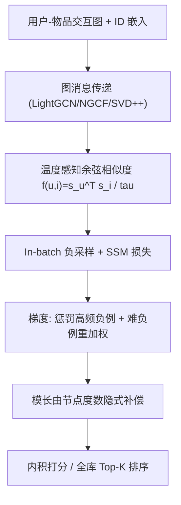
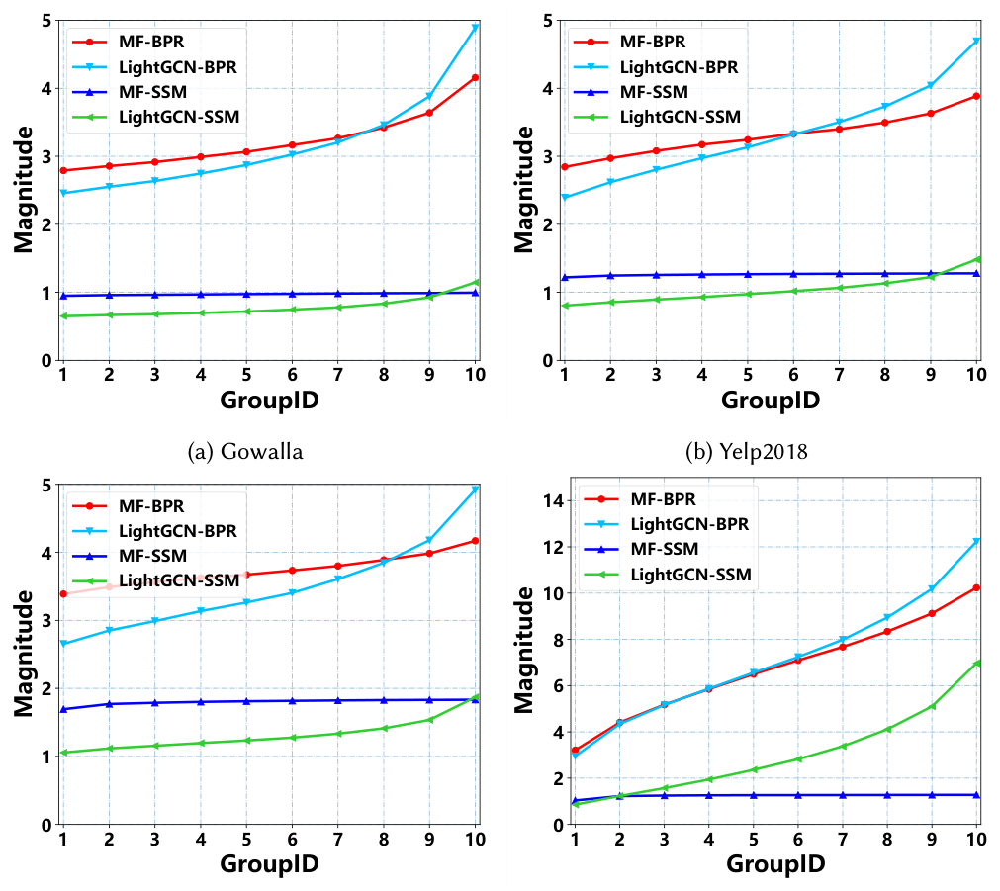

# On the Effectiveness of Sampled Softmax Loss for Item Recommendation (采样Softmax损失在物品推荐中的有效性研究)

- **会议/期刊**: ACM Transactions on Information Systems (TOIS)
- **作者与机构**: Jiancan Wu, Xiang Wang, Xingyu Gao, Jiawei Chen, Hongcheng Fu, Tianyu Qiu（中国科学技术大学、中科院微电子所、浙江大学、腾讯音乐）
- **推荐链路定位**: 召回（学习目标 / 损失函数层面）
- **研究方向**: 协同过滤与双塔召回 / 图神经网络推荐
- **论文原文**: [https://arxiv.org/abs/2201.02327v2](https://arxiv.org/abs/2201.02327v2)
- **开源代码**: [https://github.com/wujcan/SSM-Torch](https://github.com/wujcan/SSM-Torch)（另有 TensorFlow 版）

## TL;DR (1分钟核心速览)

推荐系统几乎只用 pointwise(BCE) 或 pairwise(BPR) 损失，而与大热度排序指标更契合的 softmax 损失因全库归一化开销及流式场景不可解而鲜被采用。本文把"采样 softmax (SSM)"当作主角：理论上证明其三条模型无关优势（抑制流行度偏差、动态挖掘难负样本、最小化 SSM 等价于最大化 DCG），同时指出 SSM 配合余弦相似度时**无法学习表征模长**，并证明 GCN 消息传递按节点度数自动调节模长恰好补上这一缺口。在四个基准、`7:1:2` 划分、`Full-Ranking` 协议下，LightGCN+SSM 取得 Recall@20 0.1869/0.0737/0.0590/0.1253，相对 BPR 最高提升 41.5%，且训练总时长从 9h20m 降至 13min。

## Background & Motivation (背景与核心矛盾)

- **主流范式**: 物品推荐普遍被当作监督任务，用 pointwise（BCE/MSE）拟合标签、或用 pairwise（BPR/WARP）约束正负相对序；softmax 类损失因需对全物品做归一化而长期被边缘化。
- **前人局限**: ① SSM 在推荐中通常只作为"全 softmax 的有偏近似"（配 logQ 校正）或对比学习辅助项（InfoNCE），极少作为主目标；② 已有工作（如 MSCL）只做了经验性验证，未回答"SSM 到底适不适合推荐、相对 BCE/BPR 的概念优势在哪"。
- **核心洞察 (Key Insight)**: in-batch 负采样在期望上等价于按经验频率采样负样本，因此 SSM 天然对高频物品施加重罚；温度感知余弦相似度把相似度限制在 $[-1,1]$，使难负样本梯度可控；而 softmax 形式本身与 DCG 存在下界关系。但作者意外发现 MF+SSM 性能大幅崩塌，进一步定位到"模长学习"这一被忽略的维度。
- **本文切入点**: 先用理论给出 SSM 的三条优势与一条缺陷，再证明消息传递范式（SVD++/NGCF/LightGCN）恰好能补偿该缺陷，从而给出"何时用 SSM 会赢、何时会输"的判据。

## Method (核心方法设计)

### 1. 整体框架 (Overall Architecture)

模型本身不新，创新在于把 NCE 视角下的 SSM 损失与骨干表征能力对齐起来分析：输入用户-物品交互图，经 ID 嵌入与（可选）图消息传递得到表征 $\boldsymbol{z}_u,\boldsymbol{z}_i$，用温度感知余弦相似度$f(u,i)=\boldsymbol{s}_u^\top\boldsymbol{s}_i/\tau$打分，训练时对每个正样本共享 batch 内其余用户的正例作为负样本集合$\mathcal{N}$，最小化 SSM；推理时改用内积在全库上排序。作者的闭环论证是：SSM 负责学"方向"，消息传递负责学"模长"，二者互补才产生最优 top-$K$ 结果。

### 2. 关键设计拆解 (Key Designs)

1. **SSM 闭式解揭示流行度惩罚**：从 NCE 后验比出发得到
$\mathcal{L}_{\text{SSM}}=-\frac{1}{|\mathcal{D}|}\sum_{(u,i)\in\mathcal{D}}\log\frac{\exp(f(u,i))}{\exp(f(u,i))+\sum_{j\in\mathcal{N}}\exp(f(u,j))}$，
令梯度为零可得 $f^*(u,i)=\log\frac{N\,\mathbb{E}_{j\sim p_n}\exp(f(u,j))}{1+N|\mathcal{P}_u|p_n(i)}$。可见$p_n(i)$ 越大（越热门），最优打分的对数越小——这与 IPW 的重加权目标一致，但给出了显式闭式解，可灵活控制物品流行度。

2. **温度系数驱动的难负样本梯度整形**：对 $\boldsymbol{z}_u$求导后，负例$j$的梯度模长正比于$g(x)=\sqrt{1-x^2}\exp(x/\tau)$，其中$x=\boldsymbol{s}_u^\top\boldsymbol{s}_j$。当$\tau\in[0.1,0.2]$时，相似度越高的难负例梯度越大；但当$x\to 1$（可能是假负例）时$g(x)$ 迅速衰减到 0，实现"挖难负例但不过度惩罚"的软截断，且无需额外采样器或 margin。

3. **模长缺陷与消息传递补偿**：SSM 用余弦相似度，模长在损失中不可辨识，故模型只学方向。作者证明对度数服从 Pareto 分布的消息传递，$\mathbb{E}[(\boldsymbol{q}'_i)^2]=a|\mathcal{P}_i|^{1-2\alpha_0}+b|\mathcal{P}_i|^{2-2\alpha_0}$；取$\alpha_0=\alpha_1=0.5$（即 LightGCN）时模长随节点度数**线性增长**，恰好补上 SSM 缺口。而 MF 无此机制、BPR 用内积又会放大热门物品模长，二者均不理想。

4. **训练目标、负采样与推理效率**：总损失为 $\mathcal{L}_{\text{SSM}}+\lambda\|\Theta\|_2^2$，负采样默认用 **in-batch**（免显式采样器，$N$即为 batch 规模），无需 hard-negative mining 模块。推理用内积（$f$的模长信息在训练中被 GCN 灌入表征）。实测 Amazon-Book 上 39s/epoch、21 epoch 收敛、总计 13min，而 BPR 需 700 epoch/9h20m，$N=2048$ 的广义 BPR 达 24h47m；全 softmax(SM) 在 padding 到 50 万候选时 OOM。

## Experimental Setup & Evaluation Protocol (实验设置与评估协议)

- **数据集与预处理**: 前三个数据集沿用 NGCF/LightGCN 的 `10-core` 过滤；Alibaba-iFashion 按原处理随机采 30 万用户并保留其全部交互。

| 数据集 | #Users | #Items | #Interactions | 稀疏度/密度 | 特征/场景说明 |
| :--- | :---: | :---: | :---: | :---: | :--- |
| Gowalla | 29,858 | 40,981 | 1,027,370 | 0.00084 | LBSN 签到 |
| Yelp2018 | 31,831 | 40,841 | 1,666,869 | 0.00128 | 本地商户点评 |
| Amazon-Book | 52,643 | 91,599 | 2,984,108 | 0.00062 | 图书电商 |
| Alibaba-iFashion | 300,000 | 81,614 | 1,607,813 | 0.00007 | 服饰电商（极稀疏） |

- **数据划分与防穿越 (Splitting Strategy)**: 按 `7:1:2` **比例划分**训练/验证/测试（沿用 NGCF、LightGCN 设定），无不当时序泄露。
- **排名评测协议 (Ranking Protocol)**: 无偏 `Full-Ranking`（对测试用户全部未交互物品排序），报告 Recall@20 与 NDCG@20；结果为 5 次运行均值。
- **对比基线与超参设置**: 4 类损失（BCE 正负比 1:4、BPR 单负例、SM 全 softmax、CCL margin/权重网格搜索、SSM）跨 4 类骨干（MF、SVD++、NGCF、LightGCN）；嵌入维 $d=64$，Adam，学习率 0.001，batch 2048，$\tau$先粗网格$\{0.1,0.2,0.5,1.0\}$再细调，$L_2$系数$10^{-6}\sim10^{-1}$。

## Key Experimental Results (实验关键数据)

### 1. 主实验对比 (Main Results)

同一骨干（LightGCN）下五种损失，Recall@20 / NDCG@20：

| Loss | Gowalla | Yelp2018 | Amazon-Book | Alibaba-iFashion |
| :--- | :---: | :---: | :---: | :---: |
| BCE | 0.1743 / 0.1491 | 0.0628 / 0.0515 | 0.0373 / 0.0292 | 0.0983 / 0.0458 |
| BPR | 0.1824 / 0.1554 | 0.0640 / 0.0524 | 0.0417 / 0.0322 | 0.1086 / 0.0511 |
| SM | 0.1756 / 0.1429 | 0.0708 / 0.0580 | 0.0489 / 0.0377 | 0.1155 / 0.0558 |
| CCL | 0.1790 / 0.1407 | 0.0669 / 0.0554 | 0.0528 / 0.0416 | 0.1203 / 0.0570 |
| **SSM** | **0.1869** / **0.1571** | **0.0737** / **0.0609** | **0.0590** / **0.0459** | **0.1253** / **0.0599** |
| Improv. vs BPR | +2.5% / +1.1% | +15.2% / +16.2% | **+41.5% / +42.5%** | +15.4% / +17.2% |

骨干 × 损失的 Recall@20（BPR → SSM）：

| Backbone | Gowalla | Yelp2018 | Amazon-Book | Alibaba-iFashion |
| :--- | :---: | :---: | :---: | :---: |
| MF | 0.1558 → 0.1231 ↓ | 0.0562 → 0.0509 ↓ | 0.0352 → 0.0473 ↑ | 0.1031 → 0.0841 ↓ |
| SVD++ | 0.1589 → 0.1669 | 0.0569 → 0.0693 | 0.0373 → 0.0547 | 0.1094 → 0.1276 |
| NGCF | 0.1548 → 0.1854 | 0.0579 → 0.0736 | 0.0357 → 0.0552 | 0.0923 → 0.1296 |
| LightGCN | 0.1824 → 0.1869 | 0.0640 → 0.0737 | 0.0417 → 0.0590 | 0.1086 → 0.1253 |

### 2. 消融实验 (Ablation Study)

以 LightGCN 为骨干，把各损失也升级为 in-batch 负采样（Recall@20）：

| 变体 | Gowalla | Yelp2018 | Amazon-Book | Alibaba-iFashion |
| :--- | :---: | :---: | :---: | :---: |
| BCE-IB | 0.1429 | 0.0524 | 0.0361 | 0.1107 |
| BPR-IB | 0.1225 | 0.0492 | 0.0470 | 0.0937 |
| CCL-IB | 0.1093 | 0.0484 | 0.0495 | 0.0644 |
| **SSM (in-batch)** | **0.1869** | **0.0737** | **0.0590** | **0.1253** |

相似度组合（Gowalla，训练-测试）：IP-IP 0.1085、Cos-Cos 0.1140、**Cos-IP 0.1867**、IP-Cos 0.0825；负采样数 $N$从 1 增至 2048 时 SSM 单调上升（Amazon-Book 上$N>8$即超 BPR，此时 SSM 每 batch 仅享$N$个负例而 BPR 为$|B|\times N$）；$\beta$实验显示$p_n(i)=f_i^{\beta}$在$\beta=1.0$（即频率采样）附近最优。

### 3. 关键实验发现 (Key Findings)

1. **收益来自"学方向"而非"学幅度"，且与图卷积互补**：MF+SSM 在三个数据集上掉点（Gowalla 0.1558→0.1231，−21%），因 MF 无模长调节机制；而 SVD+++SSM 已在 Yelp2018/Amazon-Book 上超过更强的 LightGCN+BPR（0.0693 vs 0.0640、0.0547 vs 0.0417），说明"换损失"的增益可大于"加 GCN 层"。<figure class="paper-figure" markdown="span">
  <figcaption>图 5. BPR 和 SSM 所学物品表示幅值的实证研究。</figcaption>
</figure>
2. **in-batch 负采样是双刃剑，只有 SSM 能驾驭**：同一策略使 BPR-IB 在 Gowalla 从 0.1824 崩至 0.1225（−32.8%）、CCL-IB 降至 0.1093，原因是过度惩罚热门物品而丢失头部精度；SSM 因与 DCG 对齐，能同时兼顾头部与长尾。
3. **长尾分布被显著抹平**：LightGCN+BCE/BPR/SM 下，最热门组仅占 0.65%–0.83% 物品却贡献 >35% 的 Recall，最冷组占 25.5%–64.4% 物品却贡献 <3%；SSM 在 Amazon-Book 上十组贡献接近均匀，且整体指标不降。

## Highlights & Limitations (亮点、对比与审稿批判)

- **与代表作对比 (vs. Prior Work)**: 相比把 SSM 视为"有偏 softmax 近似"的 logQ 校正路线（Bengio & Senécal、Blanc & Rendle），本文主张 SSM 的有偏正是其长尾与难负例优势来源；相比 MSCL（仅经验验证 GNN+SSM），本文补上三条定理与模长缺陷证明；相比 BPR 只为 AUC/相对序优化，SSM 直接对齐 DCG@K。
- **可迁移亮点**: ① 用"$\tau$+ 余弦"在$[-1,1]$ 有界区间内实现免采样器的难负例软截断，可直接替换双塔召回中的 in-batch softmax 温度策略调参；② "损失学方向 / 消息传递学模长"的解耦分析，为选择损失-骨干配对提供了可操作的先验判据。
- **审稿级局限批判**: ① 与全 softmax 的差距、以及与 logQ 无偏估计路线的正面对比缺失，"有偏"在何规模下可接受仍无量化边界；② 模长分析基于度数服从 Pareto 分布与 $\alpha_0,\alpha_1$手工设定（附录仅给$[\alpha_0,\alpha_1]$离散网格），且互惠性极强：结论依赖 batch 内负例分布，流式/小 batch 场景下$\beta$ 需重新调优，泛化性未验证；此外 MF 崩塌的补救方案（如显式模长正则）未给出。

## Rating (四维评分)

- **方法创新性 (Novelty)**: ⭐⭐⭐⭐ （以 NCE 视角给 SSM 三条可证性质，并首次指出模长缺陷、用消息传递的度数-模长关系闭环解释，属"旧损失新理解"型贡献）
- **评估协议与实验扎实度 (Protocol & Experiments)**: ⭐⭐⭐⭐ （4 数据集 × 4 损失 × 4 骨干的矩阵式对比 + Full-Ranking + 5 次均值 + 长尾分桶与效率/显存分析，但缺显著性检验与 logQ 基线）
- **写作与数学规范度 (Clarity & Rigor)**: ⭐⭐⭐⭐ （闭式解、梯度模长 $g(x)$、DCG 下界与模长期望四条推导链条清晰，符号一致；模长部分依赖分布假设，略显理想化）
- **工业落地与复现价值 (Industrial & Practical Value)**: ⭐⭐⭐⭐⭐ （TF/PyTorch 双版本开源；in-batch 免采样、13min 收敛、显存对候选规模近乎不敏感，可直接替换大规模召回训练目标）

