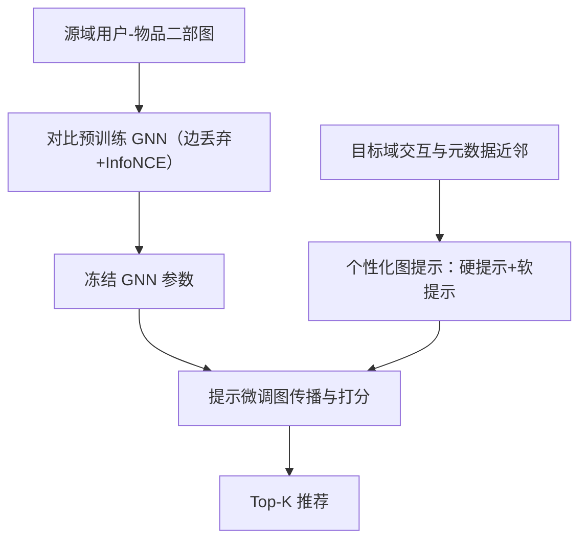
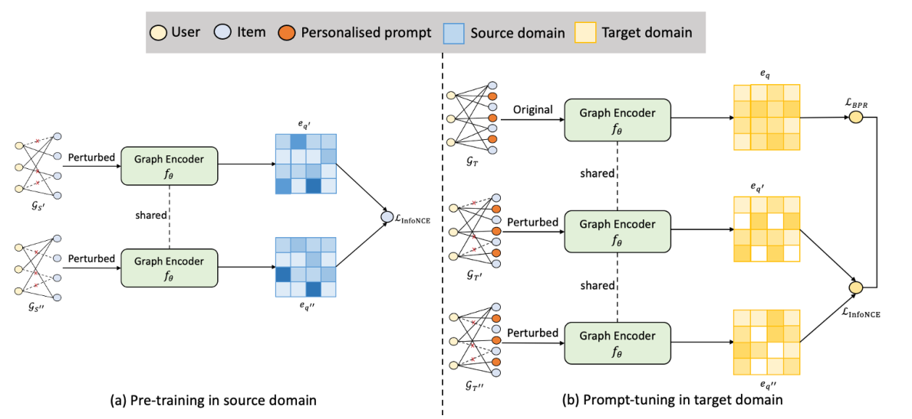

# Contrastive Graph Prompt-tuning for Cross-domain Recommendation (对比图提示微调的跨域推荐)

- **会议/期刊**: ACM Transactions on Information Systems (TOIS)
- **作者与机构**: Zixuan Yi, Iadh Ounis, Craig Macdonald；University of Glasgow
- **推荐链路定位**: 召回/排序（跨域 Top-K 推荐）
- **研究方向**: 跨域与多场景推荐 / 图神经网络推荐
- **论文原文**: [论文原文链接](https://arxiv.org/abs/2308.10685v2)
- **开源代码**: 暂未开源

## TL;DR (1分钟核心速览)

针对跨域推荐中“源域预训练-目标域全参数微调”易负迁移且调参昂贵的问题，PGPRec 冻结预训练 GNN，仅调个性化图提示（硬提示=近邻物品，软提示=可学习向量），并以对比预训练增强泛化。四组 Amazon 域对上 Recall/NDCG@10 有竞争性，调参最多降 74%，冷启动提升 11.41%。

## Background & Motivation (背景与核心矛盾)

- **主流范式**: CDR 常先在源域预训练 GNN，再把用户/物品表征迁移到目标域，并在目标域微调全部参数。
- **前人局限**: 源域预训练可能学到域特定噪声，导致目标域负迁移；全参数微调需更新整个 GNN，参数与时间开销高，且并非所有参数都必要。
- **核心洞察 (Key Insight)**: Transformer 可视为全连接图上的 GNN，NLP 中的 prompt-tuning 可迁移到用户-物品二部图：冻结图编码器，仅用物品级图提示注入目标域协作信号。
- **本文切入点**: 用“对比预训练 + 个性化图提示微调”替代“预训练 + 全参数微调”，兼顾跨域效果与调参效率。

## Method (核心方法设计)

### 1. 整体框架 (Overall Architecture)

PGPRec 先用源域二部图以边丢弃增强和 InfoNCE 预训练 GNN，使表征更具跨域泛化性；迁移到目标域后冻结 GNN 主体，仅将用户已交互物品的元数据近邻作为硬提示、随机可学习向量作为软提示，接入图传播并微调提示相关参数。训练同时优化 BPR 排序损失与对比损失，推理时用冻结主干+提示分支计算用户-物品得分并做 Top-K 排序。

<figure class="paper-figure" markdown="span">
  <figcaption>图 2</figcaption>
</figure>
图 2：PGPRec 的源域对比预训练与目标域个性化图提示微调流程。

### 2. 关键设计拆解 (Key Designs)

1. **个性化硬/软图提示（Personalised Graph Prompts）**：为免全参数微调，将目标域中与用户已交互物品共享 `also_bought / also_viewed / bought_together` 的近邻物品作为硬提示节点，并以可学习向量作软提示。图传播改为  
$\boldsymbol{h}_i^{\ell+1}=\sigma\left(\boldsymbol{W}_U\boldsymbol{h}_i^{\ell}+(1-\lambda)\sum_{j\in N(i)}\boldsymbol{W}_V\boldsymbol{h}_j^{\ell}+\lambda\sum_{r\in N(i)}\boldsymbol{P}'_V\boldsymbol{h}_r^{\ell}\right)$，  
其中 $\lambda=|N_r|/(|N_j|+|N_r|)$。硬提示按$s(j,r)=\boldsymbol{e}_j^\top\boldsymbol{e}_r$取 Top-$m$，仅$\boldsymbol{P}'_V$ 与提示参数可训，故冻结主干仍能注入目标域信号。

2. **对比预训练与对比微调（Contrastive Learning）**：预训练阶段用边丢弃生成两个子图，以 InfoNCE 拉近同一节点不同视图、推远批内其他节点：  
$\mathcal{L}_{cl}=-\log\frac{\exp(\boldsymbol{e}_q^\top\boldsymbol{e}_{q'}/\tau)}{\sum_{k=1}^{n}\exp(\boldsymbol{e}_q^\top\boldsymbol{e}_{k}/\tau)}$。  
目标域微调仍保留 $\mathcal{L}_{cl}$，使提示微调不偏离源域可迁移结构。

3. **训练目标、负采样与推理效率**：总损失  
$\mathcal{L}=\mathcal{L}_{BPR}+\lambda_1\mathcal{L}_{cl}+\lambda_2\|\Theta\|_2^2$，  
$\mathcal{L}_{BPR}$ 从未交互物品采负样本做 pairwise 排序；推理时冻结 GNN，仅走提示分支，显著减少可训参数与存储。

## Experimental Setup & Evaluation Protocol (实验设置与评估协议)

- **数据集与预处理**: 四个 Amazon Review 域对，评分二值化；目标域交互 >5 为普通用户，<5 为冷启动用户。

| 数据集(源→目标) | #Users | #Items(源/目标) | #Interactions(源/目标) | 密度(源/目标) |
| :--- | :---: | :---: | :---: | :---: |
| Elec→Phone | 12,739 | 36,183/12,772 | 465,545/178,973 | 0.101%/0.110% |
| Sport→Cloth | 6,755 | 31,514/35,131 | 93,666/87,805 | 0.044%/0.037% |
| Sport→Phone | 4,017 | 19,396/12,517 | 52,202/40,225 | 0.067%/0.080% |
| Elec→Cloth | 11,611 | 49,730/47,265 | 202,095/137,198 | 0.035%/0.025% |

- **数据划分与防穿越**: 随机按 8:1:1 划分训练/验证/测试，非全局时间戳切分，存在一定未来交互泄漏风险。
- **排名评测协议**: 对目标域未交互物品做 Top-10 排序，报告 Recall@10、NDCG@10；BPR 负样本来自未交互物品。
- **对比基线与超参**: 联合学习 CMF/CoNet/PPGN/BiTGCF，单域与预训练微调 NGCF/LightGCN/SGL；Embedding 维度 64，Adam，batch 1024，早停 50 epoch；主结果用 TOST $p<0.05$ 与 Holm–Bonferroni 校正，消融用配对 t 检验。

## Key Experimental Results (实验关键数据)

### 1. 主实验对比 (Main Results)

| 方法 | Elec-Phone R/N | Sport-Cloth R/N | Sport-Phone R/N | Elec-Cloth R/N |
| :--- | :---: | :---: | :---: | :---: |
| CMF | .4015/.2543 | .4309/.2685 | .3348/.1927 | .3054/.1836 |
| CoNet | .4514/.2696 | .4912/.3128 | .3854/.2331 | .3546/.2353 |
| PPGN | .4464/.2629 | .4678/.2930 | .3677/.2240 | .3404/.2184 |
| BiTGCF | .5064/.2999 | .5360/.3315 | .4688/.3072 | .4209/.2783 |
| LightGCN$_{SD}$ | .4776/.2993 | .5327/**.3358** | .4557/.3006 | .4261/.2699 |
| SGL$_{PT}$ | .5071/.3282 | .5398/.3119 | **.4721/.3114** | **.4301/.2967** |
| PGPRec | **.5213/.3386** | **.5678**/.3281 | .4607/.3086 | .4233/.2854 |

相对 SGL$_{PT}$：Elec-Phone +2.80%/+3.17%，Sport-Cloth Recall +5.19%；Sport-Phone 与 Elec-Cloth 分别低约 2.42%/0.90% 与 1.58%/3.81%。

### 2. 消融实验 (Ablation Study)

| 变体 | Elec-Phone | Sport-Cloth | Sport-Phone | Elec-Cloth |
| :--- | :---: | :---: | :---: | :---: |
| PGPRec-BPR | .4851 | .5332 | .4361 | .3918 |
| PGPRec-soft | .4716 | .5216 | .4468 | .4033 |
| PGPRec-hard | .5172 | .5532 | .4537 | .4231 |
| PGPRec | **.5213** | **.5678** | **.4607** | **.4233** |

### 3. 关键实验发现 (Key Findings)

1. **对比预训练是主要增益源**：PGPRec 相比 BPR 预训练变体在 Elec-Phone 的 Recall@10 提升约 7.5%（.5213 vs .4851），说明 InfoNCE 预训练提供了更可迁移的初始化。
2. **硬提示贡献显著大于软提示**：仅硬提示已显著优于仅软提示，Elec-Phone 上 .5172 vs .4716；最佳组合为 5 个硬提示+3 个软提示，软提示过多反而损害性能。
3. **效率与冷启动优势明确，但非全胜**：可训参数最多减少 74%，部分域对仅需 SGL$_{PT}$的 33%–47% 参数即可竞争；冷启动相对最强基线提升 11.41%，但在域差异较大的 Sport-Phone/Elec-Cloth 上低于 SGL$_{PT}$。

## Highlights & Limitations (亮点、对比与审稿批判)

- **与代表作对比 (vs. Prior Work)**: PCRec 预训练 GIN 后迁移表征并微调 MF；SGL$_{PT}$ 用对比学习但目标域全参数微调；BiTGCF 为双 LightGCN 联合学习。PGPRec 的本质区别是冻结 GNN，仅调图提示，参数效率更高。
- **可迁移亮点**: 用元数据近邻构造 item-wise 硬提示，可迁移到冷启动物品与多场景召回；冻结主干+提示微调适合大图低成本适配。
- **审稿级局限批判**: ①随机 8:1:1 划分而非时间切分，Top-K 评估可能偏乐观；②性能对领域距离与提示数量敏感，且未报告线上推理延迟、无开源代码，复现与工程评估不足。

## Rating (四维评分)

- **方法创新性 (Novelty)**: ⭐⭐⭐⭐ （将 NLP prompt-tuning 落到用户-物品二部图，硬/软图提示算子清晰）
- **评估协议与实验扎实度 (Protocol & Experiments)**: ⭐⭐⭐⭐ （四域对、冷启动、参数量与显著性检验较完整，但随机划分削弱时序严谨性）
- **写作与数学规范度 (Clarity & Rigor)**: ⭐⭐⭐⭐ （Transformer-GNN 等价性与提示传播推导完整，部分表格符号略密）
- **工业落地与复现价值 (Industrial & Practical Value)**: ⭐⭐⭐ （参数高效有吸引力，但依赖元数据近邻、未见开源与线上延迟验证）

