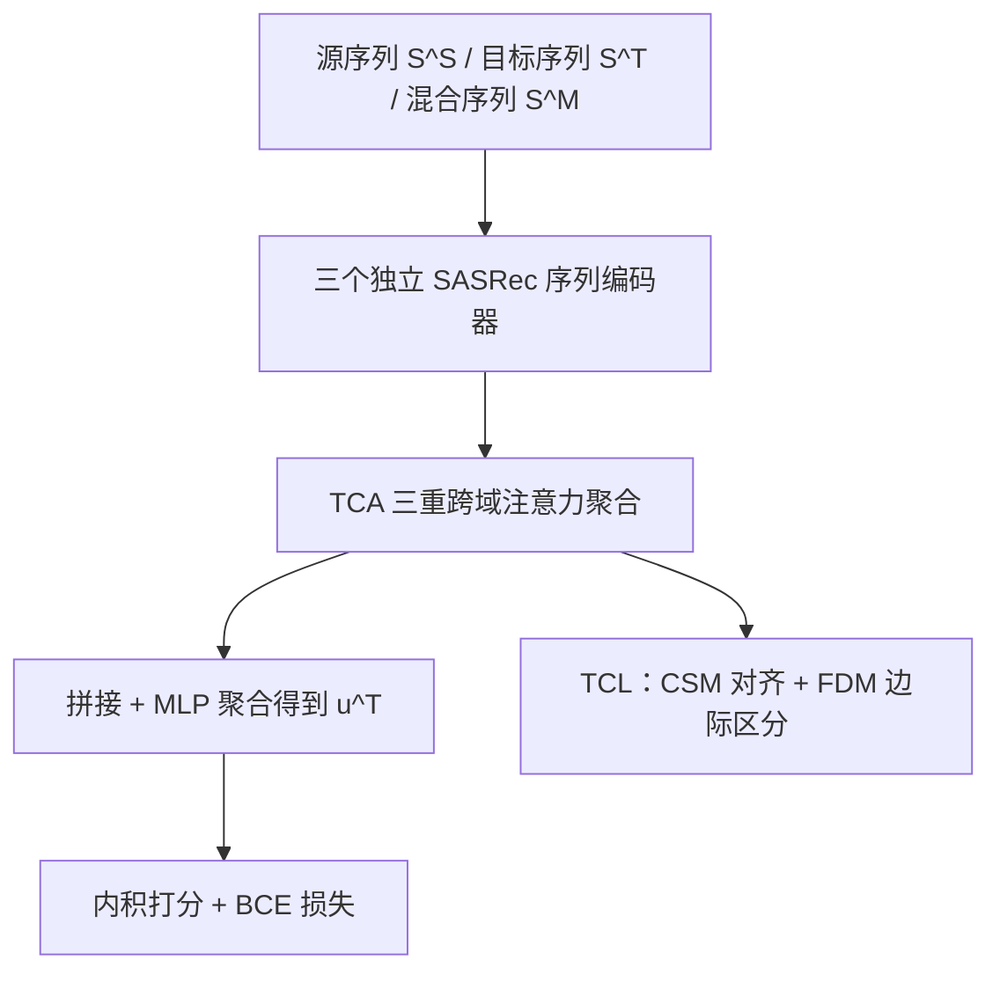
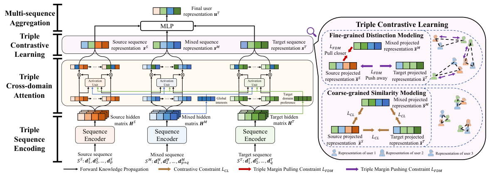

# Triple Sequence Learning for Cross-domain Recommendation (面向跨域推荐的三重序列学习)

- **会议/期刊**: TOIS 2024（投稿在审版，arXiv 2304.05027v2）
- **作者与机构**: Haokai Ma、Lei Meng（山东大学软件学院）、Ruobing Xie、Xin Chen、Xu Zhang、Leyu Lin、Jie Zhou（腾讯微信）
- **推荐链路定位**: 跨域序列精排（Next-Item 预测），可作为 model-agnostic 插件挂载于不同序列编码器
- **研究方向**: 跨域与多场景推荐 / 序列与会话推荐
- **论文原文**: [https://arxiv.org/abs/2304.05027v2](https://arxiv.org/abs/2304.05027v2)
- **开源代码**: 暂未开源（原文声明接收后放出）

## TL;DR (1分钟核心速览)

现有 CDR 只在"源域↔目标域"二元关系上做迁移，丢掉了把两域行为按时间戳拼接后天然形成的**混合序列**所蕴含的全局兴趣。Tri-CDR 用三个独立序列编码器同时建模源/目标/混合序列，以**三重跨域注意力（TCA）**筛选与目标偏好和全局兴趣相关的信息，再用**三重对比学习（TCL）**——粗粒度 InfoNCE 对齐 + 边际三元组区分——兼顾正迁移与信息多样性。在 Amazon、Douban 六个跨域设定上（Leave-one-out、99 负采样排序），NDCG@10 相对最优基线提升 1.2%–4.8%，且在 GRU4Rec/SASRec/CL4SRec 三种编码器下均稳定生效。

## Background & Motivation (背景与核心矛盾)

- **主流范式**: CDR/CDSR 主流做法是双域建模——映射函数（EMCDR/SSCDR）、显式跨域通路（CoNet/DASL）、多域全局图（DDGHM/C2DSR），统一目标是把源域知识搬到目标域缓解稀疏。
- **前人局限**: ① 只建模 `源→目标` 或 `全局→局部` 的**二元**关系，无法刻画用户跨域行为在时间轴上的真实跳转逻辑（如 book:AlphaGo → movie:AI → book:Transformers 这种跨域交替兴趣演化）；② 已有引入混合序列的工作（C2DSR/DDGHM）又常丢弃源域序列本身，或只做 inter-CL 互信息最大化，**过度拉近**导致表征塌缩与负迁移。
- **核心洞察 (Key Insight)**: 混合序列 $S^M$天然由$S^S$与$S^T$组成，因此三者的距离结构应满足"$d(s_S,s_M)$、$d(s_T,s_M)$小于$d(s_S,s_T)$"——这一序关系是先验可用的免费监督信号，而普通 InfoNCE 反而会破坏它。
- **本文切入点**: 把"三元组"作为一等公民：序列层面三路编码，注意力层面三路交互筛选，损失层面"拉近 + 推开"双约束。

## Method (核心方法设计)

### 1. 整体框架 (Overall Architecture)

对每个用户构造三条按时间排序的序列：源域 $S^S$、目标域$S^T$、混合序列$S^M$(长度$p+q$，两域行为按时间戳交织)。三条序列分别经三个**同构但参数独立**的序列编码器（默认 SASRec 自注意力）得到隐矩阵$H^S,H^T,H^M$；注意同 ID 物品在不同域使用不同 embedding，避免表征过度同质化。随后 TCA 以目标域末位隐状态$h^T_q$与混合域末位隐状态$h^M_{p+q}$为"查询锚点"，对三条序列分别做注意力聚合成$s_S,s_T,s_M$；三者拼接经两层 MLP 得用户表征$u^T$，与候选物品内积做 CTR 打分。训练时在 CTR 损失外并联 TCL 的 CSM 与 FDM 两项，并采用"单域预训练 + 跨域微调"两阶段策略稳定收敛。

<figure class="paper-figure" markdown="span">
  <figcaption>图2. Tri-CDR的整体结构。TCA突出与用户目标域偏好和全局兴趣相关的信息性知识，而TCL捕获三个域之间的三重相关性，以实现更好的跨域知识迁移。</figcaption>
</figure>

### 2. 关键设计拆解 (Key Designs)

1. **三重跨域注意力 TCA（把"筛知识"变成注意力权重）**：痛点是不加区分的源/混合序列会带来负迁移，而直接用候选物品 embedding 做 query 在线上要为每个候选算一遍。TCA 改用目标域当前偏好 $h^T_q$与全局兴趣$h^M_{p+q}$共同作锚点，对第$i$ 个源域行为：
   $\alpha^S_i=\mathrm{MLP}_a\big(h^T_q\,\|\,h^S_i\,\|\,h^S_i-h^T_q\,\|\,h^S_i\odot h^T_q\,\|\,h^M_{p+q}\big),\quad s_S=\sum_i \mathrm{Softmax}(\alpha^S_i)\,h^S_i$。
   差值项与点积项显式刻画"该行为与目标偏好的一致/冲突程度"，因此对齐与冲突知识可被分开加权；用上一步隐状态而非候选物品做 query，使在线打分只需一次前向（与候选数解耦）。
2. **三重对比学习 TCL（粗对齐 + 细区分）**：CSM 在三个投影子空间上对 $(\bar s_M,\bar s_S)$、$(\bar s_M,\bar s_T)$、$(\bar s_S,\bar s_T)$ 三对正例各做 InfoNCE，把同用户跨域表征从"按域聚类"拉成"按用户聚类"。但单调拉近会让源/混合序列对目标序列不再提供增量信息，故 FDM 用边际三元组约束距离序：
   $\mathcal{L}_{FDM}=\sum_u \max\{d(\bar s_S,\bar s_M)-d(\bar s_S,\bar s_T)+\gamma,\,0\}$。
   该式只要求"源-混合更近、源-目标更远"，天然保留域间差异（$L_2$距离，$\gamma$ 按数据密度域内取值）。
3. **训练目标、负采样与推理开销**：总损失 $\mathcal{L}=\mathcal{L}_{CTR}+\lambda_{CSM}\mathcal{L}_{CSM}+\lambda_{FDM}\mathcal{L}_{FDM}$，$\mathcal{L}_{CTR}$为 BCE，负样本为训练集内随机负采样（CSM 的负例即 batch 内其他用户，in-batch）。TCL 只在训练期生效，推理时无额外开销；时间/空间复杂度与 CL4SRec 同阶$O((L^2+L+B)d|U|)$，仅多出三个编码器与少量 MLP 参数。

## Experimental Setup & Evaluation Protocol (实验设置与评估协议)

- **数据集与预处理**: 保留双域均有行为的用户，过滤行为数 < 3 的用户，全部评分记录视为隐式交互。

| 数据集 | #Users | #Items | #Interactions | 稀疏度/密度 | 特征/场景说明 |
| :--- | :---: | :---: | :---: | :---: | :--- |
| Amazon Toy | 7,996 | 37,868 | 114,487 | 0.0378% | 与 Game 构成双向对 |
| Amazon Game | 7,996 | 11,735 | 82,871 | 0.0883% | 较稠密，作源域更优 |
| Amazon Book | 28,531 | 239,042 | 625,692 | 0.0092% | 极稀疏，与 Movie 配对 |
| Amazon Movie | 28,531 | 38,185 | 349,918 | 0.0321% | 稠密域 |
| Douban Book | 4,580 | 64,340 | 224,117 | 0.0761% | 平均交互 48.93 |
| Douban Music | 4,580 | 57,586 | 278,855 | 0.1057% | 平均交互 60.89 |

- **数据划分与防穿越 (Splitting Strategy)**: `Leave-One-Out`——每位用户最后一条交互作测试、倒数第二条作验证，序列按时间戳升序构造，混合序列由两域行为合并后重排序，严格无未来信息泄漏。
- **排名评测协议 (Ranking Protocol)**: `Sampled Ranking`——测试阶段为每个正例随机采 99 个负例（1:99），报告 NDCG@{5,10,20,50}、HR@{5,10,20,50} 与 AUC；**非 Full-Ranking**，绝对数值偏乐观。
- **对比基线与超参设置**: 单域 GRU4Rec / SASRec / CL4SRec；跨域 SASRec(S+T)、DTCDR+、DDTCDR+、DASL+、C2DSR+（"+ "表示统一换成 SASRec 编码器以保证公平）；$d=64$、batch 120、最大序列长 200、lr 5e-4、$\tau=0.1$，$\lambda_{CSM},\lambda_{FDM}\in\{0.1,0.5,1,4,10\}$，$\gamma$按域密度取 0.05–4.0；5 次随机种子取均值，配对 t 检验$p<0.05$。

## Key Experimental Results (实验关键数据)

### 1. 主实验对比 (Main Results)

| 数据集 | 指标 | GRU4Rec | SASRec | CL4SRec | SASRec(S+T) | DASL+ | C2DSR+ | **Tri-CDR** | Improv. |
| :--- | :---: | :---: | :---: | :---: | :---: | :---: | :---: | :---: | :---: |
| Game→Toy | N@10 | 0.1551 | 0.2097 | 0.2143 | 0.2189 | 0.2206 | 0.2213 | **0.2312** | +4.5% |
| Game→Toy | HR@10 | 0.2624 | 0.3260 | 0.3338 | 0.3355 | 0.3338 | 0.3442 | **0.3548** | +3.1% |
| Toy→Game | N@10 | 0.3053 | 0.3673 | 0.3687 | 0.3803 | 0.3734 | 0.3691 | **0.3892** | +2.3% |
| Toy→Game | HR@10 | 0.4839 | 0.5546 | 0.5579 | 0.5702 | 0.5613 | 0.5704 | **0.5854** | +2.6% |
| Movie→Book | N@10 | 0.2695 | 0.3160 | 0.3340 | 0.3285 | 0.3346 | 0.3359 | **0.3519** | +4.8% |
| Movie→Book | HR@10 | 0.4173 | 0.4728 | 0.4937 | 0.4874 | 0.4933 | 0.4966 | **0.5182** | +4.3% |
| Book→Movie | N@10 | 0.4477 | 0.4843 | 0.4930 | 0.4944 | 0.4939 | 0.4945 | **0.5015** | +1.4% |
| Book→Movie | HR@10 | 0.6432 | 0.6795 | 0.6897 | 0.6913 | 0.6899 | 0.6973 | **0.6999** | +0.4% |
| Book→Music | N@10 | 0.5338 | 0.5973 | 0.5815 | 0.6062 | 0.6089 | 0.6101 | **0.6177** | +1.2% |
| Book→Music | HR@10 | 0.7258 | 0.7818 | 0.7761 | 0.7913 | 0.7936 | 0.7949 | **0.8019** | +0.9% |
| Music→Book | N@10 | 0.4944 | 0.5632 | 0.5514 | 0.5813 | 0.5806 | 0.5823 | **0.5924** | +1.7% |
| Music→Book | HR@10 | 0.6746 | 0.7414 | 0.7386 | 0.7598 | 0.7602 | 0.7641 | **0.7737** | +1.3% |

### 2. 消融实验 (Ablation Study)

| 变体 (SASRec 编码器) | Game→Toy N@10 / HR@10 | Toy→Game N@10 / HR@10 | Movie→Book N@10 / HR@10 | Book→Movie N@10 / HR@10 | Book→Music N@10 / HR@10 | Music→Book N@10 / HR@10 |
| :--- | :---: | :---: | :---: | :---: | :---: | :---: |
| w/o TCA & TCL | 0.2239 / 0.3446 | 0.3636 / 0.5578 | 0.3279 / 0.4866 | 0.4754 / 0.6860 | 0.6092 / 0.7970 | 0.5833 / 0.7649 |
| w/o TCA | 0.2274 / 0.3522 | 0.3871 / 0.5816 | 0.3399 / 0.4967 | 0.4953 / 0.6902 | 0.6160 / 0.7997 | 0.5881 / 0.7693 |
| w/o FDM (仅 CSM) | 0.2280 / 0.3530 | 0.3861 / 0.5837 | 0.3415 / 0.5057 | 0.4858 / 0.6916 | 0.6138 / 0.8014 | 0.5902 / 0.7728 |
| **Tri-CDR 完整** | **0.2312 / 0.3548** | **0.3892 / 0.5854** | **0.3519 / 0.5182** | **0.5015 / 0.6999** | **0.6177 / 0.8019** | **0.5924 / 0.7737** |

### 3. 关键实验发现 (Key Findings)

1. **混合序列本身就是最强单路信号，但"无脑三路拼接"会反噬**：单域基线中 SASRec(M)（只用混合序列）在 Game→Toy 上 N@10 已达 0.2200，远超 SASRec(T) 的 0.2097，说明跨域交替兴趣确有增益；然而朴素拼接的 SASRec(S+T+M) 在 Book→Movie 上 N@10 反而跌到 0.4814（低于 SASRec(S+T) 的 0.4944），印证源/混合序列同时携带噪声——这正是 TCA+TCL 把该设定拉回 0.5015 的价值来源。
2. **TCL 与 TCA 互补，FDM 是抗塌缩的关键**：去掉 TCA&TCL 后 Movie→Book 的 HR@10 仅 0.4866，恢复 TCA 得 0.4967，恢复 TCL 得 0.5057，两者叠加到 0.5182；单独消去 FDM 平均损失 1.60% NDCG@10 / 0.78% HR@10，且在 Book→Movie 上掉幅最大（0.5015→0.4858），说明仅靠 InfoNCE 对齐会让源/混合序列对目标域"无话可说"。
3. **稀疏目标域才是主战场，且 FDM 提升了对权重的鲁棒性**：Game→Toy、Movie→Book 两个稀疏目标域提升最大（N@10 +4.5%/+4.8%），而稠密域 Book→Movie 仅 +1.4%；在 CSM 权重比从 1:1:1 恶化到 1000:1:1 时，无 FDM 版本 N@10 从 0.2312 掉到 0.2244，带 FDM 版本仍保持 0.2312 附近，平均优势 1.17%（NDCG@10），显著降低调参成本。

## Highlights & Limitations (亮点、对比与审稿批判)

- **与代表作对比 (vs. Prior Work)**: 相较 DASL（双注意力、双域独立/共享偏好）与 DDTCDR（正交映射双迁移），Tri-CDR 把建模单元从"两序列"扩到"三序列"，显式引入混合序列作为全局兴趣载体；相较 C2DSR（图 + inter-domain infomax），本文指出纯互信息最大化会产生"过度同质"的负迁移，并用 margin 三元组把"区分度"写进目标函数，这是最本质的差异。
- **可迁移亮点**: ① "组合序列由子序列构成 ⇒ 距离序应满足 $d(S,M)<d(S,T)$"这一先验，可零成本迁移到多行为/多场景/多模态融合的任何多路表征对齐任务；② 用"上一步隐状态 + 全局末位状态"替代候选物品 embedding 做注意力 query，把注意力计算从$O(|\mathcal{I}|)$降到$O(1)$，是线上可落地的工程技巧。
- **审稿级局限批判**: ① 评测采用 1:99 负采样排序而非 Full-Ranking，稠密域（Douban）上的 1% 级提升在无偏全库排序下能否保持存疑，且未报告方差/置信区间；② 三套独立编码器 + 三条序列使训练显存与预训练成本约三倍于单域 SASRec，论文只给了渐近复杂度而未给实测吞吐/延迟；③ 混合序列在时间上跨域交织，若两域时间戳语义不一致（如评分时间 vs 播放时间），构造本身可能引入伪序关系，文中未讨论该鲁棒性。

## Rating (四维评分)

- **方法创新性 (Novelty)**: ⭐⭐⭐⭐ （"三序列 + 距离序先验"视角新颖，TCA 的差值/点积交互项与 FDM 的 margin 约束均有清晰物理直觉，但组件本身（InfoNCE、三元组损失、跨域注意力）均为已有积木的重组）
- **评估协议与实验扎实度 (Protocol & Experiments)**: ⭐⭐⭐⭐ （6 个跨域设定 × 3 种编码器的通用性验证与 5 种子 t 检验较扎实，但仅用 1:99 采样排序、缺少全库排序与线上 A/B，稀疏分桶分析也偏薄）
- **写作与数学规范度 (Clarity & Rigor)**: ⭐⭐⭐⭐ （公式与符号定义完整、复杂度与三类基线对比表清晰；$\lambda_1{:}\lambda_2{:}\lambda_3$ 按域密度手工设 100:1:1/1000:1:1，超参启发式色彩较重）
- **工业落地与复现价值 (Industrial & Practical Value)**: ⭐⭐⭐⭐ （model-agnostic 可插拔、推理期无 TCL 开销、注意力与候选数解耦，工程友好；但代码尚未开源、三编码器训练成本需实测评估）

