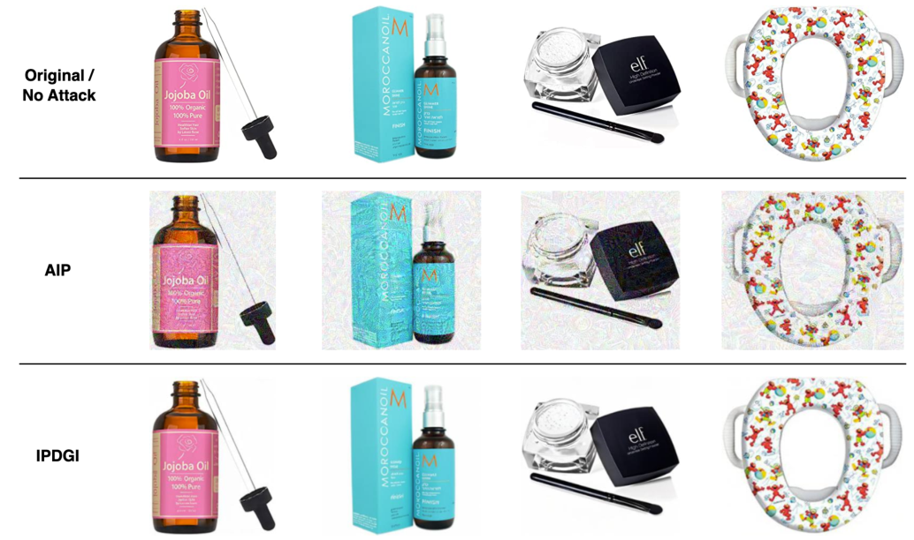
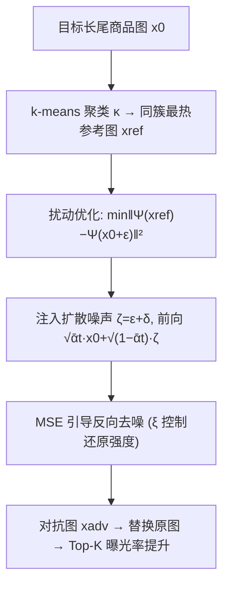
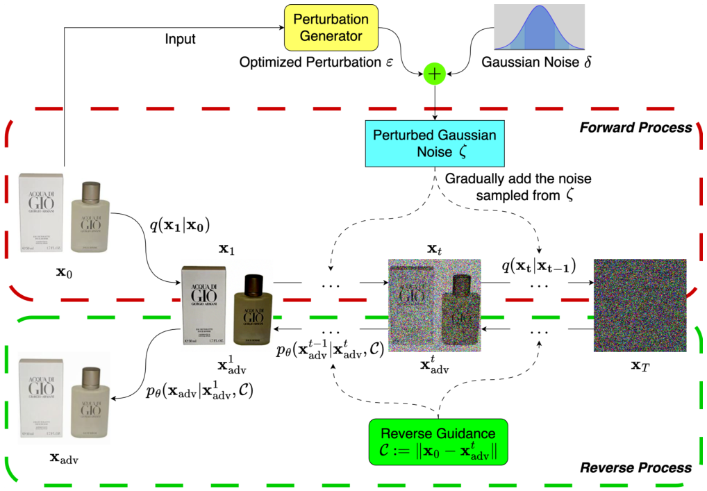

# Adversarial Item Promotion on Visually-Aware Recommender Systems by Guided Diffusion (基于引导扩散的视觉感知推荐系统对抗商品推广)

- **会议/期刊**: ACM Transactions on Information Systems (TOIS) 2024
- **作者与机构**: Lijian Chen, Wei Yuan, Tong Chen, Hongzhi Yin (The University of Queensland)；Guanhua Ye (DNCC)；Quoc Viet Hung Nguyen (Griffith University)
- **推荐链路定位**: 精排 / Top-K Ranker（对视觉特征通道的投毒攻击）
- **研究方向**: 去偏公平、可信隐私与工业架构 / 多模态推荐
- **论文原文**: [论文原文链接](https://arxiv.org/abs/2312.15826v4)
- **开源代码**: 暂未开源

## TL;DR (1分钟核心速览)

视觉感知推荐系统（VBPR/DVBPR/AMR）允许商家上传商品图，构成投毒后门，但已有攻击 AIP 生成的图严重失真、且常失效。本文提出 IPDGI：先用 k-means 在同簇内取"最热商品图"作参考，优化一个使目标图视觉特征向参考图靠拢的扰动 $\boldsymbol{\varepsilon}$，再把$\boldsymbol{\varepsilon}$直接融进扩散前向过程的高斯噪声$\boldsymbol{\delta}$，并在反向过程加 MSE 引导约束还原原图内容。在 Amazon Beauty/Baby 上以 **Full-Ranking** 协议评估，ER@5 相对最强基线 AIP 最高提升 **63.74%**，FID 从 114.55 降到 **14.25**。

## Background & Motivation (背景与核心矛盾)

- **主流范式**: 视觉感知推荐把 CNN 视觉特征（VBPR 的预提特征 + 视觉偏置、DVBPR 的端到端 CNN、AMR 的对抗训练鲁棒版）拼进 BPR 偏好打分，缓解稀疏与冷启动。
- **前人局限**: 现有攻击分两类——分类器定向（TAaMR，只改类目预测，改不了排序）与排序器定向（AIP，直接扰动图像拉近与热门商品视觉距离）。AIP 的两个硬伤：(1) 扰动尺度约束宽松，生成图肉眼可辨（图 1）；(2) 对所有目标商品固定选"全局最热"图作参考，语义错配导致扰动过大、ER@5 甚至负增益（VBPR/Baby 上 −11.11%）。
- **核心洞察 (Key Insight)**: 攻击失败的直接诱因不是扰动强度不够，而是扰动带来的**图像分布偏移**。扩散模型能精确建模正常图像分布，因此"落在正常分布内的对抗图"才能同时做到隐蔽与有效——图像质量本身是攻击有效性的隐式因子。
- **本文切入点**: 用"同簇参考图 + 扰动注入扩散噪声"把对抗目标写进生成过程，而非叠加在原图上。

<figure class="paper-figure" markdown="span">
  <figcaption>图1. 原始图像、AIP攻击（基线）与IPDGI攻击（本文方法）的图像比较</figcaption>
</figure>

## Method (核心方法设计)

### 1. 整体框架 (Overall Architecture)

对每个目标（长尾）商品图 $\mathbf{x}_0$：先由预训练聚类模型$\kappa$定位其所属视觉簇，取簇内交互最多的商品图作参考$\mathbf{x}_{\text{ref}}$；在该参考上迭代优化扰动$\boldsymbol{\varepsilon}$，使其视觉特征对齐参考图；随后把$\boldsymbol{\varepsilon}$与扩散前向的第$T$步高斯噪声相加为$\boldsymbol{\zeta}=\boldsymbol{\varepsilon}+\boldsymbol{\delta}$，经前向过程得到含扰动的噪声图，再在**带引导项的反向过程**中逐步去噪，恢复出"看起来像原图、但特征偏向热门"的对抗图$\mathbf{x}_{\text{adv}}$，替换原图后即可推高目标商品在 Top-K 中的曝光。

<figure class="paper-figure" markdown="span">
  <figcaption>图2. IPDGI概述</figcaption>
</figure>

### 2. 关键设计拆解 (Key Designs)

1. **同簇参考图选择（把"语义错配"变成"小扰动"）**：AIP 用全局最热图作参考，跨类目时需巨大扰动才能对齐特征。IPDGI 先在视觉特征空间聚类，只在目标图所属簇内选最热商品作 $\mathbf{x}_{\text{ref}}$，于是$\min_{\boldsymbol{\varepsilon}}\|\Psi(\mathbf{x}_{\text{ref}})-\Psi(\mathbf{x}_0+\boldsymbol{\varepsilon})\|_2^2$ 的解范数天然更小；消融显示去掉聚类后 ER@5 甚至劣于"不攻击"，说明参考图的语义距离直接决定扰动幅度与失真度。

2. **扰动注入扩散噪声（用生成先验"洗掉"失真）**：直接叠加扰动必然破坏像素统计。IPDGI 将扰动伪装成扩散噪声的一部分：$\mathbf{x}_t=\sqrt{\bar{\alpha}_t}\mathbf{x}_0+\sqrt{1-\bar{\alpha}_t}\,(\boldsymbol{\varepsilon}+\boldsymbol{\delta})$。由于扩散模型只在干净图上训练，反向去噪会把样本拉回正常图像流形，从而在保留对抗方向的同时抹除可见畸变。

3. **MSE 引导的反向采样（锁住原图内容）**：无条件采样内容随机，故在每一步注入条件 $p(\mathbf{x}_0|\mathbf{x}_t^{\text{adv}})=\exp(\xi\|\mathbf{x}_0-\mathbf{x}_t^{\text{adv}}\|)$，采样分布变为$\mathbf{x}_{t-1}\sim\mathcal{N}\big(\mu_\theta(\mathbf{x}_t^{\text{adv}},t)+\xi\sigma_t^2\nabla_{\mathbf{x}_t^{\text{adv}}}\|\mathbf{x}_0-\mathbf{x}_t^{\text{adv}}\|,\ \sigma_t^2\mathbf{I}\big)$，$\xi$越大越贴近原图像素。**训练/推理开销**：扩散模型直接复用 ImageNet 预训练权重（256×256 无条件引导扩散），无需针对推荐系统重训；攻击侧仅需 30 轮扰动优化（Adam，lr=1e-3）+ 15 步反向采样，VBPR/DVBPR/AMR 的 BPR 训练损失完全不动（$\mathcal{L}_{\text{BPR}}$ 保持原样，攻击只发生在数据层），属离线一次性生成成本，对商家完全可行。

## Experimental Setup & Evaluation Protocol (实验设置与评估协议)

- **数据集与预处理**（`10-core` 过滤，评分二值化，训练负采样比 **1:4**）：

| 数据集 | #Users | #Items | #Interactions | 稀疏度 | 场景说明 |
| :--- | :---: | :---: | :---: | :---: | :--- |
| Amazon Beauty | 8,787 | 1,480 | 62,631 | 99.52% | 美妆，视觉主导决策 |
| Amazon Baby | 6,158 | 1,009 | 44,335 | 99.29% | 母婴，视觉主导决策 |

- **数据划分与防穿越**: `Leave-One-Out`（每用户最后交互作测试，倒数第二条件验证）。
- **排名评测协议**: 无偏 **Full-Ranking**（对全部 1,480/1,009 个物品排序），因此 ER@K 量级仅 1% 左右，远低于 100 负采样下的数值——这是与 AIP 原论文数字不可直接横比的关键。
- **指标**: 攻击有效性 ER@K（目标商品进入 Top-K 的平均曝光率，$K\in\{5,10,20\}$）、推荐精度 NDCG@K、图像隐蔽性 FID（越低越像原图）。
- **攻击目标与威胁模型**: 取交互 < 20 的不热门商品为目标（Beauty 112 个、Baby 6 个）；攻击者**仅知晓视觉特征提取器 $\Psi$**（ResNet152，2048 维），不知用户交互数据——比依赖"代理用户"的[5]更贴近真实商家能力。
- **基模型与超参**: VBPR / DVBPR / AMR，embedding 维 $d=100$，Adam lr=1e-4、weight decay=1e-3，分别训练 2000/50/2000 epochs；基线仅 `No Attack` 与 AIP（唯一同类排序器定向攻击）。

## Key Experimental Results (实验关键数据)

### 1. 主实验对比 (Main Results)

| 数据集 | 基模型 | K | No Attack | AIP | **IPDGI** | Improv.(a→c) | Improv.(b→c) |
| :--- | :--- | :---: | :---: | :---: | :---: | :---: | :---: |
| Beauty | VBPR | 5 | 0.0095 | 0.0091 | **0.0149** | **+56.84%** | +63.74% |
| Beauty | VBPR | 20 | 0.0670 | 0.0666 | **0.0674** | +0.60% | +1.20% |
| Beauty | DVBPR | 5 | 0.0153 | 0.0153 | **0.0171** | +11.76% | +11.76% |
| Beauty | DVBPR | 20 | 0.0639 | 0.0640 | **0.0667** | +4.38% | +4.22% |
| Beauty | AMR | 5 | 0.0183 | 0.0173 | **0.0187** | +2.19% | +8.09% |
| Beauty | AMR | 20 | 0.0651 | 0.0650 | **0.0657** | +0.92% | +1.08% |
| Baby | VBPR | 5 | 0.0180 | 0.0160 | **0.0187** | +3.89% | +16.88% |
| Baby | VBPR | 20 | 0.0677 | 0.0680 | **0.0697** | +2.95% | +2.50% |
| Baby | DVBPR | 5 | 0.0170 | 0.0168 | **0.0180** | +5.88% | +7.14% |
| Baby | DVBPR | 20 | 0.0661 | 0.0663 | **0.0696** | +5.30% | +4.98% |
| Baby | AMR | 5 | 0.0157 | 0.0153 | **0.0165** | +5.10% | +7.84% |
| Baby | AMR | 20 | 0.0710 | 0.0717 | **0.0723** | +1.83% | +0.84% |

**隐蔽性与副作用**（FID 越低越好；NDCG@K 变化越小越好）：

| 数据集 | FID (AIP) | **FID (IPDGI)** | FID 改善 | NDCG@5 变化 (IPDGI) | 被污染商品数 |
| :--- | :---: | :---: | :---: | :---: | :---: |
| Beauty | 114.55 | **14.25** | 87.56% | VBPR −2.94% / DVBPR −2.88% / AMR −3.86% | 112 |
| Baby | 265.48 | **22.54** | 91.51% | 0% / 0% / 0% | 6 |

### 2. 消融实验 (Ablation Study)

原论文以柱状图（图 6，Amazon Beauty，指标 ER@5）呈现，未给具体数值，此处按相对趋势整理：

| 配置 | VBPR | DVBPR | AMR | 结论 |
| :--- | :---: | :---: | :---: | :--- |
| IPDGI（完整） | 最优 | 最优 | 最优 | 全组件必要 |
| IPDGI w/o Clustering（改用全局最热图作参考） | 显著下降 | 显著下降 | 显著下降 | 部分场景**劣于不攻击** |
| IPDGI w/o Attack（仅用引导扩散还原图，无扰动） | 下降 | 下降 | 下降 | 曝光提升确由扰动提供 |

### 3. 关键实验发现 (Key Findings)

1. **模型越"裸"越脆弱，鲁棒训练确实有效但非免疫**：VBPR（预提特征 + 冻结视觉偏置）在 Beauty 上 ER@5 从 0.0095 跃至 0.0149（+56.84%）；端到端 DVBPR 为 +11.76%；做过 minimax 对抗训练的 AMR 仅 +2.19%，但仍被稳定攻破（Baby 上 +5.10%），说明 AMR 的 $\ell_2$ 特征扰动训练无法覆盖"图像在整个正常分布内偏移"这类攻击。
2. **有效性—隐蔽性的权衡被打破，且图像质量是有效性的隐式前提**：AIP 的 FID 高达 114.55/265.48，IPDGI 仅 14.25/22.54（改善 87.56%/91.51%）；同时超参分析显示 $\epsilon$从 16 增到 256 只让 FID 恶化而 ER@5 非单调上升，$T\approx 30$、$\xi$ 增大时 ER@5 与 FID 同步向好——证明"更像原图"与"更能推排名"在扩散先验下正相关，而非此消彼长。
3. **附带损伤极小、难以用全局指标发现**：Beauty 在 112/1480 个商品图被全部污染的最坏情形下，NDCG@5 仅降 2.94%（AMR 3.86%）；Baby 因目标仅 6/1009，NDCG@K 变化精确为 0%。这意味着平台靠整体精度监控几乎无法察觉该投毒，风险主要落在长尾商品的结构性曝光操控上。

## Highlights & Limitations (亮点、对比与审稿批判)

- **与代表作对比 (vs. Prior Work)**: 相比 AIP（直接叠加优化扰动、全局最热图参考），本文把攻击搬进扩散生成过程并用同簇参考压缩扰动范数，从"扰动域"转为"分布域"攻击；相比分类器定向的 TAaMR，本文不依赖类目标签，可直接操纵排序；相比依赖"代理用户"的黑盒攻击[5]，本文只假设知晓特征提取器 $\Psi$，前提更弱、更符合商家能力。
- **可迁移亮点**: (1) "扰动注入前向噪声 + MSE 引导反向"可作为通用范式，为任意特征编码器构造分布内对抗样本；(2) 同簇参考比全局最热参考的降扰动思路，可直接迁移到多模态推荐的对比学习负样本/数据增广选择。
- **审稿级局限批判**: (1) 评估仅有 AIP 一个同类基线，且缺少显著性检验，ER@K 绝对量级仅 0.9%→1.5%，统计波动敏感性存疑；(2) 未评估任何实际防御（压缩/重建、AMR 变体）与在线 A/B，防御章节仅停留在讨论；对 k-means 簇数、参考图唯一性、扩散步数 15 的推理成本也缺少定量报告。

## Rating (四维评分)

- **方法创新性 (Novelty)**: ⭐⭐⭐⭐ （首个把引导扩散用于视觉推荐投毒，扰动注入前向噪声的做法物理直觉清晰，但扩散框架本身为成熟组件组合）
- **评估协议与实验扎实度 (Protocol & Experiments)**: ⭐⭐⭐ （全库排序 + 三种主流视觉推荐基模型值得肯定，但仅一个攻击基线、无显著性检验、消融只给图不给数）
- **写作与数学规范度 (Clarity & Rigor)**: ⭐⭐⭐⭐ （前向/反向/引导推导完整、威胁模型与假设交代清楚，符号稍显冗长重复）
- **工业落地与复现价值 (Industrial & Practical Value)**: ⭐⭐⭐ （直接复用 ImageNet 扩散权重、离线生成成本低、揭示真实上传后门；但无开源代码、无线上验证、模型规模偏小）

